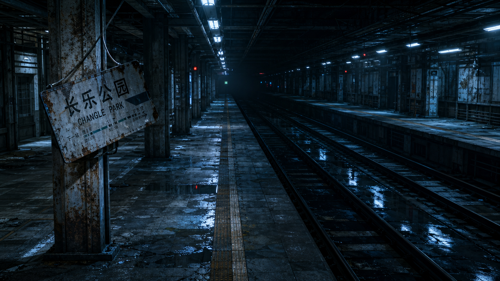
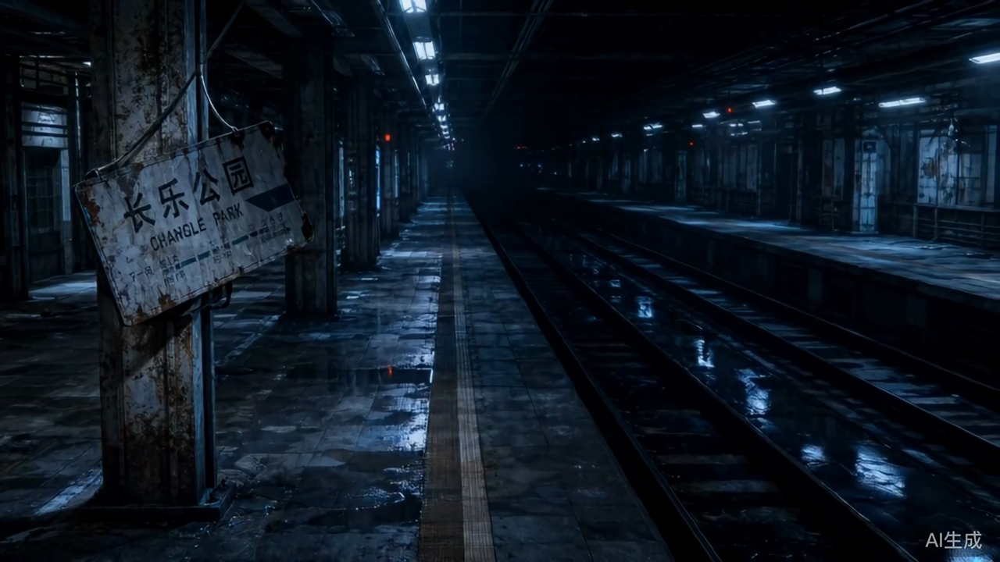
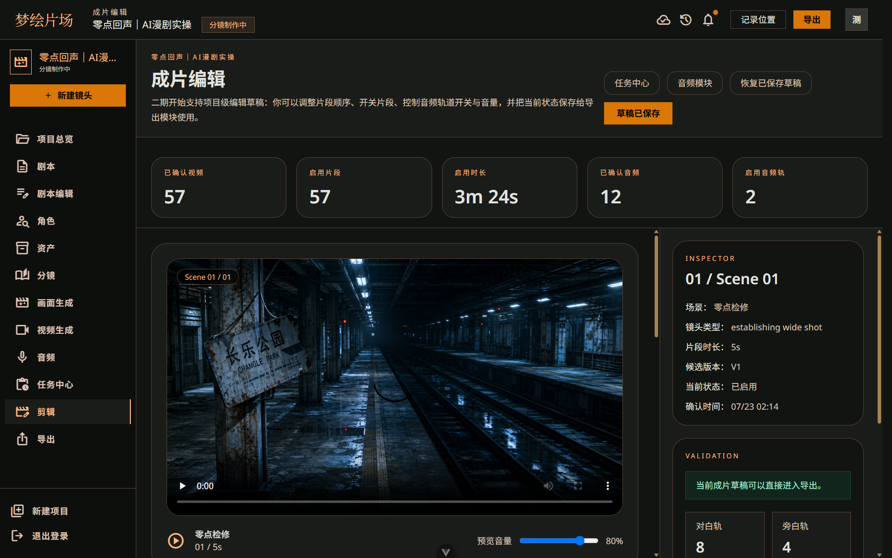
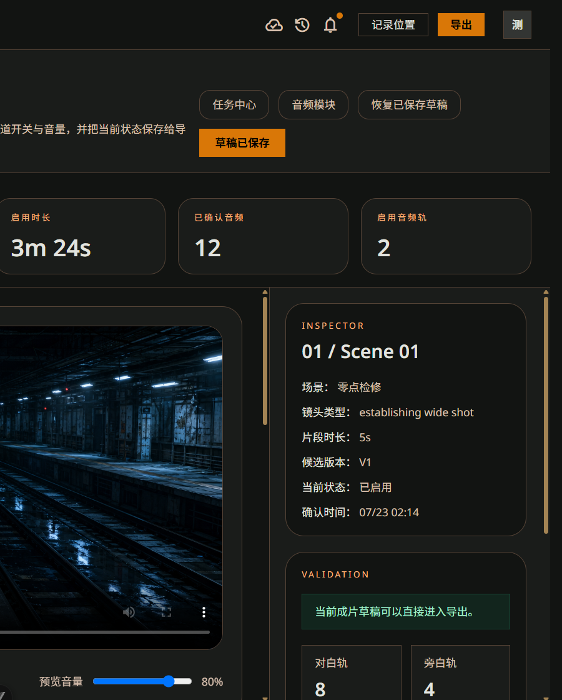
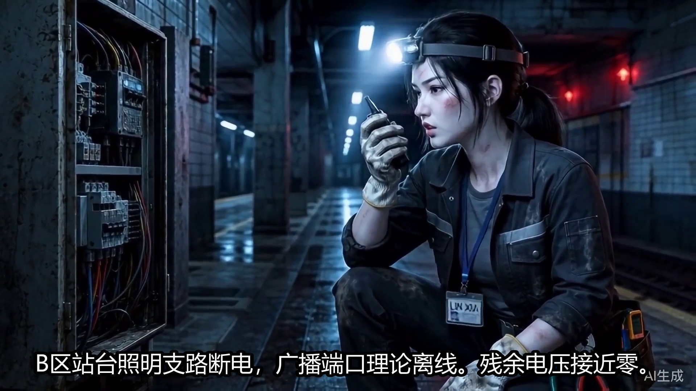

# AI 漫剧混合成片落地与质量验收指南

> 更新日期：2026-07-24
> 适用范围：ProjectDream 图片、图生视频、音频、混合时间线与 MP4 导出

## 1. 落地结论

当前链路已经能生成并导出完整故事视频，但推荐采用“关键镜头真实视频 + 其余镜头动态静帧”的混合方案，而不是把所有分镜都交给视频模型。

| 项目 | 推荐单集规格 |
|---|---|
| 成片时长 | 40-60 秒 |
| 分镜数量 | 8-12 个 |
| 真实视频 | 4-6 个关键镜头 |
| 动态静帧 | 其余镜头，使用轻微推近或平移 |
| 单镜头时长 | 3-6 秒 |
| 输出 | 1920×1080、24fps、H.264/AAC MP4 |

项目 12 的 204 秒、57 镜头全量成片是一次工程压力验证，用于确认任务恢复、素材下载、音轨、字幕和 FFmpeg 合成闭环，不是推荐的单集内容规格。

## 2. 当前模型链路

| 环节 | Provider | 当前模型或实现 |
|---|---|---|
| 总纲、剧本、角色、分镜 | OpenAI-compatible | `AI_MODEL*` 配置 |
| 定妆图、分镜静帧 | Agnes | `agnes-image-2.1-flash`，备用 `agnes-image-2.0-flash` |
| 图生视频 | Agnes | `agnes-video-v2.0` |
| 对白、旁白、音色试听 | DashScope | `qwen3-tts-flash` / `qwen3-tts-instruct-flash` |
| 混合剪辑与导出 | 本地 FFmpeg | 动态静帧、视频、音轨、字幕合成 |

图片生成结果会校验实际尺寸与 `FRAME_IMAGE_RATIO=16:9`，不符合画幅的结果不会直接进入确认链路。

### 图生视频为什么需要公网图片

Agnes 服务必须从自己的服务器拉取源图，因此 `127.0.0.1`、`localhost` 和局域网 URL 不能直接用于图生视频。出现以下错误时，并不是图片内容有问题：

`Confirmed image must use a public HTTP(S) URL for image-to-video generation`

当前实现会先把本地确认静帧上传到 ToAPI，取得公网 HTTPS 地址后再提交给 Agnes。视频任务进入持久化后台队列，供应商任务 ID 会保存到数据库；状态查询网络抖动会自动重试，服务重启后继续查询原任务。供应商返回的视频会立即下载到 `.codex-runtime/generated-videos`，避免依赖临时链接。正式部署仍应转存到 OSS、COS 或其他对象存储。

## 3. 推荐生产流程

1. 锁定 40-60 秒剧本，先删掉不能推动剧情或情绪的镜头。
2. 完成角色档案、性别、年龄、固定服装和定妆图确认。
3. 生成全部 16:9 静帧，先做角色一致性和构图审核。
4. 把镜头分为 A/B/C：A 为动作、情绪爆点和转场；B 为轻动作；C 为对白、空镜和信息镜头。
5. A 类优先生成真实视频，B 类按预算选择视频或动态静帧，C 类使用动态静帧。
6. 确认角色音色后生成对白与旁白，绑定具体分镜并按该镜头起点放入时间线。
7. 在成片编辑器调整片段开关、顺序、音轨和音量，保存草稿后导出。
8. 完整观看导出文件，按下方质量门槛退回问题镜头，不要只检查单张封面。

## 4. 时间预期

模型耗时受供应商排队、内容审核和重试影响，不能按本地渲染速度估算。

| 阶段 | 40-60 秒单集的常见投入 |
|---|---|
| 剧本和镜头筛选 | 15-30 分钟 |
| 定妆与静帧生成、挑选 | 20-50 分钟 |
| 4-6 个关键视频生成、重试 | 15-45 分钟 |
| TTS、字幕、时间线调整 | 15-30 分钟 |
| 全片复核与导出 | 10-25 分钟 |

已有角色模板和提示词稳定后，单集通常需要约 1-2 小时；首集为了定角色、试模型和处理失败，预留 2-4 小时更现实。项目 12 这种 3 分 24 秒、57 镜头的全量验证花费一个下午属于正常范围。

实测样本中，5 秒真实视频通常需要数分钟，具体取决于 Agnes 排队与审核；最新 204 秒成片导出约 2 分 46 秒完成。系统默认每镜头只生成 1 版，并把创建频率控制为每分钟最多 2 个任务。

## 5. 观众质量门槛

### 必须退回的硬伤

- 同一角色被复制成多人，或人物数量与分镜不符。
- 性别、年龄、发型、服装或脸型在相邻镜头明显漂移。
- 手、脸、肢体或关键道具出现持续可见的变形。
- 运动方向突变、人物穿模、镜头无原因跳切或明显回弹。
- 对白角色与音色不匹配，音量忽大忽小，句子被镜头切断。
- 字幕错字、遮脸、超出安全区或与声音明显不同步。
- 画幅不是 16:9，主体被裁掉，或上下黑边在镜头间跳变。
- 不符合发布平台要求的供应商水印或 AI 标识仍然可见。

### 建议达到的观感

- 前 3 秒出现人物目标、异常事件或明确冲突，不用说明性空镜拖开场。
- 每个真实视频镜头都承担动作、情绪或空间变化，静止对白不浪费视频额度。
- 单个动态静帧通常不超过 3-4 秒，推拉幅度克制，不制造廉价晃动。
- 对白优先清楚，音乐不盖人声；同一角色音色、语速和情绪连续。
- 字幕一眼能读完，断句跟随语义，镜头切换点与声音节奏一致。
- 完整观看时没有“为了展示模型而停留”的镜头。

发布前至少执行一次全片人工复核。工程状态为 `completed` 只代表合成成功，不代表内容已经适合观众。

## 6. 项目 12 验证证据

确认静帧为 `gpt-image-2` 生成的 1280×720、16:9 原始产物：

同一静帧生成的 `cogvideox-flash` 真实视频帧，可见环境运动带来的轻微动态模糊；右下角仍有供应商 AI 标识，发布前必须按平台规则处理：

成片编辑器已装入 57 个镜头，时间线总长 3 分 24 秒，并启用两类音频轨：

编辑器校验显示草稿可进入导出，同时展示已确认音频、启用音轨和字幕统计：

历史全项目导出 `#14` 的实际成片帧，字幕已烧录：

历史全项目导出数据：

- 文件：`.codex-runtime/exports/export-14.mp4`
- 播放地址：`http://127.0.0.1:3001/generated/export/14`
- 时长：204 秒，文件大小 50,879,919 字节
- 编码：H.264/AAC，1920×1080，24fps
- 镜头：57/57，真实视频 24 条，动态静帧 33 条
- 音频：12 条已确认音频资产，成片启用 2 类音轨
- 字幕：`.codex-runtime/exports/14/subtitles.srt`，同时烧录进视频
- 导出耗时：约 2 分 46 秒

当前 40-60 秒发布候选为导出 `#24`：

- 文件：`.codex-runtime/exports/export-24.mp4`
- 播放地址：`http://127.0.0.1:3001/generated/export/24`
- 时长：54.36 秒；H.264/AAC；1920×1080；25fps
- 镜头：12 条；11 条真实视频 + 1 条动态静帧
- 对白：9 条分镜级中文音频，严格排除旧场景音频和禁用镜头音频
- 字幕：纯台词，无角色名前缀、表演提示、问号和“无对白”占位
- 口型：6 条正面对白镜头使用 VideoReTalk 结果
- 验收：Chrome 原速完整播放至结束，无黑帧、解码错误或开头叠音

## 7. 已知问题与优先级

1. 真实视频样本仍可见供应商 AI 标识，公开发布前需要确认平台标识要求和供应商商业使用规则。
2. 远程媒体虽然会在导出时本地化，但正式环境仍需要对象存储和生命周期管理。
3. 下一步应补项目级“只生成缺失项”、失败镜头批量重试和自动画幅/黑帧/静音检测。
4. 质量提升优先顺序是角色一致性、关键动作、声音和节奏，最后才是提高真实视频占比。
