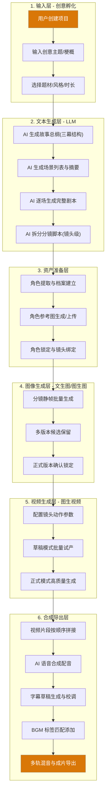
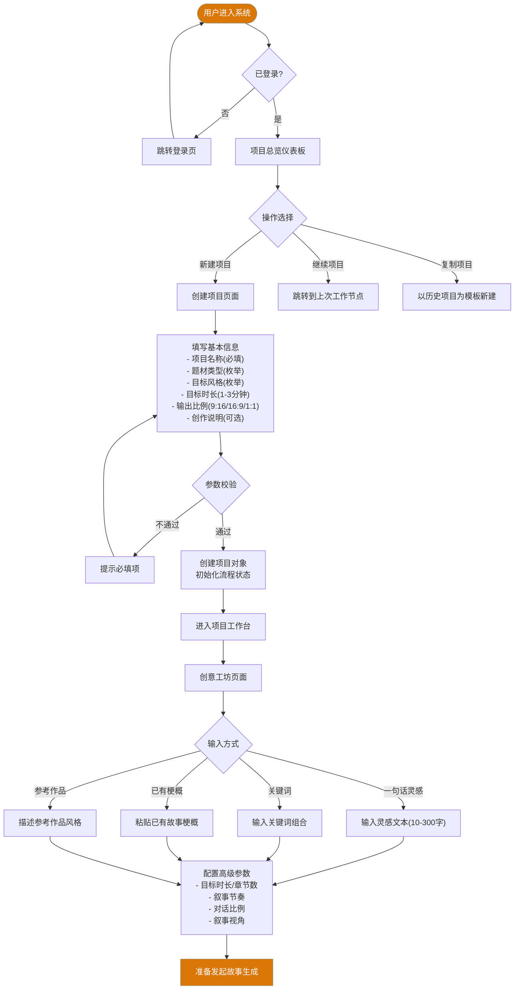
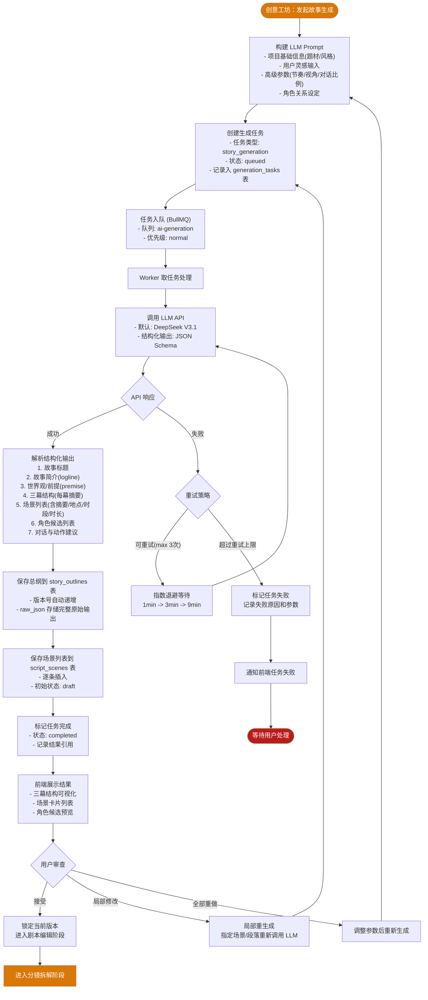
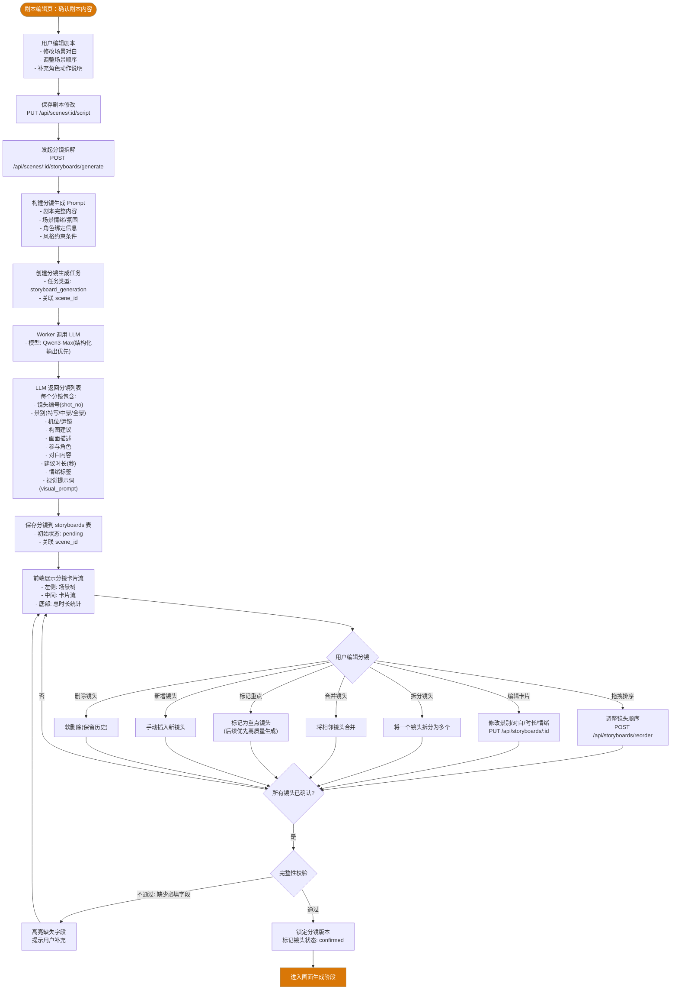
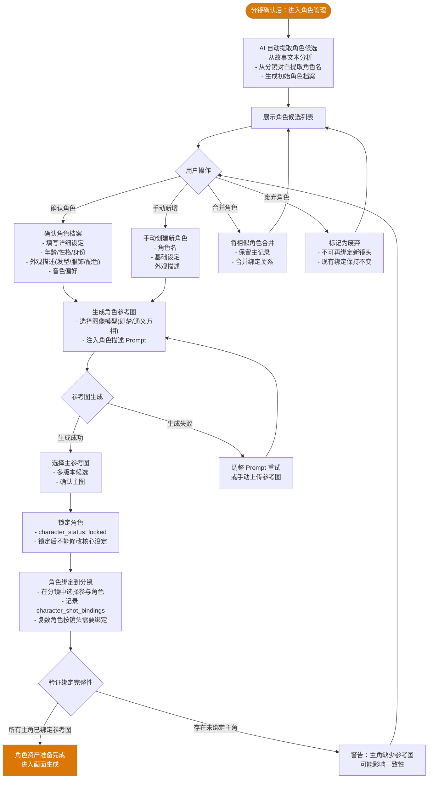
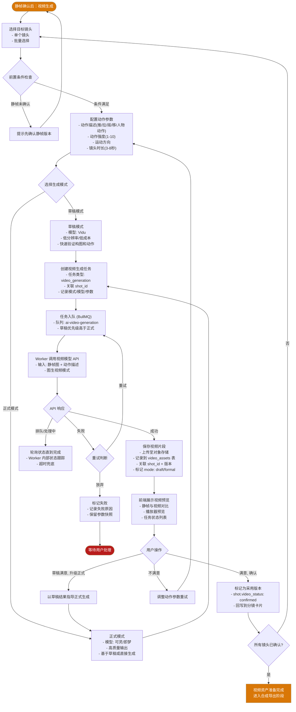
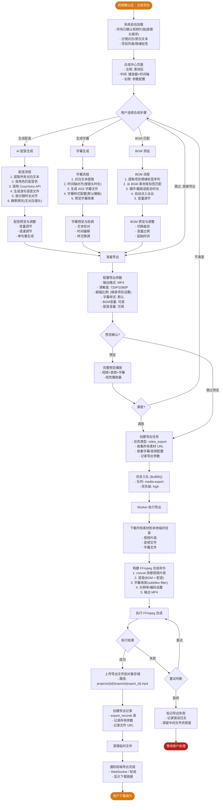
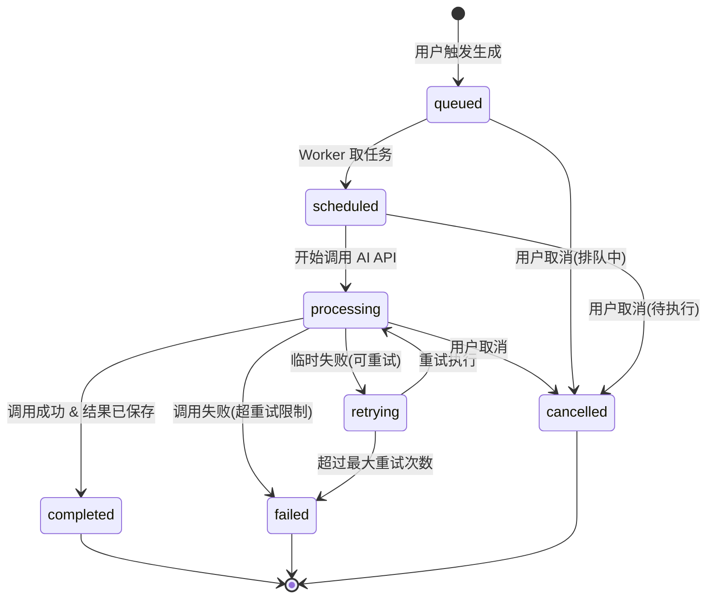
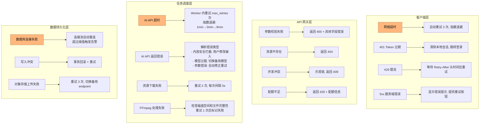

# AI 灵感一键生成短视频全链路系统 —— 功能细化拆解文档

> **文档版本**: V1.0  
> **编制日期**: 2026-07-20  
> **对应 PRD**: 《AI漫剧创作工作台 PRD 文档》V2.0  
> **文档用途**: 系统开发详细技术指导依据  
> **适用对象**: 前后端研发、AI 应用工程、架构师、测试、项目经理

---

## 目录

1. [系统概述与技术架构总览](#1-系统概述与技术架构总览)
2. [技术栈选型详解](#2-技术栈选型详解)
   - 2.1 [前端技术栈](#21-前端技术栈)
   - 2.2 [后端服务架构](#22-后端服务架构)
   - 2.3 [AI 模型选型矩阵](#23-ai-模型选型矩阵)
   - 2.4 [数据库方案](#24-数据库方案)
   - 2.5 [存储方案](#25-存储方案)
   - 2.6 [媒体处理与基础设施](#26-媒体处理与基础设施)
   - 2.7 [部署与运维方案](#27-部署与运维方案)
3. [技术栈与 PRD 差异分析与建议](#3-技术栈与-prd-差异分析与建议)
4. [核心环节详细业务流程图](#4-核心环节详细业务流程图)
   - 4.1 [全链路总览流程图](#41-全链路总览流程图)
   - 4.2 [项目创建与创意输入流程](#42-项目创建与创意输入流程)
   - 4.3 [故事生成流程（文字灵感→长篇小说文本）](#43-故事生成流程文字灵感长篇小说文本)
   - 4.4 [分镜拆解流程（长篇小说→影视分镜脚本）](#44-分镜拆解流程长篇小说影视分镜脚本)
   - 4.5 [角色管理流程](#45-角色管理流程)
   - 4.6 [画面生成流程（分镜脚本→分镜插画素材）](#46-画面生成流程分镜脚本分镜插画素材)
   - 4.7 [视频生成流程（分镜插画→批量短视频片段）](#47-视频生成流程分镜插画批量短视频片段)
   - 4.8 [合成导出流程（视频剪辑+AI配音+字幕→成片）](#48-合成导出流程视频剪辑ai配音字幕成片)
5. [全链路任务编排方案](#5-全链路任务编排方案)
   - 5.1 [任务状态机设计](#51-任务状态机设计)
   - 5.2 [数据流转机制](#52-数据流转机制)
   - 5.3 [RESTful API 接口定义](#53-restful-api-接口定义)
   - 5.4 [异常处理与重试策略](#54-异常处理与重试策略)
6. [数据库设计扩展方案](#6-数据库设计扩展方案)

---

## 1. 系统概述与技术架构总览

### 1.1 系统定位

本系统是一套面向单人创作者和小型工作室的 **AI 驱动短视频全链路生产平台**，核心价值在于将「文字灵感 → 长篇小说文本 → 影视分镜脚本 → 分镜插画素材 → 批量短视频片段 → 视频剪辑合并 + AI 配音 + 字幕合成 → 成片导出」的完整链路整合到统一工作空间中，以项目为单位管理创作全流程。

### 1.2 核心闭环流程

```
┌──────────┐   ┌──────────┐   ┌──────────┐   ┌──────────┐
│ 创意输入  │ → │ 故事生成  │ → │ 分镜拆解  │ → │ 角色管理  │
│ (灵感/梗概)│   │ (LLM)    │   │ (LLM)    │   │ (图像+文本)│
└──────────┘   └──────────┘   └──────────┘   └──────────┘
                                                    ↓
┌──────────┐   ┌──────────┐   ┌──────────┐   ┌──────────┐
│ 成片导出  │ ← │ 合成中心  │ ← │ 视频生成  │ ← │ 画面生成  │
│ (MP4)    │   │(配音/字幕)│   │ (图生视频) │   │ (文生图)  │
└──────────┘   └──────────┘   └──────────┘   └──────────┘
```

### 1.3 系统架构总览

```text
┌──────────────────────────────────────────────────────────────────┐
│                        前端展示层 (Vue 3 SPA)                       │
│  ┌─────────┐ ┌──────────┐ ┌─────────┐ ┌──────────┐ ┌──────────┐ │
│  │ 项目中心 │ │ 创意工坊  │ │ 分镜系统 │ │ 角色库   │ │ 资产中心 │ │
│  └─────────┘ └──────────┘ └─────────┘ └──────────┘ └──────────┘ │
│  ┌─────────┐ ┌──────────┐ ┌─────────┐ ┌──────────┐ ┌──────────┐ │
│  │ 画面生成 │ │ 视频生成  │ │ 合成中心 │ │ 任务中心 │ │ 导出交付 │ │
│  └─────────┘ └──────────┘ └─────────┘ └──────────┘ └──────────┘ │
└───────────────────────────┬──────────────────────────────────────┘
                            │ HTTP REST API (JSON)
┌───────────────────────────▼──────────────────────────────────────┐
│                      API 网关层 (Node.js HTTP Server)              │
│  ┌─────────┐ ┌──────────┐ ┌─────────┐ ┌──────────────────────┐  │
│  │ 认证鉴权 │ │ 路由分发  │ │ 限流控制 │ │ CORS / 安全头        │  │
│  └─────────┘ └──────────┘ └─────────┘ └──────────────────────┘  │
└───────────────────────────┬──────────────────────────────────────┘
                            │
┌───────────────────────────▼──────────────────────────────────────┐
│                      业务服务层 (Node.js)                          │
│  ┌─────────┐ ┌──────────┐ ┌─────────┐ ┌──────────┐ ┌──────────┐ │
│  │ 项目管理 │ │ 故事/分镜 │ │ 角色服务 │ │ 生成服务 │ │ 导出服务 │ │
│  └─────────┘ └──────────┘ └─────────┘ └──────────┘ └──────────┘ │
└───────────────────────────┬──────────────────────────────────────┘
                            │
┌───────────────────────────▼──────────────────────────────────────┐
│                     任务调度层 (Bull / Redis)                       │
│  ┌──────────────────────────────────────────────────────────────┐ │
│  │ 任务队列管理 │ 优先级调度 │ 并发控制 │ 状态追踪 │ 失败重试     │ │
│  └──────────────────────────────────────────────────────────────┘ │
└───────────────────────────┬──────────────────────────────────────┘
                            │
┌───────────────────────────▼──────────────────────────────────────┐
│                       AI 路由层 (统一模型适配)                      │
│  ┌──────────┐ ┌──────────┐ ┌──────────┐ ┌──────────┐            │
│  │ LLM 适配  │ │ 图像适配  │ │ 视频适配  │ │ TTS 适配  │            │
│  │ DeepSeek  │ │ 通义万相  │ │ Vidu/可灵 │ │ CosyVoice │            │
│  │ 通义千问  │ │ 即梦     │ │ 即梦     │ │ 火山TTS   │            │
│  │ 文心一言  │ │ Seedream │ │          │ │ Qwen TTS  │            │
│  └──────────┘ └──────────┘ └──────────┘ └──────────┘            │
└───────────────────────────┬──────────────────────────────────────┘
                            │
┌───────────────────────────▼──────────────────────────────────────┐
│                       数据与存储层                                  │
│  ┌─────────┐ ┌──────────┐ ┌──────────┐ ┌──────────────────────┐  │
│  │ MySQL   │ │ Redis    │ │ 对象存储  │ │ 本地文件系统(临时)    │  │
│  │ (主数据) │ │ (缓存/队)│ │ (OSS/COS)│ │ (媒体处理中间产物)    │  │
│  └─────────┘ └──────────┘ └──────────┘ └──────────────────────┘  │
└──────────────────────────────────────────────────────────────────┘
```

---

## 2. 技术栈选型详解

### 2.1 前端技术栈

| 技术组件 | 选型 | 版本 | 选型理由 |
|----------|------|------|----------|
| **前端框架** | Vue 3 (Composition API) | ^3.5.x | 已有项目基于 Vue 3 构建完成，包含路由、布局、认证等完整基础架构；Composition API + `<script setup>` 提供优秀的逻辑复用和类型推导；与 TypeScript 深度集成 |
| **构建工具** | Vite | ^6.x | 基于 ESM 的极速冷启动和 HMR；对 Vue SFC 的一流支持；已有项目已配置完成 |
| **类型系统** | TypeScript | ^5.9.x | 全类型安全保障；接口定义与后端 DTO 对齐；已有完整的类型声明体系 |
| **路由** | Vue Router | ^4.4.x | Vue 3 官方路由；支持懒加载、路由守卫、过渡动画；已有完整的路由表和认证守卫 |
| **状态管理** | Pinia | ^3.x | Vue 3 官方状态管理；模块化 Store 设计；支持 DevTools；更适合中小型应用的轻量方案 |
| **CSS 框架** | Tailwind CSS | ^3.4.x | 原子化 CSS，开发效率高；已有完整的 Darkroom Professional 设计系统配置；自定义颜色、间距、字体系统已就绪 |
| **UI 组件库** | 自定义组件 + Tailwind | - | 已有项目未使用第三方 UI 库，采用自建组件体系，保持设计一致性；对特殊交互（分镜编辑、时间轴等）更灵活 |
| **HTTP 客户端** | Fetch API | 原生 | 轻量无依赖；已有统一封装的 `request()` 函数（自动注入 Token、统一错误处理、ApiResponse 包装） |
| **画布/编辑** | Konva.js / Fabric.js | 最新 | 分镜编辑的画布交互、角色区域标注、画面预览标注等场景 |
| **视频播放** | Video.js / 原生 video | - | 视频预览、帧级定位、合成预览播放器 |

#### 2.1.1 前端页面与组件映射

| PRD 页面 | 已有实现 | 状态 |
|----------|----------|------|
| 项目列表页 | `Dashboard.vue` | 已实现 |
| 创建项目页 | `NewProject.vue` | 已实现 |
| 项目工作台首页 | `Dashboard.vue` + `WorkspaceLayout.vue` | 已实现 |
| 创意工坊页 | `AIScript.vue` + `ScriptEditor.vue` | 已实现（AI总纲+场景剧本） |
| 分镜编辑页 | `StoryboardList.vue` + `StoryboardEditor.vue` | 已实现 |
| 角色库页 | `CharacterLibrary.vue` + `CharacterDetail.vue` | 已实现（UI框架） |
| 静帧生成页 | `FrameGenerate.vue` + `FrameResult.vue` | 已实现（UI框架，待接入真实AI） |
| 视频生成页 | `VideoGenerate.vue` | 已实现（UI框架，待接入真实AI） |
| 合成导出页 | `FinalEdit.vue` + `Export.vue` + `AudioStudio.vue` | 已实现（UI框架） |
| 资产中心页 | `AssetLibrary.vue` | 已实现（UI框架） |
| AI 任务中心 | `AITaskCenter.vue` | 已实现（UI框架） |

### 2.2 后端服务架构

#### 2.2.1 当前架构：Node.js 单体服务

已有项目采用 **Node.js 原生 HTTP 模块 + MySQL** 的单体架构，已实现完整的认证体系和项目管理 CRUD：

```
server/
├── index.mjs                 # 主服务器 (HTTP路由 + 认证 + 数据库)
└── services/ai/
    ├── outline.mjs           # 总纲生成 Mock
    ├── script.mjs            # 剧本生成 Mock
    └── storyboard.mjs        # 分镜生成 Mock
```

**已有能力：**
- 用户注册/登录（短信验证码 + 密码）
- Token-based 认证（Bearer Token）
- 项目管理 CRUD（项目、总纲、场景、分镜）
- AI 生成 Mock 服务（为真实模型接入预留了接口）
- MySQL 数据库自动建表和迁移

#### 2.2.2 推荐演进架构：分层模块化 Node.js

基于现有项目基础，推荐采用 **分层模块化架构** 进行演进，而非 PRD 中的 FastAPI 方案：

| 层级 | 技术选型 | 选型理由 |
|------|----------|----------|
| **HTTP 框架** | Express.js / Fastify | 在现有 Node.js 基础上增加路由中间件、请求校验等；不推翻重做，平滑演进 |
| **运行时** | Node.js | ^22.x (已在使用) |
| **数据库驱动** | mysql2 | ^3.23.x (已在使用) |
| **任务队列** | BullMQ + Redis | 长耗时 AI 生成任务的异步调度、优先级管理、失败重试 |
| **API 校验** | Zod | 请求/响应 Schema 校验，与 TypeScript 类型系统深度整合 |
| **日志系统** | Pino / Winston | 结构化日志、分级输出、便于排查 AI 调用链路问题 |
| **文件上传** | multer / busboy | 角色参考图上传、素材导入等 |

#### 2.2.3 服务模块拆分

```
server/
├── index.mjs                 # 入口 + 启动引导
├── config/
│   └── index.mjs             # 配置管理（环境变量、模型密钥等）
├── middleware/
│   ├── auth.mjs              # 认证中间件
│   ├── cors.mjs              # CORS 处理
│   ├── rateLimit.mjs         # 请求限流
│   └── validate.mjs          # Zod Schema 校验
├── routes/
│   ├── auth.routes.mjs       # 认证路由
│   ├── project.routes.mjs    # 项目路由
│   ├── story.routes.mjs      # 故事/分镜路由
│   ├── character.routes.mjs  # 角色路由
│   ├── generation.routes.mjs # AI 生成路由
│   ├── export.routes.mjs     # 导出路由
│   └── asset.routes.mjs      # 资产路由
├── services/
│   ├── project.service.mjs   # 项目业务逻辑
│   ├── story.service.mjs     # 故事业务逻辑
│   ├── character.service.mjs # 角色业务逻辑
│   ├── generation.service.mjs# 生成任务编排
│   ├── export.service.mjs    # 导出/合成
│   └── asset.service.mjs     # 资产管理
├── ai/
│   ├── router.mjs            # AI 模型路由层
│   ├── adapters/
│   │   ├── llm.mjs           # LLM 统一适配器
│   │   ├── image.mjs         # 图像生成适配器
│   │   ├── video.mjs         # 视频生成适配器
│   │   └── tts.mjs           # 语音合成适配器
│   └── prompts/
│       ├── story.mjs         # 故事生成 Prompt 模板
│       ├── storyboard.mjs    # 分镜生成 Prompt 模板
│       └── image.mjs         # 画面生成 Prompt 模板
├── queue/
│   ├── index.mjs             # 队列初始化
│   ├── processors/
│   │   ├── story.processor.mjs
│   │   ├── image.processor.mjs
│   │   ├── video.processor.mjs
│   │   ├── audio.processor.mjs
│   │   └── export.processor.mjs
│   └── events.mjs            # 队列事件监听
├── media/
│   ├── compose.mjs           # FFmpeg 视频合成
│   ├── subtitle.mjs          # 字幕渲染
│   └── audio.mjs             # 音频混音
├── storage/
│   └── index.mjs             # 对象存储适配层
└── db/
    ├── pool.mjs              # 数据库连接池
    ├── migrations/           # 数据库迁移脚本
    └── schema.mjs            # 建表 DDL
```

### 2.3 AI 模型选型矩阵

#### 2.3.1 大语言模型（LLM）—— 故事生成 & 分镜拆解

| 模型 | 提供商 | 上下文窗口 | 适用场景 | 选型理由 |
|------|--------|-----------|----------|----------|
| **DeepSeek V3.1** (主力) | DeepSeek | 128K | 故事草稿生成、对白扩写 | 性价比最高，中文长文本能力强，适合批量生成场景 |
| **通义千问 Qwen3-Max** (备选) | 阿里云 | 128K | 复杂分镜拆解、结构化输出 | 结构化 JSON 输出稳定性好，长上下文理解准确 |
| **文心一言 ERNIE 4.5** (增强) | 百度 | 128K | 古风/历史/教育类题材 | 中文古典文学知识储备强，特定题材加分 |
| **豆包 Pro** (增强) | 字节跳动 | 128K | 对白口语化改写、网感文案 | 中文口语表达自然，适合短视频风格对白 |

**调用策略：**
- 故事草稿（量多、成本敏感）→ DeepSeek V3.1 默认
- 分镜拆解（质量要求高）→ Qwen3-Max / DeepSeek V3.1
- 特定题材内容 → 按题材路由到对应增强模型
- 所有模型通过统一适配层调用，支持热切换

#### 2.3.2 图像生成模型 —— 分镜静帧 & 角色设定图

| 模型 | 提供商 | 分辨率 | 适用场景 | 选型理由 |
|------|--------|--------|----------|----------|
| **通义万相 2.x** (主力) | 阿里云 | 1024×1024+ | 默认静帧生成、批量场景图 | API 稳定，中文提示词理解好，成本可控 |
| **即梦 3.0 / Seedream** (高质量) | 字节跳动 | 1024×1024+ | 重点镜头、角色设定图 | 人物表现力强，创意构图能力突出 |
| **可灵图片** (备选) | 快手 | 1024×1024 | 写实风格、动态感镜头 | 偏写实风格，适合特定视觉需求 |

**角色一致性策略：**
- 角色锁定后，以角色参考图作为 Image-to-Image 的输入约束
- 在 Prompt 中注入角色外观描述标签（发型、服饰、配色）
- 重点角色可预先用 Seedream 生成多角度参考图集

#### 2.3.3 视频生成模型 —— 静帧转动态片段

| 模型 | 提供商 | 时长 | 适用场景 | 选型理由 |
|------|--------|------|----------|----------|
| **Vidu** (草稿模式) | 生数科技 | 4-8s | 批量试产、草稿验证 | 成本低、生成快，适合快速试错 |
| **可灵视频** (正式模式) | 快手 | 5-10s | 正式镜头生成 | 动作稳定性好，画面质量高 |
| **即梦视频** (重点镜头) | 字节跳动 | 4-8s | 关键镜头、视觉亮点 | 短片创意表现力强 |

**草稿/正式双模式策略：**
- 草稿模式（低成本 Vidu）：快速验证构图和动作方向，确认后再进入正式模式
- 正式模式（高质量 可灵/即梦）：对确认过的草稿进行高质量生成
- 用户可在分镜级别灵活选择模式

#### 2.3.4 语音合成模型（TTS）—— AI 配音

| 模型 | 提供商 | 适用场景 | 选型理由 |
|------|--------|----------|----------|
| **CosyVoice** (主力) | 阿里云 | 默认旁白、角色对白 | 情感表达自然，支持多种音色 |
| **火山 TTS** (备选) | 字节跳动 | 批量配音、多角色音色 | 稳定性好，指令式控制灵活 |
| **Qwen TTS** (增强) | 阿里云 | 快速生成、低延迟场景 | 延迟低，适合实时预览 |

#### 2.3.5 BGM 与音效策略

MVP 阶段不依赖 AI 音乐生成，采用：
- 内置版权清晰 BGM 素材库（按情绪标签分类）
- 基于场景情绪标签（紧张/轻松/温暖/压迫）自动匹配
- 后续可接入 Suno / Udio 等 AI 音乐生成

### 2.4 数据库方案

#### 2.4.1 主数据库：MySQL

**选型理由：**
- 已有项目基于 MySQL 构建，数据模型成熟
- 关系型数据（项目、用户、角色、分镜等）天然适合关系型数据库
- 事务支持保证数据一致性（任务状态变更、资产关联等）
- 已有 6 张核心表，结构清晰

**已有表结构（需扩展）：**

| 表名 | 用途 | 已有字段数 | 状态 |
|------|------|-----------|------|
| `users` | 用户信息 | 5 | 已实现 |
| `sms_codes` | 短信验证码 | 7 | 已实现 |
| `sessions` | 用户会话 | 5 | 已实现 |
| `projects` | 项目基础信息 | 9 | 已实现 |
| `story_outlines` | 故事总纲 | 9 | 已实现 |
| `script_scenes` | 剧本场景 | 13 | 已实现 |
| `storyboards` | 分镜数据 | 14 | 已实现 |

**需新增的表（详见第6章）：**

| 表名 | 用途 |
|------|------|
| `characters` | 角色档案 |
| `character_references` | 角色参考图 |
| `character_shot_bindings` | 角色-镜头绑定关系 |
| `image_assets` | 静帧图像资产 |
| `video_assets` | 视频片段资产 |
| `audio_assets` | 音频资产 |
| `generation_tasks` | AI 生成任务记录 |
| `export_records` | 导出记录 |
| `style_templates` | 风格模板 |
| `bgm_library` | BGM 素材库 |
| `project_snapshots` | 项目快照 |

#### 2.4.2 缓存与队列：Redis

| 用途 | 说明 |
|------|------|
| **Session 缓存** | 热点 Token 快速校验，减少 DB 查询 |
| **任务队列** | BullMQ 依赖 Redis 实现任务调度 |
| **API 限流** | 基于滑动窗口的请求速率控制 |
| **生成状态缓存** | 实时任务状态查询，避免频繁轮询 DB |
| **临时数据** | 生成过程中的中间状态存储 |

### 2.5 存储方案

| 存储类型 | 技术选型 | 选型理由 |
|----------|----------|----------|
| **对象存储** | 阿里云 OSS / 腾讯云 COS | 图片、视频、音频等大文件存储；支持 CDN 加速；成本可控；已有阿里云账号体系 |
| **本地临时存储** | 服务器本地磁盘 | FFmpeg 处理的中间产物、导出暂存文件；处理完成后上传至对象存储并清理 |
| **数据库存储** | MySQL | 结构化元数据、项目配置、生成参数、关联关系 |

**存储路径规范：**
```
{object-storage}/
└── projects/
    └── {project_id}/
        ├── images/
        │   ├── characters/      # 角色参考图
        │   └── shots/           # 分镜静帧
        │       └── {shot_id}/
        │           ├── v1.png   # 版本1
        │           └── v2.png   # 版本2
        ├── videos/
        │   └── {shot_id}/
        │       ├── draft.mp4    # 草稿版本
        │       └── final.mp4    # 正式版本
        ├── audio/
        │   ├── voice/           # AI 配音
        │   └── bgm/             # 背景音乐
        └── exports/
            └── {export_id}.mp4  # 导出成品
```

### 2.6 媒体处理与基础设施

| 技术组件 | 选型 | 用途 |
|----------|------|------|
| **视频处理** | FFmpeg 6.x | 视频拼接、转码、分辨率调整、字幕烧录 |
| **音频处理** | FFmpeg (音频滤镜) | 配音与 BGM 混音、音量归一化、格式转换 |
| **图像处理** | Sharp | 缩略图生成、格式转换、尺寸调整（比 Pillow/OpenCV 更轻量，适合 Node.js 生态） |
| **字幕渲染** | ASS/SSA + FFmpeg | 字幕样式定义与视频烧录合成 |
| **容器化** | Docker + Docker Compose | 环境一致性、MySQL/Redis 等服务编排 |

### 2.7 部署与运维方案

| 层级 | 方案 | 说明 |
|------|------|------|
| **Web 前端** | Nginx 静态托管 + CDN | Vite 构建产物部署至 Nginx 或对象存储静态托管 |
| **API 服务** | Docker 容器 + PM2 | 多实例部署保证高可用 |
| **任务 Worker** | Docker 容器 + PM2 | AI 生成任务独立 Worker 进程 |
| **数据库** | MySQL 8.0 (云服务或自建) | 主从复制 + 定期备份 |
| **Redis** | Redis 7.x (云服务或自建) | 持久化配置 (AOF + RDB) |
| **对象存储** | 阿里云 OSS / 腾讯云 COS | 生命周期管理，冷热数据分层 |
| **CI/CD** | GitHub Actions / 自建流水线 | 自动构建、测试、部署 |

---

## 3. 技术栈与 PRD 差异分析与建议

### 3.1 关键差异对比

| 维度 | PRD 建议 | 现有实现 | 差异分析 |
|------|----------|----------|----------|
| **前端框架** | React 18 + Ant Design | Vue 3 + Tailwind CSS | PRD 组件库建议可参考，但现有 Vue 3 实现更成熟；Ant Design 组件可迁移至 Naive UI 或自定义 |
| **后端框架** | FastAPI (Python) | Node.js 原生 HTTP | 建议不推翻重做；逐步引入 Express/Fastify 框架化改造 |
| **ORM/DB** | PostgreSQL + MongoDB | MySQL (mysql2) | 现有 MySQL 满足业务需求；JSON 字段可替代 MongoDB 文档存储需求 |
| **任务队列** | Celery + Redis | 需新建 (BullMQ + Redis) | Node.js 生态中 BullMQ 是 Celery 的对等方案 |
| **状态管理** | Zustand + TanStack Query | Pinia + Fetch | Pinia 功能对等；建议引入 TanStack Query (Vue 版) 优化服务端状态管理 |

### 3.2 演进建议

**阶段一（MVP 增强）**：在现有 Node.js 基础上补充缺失模块
- 引入 Express.js 重构路由层（保持现有业务逻辑不变）
- 引入 BullMQ + Redis 实现异步任务调度
- 实现 AI 模型统一适配层，接入真实模型
- 补充画面生成、视频生成、合成导出等后端服务

**阶段二（生产就绪）**：
- 引入 Zod 做 API Schema 校验
- 前端引入 Vue Query (TanStack Query for Vue) 优化数据获取
- 完善监控、日志、告警体系
- 数据库读写分离、Redis 哨兵模式

**阶段三（规模化）**：
- 考虑部分计算密集型服务迁移至 Python/FastAPI（如复杂的媒体处理）
- 引入消息队列做服务间异步通信
- 多租户隔离与计费系统

---

## 4. 核心环节详细业务流程图

### 4.1 全链路总览流程图



### 4.2 项目创建与创意输入流程



### 4.3 故事生成流程（文字灵感→长篇小说文本）



### 4.4 分镜拆解流程（长篇小说→影视分镜脚本）



### 4.5 角色管理流程



### 4.6 画面生成流程（分镜脚本→分镜插画素材）

```mermaid
flowchart TD
    Start(["分镜+角色就绪：画面生成"]) --> SelectShot["用户选择目标镜头\n- 单个镜头\n- 批量选择"]

    SelectShot --> CheckPrereq{前置条件检查}

    CheckPrereq -->|角色未绑定| NeedChar["提示先绑定角色\n跳转角色库"]
    NeedChar --> Start

    CheckPrereq -->|镜头缺少描述| NeedDesc["提示补充画面描述\n跳转分镜编辑"]
    NeedDesc --> Start

    CheckPrereq -->|条件满足| BuildImgPrompt["构建图像生成 Prompt\n- 画面描述(visual_prompt)\n- 角色参考图(作为 img2img 输入)\n- 风格模板(注入风格关键词)\n- 负向约束(排除项)\n- 画面比例(项目设置)"]

    BuildImgPrompt --> SelectModel{"选择生成策略"}
    SelectModel -->|默认| DefaultModel["主力: 通义万相 2.x\n- 成本优先\n- 适合批量"]
    SelectModel -->|重点镜头| QualityModel["高质量: 即梦 3.0\n- 质量优先\n- 适合关键画面"]

    DefaultModel --> CreateImgTask["创建画面生成任务\n- 任务类型: image_generation\n- 关联 shot_id\n- 记录模型和参数"]

    QualityModel --> CreateImgTask

    CreateImgTask --> EnqueueImg["任务入队 (BullMQ)\n- 队列: ai-image-generation"]

    EnqueueImg --> WorkerImg["Worker 调用图像模型 API"]
    WorkerImg --> ImgResponse{API 响应}

    ImgResponse -->|成功| SaveImage["保存生成图像\n- 上传至对象存储\n- 记录到 image_assets 表\n- 关联 shot_id + 版本号"]

    ImgResponse -->|失败| ImgRetry{重试判断}
    ImgRetry -->|可重试(max 2次)| AdjustPrompt["微调 Prompt 后重试"]
    AdjustPrompt --> WorkerImg
    ImgRetry -->|不可重试| MarkImgFail["标记失败\n记录失败原因"]

    SaveImage --> ShowPreview["前端展示生成预览\n- 主预览区\n- 多版本对比区\n- 参数与历史"]

    ShowPreview --> UserImgAction{用户操作}

    UserImgAction -->|满意, 确认| ConfirmVersion["标记为正式版本\n- shot.image_status: confirmed\n- 作为后续视频生成输入"]

    UserImgAction -->|不满意, 重试| Regenerate["调整参数重新生成\n- 修改 Prompt\n- 切换模型\n- 调整风格模板"]
    Regenerate --> BuildImgPrompt

    UserImgAction -->|保留多版本| KeepVersion["保留候选版本\n供后续回退使用"]

    UserImgAction -->|批量生成其他| BatchGenerate["选择其他镜头批量生成"]
    BatchGenerate --> SelectShot

    ConfirmVersion --> CheckAllDone{所有镜头已确认?}
    CheckAllDone -->|否| SelectShot
    CheckAllDone -->|是| ImgDone["画面资产准备完成\n进入视频生成阶段"]

    MarkImgFail --> End(["等待用户处理"])

    style Start fill:#d97707,stroke:#a48454,color:#fff
    style ImgDone fill:#d97707,stroke:#a48454,color:#fff
    style End fill:#b91c1c,stroke:#a48454,color:#fff
```

### 4.7 视频生成流程（分镜插画→批量短视频片段）



### 4.8 合成导出流程（视频剪辑+AI配音+字幕→成片）



---

## 5. 全链路任务编排方案

### 5.1 任务状态机设计

#### 5.1.1 通用任务状态流转



#### 5.1.2 各环节任务类型定义

| 任务类型 | 队列名 | 预估耗时 | 最大重试 | 超时时间 | 优先级 |
|----------|--------|----------|----------|----------|--------|
| `story_generation` | `ai-generation` | 30-120s | 3 | 300s | normal |
| `storyboard_generation` | `ai-generation` | 20-60s | 3 | 180s | normal |
| `character_extraction` | `ai-generation` | 10-30s | 2 | 90s | normal |
| `image_generation` | `ai-image-generation` | 10-60s | 2 | 180s | normal |
| `image_generation_key` | `ai-image-generation` | 30-120s | 2 | 300s | high |
| `video_generation_draft` | `ai-video-generation` | 60-300s | 2 | 600s | normal |
| `video_generation_formal` | `ai-video-generation` | 120-600s | 1 | 900s | high |
| `tts_generation` | `ai-audio-generation` | 5-30s | 3 | 120s | normal |
| `video_export` | `media-export` | 60-300s | 2 | 600s | high |

#### 5.1.3 任务状态字段定义

```typescript
interface GenerationTask {
  id: number;                    // 主键
  project_id: number;            // 关联项目
  task_type: TaskType;           // 任务类型枚举
  status: TaskStatus;            // queued | scheduled | processing | retrying | completed | failed | cancelled

  // 输入参数
  input_params: object;          // JSON，记录触发参数

  // 关联资源
  reference_type?: string;       // story | scene | shot | character
  reference_id?: number;         // 关联资源 ID

  // AI 模型信息
  model_name: string;            // 使用的模型名称
  model_provider: string;        // 模型提供商
  prompt_snapshot?: string;      // 发送给模型的 Prompt 完整快照

  // 执行信息
  retry_count: number;           // 当前重试次数
  max_retries: number;           // 最大重试次数
  started_at?: datetime;         // 开始执行时间
  completed_at?: datetime;       // 完成时间

  // 结果
  result_refs?: object;          // 结果引用（如 { image_asset_ids: [1,2,3] }）
  error_code?: string;           // 错误码
  error_message?: string;        // 错误详情
  error_details?: object;        // 错误详细信息

  // 成本
  estimated_cost?: number;       // 预估消耗
  actual_cost?: number;          // 实际消耗

  created_at: datetime;
  updated_at: datetime;
}
```

### 5.2 数据流转机制

#### 5.2.1 环节间数据传递结构

```mermaid
flowchart LR
    subgraph S1["项目创建"]
        P["Project\n{id, name, category, visual_style,\ntarget_duration, aspect_ratio}"]
    end

    subgraph S2["故事生成"]
        O["Outline\n{id, project_id, version_no,\ntitle, logline, premise,\nacts[], scenes[]}"]
        SC["Scenes[]\n{id, scene_no, title, summary,\ncontent, mood, location,\ntime_of_day, estimated_duration}"]
    end

    subgraph S3["分镜拆解"]
        SB["Storyboards[]\n{id, shot_no, shot_type,\ncamera_angle, composition,\nduration_seconds, character_name,\naction_text, dialogue_text,\nvisual_prompt, image_url}"]
    end

    subgraph S4["角色管理"]
        CH["Characters[]\n{id, name, personality,\nappearance, voice_setting,\nreference_image_url, status}"]
        CB["Character-Shot Bindings[]\n{character_id, shot_id}"]
    end

    subgraph S5["画面生成"]
        IA["Image Assets[]\n{id, shot_id, version_no,\nimage_url, prompt_snapshot,\nmodel_name, status}"]
    end

    subgraph S6["视频生成"]
        VA["Video Assets[]\n{id, shot_id, version_no,\nvideo_url, mode(draft/formal),\naction_description, duration,\nmodel_name, status}"]
    end

    subgraph S7["合成导出"]
        EX["Export Record\n{id, project_id, video_url,\nresolution, aspect_ratio, config,\ncreated_at}"]
    end

    P -->|project_id| O
    O -->|outline_id| SC
    SC -->|scene_id| SB
    SB -->|character_name| CH
    CH -->|character_id + shot_id| CB
    SB -->|shot_id + visual_prompt| IA
    IA -->|shot_id + confirmed image| VA
    VA -->|shot_id + confirmed video| EX
    CH -.->|reference_image| IA
    CB -.->|binding context| IA
```



#### 5.2.2 数据流转详细映射

| 上游环节 | 输出数据 | 关键字段 | 下游环节 | 消费方式 |
|----------|----------|----------|----------|----------|
| 项目创建 | Project | `id`, `category`, `visual_style`, `target_duration` | 故事生成 | `project_id` 关联 + 风格/题材注入 Prompt |
| 故事生成 | Outline + Scenes | `acts[]`, `scenes[].summary`, `content` | 分镜拆解 | `scene_id` + 剧本内容全文传入 LLM |
| 故事生成 | Scenes | `content` (角色对话) | 角色管理 | 从 `content` 文本中 NLP 提取角色名 |
| 分镜拆解 | Storyboards | `visual_prompt`, `shot_type`, `character_name` | 画面生成 | `shot_id` + visual_prompt 构建图像 Prompt |
| 角色管理 | Characters + Reference Images | `appearance`, `reference_image_url` | 画面生成 | 角色外观注入 Prompt + 参考图作为 img2img 输入 |
| 画面生成 | Image Assets (confirmed) | `image_url` | 视频生成 | 以静帧为图生视频的起始帧 |
| 视频生成 | Video Assets (confirmed) | `video_url`, `duration` | 合成导出 | 按 shot.sort_order 拼接视频片段 |
| 分镜拆解 | Storyboards | `dialogue_text`, `duration_seconds` | 合成导出 | 生成配音和字幕的时间轴参考 |
| 角色管理 | Characters | `voice_setting` | 合成导出 | 配音音色选择 |

### 5.3 RESTful API 接口定义

> **说明**：以下接口定义基于现有 API 层（`src/api/project.ts`）扩展。已有接口不再重复列出，仅列出需新增或扩展的接口。

#### 5.3.1 通用规范

**基础路径**：`http://127.0.0.1:3001/api`

**统一响应格式**：
```json
{
  "code": 0,
  "message": "success",
  "data": { }
}
```

**错误码规范**：

| code | 含义 | HTTP 状态码 |
|------|------|------------|
| 0 | 成功 | 200 |
| 1001 | 参数校验失败 | 400 |
| 1002 | 未登录/Token失效 | 401 |
| 1003 | 权限不足 | 403 |
| 1004 | 资源不存在 | 404 |
| 2001 | AI 模型调用失败 | 502 |
| 2002 | 任务超时 | 504 |
| 2003 | 配额不足 | 429 |
| 3001 | 文件上传失败 | 500 |
| 3002 | 媒体处理失败 | 500 |
| 9999 | 服务器内部错误 | 500 |

#### 5.3.2 角色管理 API

**获取项目角色列表**
```
GET /api/projects/:projectId/characters
```
Response:
```json
{
  "code": 0,
  "data": {
    "items": [
      {
        "id": 1,
        "projectId": 1,
        "name": "主角·林夜",
        "personality": "冷静、果断、内心柔软",
        "appearance": "黑色短发、深蓝风衣、身高180cm",
        "voiceSetting": "青年男声、沉稳",
        "referenceImageUrl": "https://oss.example.com/projects/1/characters/1/ref.png",
        "status": "locked",
        "createdAt": "2026-07-20T08:00:00Z"
      }
    ]
  }
}
```

**创建/更新角色**
```
POST /api/projects/:projectId/characters
PUT  /api/characters/:id
```
Request:
```json
{
  "name": "主角·林夜",
  "personality": "冷静、果断",
  "appearance": "黑色短发、深蓝风衣",
  "voiceSetting": "青年男声、沉稳"
}
```

**锁定/解锁角色**
```
POST /api/characters/:id/lock
POST /api/characters/:id/unlock
```

**生成角色参考图**
```
POST /api/characters/:id/reference-image/generate
```
Request:
```json
{
  "model": "seedream",
  "style": "国漫写实"
}
```
Response (异步任务):
```json
{
  "code": 0,
  "data": {
    "taskId": 42,
    "status": "queued"
  }
}
```

**上传角色参考图**
```
POST /api/characters/:id/reference-image/upload
Content-Type: multipart/form-data
```
Form Data: `file` (图片文件)

**角色-分镜绑定**
```
POST /api/shots/:shotId/bind-characters
```
Request:
```json
{
  "characterIds": [1, 3]
}
```

#### 5.3.3 画面生成 API

**生成单镜头静帧**
```
POST /api/shots/:shotId/images/generate
```
Request:
```json
{
  "model": "tongyi-wanxiang",
  "styleTemplateId": 1,
  "negativePrompt": "模糊, 扭曲, 低质量",
  "generateCount": 3
}
```
Response (异步任务):
```json
{
  "code": 0,
  "data": {
    "taskId": 50,
    "status": "queued"
  }
}
```

**批量生成静帧**
```
POST /api/projects/:projectId/images/batch-generate
```
Request:
```json
{
  "shotIds": [1, 2, 3, 4, 5],
  "model": "tongyi-wanxiang",
  "styleTemplateId": 1
}
```

**获取镜头图像列表**
```
GET /api/shots/:shotId/images
```
Response:
```json
{
  "code": 0,
  "data": {
    "items": [
      {
        "id": 100,
        "shotId": 1,
        "versionNo": 1,
        "imageUrl": "https://oss.example.com/projects/1/images/shots/1/v1.png",
        "thumbnailUrl": "https://oss.example.com/projects/1/images/shots/1/v1_thumb.png",
        "promptSnapshot": "masterpiece, best quality...",
        "modelName": "tongyi-wanxiang-2",
        "status": "confirmed",
        "createdAt": "2026-07-20T08:30:00Z"
      }
    ]
  }
}
```

**确认静帧版本**
```
POST /api/images/:imageId/confirm
```

**放弃/删除静帧版本**
```
DELETE /api/images/:imageId
```

#### 5.3.4 视频生成 API

**生成单镜头视频**
```
POST /api/shots/:shotId/videos/generate
```
Request:
```json
{
  "imageAssetId": 100,
  "mode": "draft",
  "model": "vidu",
  "actionDescription": "镜头缓慢推进，人物转头看向窗外",
  "actionStrength": 5,
  "duration": 6
}
```
Response (异步任务):
```json
{
  "code": 0,
  "data": {
    "taskId": 80,
    "status": "queued"
  }
}
```

**获取镜头视频列表**
```
GET /api/shots/:shotId/videos
```

**确认视频版本**
```
POST /api/videos/:videoId/confirm
```

#### 5.3.5 合成与导出 API

**获取合成预览数据**
```
GET /api/projects/:projectId/compose-preview
```
Response:
```json
{
  "code": 0,
  "data": {
    "shots": [
      {
        "shotId": 1,
        "shotNo": "1A",
        "confirmedVideoUrl": "https://oss.example.com/...",
        "duration": 6,
        "dialogueText": "你今天必须给我一个答案。",
        "characterName": "林夜"
      }
    ],
    "totalDuration": 48,
    "hasVoice": false,
    "hasSubtitle": false,
    "hasBgm": false
  }
}
```

**生成配音（批量）**
```
POST /api/projects/:projectId/voice/generate
```
Request:
```json
{
  "model": "cosyvoice",
  "voiceMappings": {
    "1": "young_male_deep",
    "3": "young_female_clear"
  }
}
```

**生成字幕**
```
POST /api/projects/:projectId/subtitle/generate
```
Request:
```json
{
  "style": "default",
  "fontSize": 24,
  "position": "bottom"
}
```

**设置 BGM**
```
POST /api/projects/:projectId/bgm/set
```
Request:
```json
{
  "bgmId": 5,
  "volume": 0.3,
  "fadeIn": true,
  "fadeOut": true
}
```

**获取 BGM 素材库**
```
GET /api/bgm-library?mood=紧张&genre=电子
```

**发起导出**
```
POST /api/projects/:projectId/export
```
Request:
```json
{
  "resolution": "1080p",
  "format": "mp4",
  "voiceVolume": 0.8,
  "bgmVolume": 0.3,
  "subtitleStyle": "default"
}
```
Response (异步任务):
```json
{
  "code": 0,
  "data": {
    "taskId": 120,
    "status": "queued",
    "estimatedDuration": 180
  }
}
```

**获取导出状态**
```
GET /api/exports/:exportId/status
```
Response:
```json
{
  "code": 0,
  "data": {
    "id": 120,
    "status": "completed",
    "downloadUrl": "https://oss.example.com/projects/1/exports/120.mp4",
    "resolution": "1080p",
    "duration": 48,
    "fileSize": 52428800,
    "createdAt": "2026-07-20T09:30:00Z"
  }
}
```

#### 5.3.6 任务中心 API

**获取项目任务列表**
```
GET /api/projects/:projectId/tasks?status=processing&type=image_generation
```

**获取单个任务状态**
```
GET /api/tasks/:taskId
```

**取消任务**
```
POST /api/tasks/:taskId/cancel
```

**重试失败任务**
```
POST /api/tasks/:taskId/retry
```
Request:
```json
{
  "params": { "model": "kling" }
}
```

#### 5.3.7 风格模板 API

**获取风格模板列表**
```
GET /api/style-templates?category=国漫
```

**保存当前参数为模板**
```
POST /api/style-templates
```
Request:
```json
{
  "name": "我的赛博朋克风",
  "category": "科幻",
  "imagePromptPrefix": "cyberpunk style, neon lights, high contrast",
  "negativePrompt": "bright daylight, natural scenery",
  "modelPreference": "tongyi-wanxiang",
  "isPublic": false
}
```

### 5.4 异常处理与重试策略

#### 5.4.1 分层异常处理架构



#### 5.4.2 AI 模型调用重试策略

```typescript
// AI 模型调用重试配置
interface AiRetryConfig {
  maxRetries: number;          // 最大重试次数
  baseDelayMs: number;          // 基础延迟(毫秒)
  maxDelayMs: number;           // 最大延迟(毫秒)
  backoffMultiplier: number;    // 退避倍数
  retryableErrors: string[];    // 可重试的错误类型
  fallbackModel?: string;      // 降级备用模型
  circuitBreakerThreshold: number; // 熔断阈值(连续失败次数)
  circuitBreakerResetMs: number;   // 熔断恢复时间
}

const defaultRetryConfig: Record<string, AiRetryConfig> = {
  story_generation: {
    maxRetries: 3,
    baseDelayMs: 30000,      // 30s
    maxDelayMs: 600000,       // 10min
    backoffMultiplier: 3,     // 30s -> 90s -> 270s
    retryableErrors: ['timeout', 'rate_limit', 'server_error', 'network_error'],
    fallbackModel: 'qwen-max',
    circuitBreakerThreshold: 5,
    circuitBreakerResetMs: 300000,  // 5min
  },
  image_generation: {
    maxRetries: 2,
    baseDelayMs: 10000,      // 10s
    maxDelayMs: 120000,       // 2min
    backoffMultiplier: 2,     // 10s -> 20s
    retryableErrors: ['timeout', 'server_error', 'network_error'],
    fallbackModel: 'seedream',
    circuitBreakerThreshold: 10,
    circuitBreakerResetMs: 180000,  // 3min
  },
  video_generation: {
    maxRetries: 2,
    baseDelayMs: 60000,      // 60s
    maxDelayMs: 600000,       // 10min
    backoffMultiplier: 2,     // 60s -> 120s
    retryableErrors: ['timeout', 'server_error'],
    fallbackModel: 'jimeng-video',
    circuitBreakerThreshold: 5,
    circuitBreakerResetMs: 600000,  // 10min
  },
}
```

#### 5.4.3 异常分类与处理对照表

| 异常类型 | 触发场景 | 处理策略 | 用户感知 |
|----------|----------|----------|----------|
| **网络超时** | LLM API 响应超时 | 指数退避重试 (max 3次) | 任务状态 "重试中" |
| **模型过载** | 模型服务 429/503 | 1. 退避重试 2. 切换备用模型 | 任务可能稍慢 |
| **内容安全拦截** | Prompt 触发安全策略 | 记录拦截原因，不重试 | 提示修改输入内容 |
| **配额不足** | API 额度用尽 | 不重试 | 提示充值/升级 |
| **参数无效** | 请求参数异常 | 自动修正后重试 1 次 | 透明处理 |
| **资源不存在** | 参考图/素材被删除 | 不重试 | 提示重新上传 |
| **磁盘空间不足** | 导出/合成时磁盘满 | 不重试 | 提示管理员 |
| **数据库异常** | 连接超时/死锁 | 连接池自动恢复 | 透明处理(最多感知延迟) |
| **对象存储异常** | OSS/COS 服务故障 | 1. 重试 2. 降级本地存储 | 可能影响下载 |

#### 5.4.4 熔断器模式

```mermaid
stateDiagram-v2
    [*] --> CLOSED: 初始化
    CLOSED --> OPEN: 连续失败 ≥ threshold
    OPEN --> HALF_OPEN: 冷却时间到期
    HALF_OPEN --> CLOSED: 测试请求成功
    HALF_OPEN --> OPEN: 测试请求失败

    note right of CLOSED: 正常状态: 所有请求正常通过
    note right of OPEN: 熔断状态: 直接拒绝请求\n返回 fallback 或错误
    note right of HALF_OPEN: 半开状态: 允许少量请求\n探测服务是否恢复
```

#### 5.4.5 Worker 异常恢复机制

```
1. Worker 进程崩溃：
   - PM2 自动重启 Worker 进程
   - 重启后检查未完成任务（status: processing/scheduled）
   - 将异常中断的任务状态重置为 queued 重新入队
   
2. Redis 连接断开：
   - BullMQ 内置自动重连机制
   - 重连成功后恢复队列处理
   
3. 任务执行超时：
   - 每个任务类型配置独立超时时间
   - 超时后自动标记为 failed
   - 根据 retryConfig 自动重试
```

---

## 6. 数据库设计扩展方案

### 6.1 新增表 DDL

#### 6.1.1 角色相关

```sql
-- 角色档案表
CREATE TABLE IF NOT EXISTS characters (
  id BIGINT UNSIGNED NOT NULL AUTO_INCREMENT,
  project_id BIGINT UNSIGNED NOT NULL,
  name VARCHAR(100) NOT NULL COMMENT '角色名',
  personality TEXT COMMENT '性格描述',
  appearance TEXT COMMENT '外观描述(发型/服饰/配色/体态)',
  voice_setting VARCHAR(200) COMMENT '音色设定',
  identity_info TEXT COMMENT '身份/背景信息',
  status VARCHAR(20) NOT NULL DEFAULT 'draft' COMMENT 'draft | locked | deprecated',
  locked_at DATETIME DEFAULT NULL COMMENT '锁定时间',
  created_at DATETIME NOT NULL DEFAULT CURRENT_TIMESTAMP,
  updated_at DATETIME NOT NULL DEFAULT CURRENT_TIMESTAMP ON UPDATE CURRENT_TIMESTAMP,
  PRIMARY KEY (id),
  KEY idx_characters_project_id (project_id),
  KEY idx_characters_status (status),
  CONSTRAINT fk_characters_project_id FOREIGN KEY (project_id) REFERENCES projects(id) ON DELETE CASCADE
) ENGINE=InnoDB DEFAULT CHARSET=utf8mb4 COLLATE=utf8mb4_unicode_ci;

-- 角色参考图表
CREATE TABLE IF NOT EXISTS character_references (
  id BIGINT UNSIGNED NOT NULL AUTO_INCREMENT,
  character_id BIGINT UNSIGNED NOT NULL,
  image_url VARCHAR(500) NOT NULL COMMENT '参考图 URL',
  thumbnail_url VARCHAR(500) COMMENT '缩略图 URL',
  is_primary TINYINT(1) NOT NULL DEFAULT 0 COMMENT '是否主参考图',
  source VARCHAR(20) NOT NULL DEFAULT 'generated' COMMENT 'generated | uploaded',
  model_name VARCHAR(100) COMMENT '生成模型名称',
  prompt_snapshot TEXT COMMENT '生成 Prompt 快照',
  version_no INT UNSIGNED NOT NULL DEFAULT 1,
  created_at DATETIME NOT NULL DEFAULT CURRENT_TIMESTAMP,
  PRIMARY KEY (id),
  KEY idx_char_refs_character_id (character_id),
  CONSTRAINT fk_char_refs_character_id FOREIGN KEY (character_id) REFERENCES characters(id) ON DELETE CASCADE
) ENGINE=InnoDB DEFAULT CHARSET=utf8mb4 COLLATE=utf8mb4_unicode_ci;

-- 角色-分镜绑定表
CREATE TABLE IF NOT EXISTS character_shot_bindings (
  id BIGINT UNSIGNED NOT NULL AUTO_INCREMENT,
  character_id BIGINT UNSIGNED NOT NULL,
  storyboard_id BIGINT UNSIGNED NOT NULL,
  role_type VARCHAR(40) DEFAULT 'supporting' COMMENT 'lead | supporting | background',
  created_at DATETIME NOT NULL DEFAULT CURRENT_TIMESTAMP,
  PRIMARY KEY (id),
  UNIQUE KEY uk_char_shot (character_id, storyboard_id),
  KEY idx_bindings_storyboard_id (storyboard_id),
  CONSTRAINT fk_bindings_character_id FOREIGN KEY (character_id) REFERENCES characters(id) ON DELETE CASCADE,
  CONSTRAINT fk_bindings_storyboard_id FOREIGN KEY (storyboard_id) REFERENCES storyboards(id) ON DELETE CASCADE
) ENGINE=InnoDB DEFAULT CHARSET=utf8mb4 COLLATE=utf8mb4_unicode_ci;
```

#### 6.1.2 资产相关

```sql
-- 图像资产表
CREATE TABLE IF NOT EXISTS image_assets (
  id BIGINT UNSIGNED NOT NULL AUTO_INCREMENT,
  storyboard_id BIGINT UNSIGNED NOT NULL COMMENT '关联分镜',
  version_no INT UNSIGNED NOT NULL DEFAULT 1,
  image_url VARCHAR(500) NOT NULL COMMENT '原图 URL',
  thumbnail_url VARCHAR(500) COMMENT '缩略图 URL',
  prompt_snapshot TEXT COMMENT '生成 Prompt 完整快照',
  negative_prompt TEXT COMMENT '负向 Prompt',
  model_name VARCHAR(100) COMMENT '模型名称',
  model_provider VARCHAR(100) COMMENT '模型提供商',
  task_id BIGINT UNSIGNED COMMENT '关联生成任务',
  status VARCHAR(20) NOT NULL DEFAULT 'candidate' COMMENT 'candidate | confirmed | discarded',
  confirmed_at DATETIME DEFAULT NULL,
  source_params JSON COMMENT '完整生成参数 JSON',
  created_at DATETIME NOT NULL DEFAULT CURRENT_TIMESTAMP,
  PRIMARY KEY (id),
  KEY idx_image_assets_storyboard_id (storyboard_id),
  KEY idx_image_assets_status (status),
  KEY idx_image_assets_task_id (task_id),
  CONSTRAINT fk_image_assets_storyboard_id FOREIGN KEY (storyboard_id) REFERENCES storyboards(id) ON DELETE CASCADE
) ENGINE=InnoDB DEFAULT CHARSET=utf8mb4 COLLATE=utf8mb4_unicode_ci;

-- 视频资产表
CREATE TABLE IF NOT EXISTS video_assets (
  id BIGINT UNSIGNED NOT NULL AUTO_INCREMENT,
  storyboard_id BIGINT UNSIGNED NOT NULL COMMENT '关联分镜',
  image_asset_id BIGINT UNSIGNED COMMENT '源静帧资产 ID',
  version_no INT UNSIGNED NOT NULL DEFAULT 1,
  video_url VARCHAR(500) NOT NULL COMMENT '视频 URL',
  thumbnail_url VARCHAR(500) COMMENT '封面缩略图',
  mode VARCHAR(20) NOT NULL DEFAULT 'draft' COMMENT 'draft | formal',
  duration_seconds INT UNSIGNED COMMENT '实际时长(秒)',
  action_description TEXT COMMENT '动作描述',
  action_strength INT UNSIGNED DEFAULT 5 COMMENT '动作强度 1-10',
  model_name VARCHAR(100) COMMENT '模型名称',
  model_provider VARCHAR(100) COMMENT '模型提供商',
  task_id BIGINT UNSIGNED COMMENT '关联生成任务',
  status VARCHAR(20) NOT NULL DEFAULT 'candidate' COMMENT 'candidate | confirmed | discarded',
  confirmed_at DATETIME DEFAULT NULL,
  source_params JSON COMMENT '完整生成参数 JSON',
  created_at DATETIME NOT NULL DEFAULT CURRENT_TIMESTAMP,
  PRIMARY KEY (id),
  KEY idx_video_assets_storyboard_id (storyboard_id),
  KEY idx_video_assets_image_asset_id (image_asset_id),
  KEY idx_video_assets_status (status),
  CONSTRAINT fk_video_assets_storyboard_id FOREIGN KEY (storyboard_id) REFERENCES storyboards(id) ON DELETE CASCADE
) ENGINE=InnoDB DEFAULT CHARSET=utf8mb4 COLLATE=utf8mb4_unicode_ci;

-- 音频资产表
CREATE TABLE IF NOT EXISTS audio_assets (
  id BIGINT UNSIGNED NOT NULL AUTO_INCREMENT,
  project_id BIGINT UNSIGNED NOT NULL,
  audio_type VARCHAR(20) NOT NULL COMMENT 'voice | bgm | effect',
  storyboard_id BIGINT UNSIGNED DEFAULT NULL COMMENT '关联分镜(配音时)',
  character_id BIGINT UNSIGNED DEFAULT NULL COMMENT '关联角色(配音时)',
  audio_url VARCHAR(500) NOT NULL COMMENT '音频 URL',
  duration_seconds INT UNSIGNED COMMENT '时长(秒)',
  text_content TEXT COMMENT '配音文本内容',
  model_name VARCHAR(100) COMMENT 'TTS 模型名称',
  task_id BIGINT UNSIGNED COMMENT '关联生成任务',
  created_at DATETIME NOT NULL DEFAULT CURRENT_TIMESTAMP,
  PRIMARY KEY (id),
  KEY idx_audio_assets_project_id (project_id),
  KEY idx_audio_assets_storyboard_id (storyboard_id),
  CONSTRAINT fk_audio_assets_project_id FOREIGN KEY (project_id) REFERENCES projects(id) ON DELETE CASCADE
) ENGINE=InnoDB DEFAULT CHARSET=utf8mb4 COLLATE=utf8mb4_unicode_ci;
```

#### 6.1.3 任务与导出相关

```sql
-- AI 生成任务表
CREATE TABLE IF NOT EXISTS generation_tasks (
  id BIGINT UNSIGNED NOT NULL AUTO_INCREMENT,
  project_id BIGINT UNSIGNED NOT NULL,
  task_type VARCHAR(40) NOT NULL COMMENT 'story_generation|storyboard_generation|image_generation|video_generation|tts_generation|video_export',
  status VARCHAR(20) NOT NULL DEFAULT 'queued' COMMENT 'queued|scheduled|processing|retrying|completed|failed|cancelled',
  input_params JSON COMMENT '请求参数 JSON',
  reference_type VARCHAR(40) COMMENT '关联资源类型: story|scene|shot|character',
  reference_id BIGINT UNSIGNED COMMENT '关联资源 ID',
  model_name VARCHAR(100) COMMENT 'AI 模型名称',
  model_provider VARCHAR(100) COMMENT '模型提供商',
  prompt_snapshot LONGTEXT COMMENT '发送给模型的完整 Prompt',
  retry_count INT UNSIGNED NOT NULL DEFAULT 0,
  max_retries INT UNSIGNED NOT NULL DEFAULT 3,
  worker_id VARCHAR(100) COMMENT '执行 Worker 标识',
  started_at DATETIME DEFAULT NULL,
  completed_at DATETIME DEFAULT NULL,
  result_refs JSON COMMENT '结果引用, 如 {"image_asset_ids":[1,2,3]}',
  error_code VARCHAR(40) COMMENT '错误码',
  error_message TEXT COMMENT '错误详情',
  error_details JSON COMMENT '错误详细信息',
  estimated_cost DECIMAL(10,4) COMMENT '预估消耗',
  actual_cost DECIMAL(10,4) COMMENT '实际消耗',
  created_at DATETIME NOT NULL DEFAULT CURRENT_TIMESTAMP,
  updated_at DATETIME NOT NULL DEFAULT CURRENT_TIMESTAMP ON UPDATE CURRENT_TIMESTAMP,
  PRIMARY KEY (id),
  KEY idx_tasks_project_id (project_id),
  KEY idx_tasks_status (status),
  KEY idx_tasks_type_status (task_type, status),
  KEY idx_tasks_reference (reference_type, reference_id),
  CONSTRAINT fk_tasks_project_id FOREIGN KEY (project_id) REFERENCES projects(id) ON DELETE CASCADE
) ENGINE=InnoDB DEFAULT CHARSET=utf8mb4 COLLATE=utf8mb4_unicode_ci;

-- 导出记录表
CREATE TABLE IF NOT EXISTS export_records (
  id BIGINT UNSIGNED NOT NULL AUTO_INCREMENT,
  project_id BIGINT UNSIGNED NOT NULL,
  task_id BIGINT UNSIGNED COMMENT '关联导出任务',
  video_url VARCHAR(500) NOT NULL COMMENT '导出文件 URL',
  file_size BIGINT UNSIGNED COMMENT '文件大小(字节)',
  duration_seconds INT UNSIGNED COMMENT '视频总时长(秒)',
  resolution VARCHAR(20) COMMENT '720p|1080p',
  aspect_ratio VARCHAR(10) COMMENT '9:16|16:9|1:1',
  format VARCHAR(10) NOT NULL DEFAULT 'mp4',
  config JSON COMMENT '导出配置完整快照',
  status VARCHAR(20) NOT NULL DEFAULT 'completed' COMMENT 'processing|completed|failed',
  created_at DATETIME NOT NULL DEFAULT CURRENT_TIMESTAMP,
  PRIMARY KEY (id),
  KEY idx_exports_project_id (project_id),
  CONSTRAINT fk_exports_project_id FOREIGN KEY (project_id) REFERENCES projects(id) ON DELETE CASCADE
) ENGINE=InnoDB DEFAULT CHARSET=utf8mb4 COLLATE=utf8mb4_unicode_ci;
```

#### 6.1.4 模板与配置相关

```sql
-- 风格模板表
CREATE TABLE IF NOT EXISTS style_templates (
  id BIGINT UNSIGNED NOT NULL AUTO_INCREMENT,
  user_id BIGINT UNSIGNED COMMENT '创建者(NULL=系统预设)',
  name VARCHAR(100) NOT NULL COMMENT '模板名称',
  category VARCHAR(40) COMMENT '国漫|日漫|写实|赛博朋克|水墨',
  image_prompt_prefix TEXT COMMENT '图像 Prompt 前缀',
  image_prompt_suffix TEXT COMMENT '图像 Prompt 后缀',
  negative_prompt TEXT COMMENT '负向 Prompt',
  video_prompt_hint TEXT COMMENT '视频动作提示',
  model_preference VARCHAR(100) COMMENT '首选模型',
  is_public TINYINT(1) NOT NULL DEFAULT 0 COMMENT '是否公开',
  preview_url VARCHAR(500) COMMENT '预览图 URL',
  created_at DATETIME NOT NULL DEFAULT CURRENT_TIMESTAMP,
  PRIMARY KEY (id),
  KEY idx_templates_category (category),
  KEY idx_templates_user_id (user_id)
) ENGINE=InnoDB DEFAULT CHARSET=utf8mb4 COLLATE=utf8mb4_unicode_ci;

-- BGM 素材库表
CREATE TABLE IF NOT EXISTS bgm_library (
  id BIGINT UNSIGNED NOT NULL AUTO_INCREMENT,
  name VARCHAR(200) NOT NULL COMMENT '曲目名',
  audio_url VARCHAR(500) NOT NULL COMMENT '音频 URL',
  duration_seconds INT UNSIGNED COMMENT '时长(秒)',
  mood_tags JSON COMMENT '情绪标签: ["紧张","悬疑","电子"]',
  genre VARCHAR(40) COMMENT '类型: 电子|管弦|钢琴|环境音',
  bpm INT UNSIGNED COMMENT 'BPM 节奏',
  is_loopable TINYINT(1) NOT NULL DEFAULT 1 COMMENT '是否可循环',
  license_info VARCHAR(200) COMMENT '版权信息',
  created_at DATETIME NOT NULL DEFAULT CURRENT_TIMESTAMP,
  PRIMARY KEY (id),
  KEY idx_bgm_mood (mood_tags)
) ENGINE=InnoDB DEFAULT CHARSET=utf8mb4 COLLATE=utf8mb4_unicode_ci;

-- 项目快照表(版本回退用)
CREATE TABLE IF NOT EXISTS project_snapshots (
  id BIGINT UNSIGNED NOT NULL AUTO_INCREMENT,
  project_id BIGINT UNSIGNED NOT NULL,
  snapshot_type VARCHAR(40) NOT NULL COMMENT 'manual|auto|before_regeneration',
  label VARCHAR(200) COMMENT '快照标签',
  project_state JSON NOT NULL COMMENT '完整项目状态快照',
  created_at DATETIME NOT NULL DEFAULT CURRENT_TIMESTAMP,
  PRIMARY KEY (id),
  KEY idx_snapshots_project_id (project_id),
  CONSTRAINT fk_snapshots_project_id FOREIGN KEY (project_id) REFERENCES projects(id) ON DELETE CASCADE
) ENGINE=InnoDB DEFAULT CHARSET=utf8mb4 COLLATE=utf8mb4_unicode_ci;
```

### 6.2 storyboards 表扩展字段

在现有 `storyboards` 表基础上增加以下字段：

```sql
ALTER TABLE storyboards
  ADD COLUMN emotion_tag VARCHAR(40) COMMENT '情绪标签: 紧张|轻松|压迫|温暖',
  ADD COLUMN is_key_shot TINYINT(1) NOT NULL DEFAULT 0 COMMENT '是否重点镜头',
  ADD COLUMN image_status VARCHAR(20) NOT NULL DEFAULT 'pending' COMMENT 'pending|generating|confirmed|failed',
  ADD COLUMN video_status VARCHAR(20) NOT NULL DEFAULT 'pending' COMMENT 'pending|generating|confirmed|failed',
  ADD COLUMN confirmed_image_id BIGINT UNSIGNED COMMENT '已确认的静帧资产 ID',
  ADD COLUMN confirmed_video_id BIGINT UNSIGNED COMMENT '已确认的视频资产 ID',
  ADD COLUMN is_deleted TINYINT(1) NOT NULL DEFAULT 0 COMMENT '软删除标记';
```

---

## 附录

### A. 缩略语对照表

| 缩略语 | 全称 |
|--------|------|
| PRD | Product Requirement Document (产品需求文档) |
| MVP | Minimum Viable Product (最小可行产品) |
| LLM | Large Language Model (大语言模型) |
| TTS | Text-to-Speech (文本转语音) |
| BGM | Background Music (背景音乐) |
| OSS | Object Storage Service (对象存储服务) |
| COS | Cloud Object Storage (腾讯云对象存储) |
| HMR | Hot Module Replacement (模块热替换) |
| SFC | Single File Component (单文件组件) |
| DTO | Data Transfer Object (数据传输对象) |
| CDN | Content Delivery Network (内容分发网络) |

### B. 文档维护说明

- 本文档随系统开发迭代持续更新，建议每个里程碑版本发布时同步更新
- API 接口定义章节应在接口实现后补充实际的请求/响应示例
- 流程图应与实际实现保持一致，架构变更时同步修改
- 数据库 DDL 变更需在文档中记录变更日志
