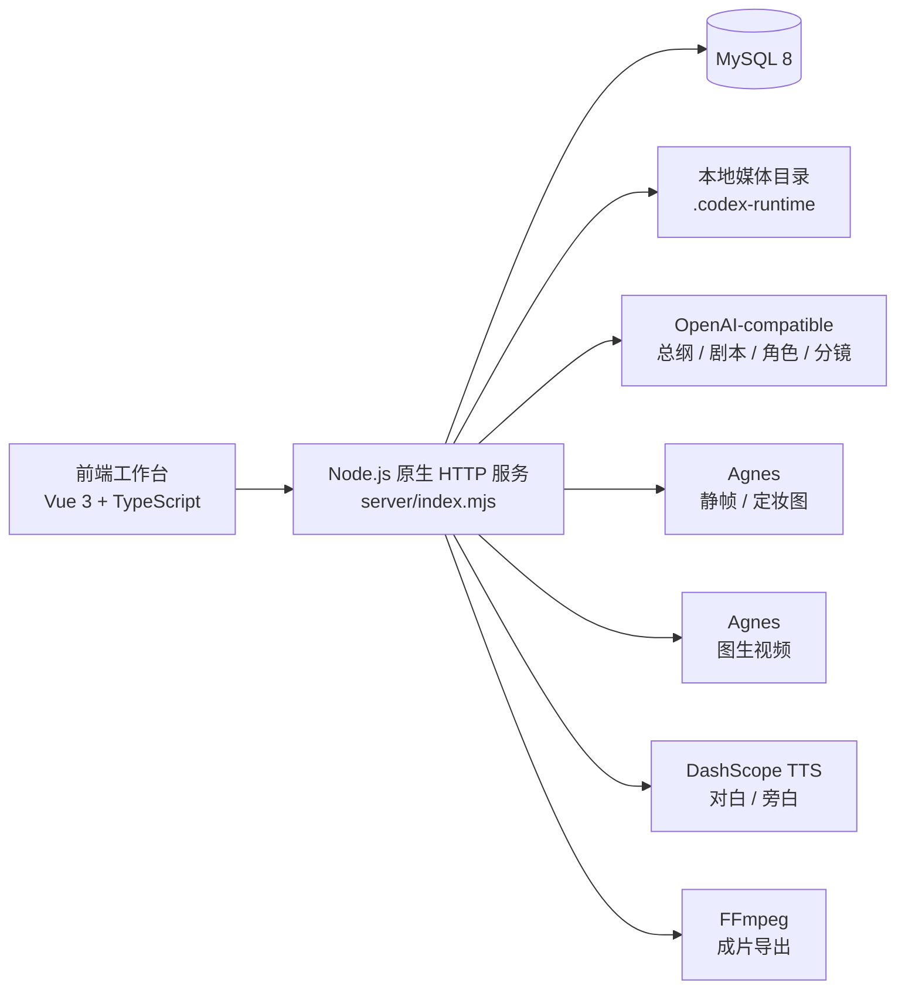
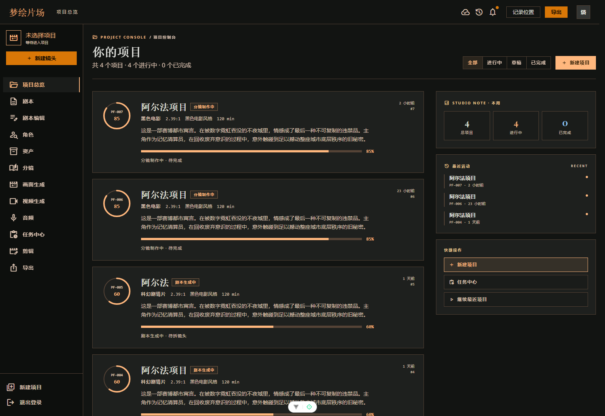
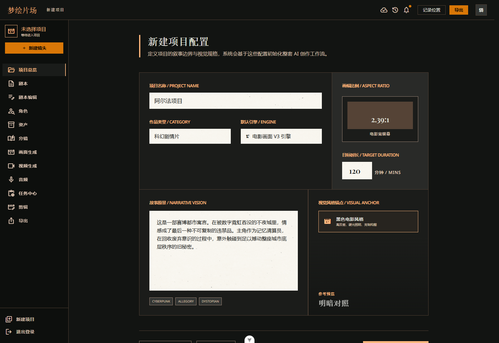
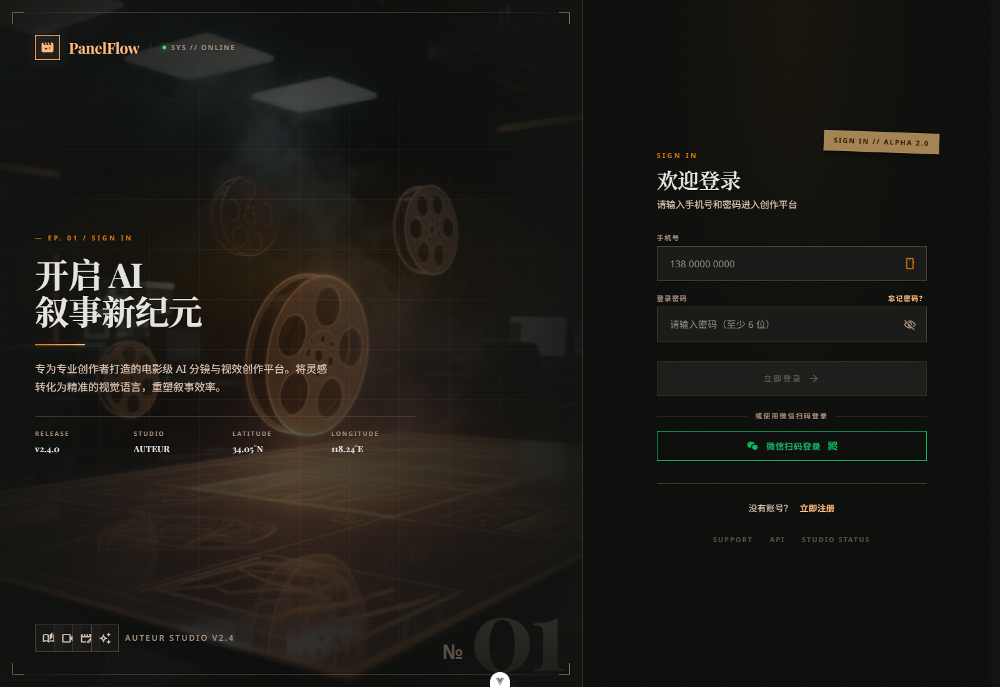
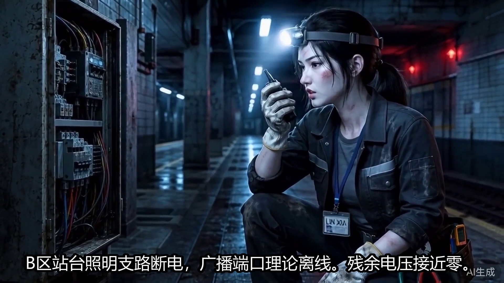

# 帧心帧意 ProjectDream：从项目到成片的 AI 漫剧工作台

> 本文是 ProjectDream 专栏的总览篇，主要记录这个项目如何把“故事想法”一路做成“可导出的成片”。

## 一、项目简介

ProjectDream 是一套面向 AI 漫剧和短视频生产的项目级工作台，不是单点生成工具，而是把完整生产链路串起来的一套系统。

它覆盖的流程很长：

**项目创建 -> 故事总纲 -> 场景拆解 -> 单场剧本 -> 角色库 -> 分镜 -> 静帧 -> 视频 -> 音频 -> 成片编辑 -> 导出**

和普通的“生成一个结果”不同，这个项目更强调生产过程中的可确认、可回跳、可重试。也就是说，前面每一步产出的内容，后面都能继续接上；中间任一步出问题，也能回到上游重新处理。

## 二、项目要解决什么问题

真正做过短视频或漫剧流程的人会发现，最难的往往不是“能不能生成”，而是“能不能稳定地串起来”。

常见问题包括：

- 文本和画面不一致
- 角色前后长相漂移
- 分镜数量一多就乱
- 音频和镜头对不齐
- 导出时历史素材混进去

ProjectDream 的思路不是让 AI 一口气做完，而是把每个环节都设计成一个独立但能衔接的节点。这样，内容生产就从黑盒变成了一条可管理的工作流。

## 三、技术栈与整体架构

### 3.1 技术栈

- 前端：Vue 3、TypeScript、Vite、Vue Router、Pinia、Tailwind CSS
- 后端：Node.js 原生 HTTP 服务
- 数据库：MySQL 8
- AI 能力：OpenAI-compatible 文本接口、Agnes 图片/视频、DashScope TTS
- 媒体处理：FFmpeg
- 本地存储：`.codex-runtime/`

### 3.2 架构图

### 3.3 目录分工

- `src/views/`：各个业务页面
- `src/components/`：工作台壳层组件
- `src/api/`：前端接口封装
- `server/index.mjs`：后端统一入口
- `server/services/`：文本、图片、视频、音频、导出等核心服务

这种拆法的好处很直接：前端页面按流程拆，后端逻辑按能力拆，结构清楚，后面写文章也方便按模块展开。

## 四、核心功能模块

### 4.1 认证与项目管理

项目支持登录、注册、找回密码和项目总览。登录后进入工作台，可以新建项目、切换项目，并查看当前项目的整体进度。

这一层的作用是把整个生产流程先装进“项目”这个容器里。后续所有总纲、场景、角色、分镜、素材和导出记录，都围绕项目展开。

### 4.2 故事总纲、场景拆解、单场剧本

文本链路是整个项目的上游。

系统先生成故事总纲，再拆成场景，最后扩写成单场剧本。这样做的好处是，上游语境会持续传递到下游，后面的角色、分镜和画面不会完全脱节。

### 4.3 角色库与一致性控制

ProjectDream 不是生成完角色图就结束，而是把角色当成长期资产来管理。

角色会保存姓名、性格、外貌、年龄段、性别、声线和定妆图。后面的分镜和静帧生成会尽量沿着这些信息走，避免“同一个角色在不同镜头里变脸”。

这部分是整个项目里很重要的一块，因为漫剧最怕的就是角色漂移。

### 4.4 分镜、静帧、视频和音频

分镜模块负责把剧本拆成镜头；静帧模块负责生成候选画面并确认主版本；视频模块负责把静帧转成视频候选；音频模块负责对白和旁白生成。

这些模块不是孤立存在的，而是层层向下衔接：

- 分镜决定镜头内容
- 静帧决定画面基底
- 视频决定运动表现
- 音频决定对白和节奏

### 4.5 任务中心与成片导出

图片、视频、口型同步这类耗时任务，没有做成前端同步等待，而是统一进入任务中心。

用户提交后可以先离开当前页面，后台继续执行。最后再通过成片编辑和导出模块，把确认过的素材合成 MP4。

导出时会走 FFmpeg，并结合时间线、字幕和音轨做最终拼接。

## 五、几个比较关键的实现点

### 5.1 后端为什么用原生 HTTP

后端没有用 Express，而是直接用 Node.js 原生 HTTP 服务统一分发路由。主入口是 `server/index.mjs`。

这样做的好处是：

- 依赖少
- 路由清晰
- 调试直观
- 适合演示和快速排查

代价也很明显，就是入口文件比较长，后期需要继续拆分。

### 5.2 AI Provider 抽象层

文本生成没有直接绑死某一家模型，而是做了一层统一适配。这样总纲、剧本、角色和分镜都可以走同一套结构化输出逻辑。

这层抽象的价值在于：

- 便于切换供应商
- 便于处理 JSON 解析异常
- 便于做 mock 模式和降级

### 5.3 异步任务与状态流转

图片、视频、口型同步这类任务都不是瞬时返回，而是先入库，再由后台持续处理。

任务中心负责把这些状态统一展示出来，用户可以看到排队、执行、成功和失败状态。这样就算页面刷新或服务重启，任务也还能继续追踪。

### 5.4 FFmpeg 合成导出

成片导出不是简单拼接几个视频，而是要同时处理：

- 镜头启用状态
- 音频位置
- 字幕烧录
- 视频时长对齐
- 历史素材过滤

最终通过 FFmpeg 统一合成 MP4，这一步是整个链路的收口。

## 六、项目成果

目前这套项目已经跑通了一条完整闭环：

- 登录注册
- 项目总览和新建项目
- 总纲、场景、剧本生成
- 角色库和角色一致性
- 分镜生成与编辑
- 静帧生成与确认
- 视频生成与口型同步
- 音频生成与声线绑定
- 任务中心
- 成片编辑
- 导出

从工程角度看，它已经不是“页面都在”的 demo，而是一个可以真正把内容往下推的工作台。

## 七、截图展示

下面这些截图最适合放在总览篇里：

### 1. 项目总览

### 2. 新建项目

### 3. 登录页

### 4. 完整成片画面

## 八、总结

ProjectDream 的重点，不在于“某一个页面做得多花”，而在于它真的把内容生产链路接起来了。

从故事到角色，从分镜到素材，再到最后的成片导出，整条流程是能跑通的，能回跳的，也能继续迭代的。对于一个 AI 漫剧工作台来说，这比“会生成一张图”更重要。

下一篇会继续拆解认证、项目总览，以及整个工作台的入口设计。

