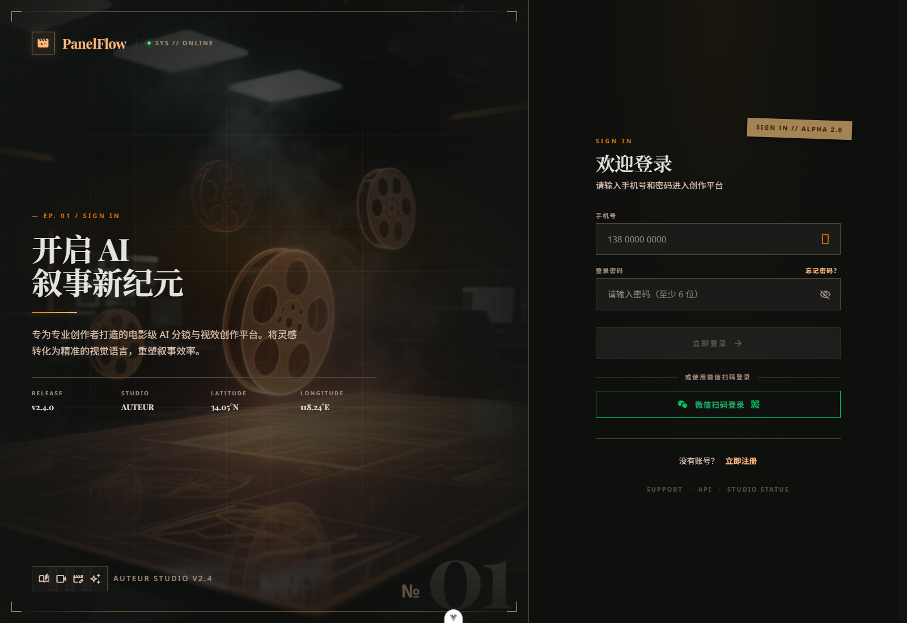
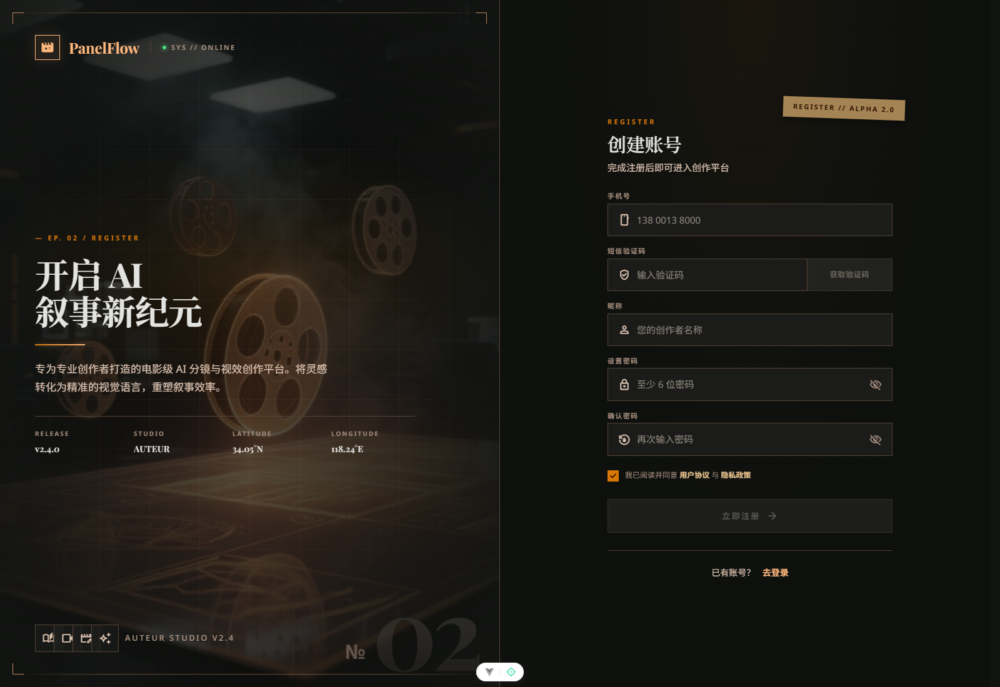
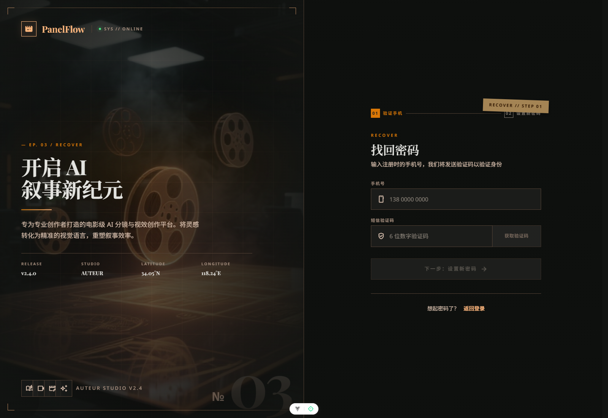
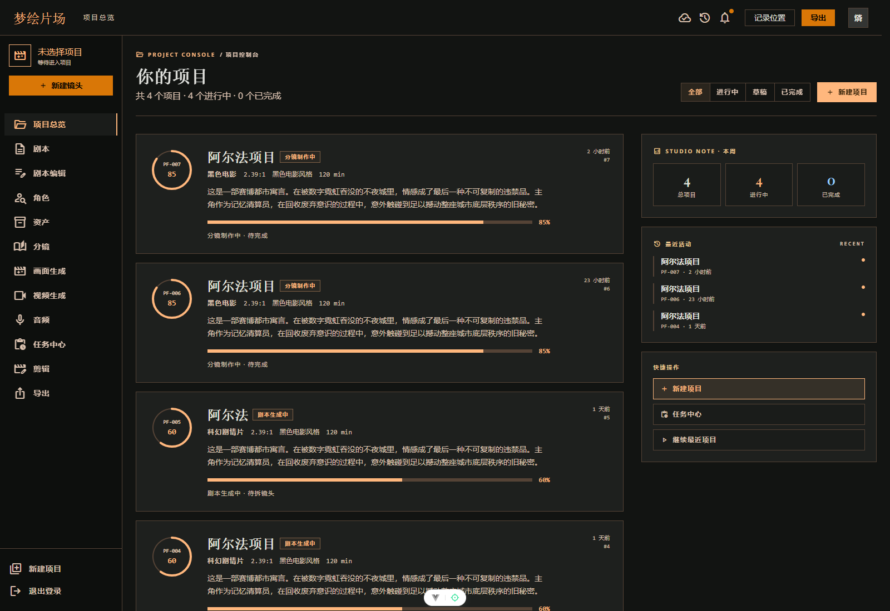
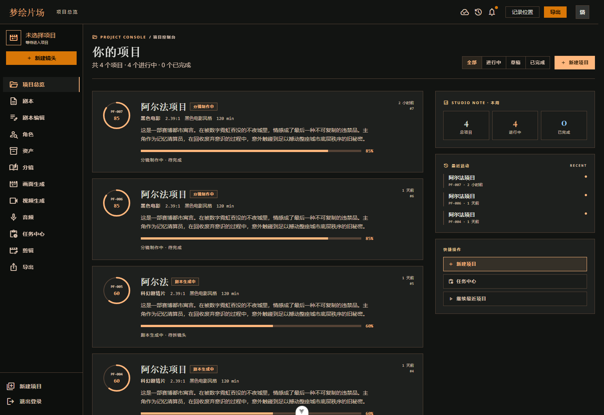
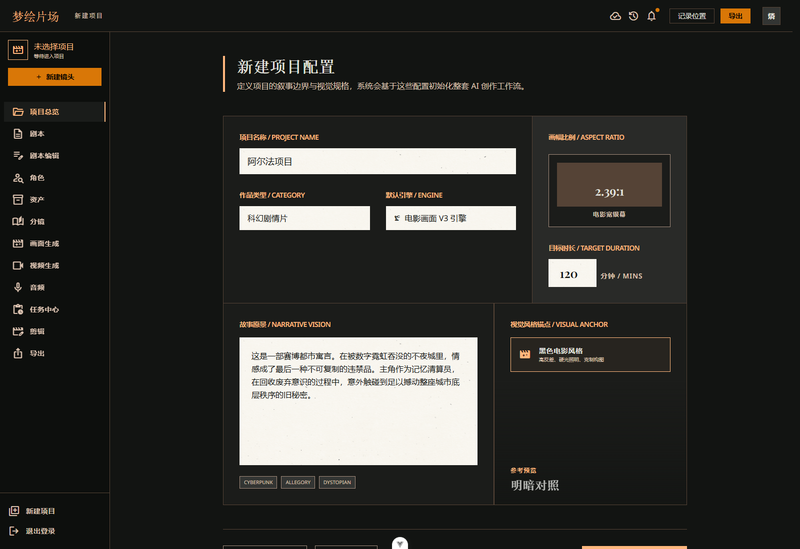

# ProjectDream 的入口设计：登录、注册、找回密码和项目总览

> 这一篇主要讲 ProjectDream 的入口层，也就是用户第一次进入系统时看到的内容：怎么登录、怎么注册、怎么找回密码，以及进入工作台后如何管理项目。

## 一、前言

在一个 AI 生产工作台里，入口页并不是“顺手做一下”就够了。

如果入口设计得很乱，后面的工作流再完整也会显得难用。ProjectDream 这部分的思路比较明确：先把用户接进来，再把项目接起来，最后把人送进真正的生产链路里。

所以这一层一共做了四件事：

- 登录
- 注册
- 找回密码
- 项目总览与新建项目

这几个页面看起来像是“前置功能”，但它们其实是整个工作台的门面，也是用户理解项目结构的第一步。

## 二、整体结构

### 2.1 路由设计

入口层的路由大致分成两类：

- 未登录可访问：登录、注册、找回密码、重置密码
- 登录后可访问：项目总览、新建项目、工作台各模块

对应到路由上，核心思路就是：

- `/` 指向登录页
- `/register` 指向注册页
- `/forgot-password` 指向找回密码页
- `/reset-password` 指向重置密码页
- `/dashboard` 指向项目总览
- `/new` 指向新建项目

这种结构很直白，没有绕弯子。用户一进来先完成身份验证，再进入项目。

### 2.2 鉴权逻辑

前端通过本地保存的 token 判断是否已登录，路由守卫会拦截未登录用户访问工作台页面，并把他们带回登录页。

登录成功后，系统会把用户信息写入本地，并进入项目总览。这样做的好处是，页面刷新后状态还能保留，用户不需要每次都重新登录。

## 三、登录页

### 3.1 页面作用

登录页是整个系统的第一入口。

ProjectDream 支持两种登录方式：

- 手机号 + 短信验证码
- 手机号 + 密码

这两种方式并不是为了炫技，而是为了覆盖不同使用场景。验证码适合首次登录或演示场景，密码适合注册后直接回流。

### 3.2 登录流程

登录页的交互比较简单：

1. 输入手机号
2. 选择登录方式
3. 输入验证码或密码
4. 登录成功后进入项目总览

后端返回 token 和用户信息后，前端会把登录态保存起来，后续访问工作台模块时统一带上认证信息。

### 3.3 页面截图

## 四、注册页

### 4.1 页面作用

注册页的设计比较直接，主要完成新用户的手机号验证、昵称设置和密码初始化。

对这种工作台型项目来说，注册流程不适合做得太重。入口页的目标不是“教育用户”，而是尽快让用户进入可用状态。

### 4.2 注册流程

注册大致分成这几步：

1. 输入手机号
2. 获取验证码
3. 输入昵称和密码
4. 完成注册并自动登录

注册完成后，用户会直接进入工作台，不需要再多跳一步。

### 4.3 页面截图

## 五、找回密码页

### 5.1 页面作用

找回密码页是入口层里很实用的一页。

这类项目的使用方式很接地气，很多时候演示账号、测试账号、临时账号都需要快速找回密码，所以找回密码流程一定要有，而且要够短。

### 5.2 找回流程

找回密码一般是：

1. 输入手机号
2. 获取验证码
3. 设置新密码
4. 返回登录页重新登录

这里没有设计太多额外步骤，重点就是让用户尽快恢复进入系统的能力。

### 5.3 页面截图

## 六、项目总览页

### 6.1 为什么总览页很重要

如果说登录页负责“把人带进来”，那项目总览页就是“告诉用户现在在做什么”。

对于 ProjectDream 这种工作台型产品来说，总览页不是一个展示海报，而是一个真正的生产控制台。用户进入系统后，第一眼就要看到：

- 当前有哪些项目
- 每个项目做到哪一步了
- 最近一次成片是什么
- 下一步该去哪一个模块

这也是为什么项目总览页不是简单的列表页，而是一个包含进度、素材数量和最新产出信息的入口页。

### 6.2 页面内容

项目总览页主要承担三件事：

- 展示项目列表
- 展示项目进度
- 提供进入生产模块的入口

用户可以在这里快速判断项目状态，不需要一个一个模块点进去看。

### 6.3 页面截图

## 七、新建项目页

### 7.1 页面作用

新建项目页是整个工作台真正开始“生产”的地方。

项目的所有文本、角色、分镜、静帧和导出记录，后面都会挂到这个项目上。所以这一步其实不是“填一个表单”这么简单，而是在建立整个创作链路的容器。

### 7.2 表单内容

新建项目页里主要会填写：

- 项目名称
- 题材
- 目标时长
- 故事方向
- 视觉风格
- 画幅比例

这些字段看起来不复杂，但它们会直接影响后面的总纲生成、场景拆解和画面风格。

### 7.3 设计思路

这里没有把表单做得太重，原因很简单：用户一开始最需要的是“先把项目立住”，而不是在入口页就被一堆选项卡住。

所以新建项目页的目标是：

- 输入成本低
- 结构清楚
- 创建后能马上进入下一步

### 7.4 页面截图

## 八、这一层的设计特点

### 8.1 入口简单

用户不需要先理解整套系统结构，登录后先进入总览页，再慢慢往下走。

### 8.2 路径清楚

从登录到项目总览，再到新建项目，路径很短，不绕。

### 8.3 状态可保留

登录态和用户信息会保留在本地，刷新页面也不会立刻掉回登录页。

### 8.4 为后续模块铺路

入口层不是孤立存在的，它的任务是把人顺利送进后面的文本、角色、分镜和导出链路。

## 九、总结

ProjectDream 的入口层做得比较克制，没有把页面做得很花，但功能上是完整的。

登录、注册、找回密码、项目总览和新建项目这几页看起来基础，实际上它们决定了用户能不能顺利进入整个工作台，也决定了后面的生产链路能不能被正确组织起来。

下一篇会继续写总纲、场景和单场剧本，开始进入真正的内容生产阶段。

