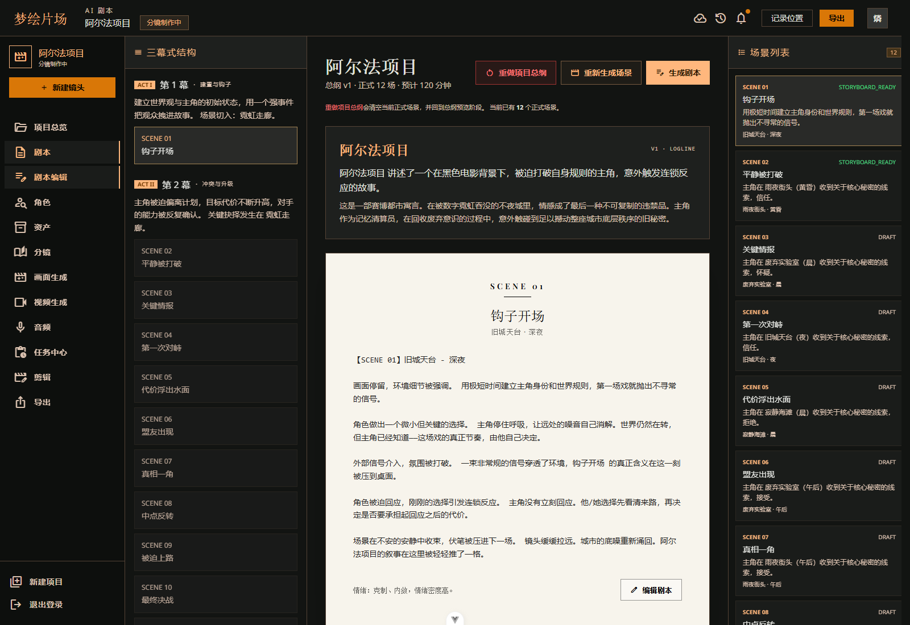
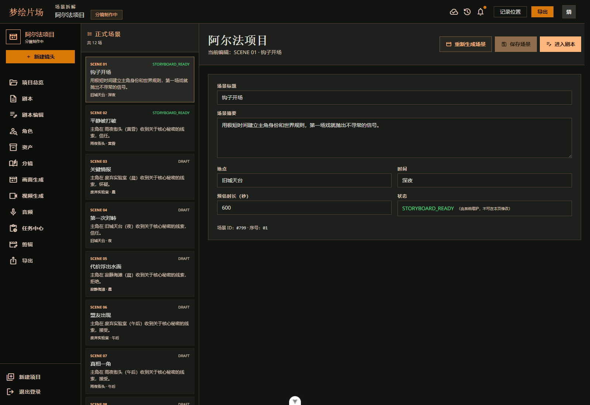
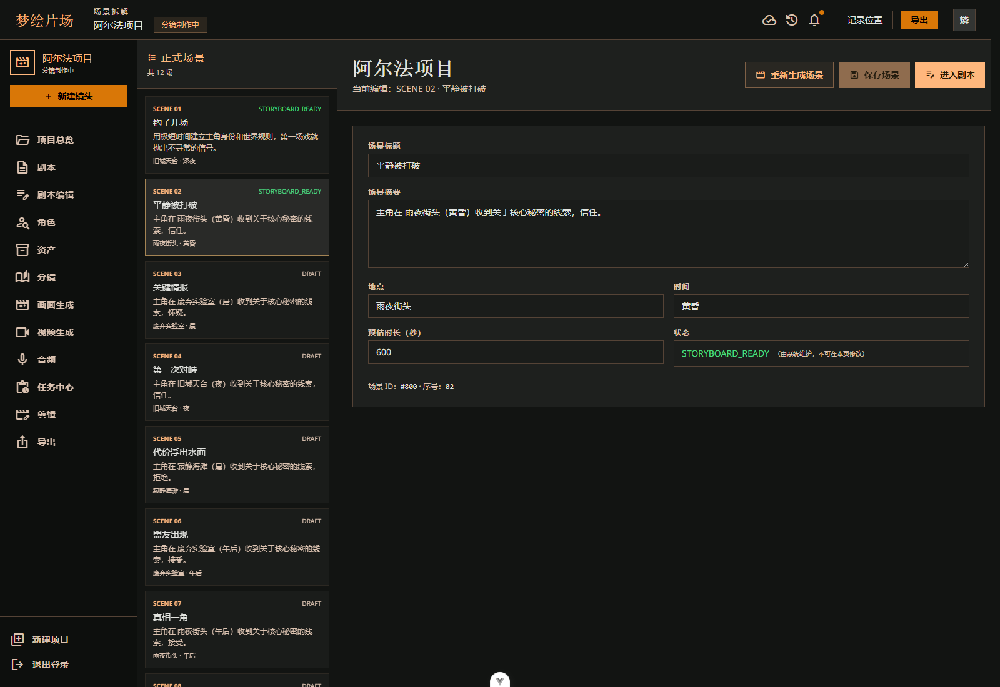
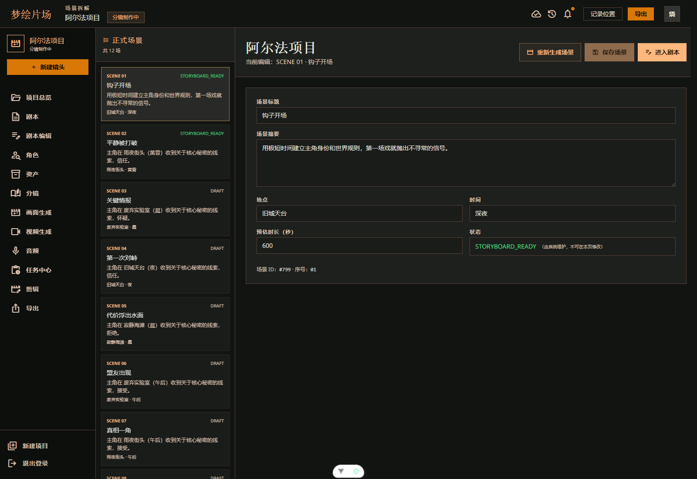
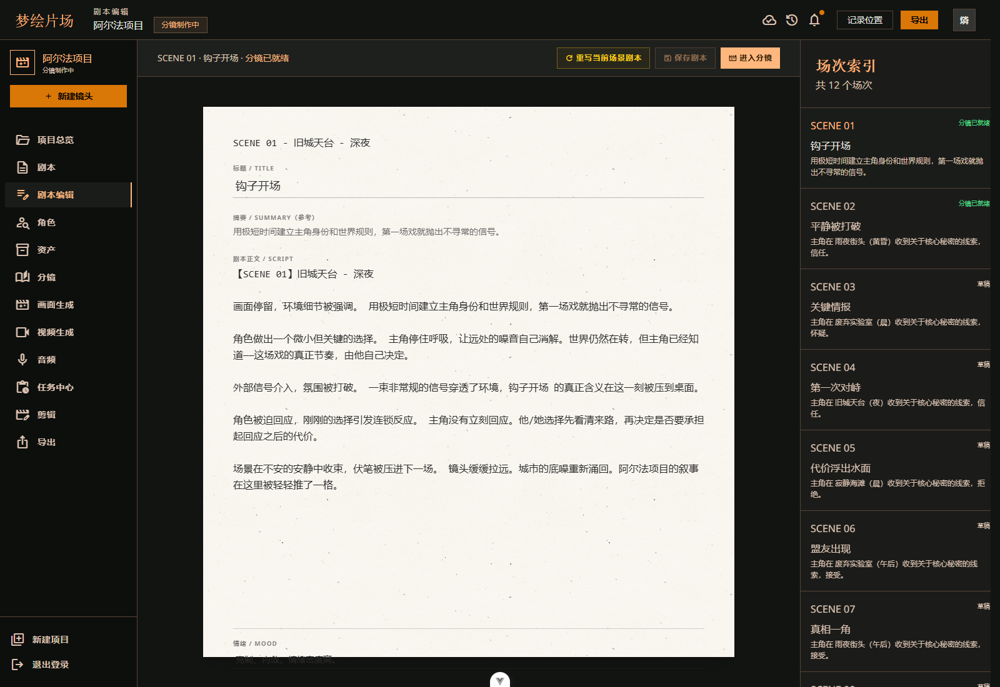
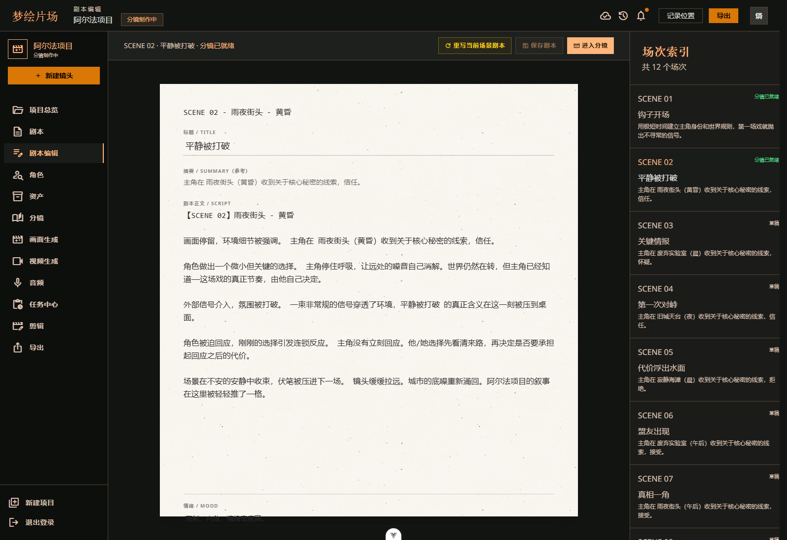

# 从故事总纲到单场剧本：ProjectDream 的文本生产链路

> 这一篇继续写 ProjectDream 的上游文本链路，主要包括 AI 故事总纲、场景拆解和单场剧本三个模块。

## 一、为什么先做文本链路

在漫剧和短视频生产里，最先定下来的不是画面，而是文本。

如果总纲不稳定，后面的场景、剧本、分镜都会跟着乱；如果剧本不清楚，后续角色、静帧和视频也很难保持一致。所以 ProjectDream 的第一条主链路，就是先把故事讲明白，再往下拆。

这部分在系统里分成三层：

- AI 故事总纲
- 场景拆解
- 单场景剧本

它们的关系很清楚：

**总纲负责定故事方向，场景负责拆生产单元，剧本负责把单场场景写成可执行文本。**

## 二、AI 故事总纲模块

### 2.1 模块作用

故事总纲模块负责把用户在创建项目时填写的题材、故事方向、视觉风格和目标时长，转换成结构化的故事蓝图。

它是后面场景拆解、单场剧本、角色提取和分镜生成的上游语境。

### 2.2 页面流程

总纲模块的流程很直接：

1. 用户进入 AI 剧本页
2. 页面读取当前项目和最新总纲
3. 用户点击生成总纲
4. 后端调用文本模型生成结构化 JSON
5. 后端规范化模型返回内容
6. 写入 `story_outlines`
7. 页面展示故事标题、logline、三幕结构和场景草案
8. 用户继续生成正式场景

### 2.3 页面截图




### 2.4 关键实现

前端页面是 `src/views/AIScript.vue`，会同时负责项目加载、总纲加载、总纲生成和场景生成。

相关接口包括：

- `getProject(projectId)`
- `getLatestOutline(projectId)`
- `generateOutline(projectId)`
- `listScenes(projectId)`
- `generateScenes(projectId)`
- `generateSceneScript(sceneId)`

后端接口主要是：

```text
GET  /api/projects/:projectId/outline
POST /api/projects/:projectId/outline/generate
```

生成流程大致是：

```text
POST /api/projects/:projectId/outline/generate
  -> authenticate
  -> 校验项目归属
  -> aiGenerateOutline(project)
  -> buildOutlinePrompts(project)
  -> generateStructuredJson()
  -> normalizeOutlinePayload()
  -> 计算 version_no
  -> 写入 story_outlines
  -> 更新项目 status
  -> 返回 OutlineDTO
```

### 2.5 数据表

核心表是 `story_outlines`，关键字段包括：

- `project_id`
- `version_no`
- `title`
- `logline`
- `premise`
- `act1_text / act2_text / act3_text`
- `visual_style`
- `raw_json`

这里最关键的是 `raw_json` 会保留模型原始结果，方便后续追溯和调试。

### 2.6 异常处理

总纲模块对异常的处理比较严格：

- 项目不存在或不属于当前用户时直接拒绝
- AI 未配置时走 mock 或返回配置错误
- 模型返回非 JSON 时抛结构化解析错误
- 生成失败时不写入无效总纲

这一步的目的很明确，就是保证后面的场景和剧本有一个稳定的上游输入。

## 三、场景拆解模块

### 3.1 模块作用

场景拆解模块负责把总纲中的场景草案落成正式场景。

如果说总纲是故事蓝图，那场景就是实际的生产单元。每个场景都会有自己的标题、地点、时间、摘要、氛围和预估时长。

### 3.2 页面流程

场景页的操作流程如下：

1. 用户进入场景拆解页
2. 页面读取项目、最新总纲和已有场景
3. 用户点击生成场景
4. 后端基于总纲中的场景列表写入 `script_scenes`
5. 用户可以切换场景并修改标题、摘要、地点、时间和氛围
6. 保存后，单场剧本模块继续读取这些场景

### 3.3 页面截图







### 3.4 关键实现

前端页面是 `src/views/Scenes.vue`，核心状态包括：

- 当前项目
- 当前总纲
- 场景列表
- 当前选中场景
- 表单草稿
- 是否有未保存改动
- 重新生成确认弹窗

相关接口包括：

- `getProject(projectId)`
- `getLatestOutline(projectId)`
- `listScenes(projectId)`
- `generateScenes(projectId)`
- `updateScene(sceneId, payload)`

后端接口主要是：

```text
GET  /api/projects/:projectId/scenes
POST /api/projects/:projectId/scenes/generate
GET  /api/scenes/:sceneId
PUT  /api/scenes/:sceneId
```

生成流程大致是：

```text
POST /api/projects/:projectId/scenes/generate
  -> authenticate
  -> 校验项目归属
  -> 查询最新 story_outlines
  -> 从总纲 raw_json / scenes 字段读取场景列表
  -> 规范化 scene_no、title、summary、location、time_of_day
  -> 写入 script_scenes
  -> 更新项目 status
  -> 返回场景列表
```

### 3.5 数据表

核心表是 `script_scenes`，关键字段包括：

- `project_id`
- `outline_id`
- `scene_no`
- `title`
- `summary`
- `content`
- `mood`
- `location`
- `time_of_day`
- `estimated_duration`
- `sort_order`
- `status`

### 3.6 异常处理

场景拆解这一步也有比较明确的保护机制：

- 没有总纲时不能生成正式场景
- 总纲里没有可用场景列表时返回错误
- 场景不属于当前用户时拒绝访问
- 非法时长会被忽略
- 重新生成场景前前端会弹确认，避免误操作

这一步的重点是把故事从“抽象描述”变成“可执行的场景单元”。

## 四、单场景剧本模块

### 4.1 模块作用

单场景剧本模块负责把一个场景扩展成完整剧本文本，包括人物对白、动作、环境氛围和节奏说明。

它是分镜生成的直接输入。

### 4.2 页面流程

单场景剧本的流程是：

1. 用户从场景列表进入剧本编辑页
2. 页面读取项目、场景列表和当前场景详情
3. 用户点击生成剧本
4. 后端基于项目、总纲和当前场景调用文本模型
5. 生成内容写回 `script_scenes.content`
6. 用户可以人工编辑并保存
7. 用户继续点击生成分镜

### 4.3 页面截图






### 4.4 关键实现

前端页面是 `src/views/ScriptEditor.vue`，它要处理两个比较重要的状态：

- 剧本文本草稿是否和数据库一致
- 切换场景时是否丢弃未保存内容

相关接口包括：

- `getProject(projectId)`
- `listScenes(projectId)`
- `getScene(sceneId)`
- `generateSceneScript(sceneId)`
- `saveSceneScript(sceneId, payload)`
- `generateStoryboards(sceneId)`

后端接口主要是：

```text
GET  /api/scenes/:sceneId/script
POST /api/scenes/:sceneId/script/generate
PUT  /api/scenes/:sceneId/script
```

生成流程大致是：

```text
POST /api/scenes/:sceneId/script/generate
  -> authenticate
  -> 查询场景并校验 owner
  -> 查询项目和最新总纲
  -> aiGenerateSceneScript()
  -> buildSceneScriptPrompts()
  -> generateStructuredJson()
  -> normalizeSceneScriptPayload()
  -> 更新 script_scenes.content / mood / status
  -> 返回 SceneDTO
```

### 4.5 数据表

这里仍然是 `script_scenes`，比较关键的字段是：

- `content`：单场剧本文本
- `mood`：情绪和氛围
- `status`：剧本阶段状态
- `updated_at`：最后编辑时间

生成分镜时，会继续读取：

- `script_scenes.content`
- `characters`
- `projects.visual_style`

### 4.6 异常处理

这一层的保护也比较直接：

- 场景不存在或不属于当前用户时拒绝
- 场景没有内容时，分镜生成会被阻止
- AI 失败时按配置决定是否 fallback 到 mock
- 切换场景前有未保存内容时，前端弹出确认

## 五、这一段链路的价值

总纲、场景和单场剧本不是三个孤立页面，而是一个连续的文本生产链路。

它们解决的不是“能不能写”，而是“能不能稳定地往下传”。

这也是 ProjectDream 和普通生成页最大的区别。普通页面更像结果展示，而这条链路更像真正的生产线：

- 上游负责定方向
- 中游负责拆单元
- 下游负责扩写成可执行剧本

## 六、总结

这三块文本模块是 ProjectDream 里最基础、也是最核心的一段。

故事总纲解决“讲什么”，场景拆解解决“拆成什么单元”，单场剧本解决“这一场怎么拍”。

有了这一层，后面的角色、分镜、静帧、视频和音频才有稳定的上游依据。

下一篇会开始写角色库和角色一致性模块，进入更下游的生产环节。

