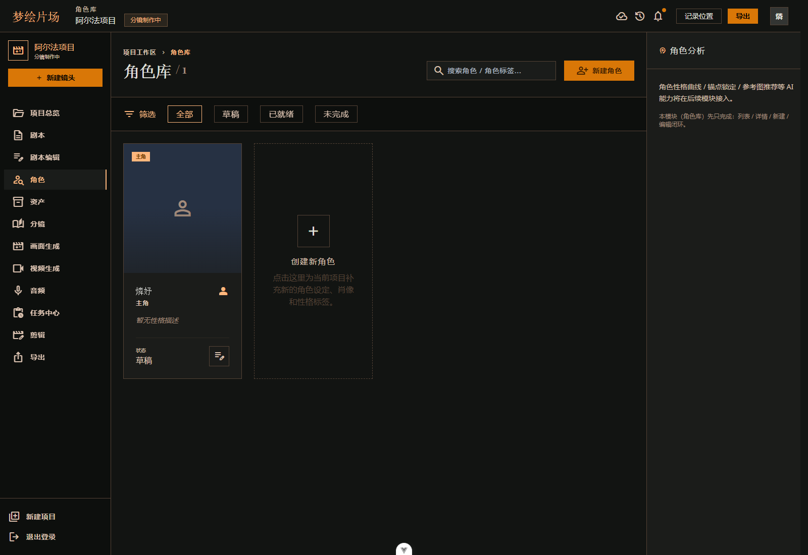
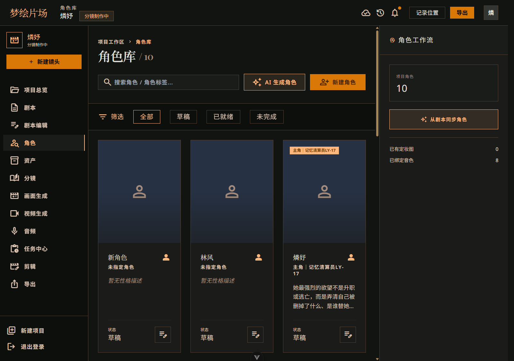
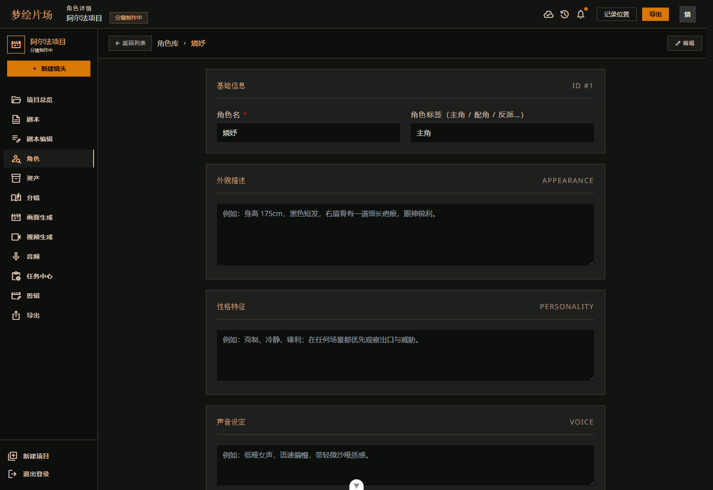
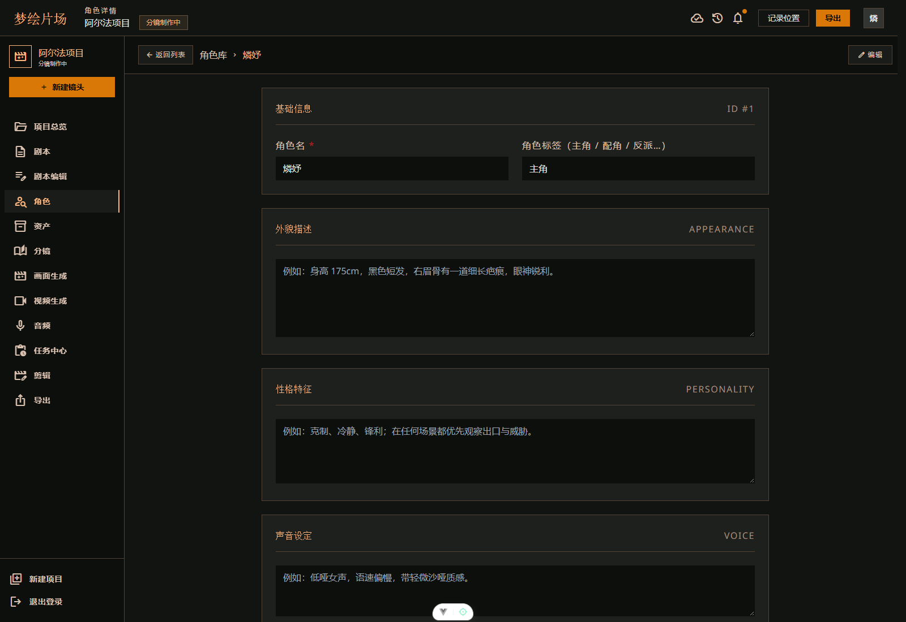

# 角色不跑偏：ProjectDream 的角色库、定妆图和声线闭环

> 本文继续记录 ProjectDream 的核心功能模块，这一篇聚焦角色库、角色定妆图和角色一致性控制。

## 一、前言

在 AI 漫剧或短视频项目里，角色一致性通常比“能不能生成”更难处理。

如果同一个角色在不同镜头里长相变化太大，用户很快就会出戏。ProjectDream 在角色这部分做得比较完整，不只是保存一个名字，而是把角色当成一个长期资产来管理。

这一篇主要讲四件事：

- 角色库
- 角色详情
- 定妆图生成与确认
- 声线绑定和改名同步

## 二、模块定位

角色库模块负责把剧本中的人物从普通文本变成可管理的角色实体。每个角色都有唯一 ID、名称、身份、性别、年龄段、外貌、性格、声线和定妆参考图。

角色一致性模块则负责在静帧生成前校验角色是否可识别、是否已经绑定到角色库、是否具备清晰的性别年龄和参考图，从而减少 AI 生成时的人物漂移。

简单说，角色库解决的是“这个人是谁”，一致性模块解决的是“后面还像不像这个人”。

## 三、角色库页面

### 3.1 页面作用

角色库是整个角色体系的入口页。

在这里，用户可以看到项目中的所有角色，也可以手动创建角色，或者直接基于总纲和剧本生成角色档案。

### 3.2 页面流程

角色库页的主要流程是：

1. 用户进入角色库
2. 页面读取当前项目下的角色列表
3. 用户可以手动新增角色
4. 也可以点击 AI 生成角色
5. 进入角色详情后继续补充档案

### 3.3 页面截图





## 四、角色详情页

### 4.1 页面作用

角色详情页是角色管理的核心页面。

它不是单纯展示信息，而是围绕角色档案补全、定妆图、声线和改名同步做完整管理。

### 4.2 页面区域

角色详情页主要分成几个区域：

- 基础档案编辑
- AI 补全角色档案
- 角色定妆图生成和确认
- 声线推荐、试听和锁定
- 改名影响预览和同步

### 4.3 页面截图





## 五、AI 生成角色档案

### 5.1 功能说明

ProjectDream 支持从总纲和剧本自动抽取角色信息。

这个过程会从文本里提取姓名、戏剧身份、性格、固定外观和 TTS 音色，然后写入角色表。这样用户就不需要每个角色都从头填一遍。

### 5.2 流程

AI 生成角色的流程大致如下：

```text
POST /api/projects/:projectId/characters/generate
  -> authenticate
  -> 校验项目
  -> 读取总纲、场景、剧本
  -> aiGenerateCharacters()
  -> normalizeCharactersPayload()
  -> 去重并写入 characters
```

### 5.3 角色信息

角色结构里比较关键的字段包括：

- `name`
- `roleTag`
- `personality`
- `appearance`
- `age_group`
- `gender`
- `voice_style`
- `voice_profile_key`
- `voice_locked`
- `reference_image_url`

这里的重点是，角色不是只有一个名字，而是带有完整档案的实体。

## 六、定妆图生成与确认

### 6.1 功能说明

角色定妆图是角色一致性的基础。

系统会根据角色档案生成候选定妆图，用户确认后写入 `reference_image_url`。后续静帧生成时，系统会读取这张图作为参考。

### 6.2 页面流程

定妆图的流程大致是：

1. 进入角色详情页
2. 点击生成定妆图
3. 后端创建生成任务
4. 生成候选图
5. 用户确认其中一张作为主参考图

### 6.3 关键接口

```text
POST /api/characters/:characterId/images/generate
GET  /api/characters/:characterId/images
POST /api/character-images/:imageId/confirm
```

### 6.4 数据表

相关表主要是：

- `character_images`
- `characters`

`character_images` 里会记录候选图的版本号、图片地址、提示词快照、模型名和状态。

当前每个角色只允许一张 `confirmed` 定妆图，这样后续静帧和视频生成才有明确参考。

### 6.5 页面截图

## 七、声线推荐与锁定

### 7.1 功能说明

角色不仅要像，还要“听起来像”。

ProjectDream 会根据角色的年龄段、性别和气质推荐声线，然后支持试听和锁定。对白生成时，会优先读取已经锁定的角色主音色。

### 7.2 关键逻辑

角色音色的管理并不是随便选一个音色就结束，而是要保存：

- 年龄段
- 性别
- 风格标签
- 声线配置
- 是否锁定

这样后面的对白、旁白和口型同步才能保持一致。

### 7.3 真实接入

真实接入记录里，这部分已经完成了 DashScope TTS 的接入和真实验证。项目里支持：

- 角色短句试听
- 声线推荐
- 声线确认
- 锁定后对白生成

这样角色的声音不再是临时随机分配，而是可以持续复用的配置。

## 八、角色改名同步

### 8.1 为什么要做同步

角色改名不是简单把 `characters.name` 更新一下就完了。

因为角色名会出现在很多地方：

- 项目简介
- 总纲
- 场景正文
- 分镜动作
- 分镜对白
- 分镜视觉提示词

如果只改角色表，其他地方不动，前后就会不一致。

### 8.2 同步流程

用户改名时，系统会先预览影响范围。如果用户选择同步引用，后端会生成改名计划并通过事务更新相关内容。

### 8.3 涉及范围

同步会覆盖：

- 项目描述
- 总纲 JSON
- 场景文本
- 分镜动作
- 分镜对白
- 分镜视觉提示词

这样可以避免角色名称在不同模块里前后不一致。

### 8.4 关键接口

```text
POST /api/characters/:id/rename-preview
PUT  /api/characters/:id
```

## 九、角色一致性校验

### 9.1 校验目标

角色一致性校验发生在静帧生成之前。

系统会检查当前分镜中的角色是否：

- 已绑定角色库
- 性别和年龄是否明确
- 是否具备参考图
- 是否能和分镜中的视觉描述匹配

### 9.2 阻断条件

下面这些情况会直接阻止静帧生成：

- 可见角色没有参考图
- 分镜里出现人类主体但无法匹配角色库
- 角色性别或年龄缺失
- 角色识别上下文不完整

这一步的目的很简单，就是尽量在生成前把问题拦住，而不是让模型生成完以后再修。

## 十、页面截图

这一组图最适合放在文章中间：


## 十一、总结

角色库这部分在 ProjectDream 里很重要，因为它不只是“存角色信息”，而是把角色变成了可以持续管理的生产资产。

从档案、定妆图、声线，到改名同步和静帧校验，整条链路都在围绕一个目标展开：让角色在后面的分镜、静帧、视频里尽量保持稳定。

下一篇会开始写分镜生成和分镜编辑，这是角色进入镜头层后的第一步。
