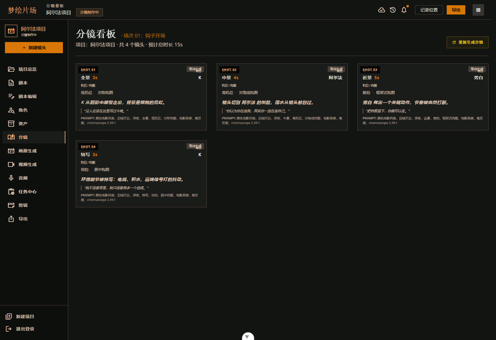
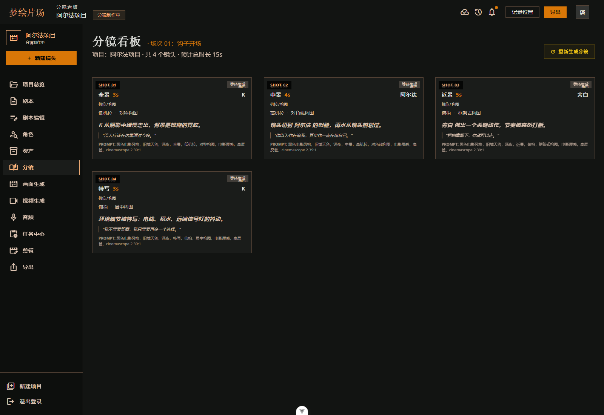
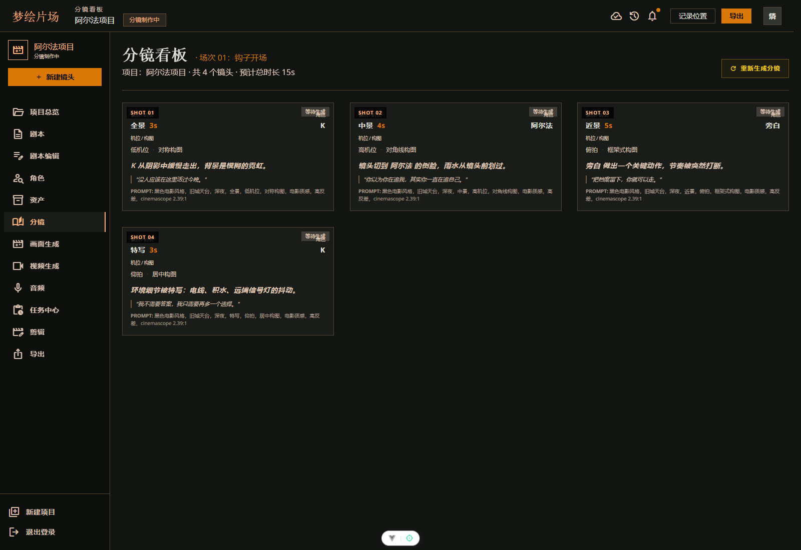
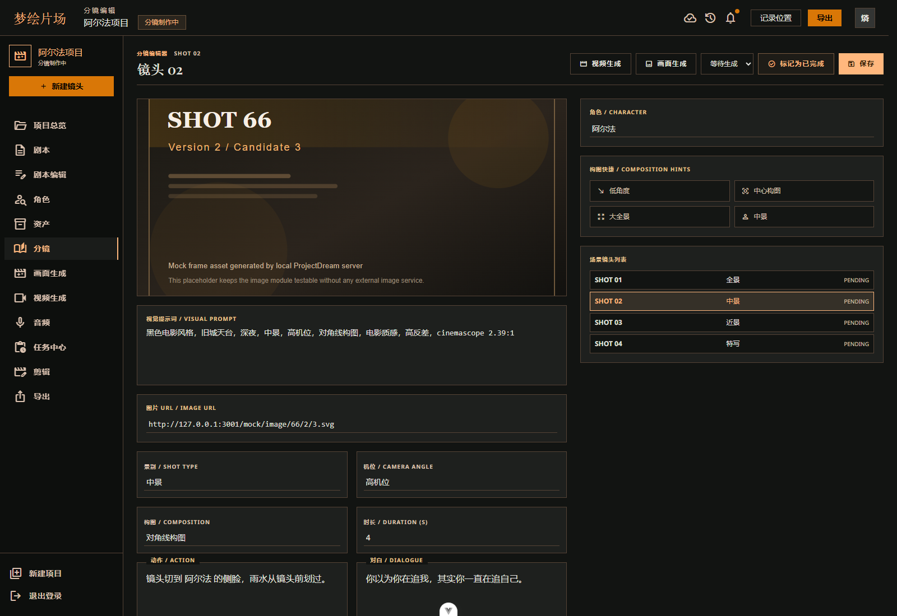
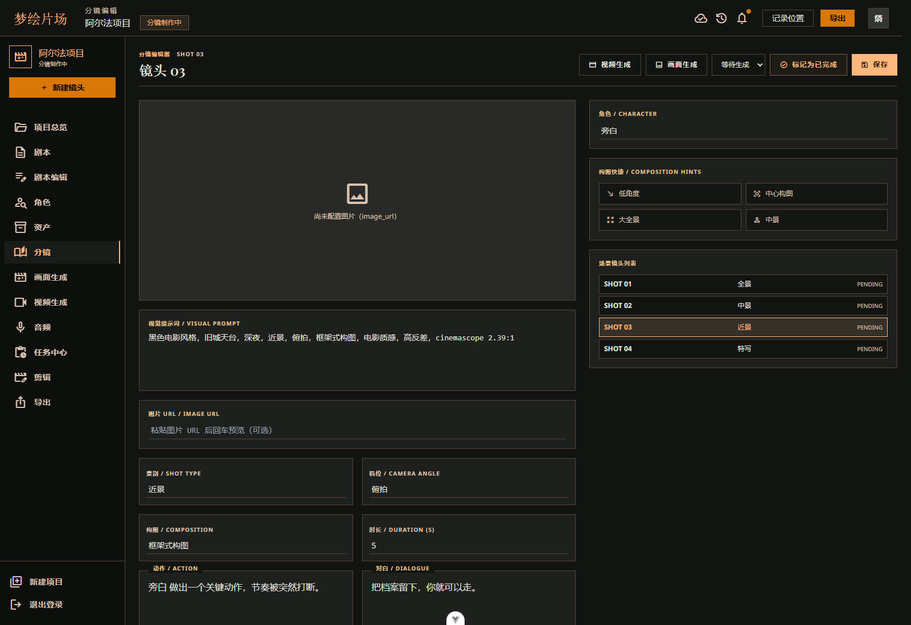
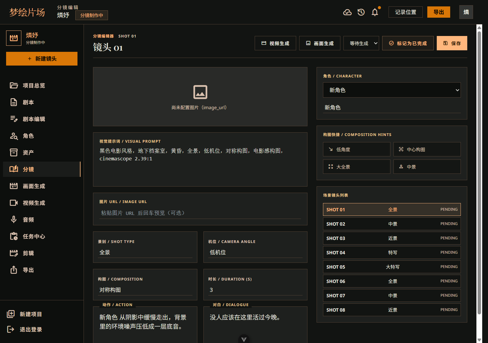
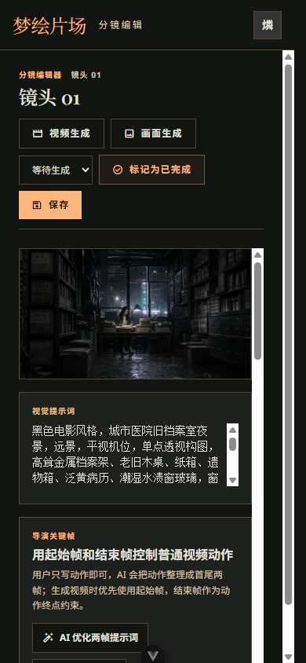

# 从剧本到镜头：ProjectDream 的分镜生成与编辑模块

> 本文继续记录 ProjectDream 的核心链路，这一篇聚焦分镜生成、分镜编辑、导演关键帧以及分镜拆分能力。

## 一、前言

在漫剧和短视频生产里，分镜通常是最关键的中间层。

它上接剧本，下接静帧、视频、音频和最终时间线。剧本写得再完整，如果分镜拆得不对，后面的生成也会乱；反过来，分镜如果拆得好，后面的画面、对白和导出都会轻很多。

ProjectDream 的分镜模块不是简单列个镜头表，而是把每条分镜都当成一个完整的镜头单元来管理。

## 二、模块定位

分镜模块负责承接单场剧本，向下决定静帧、视频、音频、字幕和成片时间线。

每条分镜都包含这些信息：

- 镜头编号
- 景别
- 机位
- 构图
- 时长
- 角色绑定
- 动作
- 对白
- 视觉提示词
- 起始帧提示词
- 结束帧提示词

简单说，剧本负责“写什么”，分镜负责“怎么拍”。

## 三、分镜生成

### 3.1 页面入口

用户通常是在单场剧本编辑页点击“生成分镜”，然后进入分镜看板。

这一层的逻辑很自然，因为分镜是从当前场景剧本里拆出来的，不是独立空生成的。

### 3.2 页面流程

分镜生成流程如下：

1. 用户在剧本编辑页点击生成分镜
2. 后端读取当前场景剧本并调用文本模型拆镜
3. 生成的分镜写入 `storyboards`
4. 用户进入分镜看板查看全部镜头
5. 用户进入分镜编辑页，继续调整动作、对白、角色和时长
6. 确认后进入静帧生成

### 3.3 页面截图







### 3.4 关键实现

前端相关页面主要是：

- `src/views/StoryboardList.vue`
- `src/views/StoryboardEditor.vue`
- `src/views/ScriptEditor.vue`

相关接口包括：

- `listStoryboards(sceneId)`
- `generateStoryboards(sceneId)`
- `getStoryboard(storyboardId)`
- `updateStoryboard(storyboardId, payload)`
- `rewriteStoryboardFramePrompt(storyboardId)`
- `optimizeStoryboardKeyframes(storyboardId)`
- `copyPreviousFrameToStoryboard(storyboardId)`
- `splitStoryboard(storyboardId)`
- `splitStoryboardDialogue(storyboardId)`
- `reorderStoryboards(orders)`
- `listCharacters(projectId)`

后端生成接口主要是：

```text
GET  /api/scenes/:sceneId/storyboards
POST /api/scenes/:sceneId/storyboards/generate
GET  /api/storyboards/:storyboardId
PUT  /api/storyboards/:storyboardId
POST /api/storyboards/reorder
POST /api/storyboards/:storyboardId/frame-prompt/rewrite
POST /api/storyboards/:storyboardId/keyframes/optimize
POST /api/storyboards/:storyboardId/continuity/start-frame
POST /api/storyboards/:storyboardId/split
POST /api/storyboards/:storyboardId/dialogue/split
```

生成流程大致是：

```text
POST /api/scenes/:sceneId/storyboards/generate
  -> authenticate
  -> 校验场景归属
  -> 检查 scene.content 不为空
  -> 读取项目和角色库
  -> aiGenerateStoryboards()
  -> normalizeStoryboardPayload()
  -> 根据角色名匹配 character_id
  -> 写入 storyboards
  -> 更新项目 status
```

## 四、分镜编辑页

### 4.1 页面作用

分镜生成之后，真正的制作就开始了。

分镜编辑页不是单纯修文本，而是把每一条镜头变成一个可控单元。用户可以在这里修改动作、对白、角色、时长和视觉提示词。

### 4.2 页面区域

分镜编辑页主要负责这些内容：

- 分镜基础字段
- 角色绑定
- 动作和对白编辑
- 视觉提示词调整
- 起始帧和结束帧设置
- 镜头切换
- 分镜排序

### 4.3 页面截图








## 五、导演关键帧

### 5.1 为什么要有导演关键帧

如果镜头里有人物动作，直接让模型理解整段动作，效果通常不稳定。

所以 ProjectDream 在分镜编辑里加了导演关键帧功能。用户只要写清楚动作文本，系统就可以帮忙生成起始帧和结束帧提示词。

### 5.2 关键帧的作用

- 起始帧：描述动作开始前的人物姿态、站位、视线、道具和构图
- 结束帧：描述动作完成后的人物姿态、情绪变化、空间位置和动作结果

这样做的好处是，后面的静帧和视频生成会更稳，动作镜头也更容易连起来。

### 5.3 页面截图


## 六、承接上一镜头

### 6.1 功能说明

导演关键帧里还有一个很实用的功能，就是“承接上一镜头”。

它可以把上一镜头已经确认过的画面作为当前分镜的起始帧，减少镜头之间的人物跳变。

这在连续动作和情绪延续场景里特别有用。

### 6.2 作用

- 降低角色漂移
- 减少镜头断裂感
- 提高起始帧一致性

## 七、长动作拆分

### 7.1 功能说明

有些动作太长，直接塞进一个分镜里并不合适。

ProjectDream 允许把长动作拆成 2 到 4 个短分镜，这样后面的静帧和视频生成会更稳定，制作时也更容易控制节奏。

### 7.2 拆分规则

拆分前会先检查当前分镜是否已经有生成素材：

- 如果已有图片、视频或音频，默认不允许拆分
- 如果还没有素材，可以拆成多个短镜头

这样可以避免破坏已经确认过的结果。

## 八、多人对白拆分

### 8.1 功能说明

多人对白是分镜里最容易混乱的部分。

如果一个镜头里多个角色轮流说话，后面的对白生成和口型同步就容易乱套。所以系统提供了“多人对白拆分”能力，把一条多人对白拆成多个单说话人分镜。

### 8.2 作用

- 便于后续音频绑定
- 便于口型同步
- 便于单角色镜头管理

### 8.3 页面截图



## 九、角色绑定与一致性

### 9.1 角色绑定

分镜编辑时，用户可以把镜头绑定到具体角色。

这一步并不是可有可无，而是后面静帧生成和角色一致性校验的基础。系统会根据当前项目的角色库去匹配 `character_id`，避免镜头里的人物和角色库脱节。

### 9.2 角色名回填

真实接入里，分镜会优先读取角色 ID，再回填最新角色名，而不是死看旧的 `character_name`。

这样即使角色后来改名，分镜也能通过角色真相源继续读取最新信息。

### 9.3 相关校验

如果角色没有绑定到当前项目，或者角色信息不足，静帧生成前就会被拦住。

这一步很重要，因为分镜是后续所有素材生成的输入端，源头不稳，后面就全乱。

## 十、数据表

核心表是 `storyboards`，比较关键的字段包括：

- `scene_id`
- `shot_no`
- `shot_type`
- `camera_angle`
- `composition`
- `duration_seconds`
- `character_id`
- `character_name`
- `action_text`
- `dialogue_text`
- `visual_prompt`
- `start_visual_prompt`
- `end_visual_prompt`
- `image_url`
- `end_image_url`
- `video_url`
- `sort_order`
- `status`

这里面最关键的是 `character_id`。它决定了分镜是不是已经真正和角色库对齐。

## 十一、异常处理

分镜模块的阻断条件比较明确：

- 空剧本禁止生成分镜
- 分镜绑定角色时，角色必须属于当前项目
- 拆分已有素材的分镜会被阻止
- 多人对白拆分时，如果无法识别多个说话人，会返回提示
- 保存后如果上下文已切换，前端会丢弃旧结果

这些保护的目标不是限制用户，而是避免后面生成一堆难以回收的错误素材。

## 十二、页面截图

这一组图最适合放在文章中间：


## 十三、总结

分镜模块是 ProjectDream 里最关键的中间层。

它把剧本变成镜头，把镜头变成能继续往下走的制作单元。导演关键帧、承接上一镜头、长动作拆分和多人对白拆分这些能力，都是为了让后面的静帧、视频和音频生成更接近真实制作流程。

下一篇会继续写静帧生成和候选确认，这是分镜往下进入画面层的第一步。

