# 从分镜到可播素材：ProjectDream 的图像、视频和音频生成链路

> 本文记录 ProjectDream 中“分镜、静帧、视频、音频”四个核心模块的开发实现。它们共同构成从剧本文本到可播素材的生产链路，也是整个 AI 漫剧工作台中最接近真实制作流程的一段。

## 一、前言

在前面的文章中，ProjectDream 已经完成了项目创建、故事总纲、场景拆解、单场剧本和角色库建设。

这些模块解决的是“故事怎么写”和“角色怎么保持一致”的问题。到了分镜之后，系统开始进入真正的制作阶段：剧本需要被拆成镜头，镜头需要生成静帧，静帧需要生成视频，有对白的镜头还要生成音频并做口型同步。

所以这一篇不把分镜、静帧、视频、音频拆开讲，而是放在一条链路里看。因为它们在系统里不是孤立模块，而是上下游关系非常强的一组功能。

## 二、整体链路

ProjectDream 的素材生成链路可以概括为：

```text
单场剧本
  -> 分镜生成与编辑
  -> 静帧生成与候选确认
  -> 图生视频
  -> 对白音频生成
  -> 口型同步
  -> 成片时间线与导出
```

这里有几个关键原则：

- 分镜是后续所有素材的输入源。
- 静帧必须先进入候选列表，由用户确认后再作为视频输入。
- 视频生成属于长耗时任务，必须进入后台任务队列。
- 对白音频必须绑定角色和分镜，不能只保存一段孤立音频。
- 口型同步需要同时满足视频、角色、音频三类条件。

也就是说，这条链路的重点不是“调用几个 AI 接口”，而是把 AI 生成结果纳入一个可编辑、可确认、可追踪、可导出的生产流程。

## 三、分镜生成与编辑

分镜模块是系统最关键的中间层。它承接单场剧本，向下决定静帧、视频、音频、字幕和最终时间线。

每条分镜不是简单的一行文本，而是一个完整的镜头单元，包含：

- 镜头编号
- 景别
- 机位
- 构图
- 时长
- 角色绑定
- 动作描述
- 对白文本
- 视觉提示词
- 起始帧提示词
- 结束帧提示词

用户通常从单场剧本页面点击“生成分镜”，后端读取当前场景剧本，调用文本模型拆解镜头，并写入 `storyboards` 表。生成后，用户可以进入分镜看板查看全部镜头，也可以进入单条分镜编辑页继续调整。

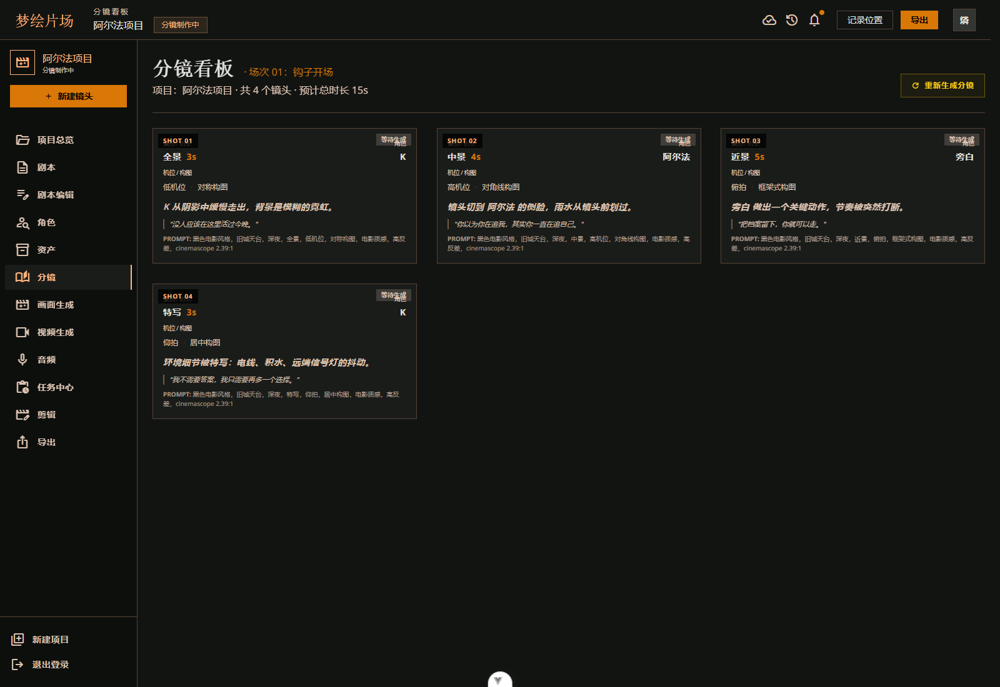

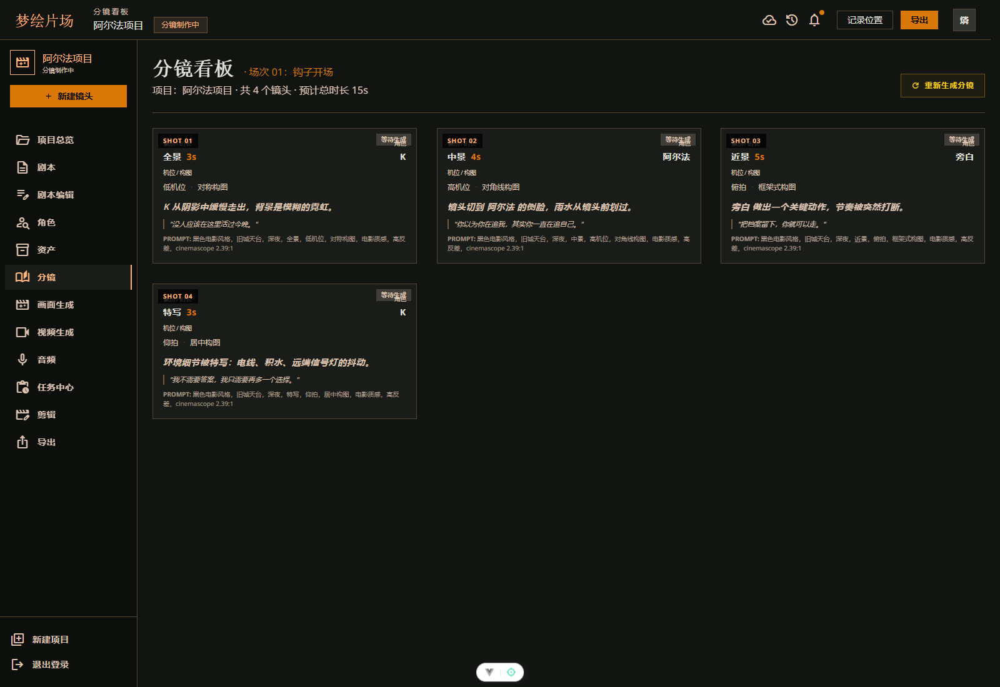

分镜编辑页的重点是“稳定上下文”。用户可能在不同镜头之间切换，也可能在保存时切到另一个分镜。前端通过 URL query 和工作区上下文保存 `projectId / sceneId / storyboardId`，保存前记录当前分镜 ID，避免异步请求返回后覆盖错误镜头。

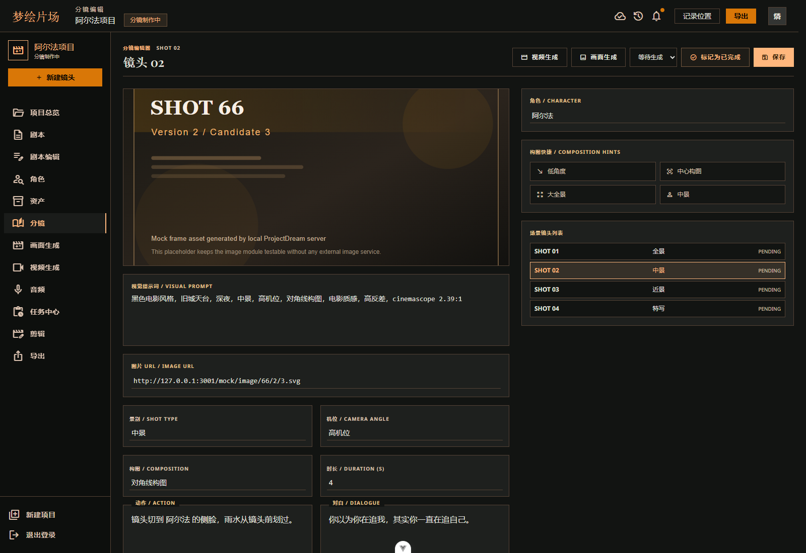

后端主要接口如下：

```text
GET  /api/scenes/:sceneId/storyboards
POST /api/scenes/:sceneId/storyboards/generate
GET  /api/storyboards/:storyboardId
PUT  /api/storyboards/:storyboardId
POST /api/storyboards/reorder
POST /api/storyboards/:storyboardId/frame-prompt/rewrite
POST /api/storyboards/:storyboardId/keyframes/optimize
POST /api/storyboards/:storyboardId/continuity/start-frame
POST /api/storyboards/:storyboardId/split
POST /api/storyboards/:storyboardId/dialogue/split
```

分镜生成流程大致是：

```text
POST /api/scenes/:sceneId/storyboards/generate
  -> authenticate
  -> 校验场景归属
  -> 检查 scene.content 不为空
  -> 读取项目和角色库
  -> aiGenerateStoryboards()
  -> normalizeStoryboardPayload()
  -> 根据角色名匹配 character_id
  -> 写入 storyboards
  -> 更新项目 status
```

这里最重要的字段是 `character_id`。历史文本里的角色名可能会改，但 `character_id` 才是分镜绑定角色的真相源。后续静帧、音频和口型同步都依赖它。

## 四、导演关键帧与分镜拆分

为了让画面生成更稳定，ProjectDream 在分镜编辑页加入了“导演关键帧”。

对于动作镜头，系统会生成两类提示词：

- 起始帧：动作开始前的人物姿态、站位、视线、构图。
- 结束帧：动作完成后的状态、空间位置、情绪变化、动作结果。

这套设计主要服务于两帧模式。比如一个角色从门口走到窗边，单靠一句动作描述很容易让模型理解不稳定；拆成起始帧和结束帧后，静帧和视频生成都有更明确的视觉锚点。


分镜编辑还支持两个拆分能力。

第一类是长动作拆分。系统可以把一条过长动作拆成 2 到 4 个短分镜，让每个镜头的动作更具体，也方便后续控制节奏。

第二类是多人对白拆分。如果一个镜头里有多个角色轮流说话，后续音频生成和口型同步很容易混乱。系统会把它拆成多个单说话人分镜，保证每条对白都能对应到明确角色。

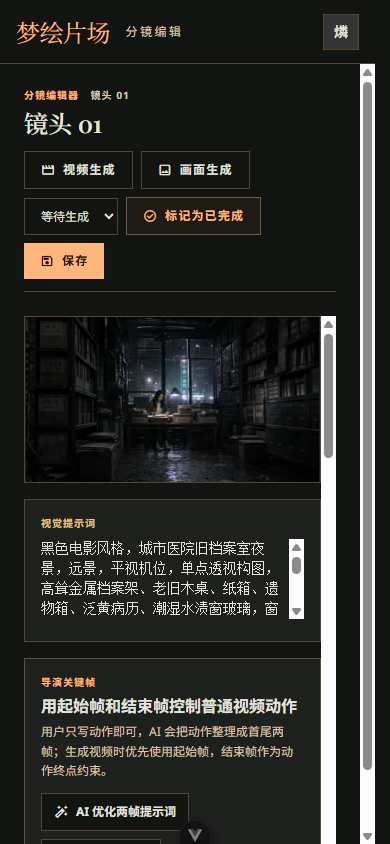

拆分前后端会检查当前分镜是否已经存在图片、视频或音频素材。如果已经有确认结果，默认阻止拆分，避免破坏已生成素材的引用关系。

## 五、静帧生成与候选确认

静帧生成负责把分镜的视觉提示词、角色约束和项目画幅比例转换成候选图片。

它不是直接把提示词发给图片模型，而是在生成前先做角色一致性检查。后端会解析当前分镜里的可见角色，确认这些角色是否已经绑定角色库、是否具备性别和年龄信息、是否有确认过的定妆参考图。

如果检查不通过，系统不会调用图片模型，而是直接返回阻塞原因。

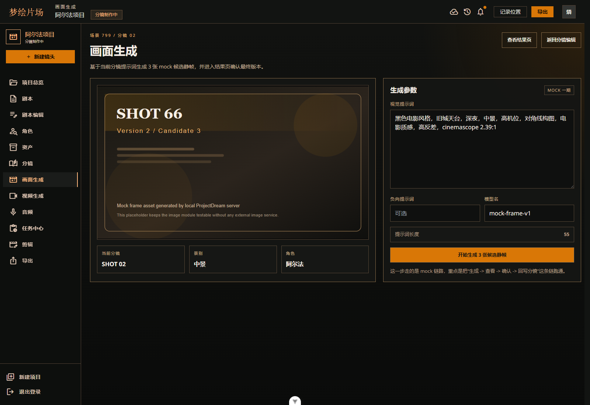

前端页面通过 `selectedFrameRole` 区分三类生成模式：

- `primary`：普通主静帧。
- `start`：动作起始帧。
- `end`：动作结束帧。

这和前面的导演关键帧设计正好对应。普通镜头可以只生成主静帧，动作镜头可以进一步生成起始帧和结束帧，为后面的视频生成提供更稳定的输入。

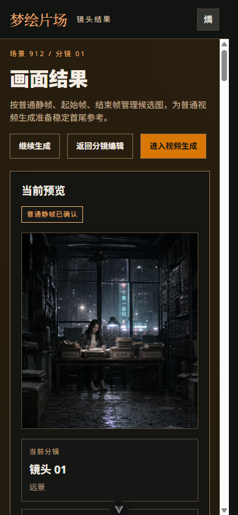

静帧相关接口如下：

```text
POST /api/shots/:storyboardId/images/generate
GET  /api/shots/:storyboardId/images
POST /api/images/:imageId/confirm
GET  /api/generation-jobs/:jobId
```

生成任务流程：

```text
POST /api/shots/:storyboardId/images/generate
  -> authenticate
  -> 查询分镜和项目
  -> resolveFrameCharacterContext()
  -> ready=false 时返回阻塞原因
  -> createGenerationJob(job_type='frame_image')
  -> queueGenerationJob()
  -> 返回 generation job

后台 processFrameGenerationJob()
  -> 读取 request_json
  -> buildFrameConsistencyPrompt()
  -> generateFrameCandidates()
  -> 校验图片比例
  -> 持久化到 .codex-runtime/generated-frames
  -> 写入 image_assets
  -> 更新 generation_jobs
```

生成结果不会直接覆盖分镜，而是进入 `image_assets` 候选列表。用户确认某张图片后，系统才会把它回写到 `storyboards.image_url` 或 `storyboards.end_image_url`。

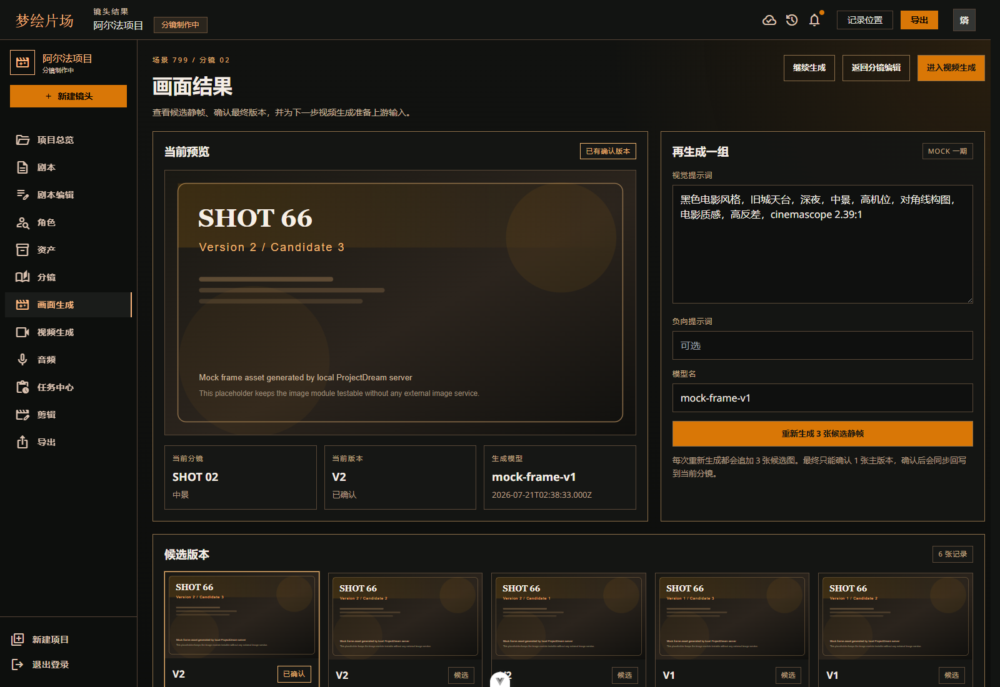

这种“候选 + 确认”的设计很重要。AI 生成结果天然有不确定性，系统不能默认第一张图就是最终资产。用户确认之后，后续视频、口型同步和导出才有稳定输入。

## 六、视频生成与口型同步

视频模块负责把确认后的静帧转换成动态视频。它的前置条件非常明确：必须先有确认静帧。

用户进入视频生成页后，页面会读取当前分镜、确认静帧、视频候选、项目音频和模型设置。用户选择运动模式、时长和模型后提交任务，后端创建 `video_image` 类型的后台任务。

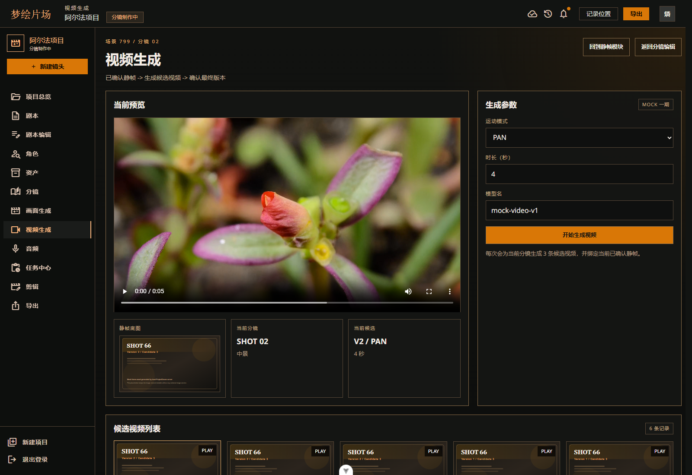

普通视频生成流程如下：

```text
POST /api/storyboards/:storyboardId/videos/generate
  -> authenticate
  -> 校验分镜归属
  -> 查询确认静帧
  -> createGenerationJob(job_type='video_image')
  -> queueGenerationJob()

后台 processVideoGenerationJob()
  -> 读取 confirmed image
  -> resolveVideoImageInput()
  -> rewriteVideoPromptForSafety()
  -> generateVideoCandidates()
  -> 下载并持久化视频到 .codex-runtime/generated-videos
  -> 写入 video_assets
```

视频候选也需要确认。确认时，如果供应商返回的是远程地址，系统会先把视频下载到本地 `generated-videos` 目录，再回写 `storyboards.video_url`，避免临时链接失效影响后续导出。


对于有对白的角色镜头，系统还支持口型同步。口型同步不是视频生成的默认步骤，它需要同时满足这些条件：

- 当前分镜已经绑定角色。
- 当前分镜存在确认静帧或确认视频。
- 当前角色存在确认对白音频。
- 音频角色与分镜角色一致。
- 多人对白已经拆成单说话人分镜。

对应接口：

```text
POST /api/storyboards/:storyboardId/videos/generate
GET  /api/storyboards/:storyboardId/videos
POST /api/storyboards/:storyboardId/lip-sync/generate
POST /api/videos/:videoId/confirm
GET  /api/generation-jobs/:jobId
```

口型同步流程：

```text
POST /api/storyboards/:storyboardId/lip-sync/generate
  -> authenticate
  -> 校验角色、确认静帧和确认对白音频
  -> createGenerationJob(job_type='lip_sync')
  -> queueGenerationJob()

后台 processLipSyncGenerationJob()
  -> 准备视频或静帧输入
  -> 准备对白音频输入
  -> 创建供应商任务
  -> 轮询任务结果
  -> 写入 video_assets(source_type='lip_sync')
```

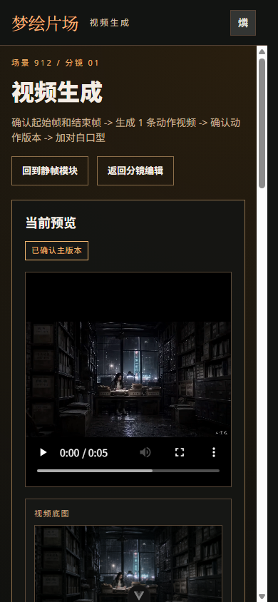

## 七、音频生成与声线绑定

音频模块负责生成对白、旁白等声音素材，并把音频绑定到具体项目、场景、分镜和角色。

这里最容易出问题的是角色声音一致性。如果同一个角色在不同对白里使用不同音色，成片观感会非常割裂。因此 ProjectDream 把声线绑定放在正式对白生成之前。

用户进入音频工作台后，页面会读取项目、场景、分镜、角色、音频素材、声线库和角色声线配置。对白轨必须选择角色和分镜，旁白可以绑定场景或分镜。

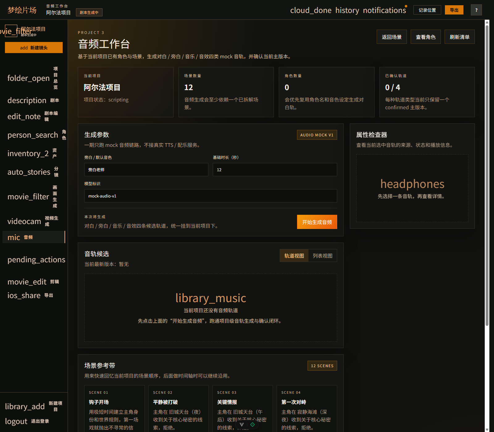

音频生成接口如下：

```text
GET  /api/projects/:projectId/audio
POST /api/projects/:projectId/audio/generate
POST /api/audio-assets/:audioId/confirm
PUT  /api/audio-assets/:audioId
POST /api/audio-assets/:audioId/archive
GET  /api/voice-profiles
GET  /api/projects/:projectId/voice-cast
GET  /api/characters/:characterId/voice-recommendations
PUT  /api/characters/:characterId/voice-binding
```

音频生成流程：

```text
POST /api/projects/:projectId/audio/generate
  -> authenticate
  -> 校验项目归属
  -> 校验 trackType
  -> 校验 scene/storyboard/character 是否属于当前项目
  -> dialogue 必须绑定角色
  -> 读取角色锁定声线
  -> extractSpokenDialogue()
  -> generateAudioCandidates()
  -> 写入 audio_assets
```

声线推荐会读取角色年龄、性别、性格和声音描述，然后匹配 `voice_profiles`。角色确认试听后，系统把 `voice_profile_key` 和 `voice_locked` 写回 `characters`。

正式音频写入 `audio_assets` 时，会保存生成快照：

- `voice_profile_key`
- `voice_name`
- `model_name`
- `voice_instructions`
- `storyboard_id`
- `start_offset_seconds`

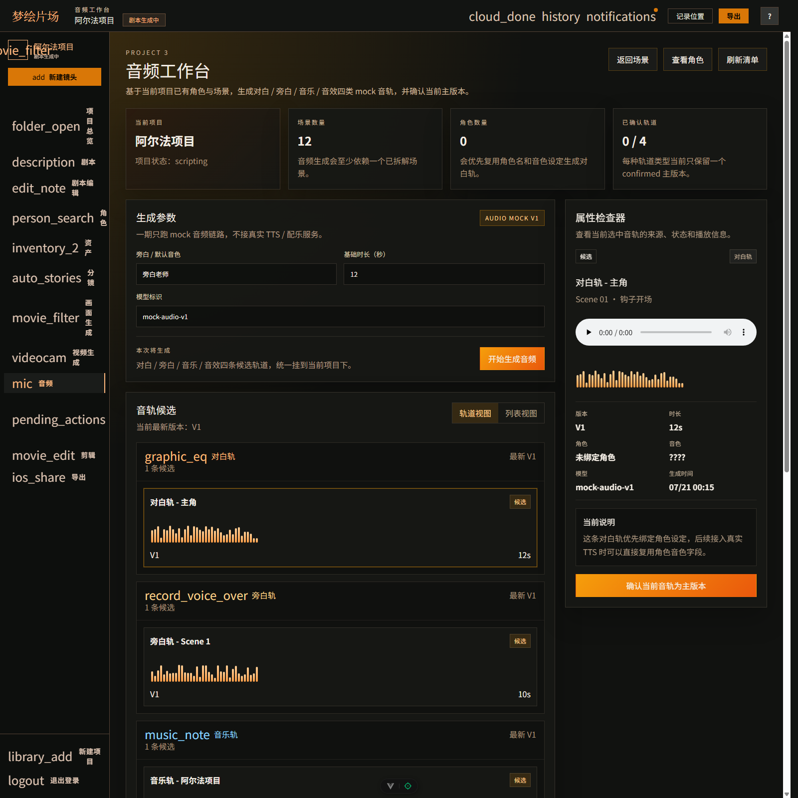

音频定位优先按 `storyboardId` 计算时间线起点。如果没有分镜绑定，再兼容旧数据按 `sceneId` 排布。严格导出模式下，没有绑定分镜的旧音频不会混到片头，避免所有声音从时间线零点同时播放。

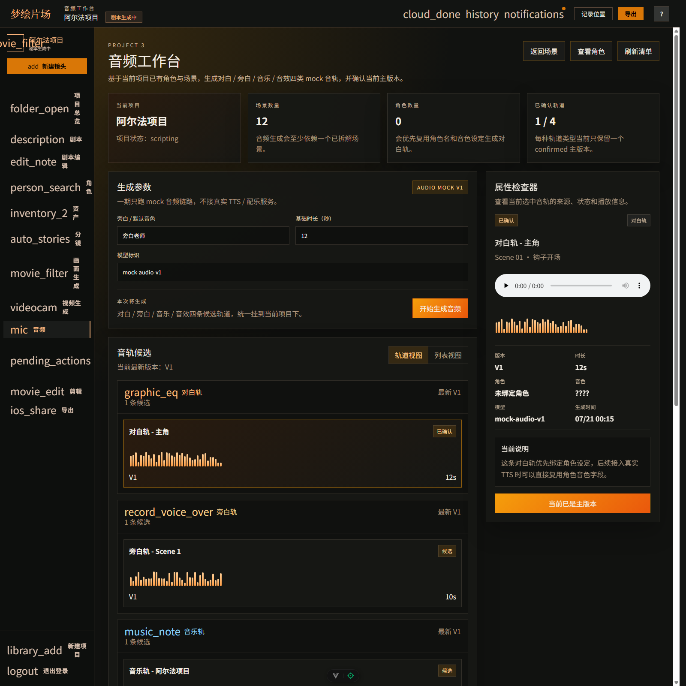

## 八、任务中心与后台生成

图片、视频和口型同步都不是瞬间完成的任务。如果页面一直同步等待，体验会非常差，也不利于失败重试和服务恢复。

ProjectDream 使用 `generation_jobs` 承接生成任务。业务页面只负责提交任务和轮询状态；真正的生成逻辑在后台执行。

后台任务状态包括：

- `queued`
- `running`
- `success`
- `failed`
- `canceled`

常见任务类型包括：

- `frame_image`：分镜静帧。
- `character_image`：角色定妆图。
- `video_image`：图生视频。
- `lip_sync`：口型同步。
- `export`：成片导出。

任务中心会把项目下的图片、视频、音频和导出任务统一汇总，用户可以查看排队、执行、成功、失败、取消和重试状态。

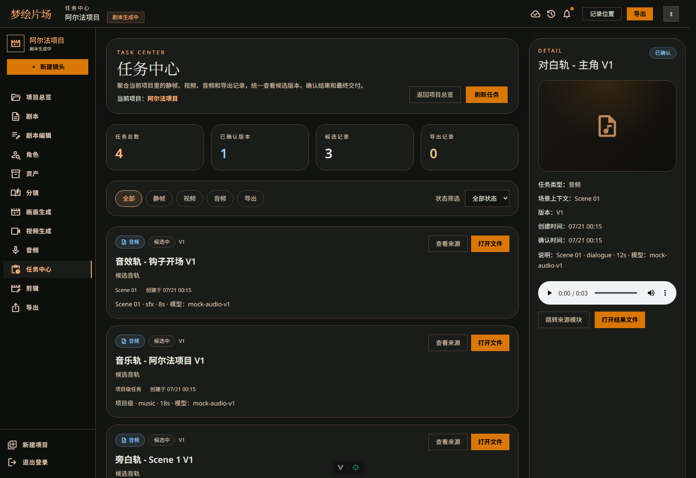

后台任务主流程：

```text
业务页面提交生成
  -> createGenerationJob(status='queued')
  -> queueGenerationJob(jobId)
  -> processGenerationJob()
  -> status queued -> running
  -> 按 job_type 分派：
       frame_image
       character_image
       video_image
       lip_sync
  -> 成功写 result_json
  -> 失败写 error_text
  -> 前端轮询展示进度
```

任务中心相关接口：

```text
GET  /api/generation-jobs/:jobId
GET  /api/projects/:projectId/tasks
POST /api/project-tasks/:taskKey/retry
POST /api/project-tasks/:taskKey/cancel
POST /api/generation-jobs/:jobId/retry
POST /api/generation-jobs/:jobId/cancel
```

服务重启后，`recoverGenerationJobs()` 和 `resumeQueuedGenerationJobs()` 会尝试恢复未完成任务。供应商错误会通过 `sanitizeProviderError()` 处理后展示，避免把敏感信息直接暴露给前端。

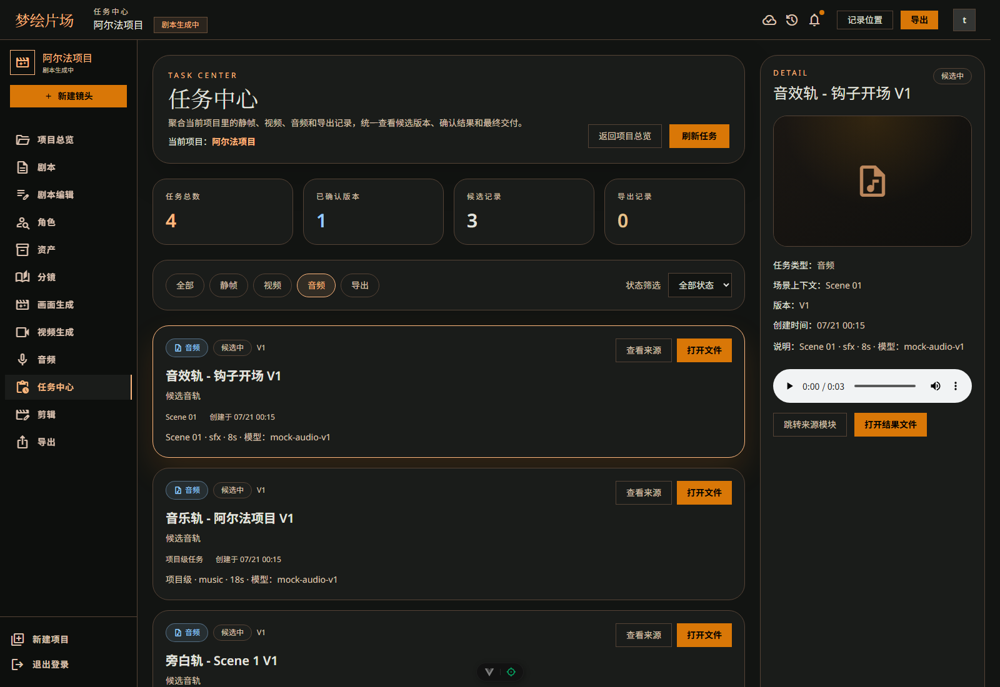

## 九、核心数据表

这条链路涉及的核心表如下：

| 数据表 | 作用 |
|---|---|
| `storyboards` | 保存分镜文本、角色绑定、视觉提示词、确认图片和确认视频 |
| `image_assets` | 保存静帧候选、确认状态、角色快照、模型快照 |
| `video_assets` | 保存视频候选、确认状态、运动模式、口型同步来源 |
| `audio_assets` | 保存对白、旁白、角色声线、分镜定位和音频文件 |
| `voice_profiles` | 保存系统可用声线方案 |
| `characters` | 保存角色档案、定妆图、声线锁定状态 |
| `generation_jobs` | 保存后台生成任务状态、结果和错误 |
| `task_runtime_states` | 保存任务中心运行态信息 |

几个关键字段关系如下：

```text
storyboards.id
  -> image_assets.storyboard_id
  -> video_assets.storyboard_id
  -> audio_assets.storyboard_id

storyboards.character_id
  -> characters.id
  -> characters.voice_profile_key
  -> audio_assets.voice_profile_key
```

其中 `storyboards.character_id` 和 `audio_assets.storyboard_id` 是两个非常关键的锚点。

前者保证镜头里的角色不会和角色库脱节，后者保证声音能落到正确的时间线位置。

## 十、异常处理

这一组模块的异常处理主要围绕“不要生成错误资产”展开。

分镜层：

- 空剧本禁止生成分镜。
- 分镜绑定角色时，角色必须属于当前项目。
- 已经存在素材的分镜默认禁止拆分。
- 多人对白拆分失败时返回明确提示。

静帧层：

- 可见角色没有绑定角色库，阻止生成。
- 可见角色缺少性别或年龄，阻止生成。
- 可见角色没有确认参考图，阻止生成。
- 供应商返回图片比例不符合项目画幅，拒绝入库。

视频层：

- 没有确认静帧，禁止生成视频。
- 没有角色绑定或确认音频，禁止口型同步。
- 音频角色和分镜角色不一致，阻止或提示。
- 远程视频确认时会尝试本地化，失败则返回错误。

音频层：

- 对白没有角色，阻止生成。
- 真实音频 provider 下没有文本，阻止生成。
- 对白角色未锁定声线，提示先完成声线绑定。
- 音频绑定的分镜不属于当前项目，拒绝保存。
- 已确认音频禁止归档，避免破坏导出链路。

这些限制看起来比较严格，但对于生成式系统很有必要。越靠后的素材生成成本越高，越应该在前置节点把错误拦住。

## 十一、真实 AI 接入情况

当前 ProjectDream 已经接入并验证过多类真实模型：

| 类型 | Provider | 状态 |
|---|---|---|
| 文本 | OpenAI-compatible | 用于总纲、剧本、分镜等文本生成 |
| 图片 | Agnes | 用于角色定妆图和分镜静帧 |
| 视频 | Agnes / 智谱兼容链路 | 用于图生视频与任务轮询 |
| 音频 | DashScope | 用于中文 TTS 和角色声线试听 |

真实接入后，系统里几个工程点变得很关键：

- 图片生成提交后立即返回任务 ID，避免同步等待 1 到 3 分钟。
- 静帧结果读取真实图片尺寸，并按项目画幅校验。
- 视频任务创建需要限流，避免触发供应商限制。
- 远程视频结果要落到本地稳定地址。
- 音频资产要保存声线快照，避免角色声线后续变化影响历史结果。
- 生成失败要保存供应商、模型和错误信息，方便任务中心重试。

这也是项目从 Demo 走向生产工具时必须补齐的一层。

## 十二、总结

ProjectDream 的分镜、静帧、视频和音频模块，本质上是在做一条“可确认的 AI 素材生产线”。

分镜负责把剧本拆成可执行镜头；静帧负责把镜头变成可选画面；视频负责把确认画面变成动态素材；音频负责把对白和旁白绑定到角色与分镜；任务中心负责把这些长耗时任务管理起来。

这条链路跑通之后，项目就不再只是一个文本生成工具，而是具备了从故事到可播素材的完整闭环。后续的成片编辑和导出模块，正是建立在这套素材链路之上。
