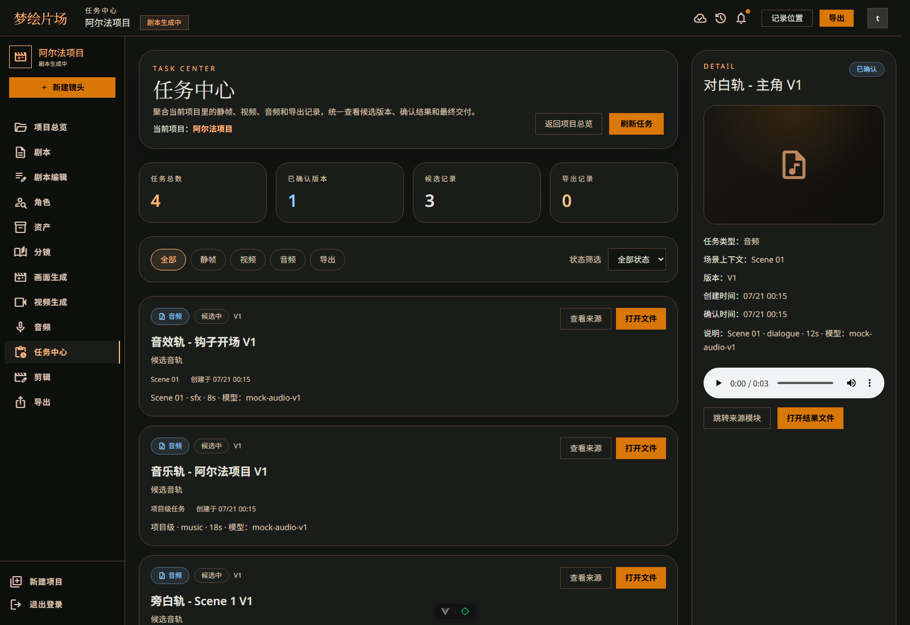
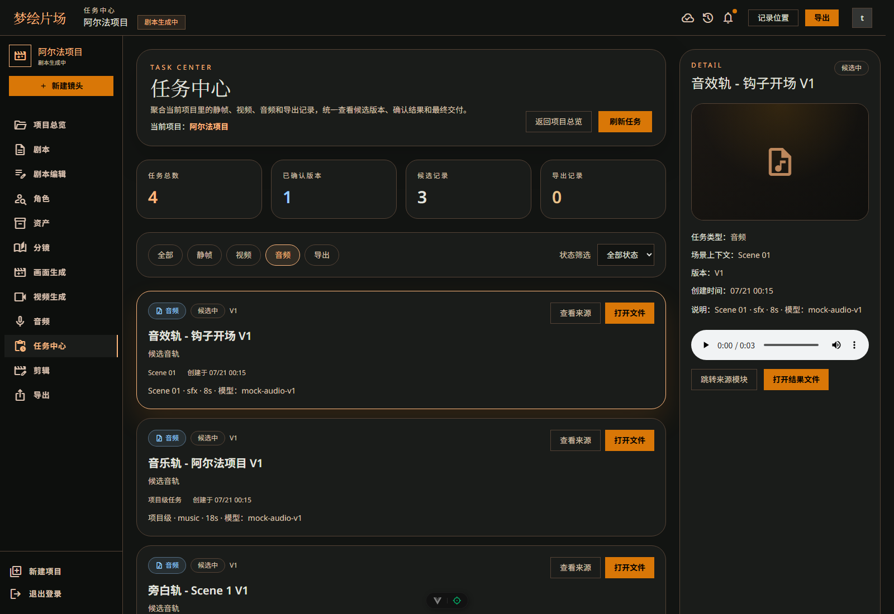
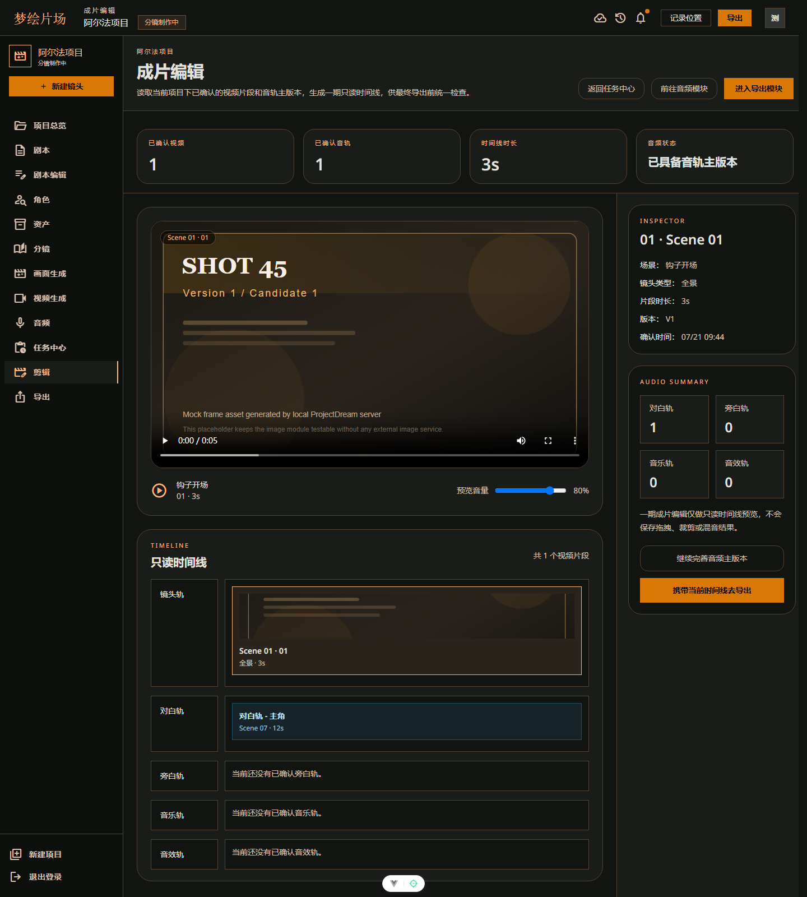
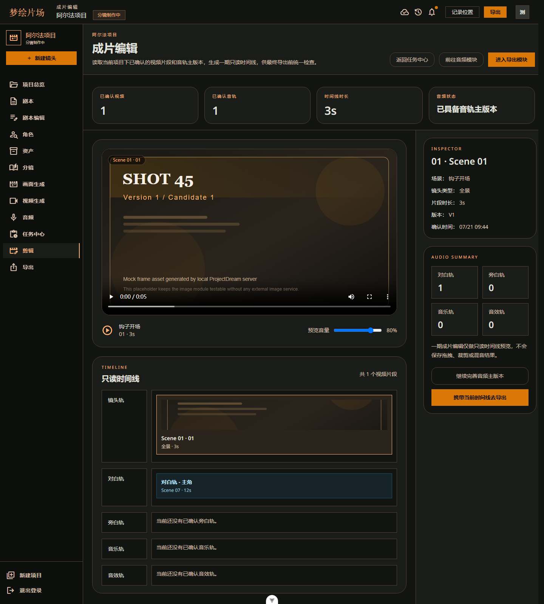
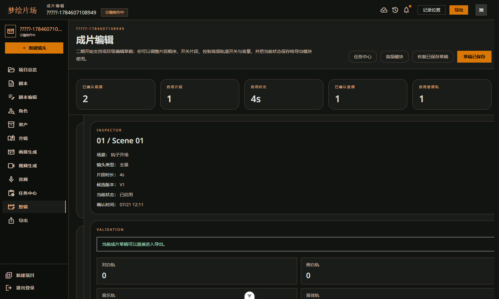
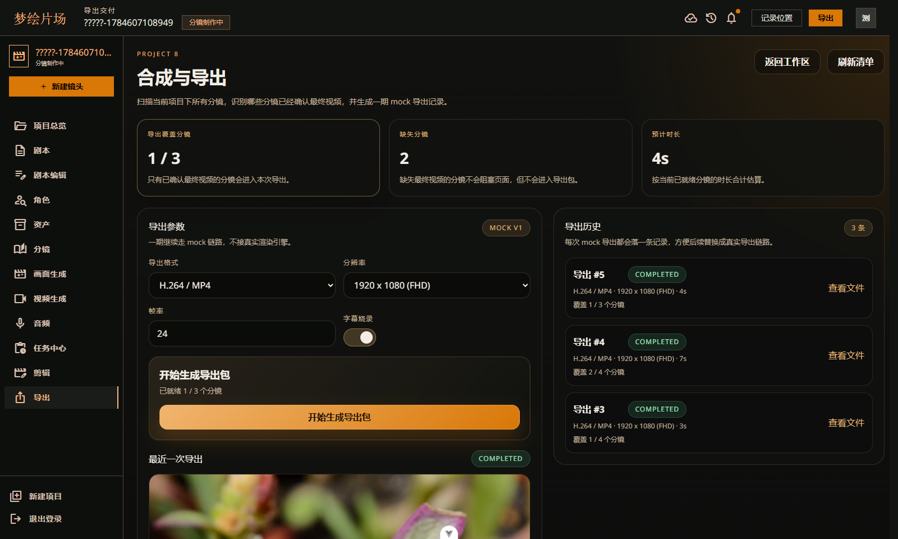
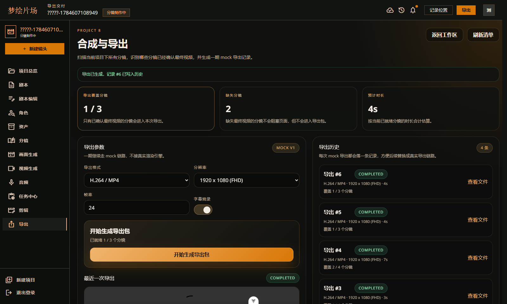
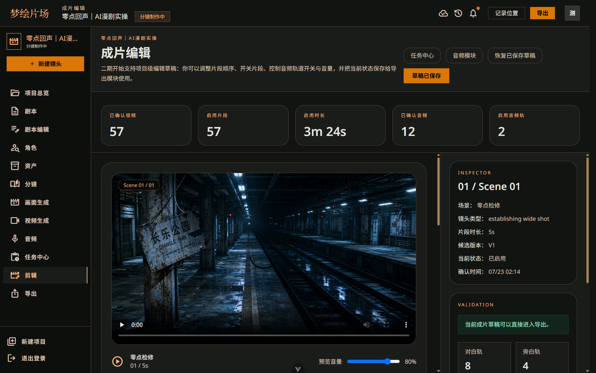
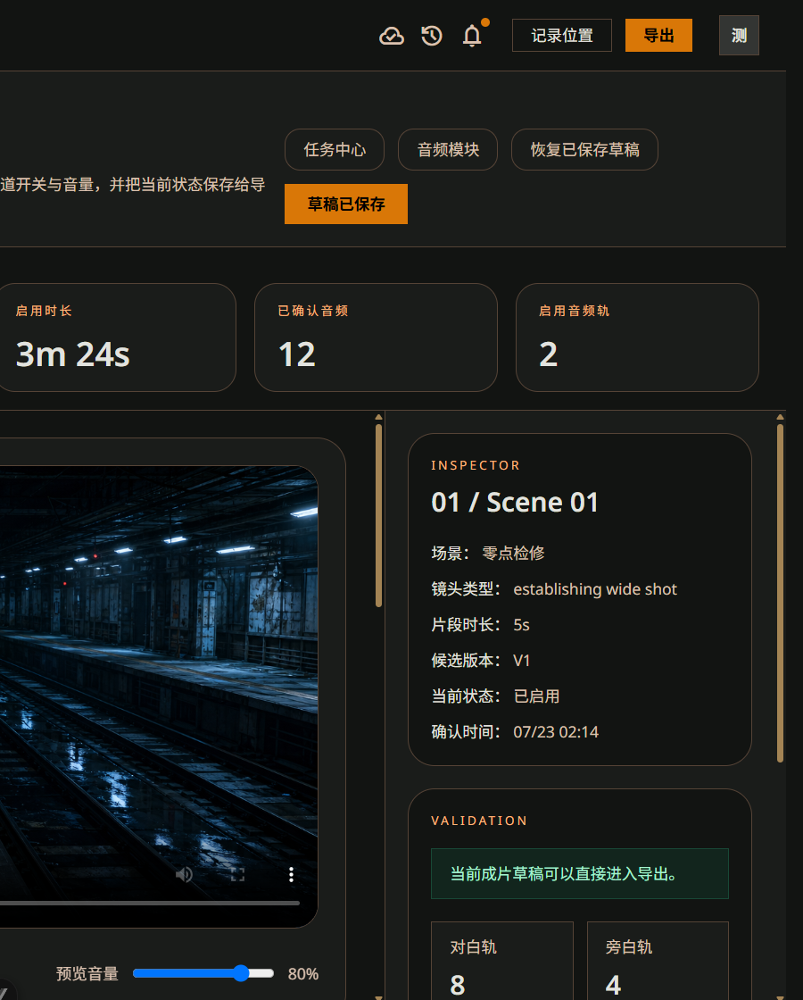

# ProjectDream 的最后一公里：任务中心、成片编辑与 FFmpeg 导出

> 本文记录 ProjectDream 中“任务中心、成片编辑、合成导出”三个收尾模块的实现。它们负责把前面生成的图片、视频、音频素材组织成时间线，并最终合成为可播放、可下载的 MP4 文件。

## 一、前言

前面的几篇文章已经完成了 ProjectDream 的主生产链路：项目、剧本、角色、分镜、静帧、视频和音频。

但一个 AI 漫剧项目不能只停留在“生成了一堆素材”。真正能交付给用户的，必须是一条完整成片：镜头顺序正确，音频落点准确，字幕能正常显示，导出文件能播放和下载。

所以这一篇讲项目的最后一公里：

- 任务中心：管理图片、视频、口型同步和导出等长耗时任务。
- 成片编辑：把确认素材组织成可编辑时间线。
- 合成导出：用 FFmpeg 合成最终 MP4。

这三个模块决定了系统是一个“生成素材的 Demo”，还是一个真正能走完生产闭环的工具。

## 二、整体流程

收尾链路可以概括为：

```text
素材生成任务
  -> 任务中心追踪状态
  -> 确认视频 / 静帧 / 音频
  -> 成片编辑构建时间线
  -> 保存剪辑草稿
  -> 导出前完整性校验
  -> FFmpeg 合成 MP4
  -> 导出历史预览和下载
```

这条链路中有两个关键点。

第一，AI 生成是长耗时任务。图片、视频、口型同步和导出都不能让用户在页面上同步等待，所以系统需要任务状态、失败重试和恢复机制。

第二，素材必须进入时间线。视频不能只是一个文件地址，音频也不能只是一个 WAV 地址，它们必须知道自己属于哪个分镜、从第几秒开始播放、是否参与最终导出。

## 三、任务中心：长耗时任务管理

任务中心负责展示项目下所有 AI 生成任务的运行状态，包括静帧、角色图、图生视频、口型同步和导出。

用户在静帧、视频、口型同步或导出页面提交任务后，后端会先创建任务记录，再放入后台执行队列。页面只需要轮询任务状态，不必同步等待供应商返回。



任务状态主要包括：

- `queued`：已排队。
- `running`：执行中。
- `success`：执行成功。
- `failed`：执行失败。
- `canceled`：已取消。

常见任务类型包括：

- `frame_image`：分镜静帧。
- `character_image`：角色定妆图。
- `video_image`：图生视频。
- `lip_sync`：口型同步。
- `export`：成片导出。

前端相关页面：

```text
src/views/AITaskCenter.vue
src/views/FrameGenerate.vue
src/views/FrameResult.vue
src/views/VideoGenerate.vue
src/views/Export.vue
```

相关 API：

```text
getGenerationJob(jobId)
getProjectTasks(projectId)
retryProjectTask(taskKey)
cancelProjectTask(taskKey)
```

后端接口如下：

```text
GET  /api/generation-jobs/:jobId
GET  /api/projects/:projectId/tasks
POST /api/project-tasks/:taskKey/retry
POST /api/project-tasks/:taskKey/cancel
POST /api/generation-jobs/:jobId/retry
POST /api/generation-jobs/:jobId/cancel
```

后台任务执行流程：

```text
业务页面提交生成
  -> createGenerationJob(status='queued')
  -> queueGenerationJob(jobId)
  -> processGenerationJob()
  -> status queued -> running
  -> 按 job_type 分派：
       frame_image
       character_image
       video_image
       lip_sync
       export
  -> 成功写 result_json
  -> 失败写 error_text
  -> 前端轮询展示进度
```

任务中心汇总时，不只查询 `generation_jobs`，还会结合素材表和运行态表，生成项目级任务列表。

```text
GET /api/projects/:projectId/tasks
  -> authenticate
  -> 校验项目归属
  -> 查询图片、视频、音频、导出等素材
  -> 查询 task_runtime_states / generation_jobs
  -> 合并成统一任务项
  -> 返回 summary + items
```


任务中心的价值不只是展示进度。它还解决了几个真实项目里很容易遇到的问题：

- 页面刷新后仍然能追踪任务。
- 失败任务可以查看错误并重试。
- 服务重启后可以恢复 queued/running 任务。
- 供应商报错会经过脱敏处理，避免泄漏敏感信息。
- 用户可以在生成任务提交后离开页面，再统一回到任务中心查看结果。



## 四、成片编辑：把素材组织成时间线

成片编辑模块负责把已确认的视频、静帧和音频组织成最终剪辑草稿。

前面的模块已经生成了很多资产，但这些资产还不能直接导出。系统必须知道：

- 哪些镜头参与成片。
- 镜头按什么顺序排列。
- 每个镜头从第几秒开始，到第几秒结束。
- 没有视频时是否允许用确认静帧兜底。
- 哪些音频轨启用。
- 对白和旁白应该从时间线哪个位置进入。



前端页面：

```text
src/views/FinalEdit.vue
```

相关 API：

```text
getProject(projectId)
getProjectFinalEdit(projectId)
updateProjectFinalEditDraft(projectId, payload)
```

页面核心状态包括：

- `finalEdit`：后端返回的完整成片数据。
- `editableVideoClips`：可编辑视频轨。
- `audioMixState`：音频混音配置。
- `lastSavedSignature`：判断是否存在未保存改动。
- `localValidation`：前端本地校验结果。

用户调整镜头顺序、启用状态和音频轨音量后，前端会构造草稿并保存：

```text
videoClips + audioMix
```

后端接口：

```text
GET /api/projects/:projectId/final-edit
PUT /api/projects/:projectId/final-edit-draft
```

读取流程：

```text
GET /api/projects/:projectId/final-edit
  -> authenticate
  -> 校验项目归属
  -> 查询分镜、确认视频、确认图片、确认音频
  -> fetchFinalEditDraft()
  -> normalizeFinalEditDraft()
  -> buildMediaTimeline()
  -> buildFinalEditValidation()
  -> 返回时间线和音频轨
```

保存流程：

```text
PUT /api/projects/:projectId/final-edit-draft
  -> authenticate
  -> 校验项目归属
  -> 接收 videoClips + audioMix
  -> normalizeFinalEditDraft()
  -> upsert final_edit_drafts
  -> 返回最新 FinalEditDTO
```



## 五、时间线算法

成片编辑里最核心的不是页面拖拽，而是时间线计算。

核心文件：

```text
server/services/media-timeline.mjs
```

关键函数：

```text
buildMediaTimeline(clips)
resolveMediaStartSeconds(item, timeline)
hasStoryboardTimelineEntry(item, timeline)
resolveRequiredSpeechDuration(item)
buildLegacySceneAudioOffsets(audioItems, timeline)
buildAtempoFilter(sourceDurationSeconds, targetDurationSeconds)
```

视频时间线的计算逻辑比较直接：

```text
遍历启用的视频片段
  -> 每条片段取 durationSeconds
  -> 累加 cursor
  -> 得到 startSeconds / endSeconds
  -> 建立 byStoryboardId 和 bySceneId 索引
```

音频定位则更复杂。系统优先按 `storyboardId` 找到对应镜头的起点，再叠加 `startOffsetSeconds`。如果没有分镜绑定，才兼容旧的 `sceneId` 级音频。

```text
音频定位
  -> 优先通过 storyboardId 找镜头起点
  -> 加上 startOffsetSeconds
  -> 没有 storyboardId 时兼容旧 scene 级音频
```

这个设计解决了一个很实际的问题：如果所有音频都从时间线 0 秒开始混音，成片开头会混入后面场景的对白或测试音。严格导出模式下，未绑定分镜的旧音频不会随便混到片头。




## 六、合成导出：从草稿到 MP4

导出模块负责把成片编辑草稿中的视频片段、静帧、对白、旁白和字幕合成为最终 MP4。

它不是简单返回某个视频地址，而是要完成完整的合成流程：

- 读取导出包。
- 校验素材完整性。
- 下载或定位视频、图片和音频文件。
- 生成字幕。
- 转码视频片段。
- 混合对白、旁白和背景音乐。
- 可选烧录字幕。
- 输出 H.264/AAC MP4。
- 写入导出记录。



前端页面：

```text
src/views/Export.vue
```

相关 API：

```text
getProjectExportPackage(projectId)
listProjectExports(projectId)
createProjectExport(projectId, payload)
getExport(exportId)
```

后端接口：

```text
GET  /api/projects/:projectId/export-package
GET  /api/projects/:projectId/exports
POST /api/projects/:projectId/exports
GET  /api/exports/:exportId
GET  /generated/export/:exportId/...
```

导出包预览流程：

```text
GET /api/projects/:projectId/export-package
  -> authenticate
  -> 校验项目归属
  -> 查询分镜、确认视频、确认图片、确认音频
  -> 读取 final_edit_drafts
  -> buildMediaCompleteness()
  -> 返回 ready/missing/canExport
```

创建导出流程：

```text
POST /api/projects/:projectId/exports
  -> authenticate
  -> 校验项目归属
  -> buildExportPackage()
  -> buildProjectFinalEdit()
  -> 校验 canExport
  -> 写入 export_records(status='queued' 或 running)
  -> queueExportJob(exportId)
  -> 返回导出记录
```

后台导出流程：

```text
processExportJob(exportId)
  -> 读取导出记录和项目
  -> 读取成片草稿
  -> 选择真实视频或静态帧兜底
  -> 下载/定位素材文件
  -> 生成字幕 SRT
  -> FFmpeg 转码视频片段
  -> 混合对白、旁白等音频轨
  -> 可选烧录字幕
  -> 输出 MP4 到 .codex-runtime/exports
  -> 更新 export_records completed/failed
```


导出完成后，用户可以在导出历史里查看记录、预览成片或下载文件。



## 七、导出完整性校验

导出前必须先做完整性校验。否则用户很可能导出一个缺镜头、缺声音、缺字幕的半成品。

核心文件：

```text
server/services/export-validation.mjs
```

主要校验规则：

- 没有分镜，不能导出。
- 场景缺分镜，不能导出。
- 分镜缺确认视频，通常不能导出。
- 成片草稿中禁用的镜头不参与严格音频导出。
- 没有可用视频或静帧片段，不能导出。
- FFmpeg 不可用时，导出失败并记录错误。
- 远程素材下载失败时，导出失败。

导出就绪状态不能只看 `storyboards.video_url`。这个字段适合展示，但不是最终确认状态的唯一依据。更稳定的判断方式是关联 `video_assets.status = 'confirmed'` 的确认视频资产。

因此导出包会优先根据确认视频资产判断镜头是否 ready。这样即使后续支持撤销确认、数据修复或历史回放，导出状态也不会和真实资产状态漂移。

## 八、字幕与音频混合

字幕来自实际对白文本，导出时会去掉说话人、表演提示和无声占位，避免画面上出现类似“角色名：”“无对白”这样的冗余内容。

音频混合依赖前面的时间线结果：

- 有 `storyboardId` 的音频按分镜起点放置。
- 有 `startOffsetSeconds` 的音频继续叠加偏移。
- 旧的场景级音频只在兼容模式下顺序排布。
- 过长音频可以通过 FFmpeg `atempo` 做适度变速。

实际导出时，系统会把对白、旁白、背景音乐等音轨交给 FFmpeg 混合。导出文件使用 H.264/AAC 编码，输出到：

```text
.codex-runtime/exports
```

生成文件通过下面的地址对外提供：

```text
/generated/export/:exportId
```

并支持 Range 播放和下载。

## 九、混合成片落地记录

ProjectDream 后续实现了混合成片策略：不是所有镜头都强制使用真实视频，而是把关键镜头交给视频模型，其余镜头使用动态静帧兜底。

这样做有两个好处：

- 降低全片视频生成成本。
- 避免长项目因为大量视频任务变得不可控。

当前混合导出链路支持：

- 每个镜头先下载到 `.codex-runtime/exports/<exportId>/sources`。
- 真实视频和动态静帧混合进入时间线。
- 静帧可统一画布、轻微推近、按指定帧率转为视频片段。
- FFmpeg 合并镜头、对白、旁白、背景音乐和字幕。
- 输出 H.264/AAC MP4。



一次发布候选记录中，项目导出结果如下：

| 指标 | 结果 |
|---|---|
| 项目 | `零点回声｜AI漫剧实操` |
| 时长 | `54.36s` |
| 分辨率 | `1920 x 1080` |
| 帧率 | `25fps` |
| 视频编码 | `H.264/AAC` |
| 镜头数量 | `12` |
| 真实视频 | `11` 条 |
| 动态静帧 | `1` 条 |
| 口型同步 | `6` 条正面对白镜头 |
| 音频 | `9` 条分镜级中文对白 |

导出时，旧场景级音频和禁用镜头音频会被严格规则跳过，避免片头混入旧对白或测试声音。



导出文件中的实际画面和烧录字幕：


## 十、核心数据表

这一组模块涉及的数据表如下：

| 数据表 | 作用 |
|---|---|
| `generation_jobs` | 保存 AI 生成任务状态、结果和错误 |
| `task_runtime_states` | 保存任务中心运行态信息 |
| `final_edit_drafts` | 保存项目成片编辑草稿 |
| `export_records` | 保存导出记录、输出地址和导出状态 |
| `storyboards` | 提供分镜、时长和镜头顺序 |
| `video_assets` | 提供确认视频资产 |
| `image_assets` | 提供静帧兜底资产 |
| `audio_assets` | 提供对白、旁白和分镜级音频 |

几个关键字段：

```text
final_edit_drafts.project_id
final_edit_drafts.draft_json

export_records.status
export_records.video_url
export_records.cover_url
export_records.duration_seconds
export_records.config_json
export_records.source_count
export_records.ready_count
export_records.missing_count

video_assets.status = confirmed
audio_assets.status = confirmed
audio_assets.storyboard_id
audio_assets.start_offset_seconds
```

这里最关键的是 `final_edit_drafts.draft_json`。它保存了用户调整后的镜头顺序、启用状态和音频混音配置。导出模块最终不是按数据库默认顺序合成，而是读取这份草稿。

## 十一、异常处理

任务中心异常：

- 任务已成功不能重复执行。
- 失败或取消任务可以重试。
- 任务不属于当前用户，直接拒绝。
- 服务重启后尝试恢复未完成任务。
- 供应商错误脱敏后再展示。

成片编辑异常：

- 没有确认视频时，可使用确认静帧作为静态兜底。
- 用户禁用了全部镜头，校验失败。
- 音频轨全部关闭，页面提示但不一定阻塞。
- 草稿引用已删除分镜，规范化时过滤。
- 音频明显长于镜头时，导出阶段做适度变速。

导出异常：

- 素材不完整，阻止导出。
- FFmpeg 不可用，导出失败。
- 远程素材下载失败，导出失败。
- 没有可用视频或静帧片段，导出失败。
- 导出任务失败后写入 `export_records.status = failed`，页面展示错误。

这些异常处理保证了一个原则：宁愿阻止导出，也不要输出一个看似成功但内容错误的成片。

## 十二、总结

任务中心、成片编辑和导出模块，是 ProjectDream 从“生成素材”走向“交付成片”的关键部分。

任务中心让长耗时 AI 生成可追踪、可恢复、可重试；成片编辑把确认素材组织成清晰的时间线；导出模块再把视频、静帧、音频和字幕交给 FFmpeg 合成为最终 MP4。

做到这一步后，ProjectDream 的核心闭环已经打通：从项目创建、故事生成、角色一致性，到分镜、静帧、视频、音频，再到时间线编辑和成片导出，整个 AI 漫剧生产流程可以完整跑完。
