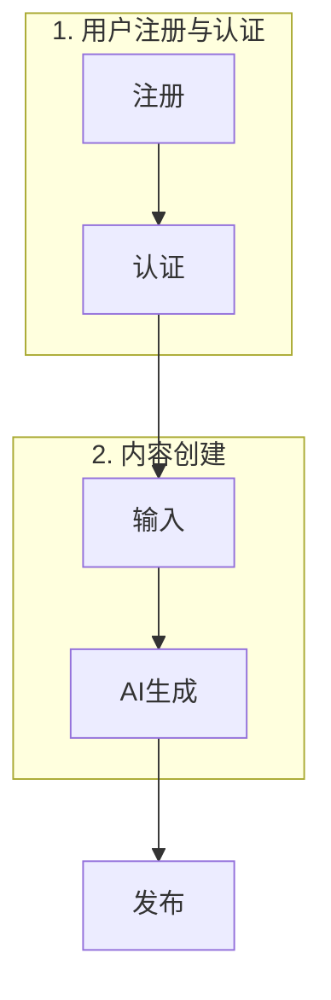
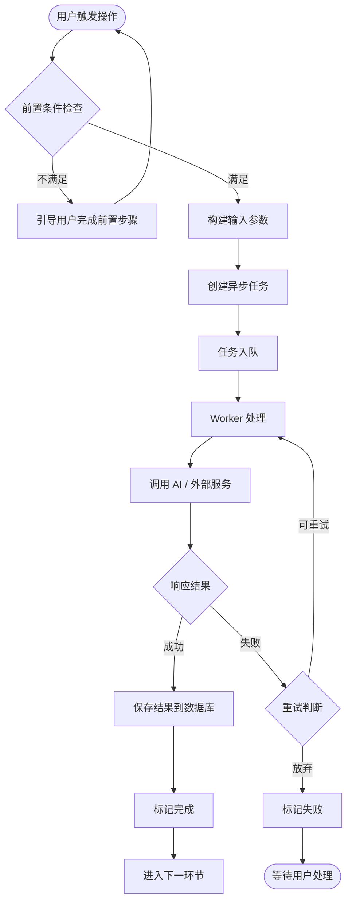

# PRD 审核与功能细化拆解 —— 通用提示词模板

> **用途**：将任意项目的 PRD 文档转化为一份结构完整、内容详实、可直接指导研发的「功能细化拆解文档」。
> **适用场景**：任何拥有 PRD 的软件项目，尤其是涉及多环节流水线、AI 模型集成、前后端协作的系统。
> **使用方法**：将下方模板中 `{...}` 占位符替换为当前项目的具体信息，粘贴给 WorkBuddy 即可。

---

## 使用方法（快速上手）

1. 打开你的 PRD 文档，找到以下关键信息：
   - 项目名称
   - 核心闭环流程（有几个环节、各环节叫什么）
   - 当前项目代码所在的根目录路径
2. 把模板里的 `{占位符}` 全部替换为真实值。
3. 把替换后的完整提示词发给 WorkBuddy。
4. WorkBuddy 会自动：读 PRD → 审查现有代码 → 生成文档 → 保存到指定目录。

---

## 提示词模板

```text
请对提供的 PRD 文档内容进行全面、细致的审核与深入理解。

{可选：在此处补充项目背景描述，帮助 WorkBuddy 更好理解上下文。例如：
"这是一个面向企业客户的 SaaS 数据看板平台，核心价值在于将多源异构数据聚合为可视化仪表盘。"}

基于文档中关于「{项目名称}」的核心闭环流程（{用→连接各环节，例如：数据接入→数据清洗→指标计算→可视化配置→看板发布}），整理出一套结构完整、内容详实的功能细化拆解文档。

该文档需包含以下关键要素：

## 一、技术栈选型说明

### 1.1 前端技术栈
- 明确前端框架（React / Vue / Angular 等）、构建工具、类型系统、状态管理、路由、CSS 方案、UI 组件库等。
- 用表格列出「技术组件 | 选型 | 版本 | 选型理由」。
- **如果已有项目代码**：必须审查现有代码实际使用的技术栈，对比 PRD 中的建议，给出差异分析。若 PRD 建议与现有实现冲突，必须给出明确的「保留现有」或「迁移」建议及理由。
- 输出前端页面与 PRD 功能模块的映射表（已有实现 vs 待开发）。

### 1.2 后端服务架构
- 明确后端运行时（Node.js / Python / Go / Java 等）、HTTP 框架、API 校验、日志等。
- **如果已有项目代码**：审查现有服务架构（单体/微服务/Serverless），给出推荐演进方案而非推翻重做。
- 输出服务模块拆分方案（目录结构图）。

### 1.3 AI 模型选型矩阵（如果项目涉及 AI）
- 按模型类别（LLM / 图像生成 / 视频生成 / 语音合成 / 其他）分别列出。
- 每个模型包含：名称、提供商、上下文窗口/分辨率、适用场景、选型理由。
- 说明模型调用策略（主力/备选/增强的路由规则）。
- **如果没有 AI 环节**：此节可省略或用「第三方服务集成」替代。

### 1.4 数据库方案
- 主数据库选型（MySQL / PostgreSQL / MongoDB 等）及选型理由。
- 缓存方案（Redis / Memcached 等）。
- **如果已有项目代码**：列出已有表结构，标注哪些需保留、哪些需扩展。

### 1.5 存储方案
- 对象存储 / 文件存储 / CDN 方案。
- 存储路径规范（目录结构）。

### 1.6 部署与运维方案
- 容器化方案（Docker / K8s）。
- CI/CD 流水线建议。
- 监控与日志。

## 二、核心环节业务流程图

### 要求
- 使用 Mermaid 语法标准化绘制。
- 覆盖从用户输入到最终输出的完整数据流转路径。
- 每个核心环节一张独立流程图，外加一张全链路总览图。
- 流程图节点必须包含：用户操作、系统判断、AI 调用、数据库写入、状态变更。
- 用不同颜色标记「起点」「终点」「失败节点」。

### 环节划分原则
- 按 PRD 中定义的核心闭环流程来划分子流程。
- 如果 PRD 有 5 个环节，就画 6 张图（5 张子流程 + 1 张总览）。
- 如果某个环节特别复杂（含多个子步骤），可单独拆成多张图。

---

### 流程图通用结构示例（以「用户注册→内容生成→发布」为例）

#### 总览图


#### 环节 N 详细流程图（这是关键——展开画到操作级）


## 三、全链路任务编排方案

### 3.1 任务状态机
- 用 Mermaid 状态图绘制通用任务状态流转（queued → scheduled → processing → completed / failed / cancelled）。
- 按任务类型列出「预估耗时 / 最大重试次数 / 超时时间 / 优先级」配置表。

### 3.2 数据流转机制
- 用表格列出环节间的输入输出映射：上游输出什么字段 → 下游消费哪些字段。
- 用 Mermaid 流程图画出数据对象在各环节的传递关系。

### 3.3 RESTful API 接口定义
- 统一响应格式 `{ code, message, data }`。
- 错误码规范表（按类别分段：参数类 1xxx、认证类 2xxx、AI 调用类 3xxx、系统类 9xxx）。
- **按业务模块**逐一列出接口：
  - 每个接口包含：方法 + 路径、Request Body（JSON）、Response Body（JSON）。
  - 异步操作（AI 生成等）返回 `{ taskId, status }`，需配套状态查询接口。
- **如果已有项目代码**：已有接口只标注「已实现」，重点列出需新增的接口。

### 3.4 异常处理与重试策略
- 按层级（客户端 / API 网关 / 任务调度 / 数据持久化）列出异常分类和处理策略。
- 用表格列出：异常类型 → 触发场景 → 处理策略 → 用户感知。
- AI / 外部服务调用的重试配置（指数退避参数、熔断器阈值）。
- 用 Mermaid 状态图画出熔断器模式。

### 3.5 数据库扩展方案
- **如果已有代码**：列出需新增的表，给出完整 DDL（CREATE TABLE 语句，含注释）。
- 已有表需扩展的字段用 ALTER TABLE 语句给出。
- **如果是新项目**：列出全部核心表的 DDL。

---

## 输出要求

1. 以 `*.md` 格式保存到 `{目标目录名}` 目录中。
2. 文档开头包含：版本号、编制日期、对应 PRD 名称、适用对象。
3. 包含完整的目录（锚点链接）。
4. 所有流程图使用 Mermaid 语法，确保可在 Markdown 渲染器中正常显示。
5. 所有接口定义包含完整的 Request / Response JSON 示例。
6. 技术选型表每项必须包含「选型理由」列。
7. 数据库 DDL 语句必须完整可执行（含注释、索引、外键约束）。
8. 文档末尾附缩略语对照表和文档维护说明。

---

## 核心方法论（WorkBuddy 执行时遵守）

1. **先审查，后设计**：必须先完整读取 PRD 文档和（如果有）现有项目代码，理解已有架构和实现状态，再输出文档。不从零假设。
2. **对比差异，给出建议**：如果 PRD 中的技术选型与现有代码冲突，必须在文档中专辟一节做差异分析，给出明确的保留/迁移建议及理由。核心原则：不到万不得已不推翻已有工作。
3. **流程图要可执行**：流程图节点不能是抽象概念（如「处理数据」），必须是具体操作（如「调用 DeepSeek V3 API 生成故事大纲」「写入 story_outlines 表」）。
4. **API 定义要完整**：每个接口必须包含 Method、Path、Request 示例、Response 示例。异步任务接口必须配套状态查询接口。
5. **异常处理要落地**：不能只说「做重试」，要给出具体参数（重试几次、间隔多久、什么错误可重试、熔断阈值是多少）。
6. **DDL 可直接使用**：所有数据库建表语句必须语法正确、包含中文 COMMENT、索引合理。
```

---

## 模板中需要替换的占位符清单

| 占位符 | 含义 | 示例 |
|--------|------|------|
| `{项目名称}` | PRD 中定义的产品名称 | 「AI漫剧创作工作台」 |
| `{用→连接各环节}` | PRD 中定义的核心闭环流程 | 「文字灵感→故事文本→分镜脚本→画面生成→视频合成→成片导出」 |
| `{目标目录名}` | 文档输出的目标文件夹名 | 「项目开发文档」 |
| `{可选：补充项目背景}` | 帮助 AI 理解项目的额外信息 | 「这是一个面向单人创作者的 AI 视频生产平台…」 |

---

## 实际使用示例

以下是将模板替换为「AI漫剧创作工作台」项目后的真实提示词：

```text
请对提供的 PRD 文档内容进行全面、细致的审核与深入理解。

这是一个面向单人创作者和小型工作室的 AI 驱动短视频全链路生产平台，核心价值在于将故事创意快速转化为可发布的漫剧短片。

基于文档中关于「AI漫剧创作工作台」的核心闭环流程（文字灵感→长篇小说文本→影视分镜脚本→分镜插画素材→批量生成短视频片段→视频剪辑合并+AI配音+字幕合成→成片导出），整理出一套结构完整、内容详实的功能细化拆解文档。

...（后续同模板中「该文档需包含以下关键要素」之后的所有内容）...

以 `*.md` 格式保存到 `项目开发文档` 目录中。
```

---

## 适用边界与注意事项

### 适用场景
- 有完整 PRD 文档的软件项目（SaaS、内容平台、工具类产品等）。
- 涉及多环节工作流的系统（电商、内容生产、数据处理流水线等）。
- 需要从「产品需求」到「技术方案」转化的场景。

### 不适用场景
- 纯静态展示类网站（无复杂业务流程）。
- PRD 过于简略（仅一页纸的概述，缺少功能细节）。
- 纯硬件 / 嵌入式项目（技术栈选型逻辑不同）。

### 注意事项
- 如果项目没有现有代码，模板中「审查现有代码」的部分会自动跳过，WorkBuddy 会从零设计方案。
- 如果 PRD 不涉及 AI 环节，AI 模型选型部分会自动省略。
- 流程图数量取决于 PRD 中核心环节的数量，模板中「8 张图」是示例，实际按需生成。
- 如果项目已经部分开发完成，WorkBuddy 会优先保留已有工作，给出增量式演进而非推倒重来的方案。
