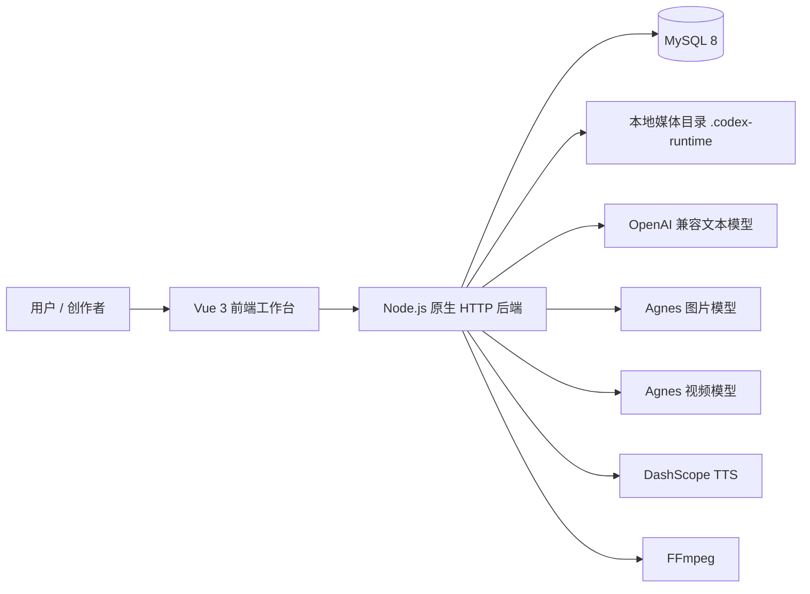

# 帧心帧意（ProjectDream）上台答辩总稿

> 用途：课程答辩、项目汇报、源码讲解和现场演示
> 建议时长：8-12 分钟
> 项目定位：面向 AI 漫剧和短视频生产的项目级工作台
> 代码目录：`D:\projectdream\dreamweaver-studio\projectdream`

---

## 一、项目一句话介绍

大家好，我今天介绍的项目叫 **帧心帧意（ProjectDream）**。

它是一个面向 AI 漫剧和短视频生产的项目级工作台，能够把一段故事逐步转换成最终的视频文件，完整流程是：

```text
项目创建
  -> 故事总纲
  -> 场景拆解
  -> 单场剧本
  -> 角色库
  -> 分镜
  -> 静帧
  -> 视频
  -> 音频
  -> 成片编辑
  -> MP4 导出
```

它和普通的 AI 生成工具最大的区别是：它不是只调用某一个模型生成一张图或一段视频，而是把整个内容生产过程组织成了一个可以保存、修改、追踪和导出的项目流程。

---

## 二、项目背景和要解决的问题

现在的 AI 工具通常擅长单点生成，例如：

- 根据文字生成图片；
- 根据图片生成视频；
- 根据文字生成配音；
- 根据文本生成剧本。

但是，真正制作一条短片时，难点并不是“能不能生成”，而是“不同环节能不能连续起来”。

项目主要解决以下问题：

1. **故事内容容易断层**
   - 直接从一句话生成视频，容易出现剧情不完整、镜头之间缺少关系的问题。

2. **角色容易不一致**
   - 同一个角色在不同镜头中可能出现脸型、发型、年龄和服装变化。

3. **AI 任务耗时且不稳定**
   - 图片、视频和音频生成都可能需要等待，也可能因为网络、审核或供应商限流失败。

4. **音画容易错位**
   - 对白如果只按场景播放，可能出现声音提前、延后或叠加的问题。

5. **生成结果难以真正交付**
   - 如果只有图片和视频候选列表，还不能算完成项目，最终还需要剪辑、配音、字幕和 MP4 导出。

因此，本项目的核心思路是：

> 先把创作流程结构化，再把 AI 生成能力接入每个阶段，最后通过时间线和 FFmpeg 输出完整成片。

---

## 三、系统整体架构



### 1. 前端

前端使用：

- Vue 3
- TypeScript
- Vite
- Vue Router
- Tailwind CSS

前端主要负责：

- 页面展示；
- 表单输入；
- 路由跳转；
- 调用后端 API；
- 展示生成任务状态；
- 编辑分镜、音频和成片时间线。

前端不会直接调用 AI 模型，而是统一请求后端。这样做可以避免把 API 密钥暴露到浏览器中。

### 2. 后端

后端使用的是：

- Node.js
- Node 原生 `http.createServer`
- `mysql2/promise`
- Node 文件系统 API
- `child_process` 调用 FFmpeg

本项目后端**不是 FastAPI**，也没有使用 Python。

后端入口是：

```text
server/index.mjs
```

它主要负责：

1. 启动 HTTP 服务；
2. 解析请求方法、URL 和请求体；
3. 手动分发 `/api/...` 路由；
4. 查询或修改 MySQL；
5. 调用 AI 服务；
6. 管理后台任务；
7. 处理媒体文件和最终导出。

### 3. 数据和媒体存储

- MySQL 保存用户、项目、总纲、场景、剧本、角色、分镜、素材、任务和导出记录。
- `.codex-runtime/` 保存生成的图片、视频、音频和导出文件。

这样设计的好处是：数据库保存“业务关系”，文件系统保存“媒体内容”，两者职责比较清楚。

---

## 四、项目完整业务流程

### 1. 创建项目

用户填写项目名称、题材、故事方向、视觉风格、目标时长和画幅比例。

系统写入项目主表，后续所有内容都通过 `projectId` 关联到这个项目。

这里的 `projectId` 可以理解为整条创作链路的主线编号。

### 2. 生成故事总纲

文本模型根据项目题材和故事方向生成：

- 故事核心设定；
- 主要冲突；
- 三幕结构；
- 场景列表；
- 角色线索。

总纲不是最终剧本，而是后续场景和剧本生成时使用的上游语境。

### 3. 场景拆解

系统将总纲拆分为多个正式场景，每个场景包含：

- 场景标题；
- 地点；
- 时间；
- 场景摘要；
- 预估时长。

正式场景会写入数据库，后面的单场剧本和分镜都依赖这些场景。

### 4. 生成单场剧本

用户选择一个场景后，系统生成该场景的详细剧本，包括：

- 人物对白；
- 人物动作；
- 环境氛围；
- 情绪变化；
- 场景节奏。

剧本是分镜生成的直接输入。

### 5. 建立角色库

角色库保存：

- 角色名称；
- 身份；
- 性别；
- 年龄段；
- 固定外貌；
- 性格；
- 服装；
- 声线；
- 定妆参考图。

角色库的关键作用是把角色从普通文本升级成有唯一 ID 的业务实体。

后续分镜绑定的是 `characterId`，而不是只依靠角色名称。这样能减少同名角色和角色信息混乱。

### 6. 生成和编辑分镜

分镜是整个系统的中间层。

它一边承接剧本，一边决定后面怎么生成图片、视频、对白和字幕。

每条分镜包含：

- 镜头编号；
- 景别；
- 摄像机角度；
- 构图；
- 时长；
- 角色；
- 动作；
- 对白；
- 视觉提示词；
- 起始帧提示词；
- 结束帧提示词。

分镜编辑页还支持：

- AI 优化起始帧和结束帧；
- 承接上一镜头；
- 拆分较长动作；
- 按说话人拆分多人对白；
- 手动修改提示词和角色绑定。

### 7. 生成静帧

静帧生成时，系统会把以下内容组合起来：

- 分镜视觉提示词；
- 项目视觉风格；
- 角色外貌信息；
- 角色性别和年龄；
- 角色定妆参考图；
- 起始帧或结束帧约束。

生成前会做角色一致性校验。

例如，一个镜头明确出现了人物，但这个人物没有绑定角色，或者角色缺少关键性别信息，系统会先阻止生成，而不是让模型自由猜测。

### 8. 生成视频

视频生成通常使用已确认的静帧作为源图。

如果分镜存在起始帧和结束帧，系统会将两帧信息一并传给视频模型，用来约束动作前后的状态。

由于视频生成耗时较长，系统不会让页面一直等待，而是：

```text
提交请求
  -> 创建任务
  -> 返回 taskId
  -> 后台轮询供应商状态
  -> 下载完成视频
  -> 写入本地目录和数据库
  -> 前端任务中心展示结果
```

### 9. 生成对白和旁白

音频模块使用 DashScope TTS 生成：

- 角色对白；
- 旁白；
- 音色试听。

对白会绑定到具体分镜，并支持起始时间微调。

这样导出时，音频可以跟随镜头时间线，而不是全部从视频开头播放。

### 10. 成片编辑和导出

成片编辑器会把视频轨、动态静帧和音频轨组织成时间线。

推荐的混合成片策略是：

- 关键动作镜头使用真实视频；
- 普通对白、空镜和信息镜头使用动态静帧；
- 通过轻微推近、平移等方式让静帧产生动态效果。

最终由 FFmpeg 完成：

- 视频片段拼接；
- 静帧转视频；
- 对白和旁白混音；
- 字幕生成和烧录；
- MP4 编码；
- 导出记录保存。

---

## 五、最值得讲的技术实现

### 1. Provider 抽象层

文本生成统一通过 `server/services/ai/provider.mjs` 处理。

业务代码不直接关心具体模型，而是只需要表达：

```text
我要生成总纲 / 剧本 / 角色 / 分镜
```

Provider 层负责：

- 读取模型配置；
- 组装请求；
- 发送 HTTP 请求；
- 设置超时时间；
- 解析模型返回内容；
- 处理异常。

这样以后更换 OpenAI 兼容服务商时，业务页面不需要全部重写。

### 2. AI 返回内容的 JSON 容错

模型有时会返回：

````text
下面是生成结果：
```json
{ ... }
```
````

后端不会直接把整个字符串交给 `JSON.parse`，而是先去掉代码块标记，再截取最可能的 JSON 区域，最后解析。

这属于“模型输出容错”，因为模型虽然理解了任务，但不一定严格按照纯 JSON 返回。

### 3. 角色一致性

角色一致性通过多层机制实现：

1. 分镜绑定角色 ID；
2. 读取角色固定外貌；
3. 注入性别、年龄等硬约束；
4. 传入定妆参考图；
5. 生成前检查角色信息是否完整；
6. 保存生成时的角色快照；
7. 角色改名时同步更新相关文本。

这里的思路不是完全依赖模型“记住角色”，而是由系统主动提供结构化约束。

### 4. 异步任务状态机

图片、视频、口型同步和导出都可能耗时，因此系统用 `ai_tasks` 表保存任务状态。

任务状态大致是：

```text
queued
  -> running
  -> succeeded
  -> failed
```

任务表会保存：

- 任务类型；
- 所属项目；
- 所属分镜；
- 当前状态；
- 供应商任务 ID；
- 进度；
- 错误信息；
- 结果信息。

这样即使用户离开页面，后台任务仍然可以继续执行，重新打开任务中心后还能看到结果。

### 5. 视频限流和任务恢复

视频供应商通常有调用频率限制。

项目中通过 Promise 串行闸和时间窗口记录，控制单位时间内的视频创建次数。

简单说就是：

```text
多个视频请求
  -> 进入队列
  -> 检查最近 60 秒创建次数
  -> 未超限才发送
  -> 超限则等待
```

供应商返回的任务 ID 会写入数据库。服务重启后，系统可以继续查询原任务，而不是重新创建一个视频任务。

### 6. 分镜级音频对齐

音频不是简单地按场景顺序播放，而是绑定到具体分镜。

导出时系统会：

1. 根据分镜编号计算镜头开始时间；
2. 把对白放到对应镜头；
3. 应用用户设置的微调时间；
4. 排除已禁用镜头的音频；
5. 过滤旧的场景级音频；
6. 生成字幕并与实际对白保持一致。

这个设计解决了短片中常见的“声音从片头开始播放”或“字幕和对白错位”问题。

### 7. 混合成片

全量生成真实视频的成本较高，也会增加等待和失败概率。

项目采用“真实视频 + 动态静帧”的混合方式：

- 关键动作使用真实视频；
- 普通对话使用动态静帧；
- 通过时间线统一拼接；
- 最后使用 FFmpeg 输出 MP4。

这是一种成本、质量和稳定性之间的工程折中。

---

## 六、核心源码目录怎么讲

| 文件或目录 | 答辩时可以怎么解释 |
|---|---|
| `src/main.ts` | 前端启动入口，创建 Vue 应用并挂载路由、状态和根组件 |
| `src/router/index.ts` | 页面路由和登录鉴权守卫 |
| `src/api/auth.ts` | 登录态、token 和认证请求 |
| `src/api/project.ts` | 项目业务 API 和数据类型 |
| `src/components/WorkspaceLayout.vue` | 工作台公共布局 |
| `src/views/AIScript.vue` | 总纲、场景和剧本生成入口 |
| `src/views/StoryboardEditor.vue` | 分镜字段、角色、关键帧和拆分操作 |
| `src/views/FrameGenerate.vue` | 静帧生成任务提交 |
| `src/views/VideoGenerate.vue` | 视频生成和候选管理 |
| `src/views/AudioStudio.vue` | 对白、旁白和音色管理 |
| `src/views/FinalEdit.vue` | 成片时间线编辑 |
| `src/views/Export.vue` | 导出任务和历史记录 |
| `src/views/AITaskCenter.vue` | 异步任务状态汇总 |
| `server/index.mjs` | 后端 HTTP 入口、路由、数据库和任务编排 |
| `server/services/ai/` | 文本模型配置、Prompt 和结构化解析 |
| `server/services/frame.mjs` | 图片生成、参考图、比例校验和降级 |
| `server/services/video.mjs` | 视频生成、限流、重试和任务恢复 |
| `server/services/audio.mjs` | TTS 音频生成 |
| `server/services/media-timeline.mjs` | 镜头时间线和音频定位 |
| `server/services/export-validation.mjs` | 导出前完整性校验 |
| `server/services/character-rename.mjs` | 角色改名后的引用同步 |

---

## 七、现场演示顺序

### 1. 演示前准备

```bash
npm install
npm run dev:full
```

启动后：

- 前端通常是 `http://localhost:5173`；
- 后端通常是 `http://127.0.0.1:3001`；
- 健康检查：`http://127.0.0.1:3001/api/health`。

前后端都要启动，因为前端页面会通过 `fetch` 请求后端接口。只启动前端只能看到页面，无法正常登录、读取项目或生成内容。

### 2. 推荐演示路线

1. 登录演示账号；
2. 打开项目总览；
3. 展示故事总纲；
4. 展示场景和单场剧本；
5. 展示角色库和定妆图；
6. 展示分镜编辑和导演关键帧；
7. 展示静帧和视频候选；
8. 展示音频绑定分镜；
9. 展示任务中心；
10. 展示成片编辑时间线；
11. 播放已经导出的 MP4。

现场不建议等待真实视频生成，可以提前准备 `.codex-runtime/exports/` 中的样片作为兜底。

---

## 八、可以直接照着讲的完整稿

大家好，我今天介绍的项目是帧心帧意，也就是 ProjectDream。

这是一个面向 AI 漫剧和短视频生产的项目级工作台。它的目标不是单独生成一张图片或者一段视频，而是把故事构思、剧本、角色、分镜、画面、视频、音频、剪辑和导出串成一条完整流程。

传统的 AI 内容制作经常会遇到三个问题：第一，生成结果是孤立的，前后镜头很难保持关系；第二，同一个角色在不同画面中容易发生变化；第三，图片、视频、音频生成时间较长，失败后也不容易追踪。

针对这些问题，我把项目设计成了“项目级上下文 + 多阶段生产流程”。每个项目都有唯一的 `projectId`，总纲、场景、剧本、角色和分镜都围绕这个项目组织。

从操作流程上看，用户先创建项目，再让文本模型生成故事总纲，然后把总纲拆成场景，再生成单场剧本。接下来进入角色库，完善角色的性别、年龄、外貌、声线和定妆图。分镜生成会读取剧本和角色信息，生成景别、动作、对白和视觉提示词。

在生成静帧时，系统会把分镜提示词和角色档案、参考图一起传给图片模型，并且在生成前检查角色绑定和关键字段是否完整。这样可以尽量减少同一个角色在不同镜头中出现明显变化。

视频和图片生成属于长耗时任务，所以后端不会让页面一直等待，而是先创建任务并返回 `taskId`。任务会进入任务中心，后台持续查询供应商状态，最终把成功结果或失败原因写入数据库。即使用户离开页面，也可以回来继续查看任务结果。

音频模块会根据角色音色生成对白，也可以生成旁白。每段对白都会绑定具体分镜并允许微调开始时间，导出时再根据镜头时间线进行混音和字幕处理。

最后，成片编辑器会把真实视频、动态静帧、对白、旁白和字幕组织起来。项目采用“关键镜头使用真实视频，其余镜头使用动态静帧”的混合方案，在质量、成本和稳定性之间取得平衡。后端调用 FFmpeg 完成拼接、混音、字幕烧录和 MP4 导出。

技术上，前端采用 Vue 3、TypeScript 和 Vite，后端采用 Node.js 原生 HTTP 服务，数据库使用 MySQL，文本生成使用 OpenAI 兼容接口，图片和视频使用 Agnes，语音使用 DashScope。

需要特别说明的是，本项目后端不是 FastAPI，而是 Node.js 原生 HTTP。后端入口使用 `createServer` 接收请求，再根据请求方法和 URL 手动分发 API。虽然没有使用 FastAPI 框架，但实现的思想同样包含 REST API、异步处理、数据库访问和任务状态管理。

项目目前已经跑通了从项目创建到 MP4 导出的本地最小可用闭环。后续如果继续工程化，我会重点补充对象存储、独立任务队列、Worker、项目权限和自动质量检测。

我的介绍到这里，谢谢大家。

---

## 九、常见答辩问题和回答

### 1. 为什么要做这个项目？

答：

因为现在 AI 工具大多是单点生成，图片、视频、音频之间缺少统一的项目管理。这个项目希望把 AI 生成能力组织成一条完整生产链，让每个阶段的结果都可以保存、修改、确认和导出。

### 2. 这个项目后端使用 FastAPI 吗？

答：

没有。本项目后端使用 Node.js 原生 HTTP 服务，通过 `node:http` 的 `createServer` 接收请求，使用 `mysql2` 连接 MySQL。它没有使用 Python、FastAPI 或 Uvicorn。

不过从知识点上看，它仍然属于前后端分离和 REST API 架构，包含路由、请求参数、JSON 响应、异步接口、数据库操作和后台任务等内容。

### 3. 为什么不用 Express 或 FastAPI？

答：

当前项目定位是本地最小可用版本和源码演示，因此选择 Node 原生 HTTP 可以减少依赖，让请求入口、路由分发和响应过程更直观。缺点是随着接口增加，`server/index.mjs` 会变得比较长。正式团队开发时，我会进一步按认证、项目、分镜、媒体和导出拆分路由模块。

### 4. 前端和后端分别负责什么？

答：

前端负责页面、交互、表单、路由和状态展示；后端负责权限、数据库、AI 调用、任务执行、媒体文件和最终导出。前端不直接调用 AI 服务，避免密钥暴露，也方便后端统一处理重试、限流和错误。

### 5. 为什么前端和后端都要启动？

答：

前端负责显示页面，后端负责提供 API。只启动前端只能打开界面，但登录、项目查询、数据库操作和 AI 生成都需要请求后端。因此本地开发推荐运行 `npm run dev:full`，同时启动 Vite 前端和 Node 后端。

### 6. 角色一致性是怎么实现的？

答：

主要通过角色 ID、角色档案、定妆参考图、性别年龄约束和生成前校验来实现。分镜不只是填写角色名字，而是绑定角色库中的 `characterId`。生成图片时，后端会把角色结构化信息和参考图一起加入请求。

### 7. AI 生成失败怎么办？

答：

系统会把任务状态和供应商错误写入任务表，在任务中心展示。部分任务支持重试，图片模型还可以配置降级模型。视频任务会保存供应商任务 ID，服务重启后能够继续查询，不会因为页面刷新而丢失。

### 8. 为什么要做任务中心？

答：

图片、视频、口型同步和导出都可能耗时较长。如果让浏览器一直等待，用户体验不好，而且页面关闭后也无法确认结果。任务中心把长耗时过程抽象成状态机，让任务可观察、可恢复和可重试。

### 9. 为什么采用真实视频和动态静帧混合？

答：

每个镜头都生成真实视频会带来更高成本、更长等待时间和更高失败率。关键动作镜头使用真实视频，普通对白和空镜使用动态静帧，可以降低成本，同时保持成片节奏和视觉完整性。

### 10. 最终视频怎么生成？

答：

后端先根据分镜生成时间线，再把真实视频和动态静帧转换为统一的视频片段，同时整理对白、旁白和字幕，最后使用 FFmpeg 完成拼接、混音、字幕烧录和 MP4 编码。

### 11. 当前项目有什么不足？

答：

目前主要是本地 MVP，还存在几个边界：

- 生成媒体主要保存在本地目录，正式部署需要对象存储；
- 长任务仍由 Node 进程管理，后续可以拆成独立队列和 Worker；
- 当前权限以用户级为主，还可以增加项目成员和角色权限；
- 还可以增加黑帧、静音、字幕越界和画幅异常等自动检测；
- 真实 AI 结果可能有供应商标识，发布前需要确认平台规则和商业授权。

### 12. 如果继续优化，你会先做什么？

答：

我会优先做三件事：

1. 把媒体文件迁移到对象存储；
2. 把长耗时任务拆成独立队列和 Worker；
3. 增加导出前自动质量检测，减少人工排查成本。

---

## 十、答辩时容易说错的地方

### 不要说

- “后端使用 FastAPI。”
- “前端直接调用 AI 模型。”
- “只启动前端就能完整运行。”
- “AI 一定能保证角色完全不变。”
- “导出完成就代表视频质量完全合格。”

### 应该说

- “后端使用 Node.js 原生 HTTP 服务。”
- “前端通过后端 API 间接调用 AI 服务。”
- “前后端都需要启动，数据库和模型配置也要正常。”
- “系统通过角色 ID、档案、参考图和生成前校验尽量保证一致性。”
- “导出成功只代表技术合成完成，仍然需要人工完整观看验收。”

---

## 十一、演示前检查清单

- [ ] MySQL 已启动；
- [ ] `.env.local` 已配置，且没有把密钥投屏；
- [ ] 执行 `npm run dev:full`；
- [ ] 访问 `http://127.0.0.1:3001/api/health`；
- [ ] 确认前端实际端口；
- [ ] 准备演示账号：`13912345678 / 123456`；
- [ ] 提前打开演示项目；
- [ ] 提前准备已导出的 MP4；
- [ ] 确认样片有画面、有声音、能播放到结束；
- [ ] 不现场等待完整的视频生成；
- [ ] 准备网络或模型调用失败时的本地结果截图；
- [ ] 答辩重点放在“为什么这样设计”，不要只念页面功能。

---

## 十二、结尾总结

ProjectDream 的核心价值不是简单调用某一个 AI 模型，而是把 AI 内容生产过程变成一个有上下文、有数据关系、有任务状态、有人工确认和最终交付能力的完整系统。

它目前已经完成了本地最小可用闭环：

```text
从故事开始
到分镜组织
再到画面、视频和音频生成
最后导出可播放的 MP4
```

这说明项目已经从“功能演示”进一步具备了“内容生产工作流”的基本形态。
