# 功能模块问题与解决方案记录

> 文档用途：统一记录各功能模块在实现过程中遇到的问题、排查过程、解决方案和最终结果  
> 创建日期：2026-07-20  
> 记录方式：后续每完成一个模块，就继续在本文档中追加对应章节

---

## 一、记录说明

本文档用于持续记录项目从开发到联调过程中，各个功能模块遇到的典型问题和解决方案。

记录重点包括：

- 问题现象
- 原因分析
- 排查过程
- 解决方案
- 最终结果

后续建议统一按下面顺序持续补充：

1. 认证模块
2. 项目模块
3. 故事总纲模块
4. 场景拆解模块
5. 单场景剧本模块
6. 分镜生成模块
7. 分镜编辑模块
8. 角色库模块
9. 静帧生成模块
10. 视频生成模块
11. 合成与导出模块
12. 资产模块
13. 音频模块
14. 任务中心模块
15. 成片编辑模块
16. 第一阶段全链路验收与收尾修 bug

---

## 二、模块记录总览

| 模块 | 当前状态 | 记录状态 |
|---|---|---|
| 认证模块 | 已完成 | 已记录 |
| 项目模块 | 已完成 | 已记录 |
| 故事总纲模块 | 已完成 | 已记录 |
| 场景拆解模块 | 已完成 | 已记录 |
| 单场景剧本模块 | 已完成 | 已记录 |
| 分镜生成模块 | 已完成 | 已记录 |
| 分镜编辑模块 | 已完成 | 已记录 |
| 角色库模块 | 已完成 | 已记录 |
| 静帧生成模块 | 已完成 | 已记录 |
| 视频生成模块 | 已完成 | 已记录 |
| 合成与导出模块 | 已完成 | 已记录 |
| 资产模块 | 已完成（二期） | 待补充 |
| 音频模块 | 已完成（二期） | 待补充 |
| 任务中心模块 | 已完成（二期） | 待补充 |
| 成片编辑模块 | 已完成（二期） | 已记录 |
| 第一阶段全链路验收与收尾修 bug | 已完成 | 已记录 |

---

## 三、认证模块问题与解决方案

### 1. 模块目标

认证模块这一阶段的目标是：

- 支持登录
- 支持注册
- 支持短信验证码发送
- 支持找回密码与重置密码
- 为后续项目工作区建立稳定的登录态与鉴权基础

---

### 2. 本轮实现内容

本轮围绕以下能力完成闭环：

1. 前端补齐登录、注册、找回密码、重置密码页面
2. 前端补齐认证 API 与本地登录态存储
3. 后端补齐短信验证码发送、验证码登录、密码登录、注册、重置密码接口
4. 路由侧补齐 `guestOnly / requiresAuth` 登录态守卫
5. 登录成功后统一落本地 `token + user`，供后续业务接口复用

---

### 3. 遇到的问题与解决方案

#### 问题 1：认证模块不只是做一个登录页，而是后续所有业务模块的前置入口

- 问题现象：
  如果认证模块只是把页面做出来，但没有稳定的登录态存储和统一鉴权链路，后面的项目、总纲、场景、分镜等页面都会频繁掉回未登录态或拿不到用户身份。

- 原因分析：
  这个项目后续所有业务接口都依赖 `Authorization`，认证模块本质上是整条业务主链的起点，而不是一个孤立页面。

- 排查过程：
  复查前后端链路后确认：
  - 前端需要统一保存 `token`
  - 前端业务请求需要统一带 `Bearer token`
  - 路由进入工作区前必须先经过登录态校验

- 解决方案：
  统一收口认证链路：
  - `auth.ts` 负责保存和读取 `projectdream_token / projectdream_user`
  - `project.ts` 请求层统一读取 token 并注入 `Authorization`
  - `router/index.ts` 统一做 `requiresAuth / guestOnly` 路由守卫

- 最终结果：
  认证模块从单页面能力升级为整套业务系统的统一入口层，后续页面可以稳定复用登录态。

---

#### 问题 2：短信验证码链路里，“登录 / 注册 / 重置密码”三种场景的手机号规则不一样，不能混用

- 问题现象：
  如果注册时允许已存在手机号继续发码，或登录/重置时允许未注册手机号发码，用户就会遇到错误流程，甚至被误导以为系统异常。

- 原因分析：
  三种短信场景的业务语义不同：
  - `register` 必须要求手机号未注册
  - `login / reset` 必须要求手机号已注册
  如果只做统一发码，而不区分场景，链路会混乱。

- 排查过程：
  复查发送验证码接口后确认，必须在发码前先查用户存在性，而不是把所有异常都延后到提交验证码时才暴露。

- 解决方案：
  在 `/api/auth/send-code` 中按 `type` 分流校验：
  - 注册时命中已注册手机号直接拦截
  - 登录或重置时命中未注册手机号直接拦截
  同时把错误提示前置到发码阶段。

- 最终结果：
  用户在发码这一步就能得到正确引导，认证链路的业务边界更清晰。

---

#### 问题 3：只支持验证码登录不够稳定，实际还需要密码登录兜底

- 问题现象：
  如果系统只支持短信验证码登录，一旦短信服务波动、验证码延迟或测试环境不便收码，登录链路就会被整体卡住。

- 原因分析：
  验证码登录适合低门槛进入，但实际项目联调和日常使用还需要密码登录作为稳定兜底手段。

- 排查过程：
  结合当前开发环境和测试流程复查后发现，只有短信登录会让认证流程过度依赖短信服务状态，不利于本地开发和高频联调。

- 解决方案：
  同时保留两条登录链路：
  - `POST /api/auth/login` 用于验证码登录
  - `POST /api/auth/login-password` 用于手机号 + 密码登录
  前端登录页优先提供密码登录入口，短信链路继续保留。

- 最终结果：
  认证链路容错更高，本地开发、测试和正式使用都更稳定。

---

#### 问题 4：验证码和密码重置如果没有统一校验，容易产生“流程走通但数据不可信”

- 问题现象：
  如果验证码格式、手机号格式、密码长度这些基础约束没有统一校验，前端看起来能提交，后端却可能写入无效数据或返回不可预期错误。

- 原因分析：
  认证相关接口天然属于高约束接口，必须在前后端两侧同时做基础格式校验，不能把所有问题都交给数据库或后置逻辑兜底。

- 排查过程：
  复查认证接口后确认，登录、注册、重置密码三个入口都需要统一约束：
  - 手机号格式
  - 验证码格式
  - 昵称最小长度
  - 密码最小长度

- 解决方案：
  在后端接口入口统一加硬校验，并在前端表单中同步做即时提示和禁用控制。

- 最终结果：
  认证模块的输入边界更稳定，接口错误表达更一致，不会出现“页面能填，提交才炸得很奇怪”的情况。

---

#### 问题 5：认证服务未启动时，前端一开始报错不够友好

- 问题现象：
  如果前端页面正常开着，但后端认证服务没启动，用户在登录或注册时会直接看到网络失败类异常，难以判断真实原因。

- 原因分析：
  对联调项目来说，“前端活着、后端没起”是高频情况；如果提示不明确，排查成本会很高。

- 排查过程：
  复查前端请求封装后发现，这类错误最适合在 `fetch` 失败的统一入口做一次语义转换。

- 解决方案：
  在 `auth.ts` 的 `request()` 中对 `TypeError` 做统一处理，直接提示：
  - `认证服务未启动，请先运行 npm run dev:full`

- 最终结果：
  联调时的错误提示更直接，开发和测试能更快定位是服务未启动，而不是误判成账号或表单问题。

---

### 4. 模块结论

认证模块当前已经完成主流程闭环，包含：

- 登录
- 注册
- 短信验证码发送
- 密码登录兜底
- 找回密码与重置密码
- 登录态持久化
- 路由鉴权保护

可以将“认证模块”标记为已完成。

需要说明的是：

- 当前认证仍以单用户项目链路为主
- 会话过期提醒、主动退出服务端失效、多端登录管理等能力仍属于后续增强项

---

### 5. 相关截图

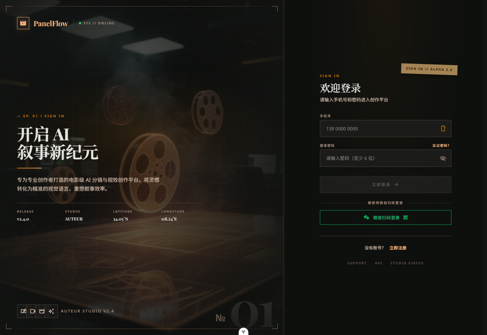

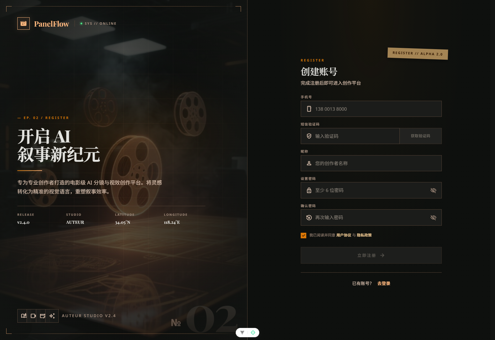

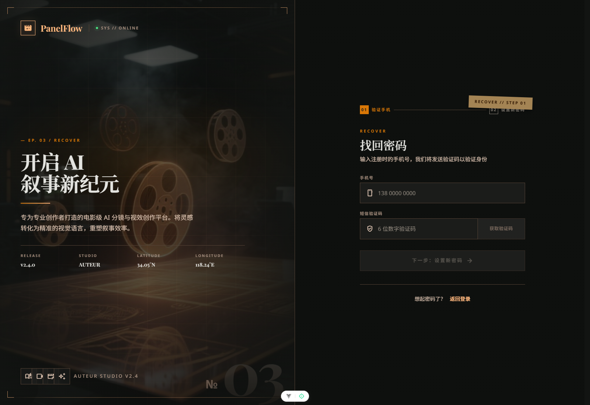

---

## 四、项目模块问题与解决方案

### 1. 模块目标

项目模块的主要目标包括：

- 展示当前登录用户的项目列表
- 支持创建新项目
- 支持查看项目详情
- 支持点击项目进入对应工作台
- 为后续总纲、场景、剧本、分镜等模块提供 `projectId` 基础上下文

---

### 2. 开发前现状

在进入项目模块之前，系统已经完成了认证功能，包括：

- 登录
- 注册
- 短信验证码
- 找回密码
- 重置密码

用户登录后已经可以进入系统，但项目模块还没有形成完整的真实业务闭环。

虽然前端已经存在项目页和新建项目页，后端也已有项目相关接口，但部分页面仍偏向静态展示，不能完整反映数据库中的真实项目数据。

---

### 3. 本模块实现内容

本次项目模块主要围绕以下功能展开：

1. 项目列表展示
2. 新建项目
3. 获取项目详情
4. 点击项目进入工作台

实现思路如下：

- 前端调用 `GET /api/projects` 获取当前用户项目列表
- 前端调用 `POST /api/projects` 创建项目
- 前端调用 `GET /api/projects/:id` 获取项目详情
- 用户点击某个项目后，带上 `projectId` 跳转到对应工作台
- 后续 AI 文本主链全部依赖该 `projectId`

---

### 4. 遇到的问题与解决方案

#### 问题 1：项目页原本是静态展示页，不能直接承载真实业务数据

- 问题现象：
  项目页界面已经存在，但展示内容并不是基于后端接口实时获取，而是偏向静态展示效果。

- 原因分析：
  初始页面更接近 UI 原型页，重点放在视觉还原，而不是基于真实数据流完成业务闭环。

- 排查过程：
  检查页面实现后发现：
  - 缺少真实项目列表请求逻辑
  - 缺少完整的页面状态管理
  - 项目点击后的业务跳转链路不够明确

- 解决方案：
  将项目页改造成真实数据驱动页面，并补齐以下状态：
  - `loading`
  - `error`
  - `empty`
  - `ok`

- 最终结果：
  项目页从静态展示页转变为真实项目列表页，可以基于当前登录用户的数据进行展示。

---

#### 问题 2：项目状态值无法直接满足前端展示需求

- 问题现象：
  后端项目状态值如 `draft`、`outlined`、`scripting`、`storyboarding`、`done` 等，不能直接满足前端卡片展示需要。

- 原因分析：
  后端状态更偏向业务流转字段，而前端页面还需要：
  - 中文状态名称
  - 阶段说明
  - 进度百分比
  - 不同样式颜色

- 排查过程：
  在做项目卡片设计时发现，仅展示原始状态值会让页面信息表达不够直观，用户难以快速理解项目当前所处阶段。

- 解决方案：
  在前端增加状态映射层，将项目状态映射成统一的展示元信息，包括：
  - 状态文案
  - 进度值
  - 阶段说明
  - 展示色彩

- 最终结果：
  前端项目列表可以更清晰地表达项目制作进度，也为后续状态扩展打下了基础。

---

#### 问题 3：进入工作台时必须稳定维护 `projectId` 上下文

- 问题现象：
  用户点击项目后，如果没有稳定传递项目上下文，后续页面就无法知道当前操作的是哪个项目。

- 原因分析：
  项目模块本身只是入口，但后续总纲、场景、剧本、分镜等模块全部依赖 `projectId`。如果这里不稳定，后续模块会频繁出现上下文丢失问题。

- 排查过程：
  结合后续页面的路由逻辑和工作台上下文实现检查后发现，项目模块不仅要负责展示列表，还要负责建立完整的项目入口链路。

- 解决方案：
  在点击项目时：
  - 写入工作台上下文
  - 路由携带 `projectId`
  - 跳转到 AI 剧本工作台页面

- 最终结果：
  用户能够稳定进入某一个具体项目，后续功能模块也可以基于该项目继续运行。

---

#### 问题 4：出现了 TypeScript 类型检查错误

- 问题现象：
  在完成项目页改造后，执行 `npm run type-check` 时出现类型错误，报错内容为：某个状态映射函数返回值可能是 `StatusMeta | undefined`，不能直接当作 `StatusMeta` 使用。

- 原因分析：
  虽然代码中写了兜底逻辑，但 TypeScript 在对象索引访问时仍然可能把结果推断为 `undefined`。

- 排查过程：
  通过运行类型检查命令定位到项目页状态映射函数，确认问题出在状态映射返回值类型收窄不够严格。

- 解决方案：
  对状态映射函数进行类型收紧，确保无论传入什么状态值，函数都明确返回一个可用的 `StatusMeta` 对象。

- 最终结果：
  该问题已经被定位清楚，属于项目模块收尾阶段必须解决的编译级问题。

---

#### 问题 5：最近活动时间字段语义不准确

- 问题现象：
  页面中“最近项目”或“最近活动”区域如果使用 `createdAt` 作为排序或展示依据，会导致项目更新后仍不能正确体现真实活跃情况。

- 原因分析：
  `createdAt` 只能表示项目创建时间，不能表示项目最近一次推进或修改时间。

- 排查过程：
  在检查项目页右侧摘要和最近活动区域时发现，这些区域更符合“最近更新”的语义，而不是“最近创建”的语义。

- 解决方案：
  将相关排序和时间展示逻辑调整为优先使用 `updatedAt`。

- 最终结果：
  页面中的时间表达会更符合实际业务含义。

---

### 5. 当前收尾项

项目模块主体功能已经基本形成闭环，目前还需要完成以下收尾项：

1. 修复类型检查错误
2. 调整最近活动时间字段逻辑
3. 做一次完整联调验收

上述收尾完成后，项目模块即可标记为正式完成。

---

### 6. 模块总结

通过本次项目模块的实现，可以明确一个关键结论：

项目模块并不只是“新建项目”这么简单，它实际上是整个系统业务主链的入口层。只有把：

- 项目列表
- 新建项目
- 项目详情
- 项目上下文
- 项目状态映射

这些基础能力打稳，后面的 AI 总纲、场景、剧本和分镜模块才能稳定运行。

项目模块的完成，也意味着系统开始真正从“展示型原型”进入“可联调的业务系统”阶段。

---

### 7. 相关截图

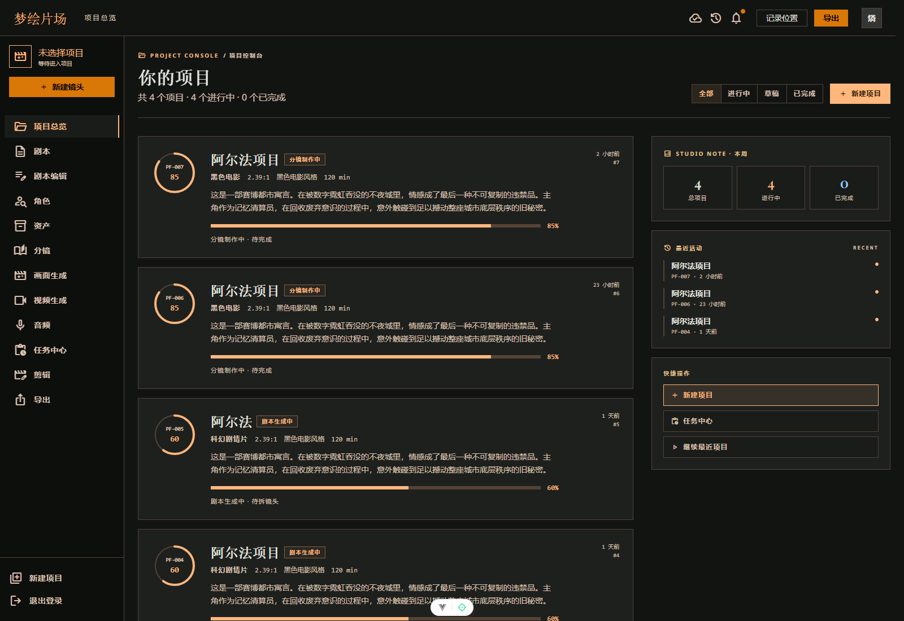

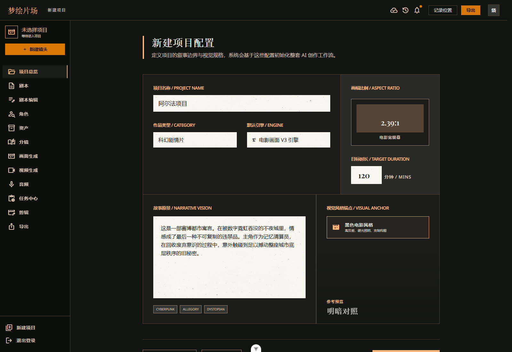

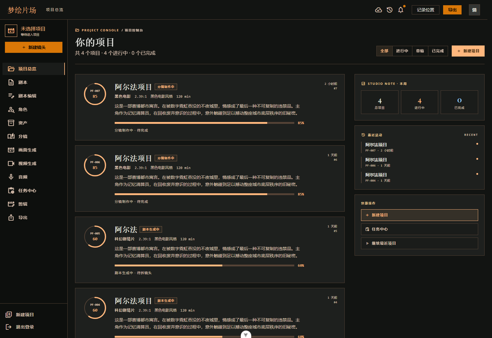

---

## 五、故事总纲模块问题与解决方案

> 详见文末“补充记录：故事总纲模块（2026-07-20）”，并参考 `截图/故事总纲模块/`

---

## 六、场景拆解模块问题与解决方案

> 详见文末“补充记录：场景拆解模块（2026-07-20）”，并参考 `截图/场景拆解模块/`

---

## 七、单场景剧本模块问题与解决方案

> 详见文末“补充记录：单场景剧本模块（2026-07-20）”

---

## 八、分镜生成模块问题与解决方案

> 详见文末“补充记录：分镜生成模块（2026-07-20）”

---

## 九、分镜编辑模块问题与解决方案

> 详见文末“补充记录：分镜编辑模块（2026-07-20）”，并参考 `截图/分镜编辑模块/`

---

## 十、角色库模块问题与解决方案

### 1. 模块目标

角色库模块这一阶段的目标是先跑通最小闭环，而不是一次性把复杂 AI 能力全部做完。  
本阶段重点包括：

- 基于当前 `projectId` 查看角色列表
- 新建角色
- 查看角色详情
- 编辑并保存角色基础信息
- 为后续分镜绑定、参考图生成保留扩展入口

---

### 2. 本轮实现内容

本轮围绕以下能力完成闭环：

1. 后端新增 `characters` 表
2. 后端补齐角色基础接口
3. 前端角色库列表页接入真实数据
4. 前端角色详情页支持创建模式和编辑模式
5. 补齐角色模块的项目上下文保护

本阶段明确暂不处理：

- 角色参考图生成
- 角色锁定/解锁
- 角色与分镜绑定
- 复杂 AI 角色分析能力

---

### 3. 遇到的问题与解决方案

#### 问题 1：角色库原本只有静态 UI，没有真实后端链路

- 问题现象：  
  页面虽然已经有角色库和角色详情原型，但进入后看到的只是演示数据，不能对应当前项目的真实角色。
- 原因分析：  
  这一块最初更偏 UI 展示页，没有独立的 `characters` 表，也没有成套的角色 CRUD 接口。
- 排查过程：  
  对照文档和现有代码后确认：
  - 前端 `CharacterLibrary.vue`、`CharacterDetail.vue` 是静态原型
  - 后端只有分镜里的 `character_name` 字段
  - 没有真正的角色库数据结构
- 解决方案：  
  先按“最小可跑通”思路补齐：
  - 新增 `characters` 表
  - 新增角色列表、详情、新建、更新接口
  - 前端改为基于 `projectId` 拉取真实角色数据
- 最终结果：  
  角色库从静态展示页变成了真实数据驱动模块，具备最基础的角色管理能力。

---

#### 问题 2：从左侧导航进入角色库时，容易丢失 `projectId` 上下文

- 问题现象：  
  用户明明已经在某个项目工作区内，但点左侧“角色”菜单后，角色库页仍然提示“缺少项目上下文”。
- 原因分析：  
  角色库页依赖 `query.projectId`，但左侧导航最初没有把“角色”视为项目级页面，跳转时不会自动补上 `projectId`。
- 排查过程：  
  复查 `SideNav.vue` 发现：
  - 剧本页和部分页面有 `requireContext`
  - 角色库最开始没有标记为 `project` 级上下文页面
  - 因此 `goItem()` 直接走了无上下文跳转
- 解决方案：  
  将角色菜单补成 `requireContext: 'project'`，统一复用工作区上下文跳转逻辑。
- 最终结果：  
  现在从左侧导航进入角色库时，会稳定带上当前 `projectId`，不会再莫名掉进缺少上下文状态。

---

#### 问题 3：角色详情页存在跨项目上下文错位风险

- 问题现象：  
  如果用户通过旧链接、手改 URL 或错误跳转进入角色详情页，可能出现“当前页面显示的是项目 A，但实际加载的是项目 B 的角色”的情况。
- 原因分析：  
  角色详情接口是按 `characterId` 读取的，如果前端不校验 `character.projectId` 和当前路由里的 `projectId` 是否一致，就会出现上下文错位。
- 排查过程：  
  对照场景页、分镜页的实现后发现，角色详情页最开始缺少这层项目一致性校验。
- 解决方案：  
  在角色详情页补齐：
  - `projectId + characterId` 快照校验
  - `character.projectId === route.query.projectId` 一致性校验
  - 不一致时进入 `mismatch` 状态，而不是继续渲染错误数据
- 最终结果：  
  角色详情页现在具备跨项目防错能力，避免了“看起来能编辑，实际上改错项目数据”的风险。

---

#### 问题 4：角色库接口代码已写好，但运行中的后端还是旧版本，导致“接口不存在”

- 问题现象：  
  页面进入角色库后直接报“接口不存在”，而不是正常返回角色列表或未登录错误。
- 原因分析：  
  这类报错不是前端请求路径错了，而是当前运行在 `3001` 端口上的后端实例没有加载到最新的角色库路由代码。
- 排查过程：  
  通过直接访问接口确认：
  - `/api/health` 正常，说明服务活着
  - `/api/projects/1/characters` 返回 `404 / 接口不存在`
  这说明当前进程是旧版本服务，而不是角色库路由本身有语法问题。
- 解决方案：  
  停掉旧的后端进程并重启服务，重新验证角色库接口是否已被当前实例加载。
- 最终结果：  
  服务重启后，角色库接口从 `404 接口不存在` 变为正常的鉴权响应，说明路由已经正确挂载到当前运行实例中。

---

### 4. 模块结论

角色库模块当前已经完成第一阶段主流程闭环，包括：

- 当前项目角色列表读取
- 新建角色
- 角色详情查看
- 角色基础信息编辑保存
- 项目上下文保护
- 跨项目错位防护

可以将“角色库模块”标记为已完成。  
需要说明的是：

- 这一阶段完成的是“角色基础管理闭环”
- 角色参考图生成、角色锁定、角色与分镜绑定仍属于后续增强能力

下一步建议进入“静帧生成模块”。

---

### 5. 相关截图

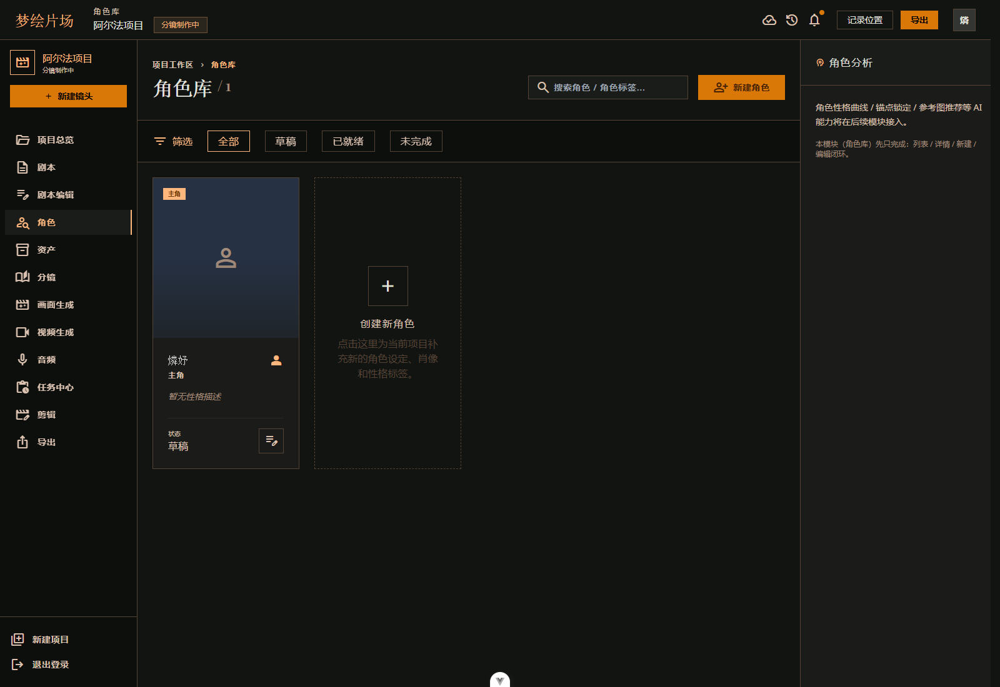

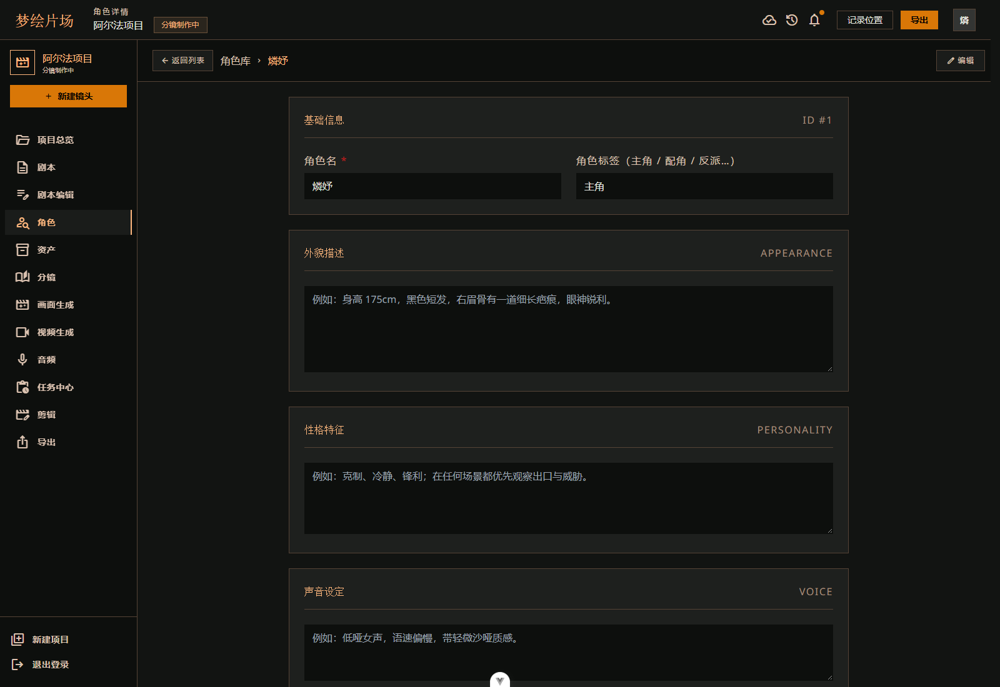

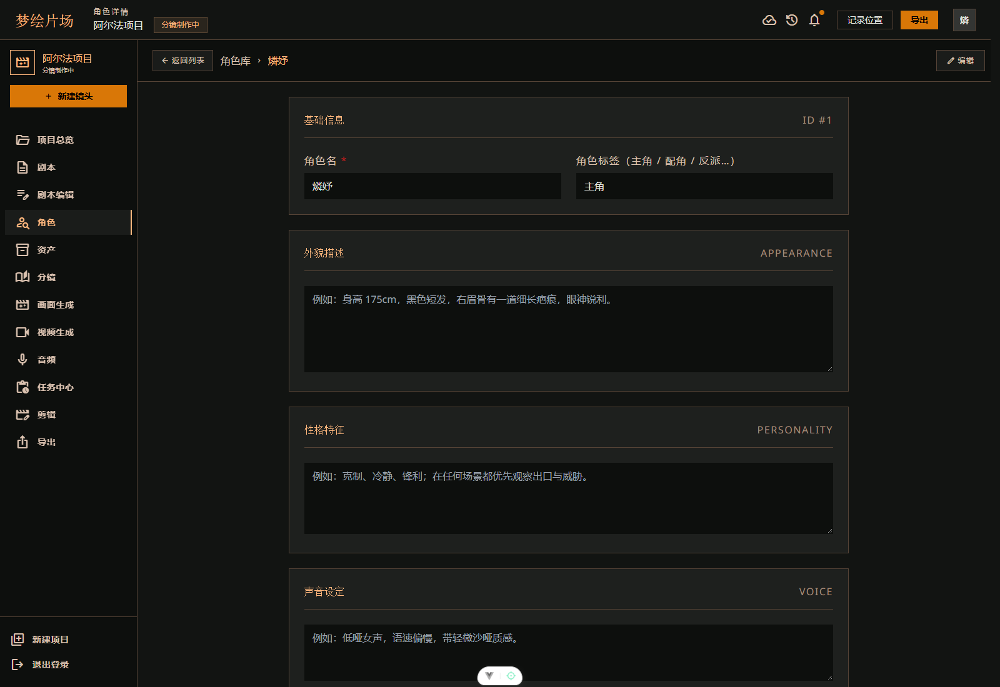

---

## 十一、静帧生成模块问题与解决方案

### 1. 模块目标

静帧生成模块的目标是：

- 基于 `projectId + sceneId + storyboardId` 进入当前分镜的静帧生成页
- 基于当前分镜内容生成一组候选静帧
- 支持查看候选结果并确认最终版本
- 让确认后的静帧稳定回写到分镜，供后续视频生成使用

---

### 2. 本轮实现内容

本轮围绕以下能力完成闭环：

1. 新增静帧资产表 `image_assets`
2. 打通静帧生成接口、列表接口、确认接口
3. 打通 `FrameGenerate.vue` 与 `FrameResult.vue`
4. 支持从分镜编辑页稳定进入静帧生成页
5. 支持在结果页确认某一张候选图为最终版本
6. 支持将确认后的图片回写到 `storyboards.image_url`

---

### 3. 遇到的问题与解决方案

#### 问题 1：生成出来的图片和提示词完全不符，容易被误判成提示词失效

- 问题现象：
  用户在静帧生成页填写了提示词，但生成结果看起来像随机图片，和提示词几乎没有对应关系。
- 原因分析：
  这一阶段为了先跑通主流程，后端接的是 mock 占位图链路，不是真实 AI 出图模型；提示词只是被保存，没有真正参与绘图。
- 排查过程：
  复查静帧接口后确认，后端生成的是固定占位图 URL，前端虽然能编辑并提交 prompt，但返回结果并不是模型按 prompt 生成的内容。
- 解决方案：
  明确把一期静帧模块定义为“最小闭环”：
  - 先打通静帧资产数据结构
  - 先打通生成、查看、确认、回写分镜这条主链路
  - 在页面和说明中明确标记当前是 mock 链路，不宣称已接入真实出图
- 最终结果：
  用户能区分“流程已打通”和“真实 AI 出图未接入”这两件事，不会再把占位图阶段误判成提示词 bug。

---

#### 问题 2：从工作区侧边入口进入静帧页时，容易丢失上下文参数

- 问题现象：
  用户明明已经在某个项目、某个场景、某个分镜里工作，但从侧边导航或顶部快捷入口进入静帧页时，页面会提示缺少上下文，无法继续。
- 原因分析：
  静帧模块不是项目级页面，而是建立在单分镜之上的子模块，必须同时依赖 `projectId + sceneId + storyboardId` 三件套。
- 排查过程：
  复查入口链路后发现，旧实现里有的入口只是简单跳 `/workspace/frame`，没有统一走分镜级上下文补齐逻辑。
- 解决方案：
  统一把静帧模块视为 `shot` 级上下文页面：
  - 侧边导航进入时优先带上 `projectId + sceneId + storyboardId`
  - 如果只有项目和场景，没有分镜，则先引导回分镜列表
  - 缺项目上下文时退回项目总览
- 最终结果：
  从分镜编辑页、静帧结果页、侧边导航进入静帧模块时，上下文链路保持一致，不会再无故掉进缺参状态。

---

#### 问题 3：单分镜详情接口缺失，导致静帧页和分镜编辑页直接报“接口不存在”

- 问题现象：
  进入静帧生成页或分镜编辑页时，页面会直接显示“分镜加载失败 / 接口不存在”。
- 原因分析：
  前端会调用 `GET /api/storyboards/:storyboardId` 读取单分镜详情，但后端最初只补了场景下的分镜列表接口，没有真正挂上单分镜详情接口。
- 排查过程：
  复查前后端链路后确认：
  - 前端 `getStoryboard()` 请求的是单分镜详情接口
  - 后端缺少完整可命中的 `/api/storyboards/:storyboardId`
  - 因此前端首屏加载就在后端 404 处失败
- 解决方案：
  在后端补齐并挂载：
  - `GET /api/storyboards/:storyboardId`
  - `PUT /api/storyboards/:storyboardId`
  同时补上 `storyboards -> script_scenes -> projects -> user` 的归属校验，确保只能读取和更新当前用户自己的分镜。
- 最终结果：
  静帧页和分镜编辑页读取单分镜详情时不再报“接口不存在”，单分镜保存链路也恢复正常。

---

#### 问题 4：时长字段的非法值会在收尾保存时误清空

- 问题现象：
  用户在分镜编辑页点“标记为已完成”或保存时，如果时长为空、为 `0` 或非法值，原本已有的时长可能被意外清空。
- 原因分析：
  旧实现里前端会把空时长压成 `0` 发给后端，后端又会把非法值降成 `null` 进入更新语句，结果不是“忽略更新”，而是把原值清掉。
- 排查过程：
  复查静帧模块联动链路时发现，这个问题虽然出现在分镜编辑接口里，但它会直接影响静帧模块使用的上游分镜基础数据。
- 解决方案：
  前后端一起收尾：
  - 前端不再把空时长强制转成 `0`
  - 后端只在 `durationSeconds > 0` 时才更新时长
  - 非法值一律视为“未提供”，跳过更新，保留数据库原值
- 最终结果：
  分镜时长字段不会再因为静帧模块前后的保存动作被误清空，上游分镜数据更稳定。

---

### 4. 模块结论

静帧生成模块当前已经完成主流程闭环，包含：

- 从分镜进入静帧生成页
- 基于当前分镜生成候选静帧
- 查看静帧候选列表
- 确认最终静帧版本
- 将最终静帧回写到分镜
- 保持项目、场景、分镜三级上下文稳定

可以将“静帧生成模块”标记为已完成。  
需要说明的是：

- 当前静帧生成仍是 mock 链路，主流程已经打通，但尚未接入真实 AI 出图能力
- 真实模型接入、提示词工程优化、多图批量策略属于后续增强项

下一步建议进入“视频生成模块”。

---

### 5. 相关截图

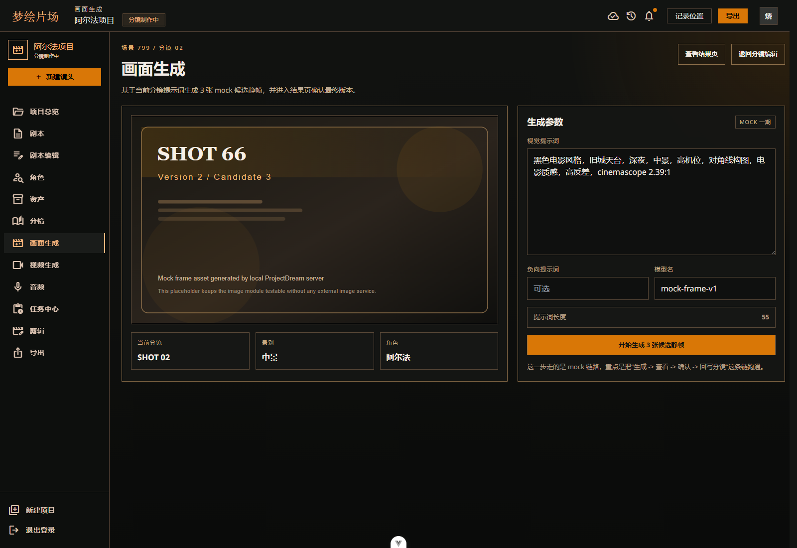

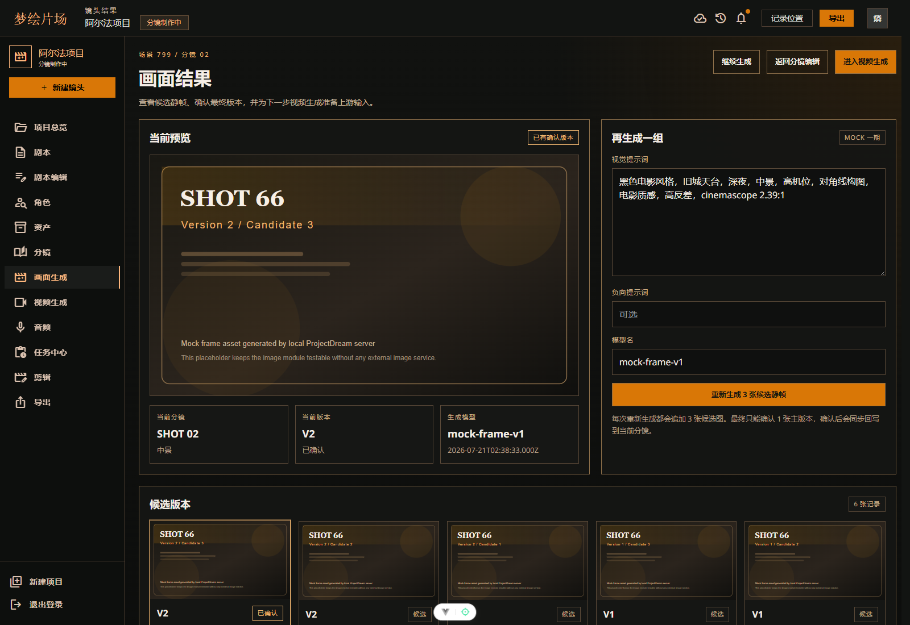

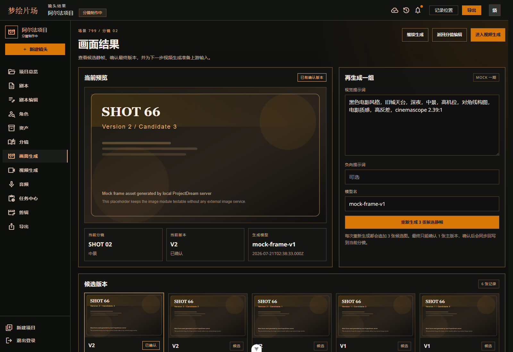

---

## 十二、视频生成模块问题与解决方案

### 1. 模块目标

视频生成模块这一阶段的目标是先跑通“最小闭环”，而不是直接接入真实视频模型。  
本阶段需要打通的主链路是：

- 基于 `projectId + sceneId + storyboardId` 进入当前分镜的视频生成页
- 必须依赖“已确认静帧”作为上游输入
- 生成一组候选视频
- 查看候选视频列表
- 确认一个最终视频版本
- 将确认结果回写到当前分镜，供后续合成与导出模块使用

---

### 2. 本轮实现内容

本轮围绕以下能力完成闭环：

1. 后端新增视频资产表 `video_assets`
2. 后端补齐视频生成、视频列表、视频确认三个接口
3. 前端 `project.ts` 增加视频模块 API 与 `VideoAssetDTO`
4. 将 `VideoGenerate.vue` 从静态原型改成真实数据驱动页面
5. 补齐从分镜编辑页进入视频页的上下文参数传递
6. 在确认最终视频后回写 `storyboards.video_url`

---

### 3. 遇到的问题与解决方案

#### 问题 1：视频生成页原本只是静态原型，没有真实数据链路

- 问题现象：
  页面虽然已经有 `VideoGenerate.vue`，但进入后看到的主要还是静态展示内容，无法真正读取当前分镜、生成候选视频或确认最终版本。
- 原因分析：
  视频模块最开始只完成了 UI 原型，后端没有 `video_assets` 表，也没有视频生成相关接口，前端自然无法形成真实闭环。
- 排查过程：
  对照静帧模块后确认，视频模块缺少的是完整的数据结构和前后端接口链路，而不是单纯的页面渲染问题。
- 解决方案：
  参考静帧模块的设计方式补齐：
  - 新增 `video_assets` 表
  - 新增 `POST /api/storyboards/:storyboardId/videos/generate`
  - 新增 `GET /api/storyboards/:storyboardId/videos`
  - 新增 `POST /api/videos/:videoId/confirm`
  - 前端补齐对应 API 封装并改成真实请求驱动
- 最终结果：
  视频生成页从演示态变成了真实业务页面，具备了生成、查看、确认视频的基础能力。

---

#### 问题 2：没有“已确认静帧”时，视频模块如果继续放行，会让链路前提失效

- 问题现象：
  用户可能直接从分镜页进入视频模块，但当前分镜并没有已确认静帧。如果此时仍允许点“生成视频”，整个视频链路就失去了明确的上游输入。
- 原因分析：
  一期视频生成是标准的“图生视频”最小闭环，必须明确依赖当前分镜下 `status = 'confirmed'` 的静帧。
- 排查过程：
  复查业务规则后确认，这不是一个可选提示，而是必须同时由前端和后端共同兜底的硬前置条件。
- 解决方案：
  前后端双层拦截：
  - 页面加载时先读取当前分镜静帧列表，只认 `confirmed` 静帧
  - 没有 confirmed 静帧时进入 `missing-image` 状态
  - 页面明确提示“请先在静帧模块确认一张最终静帧，再生成视频”
  - 后端生成接口再次校验，没有已确认静帧就直接返回 `400`
- 最终结果：
  视频模块不会再在前提不成立时误放行，静帧确认和视频生成之间的上下游关系被真正锁定了。

---

#### 问题 3：同一分镜可以有多个候选视频，但最终只能确认一个主版本

- 问题现象：
  一次视频生成会产出多个候选版本，如果确认其中一个时没有清理同分镜下其他记录的确认状态，就会出现一个分镜存在多个“最终视频”的数据冲突。
- 原因分析：
  “候选多个、最终一个”是视频资产的核心业务约束，不能只靠前端高亮判断，必须由后端事务保证。
- 排查过程：
  对照静帧确认逻辑后发现，视频确认链路也需要同样的事务化收口，否则确认状态和分镜回写可能半成功半失败。
- 解决方案：
  在 `POST /api/videos/:videoId/confirm` 中使用事务处理：
  - 先把同分镜下其他视频统一改回 `candidate`
  - 再把当前视频改成 `confirmed`
  - 写入 `confirmed_at`
  - 同步回写 `storyboards.video_url`
- 最终结果：
  同一分镜下始终只会有一个最终确认视频，后续合成模块也可以稳定拿到唯一视频输入。

---

#### 问题 4：视频模块是分镜级子页面，缺少三参数上下文时很容易跑偏

- 问题现象：
  如果进入视频页时没有同时带上 `projectId + sceneId + storyboardId`，页面就无法准确知道当前在操作哪个项目、哪个场景、哪个分镜的视频资产。
- 原因分析：
  视频模块不是项目级页面，也不是场景级页面，而是建立在单分镜之上的子模块，必须依赖完整三级上下文。
- 排查过程：
  复查入口链路后确认，视频页不仅要验证 `storyboardId` 存在，还要校验当前分镜确实属于当前 `sceneId`。
- 解决方案：
  补齐入口和页面侧的上下文保护：
  - 从 `StoryboardEditor.vue` 进入视频页时强制携带三参数
  - `VideoGenerate.vue` 加入 `missing-project / missing-scene / missing-shot / error / ready` 等状态
  - 页面加载时校验 `storyboard.sceneId === sceneId`
  - 返回分镜页时也带回完整三参数
- 最终结果：
  视频模块的上下文链路稳定下来，不会再出现“看起来进了视频页，实际参数不完整或分镜归属错位”的问题。

---

#### 问题 5：本地联调时后端一度起不来，导致新接口看起来像“没实现”

- 问题现象：
  视频模块代码补完后，后端最初没有正常启动，前端看到的效果会像是接口不可用，容易误判成视频模块本身还没接好。
- 原因分析：
  `server/index.mjs` 同一作用域里存在重复声明，导致 Node 启动时报语法级错误，服务无法正常监听。
- 排查过程：
  通过检查后端启动日志和语法校验，定位到重复声明的常量变量名冲突，而不是视频接口本身的逻辑问题。
- 解决方案：
  修正重复声明问题，重新通过 `node --check server/index.mjs`，再重启后端服务完成联调。
- 最终结果：
  后端恢复正常启动后，视频模块相关接口可以被当前运行实例正确加载，联调链路恢复正常。

---

### 4. 模块结论

视频生成模块当前已经完成第一阶段主流程闭环，包含：

- 从当前分镜进入视频生成页
- 无已确认静帧时明确拦截
- 基于已确认静帧生成 3 个候选视频
- 查看当前分镜下的视频候选列表
- 确认一个最终视频版本
- 将最终视频回写到 `storyboards.video_url`
- 保持项目、场景、分镜三级上下文稳定

可以将“视频生成模块”标记为已完成。  
需要说明的是：

- 当前视频生成仍然是 mock 链路，主流程已经打通，但尚未接入真实视频模型
- 长轮询、任务队列、批量生成、音频与字幕联动仍属于后续增强项

下一步建议进入“合成与导出模块”。

---

### 5. 相关截图

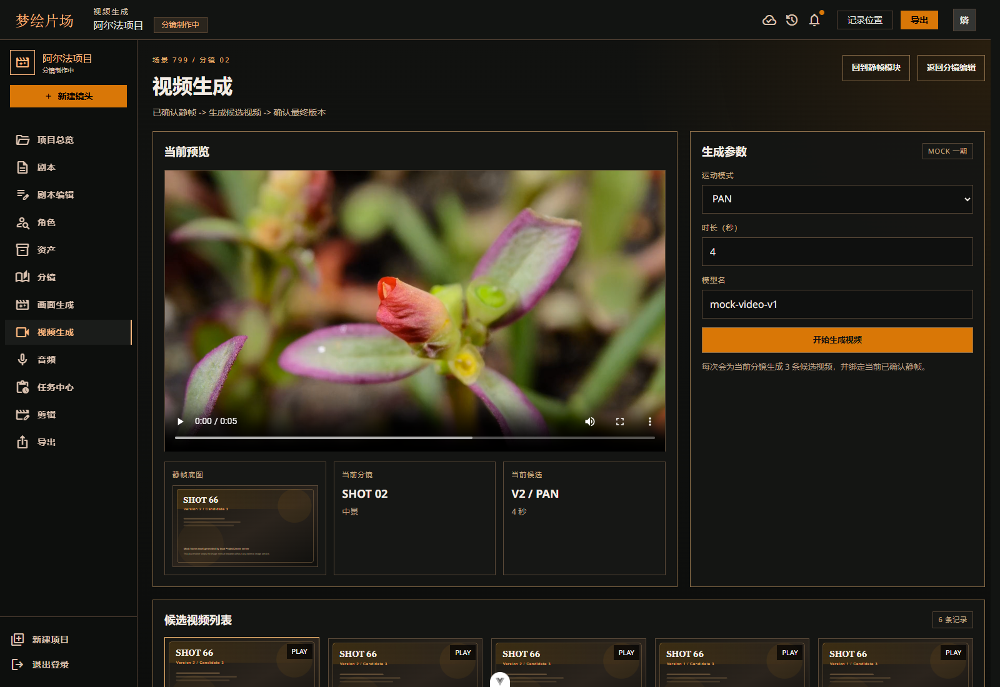


---

## 十三、合成与导出模块问题与解决方案

### 1. 模块目标

合成与导出模块这一阶段的目标是：

- 基于当前项目聚合可导出的已确认视频资产
- 展示导出清单、导出历史和导出结果
- 先跑通 mock 导出链路，而不是直接接真实渲染引擎
- 为后续成片编辑和更真实的交付流程保留扩展入口

---

### 2. 本轮收尾优化内容

这一轮不是从零重做导出模块，而是在一期最小闭环已经跑通的基础上，补一轮稳定性和产品语义收口，重点包括：

1. 导出就绪判定收口
2. 导出历史容错收口
3. 空态提示与回跳路径收口

---

### 3. 遇到的问题与解决方案

#### 问题 1：导出就绪状态一开始只依赖 `storyboards.video_url`，长期稳定性不够

- 问题现象：
  导出清单最开始是通过 `storyboards.video_url` 是否非空来判断某个分镜是否“可导出”。

- 原因分析：
  `storyboards.video_url` 更适合作为结果回写字段和展示字段，不应该独自承担“最终确认状态”的业务真相来源。
  真正更可靠的判断依据应该是 `video_assets` 中 `status = 'confirmed'` 的记录。

- 排查过程：
  在复查导出链路时发现，如果后面增加“撤销确认”“历史修复”“重新绑定”等能力，只看 `storyboards.video_url` 会和真实确认状态发生漂移。

- 解决方案：
  调整导出清单组装逻辑：
  - 优先查询当前分镜下 `status = 'confirmed'` 的视频资产
  - 只有存在已确认视频资产时，才把该分镜标记为 `ready`
  - `storyboards.video_url` 保留为兼容展示字段

- 最终结果：
  导出模块的“是否可导出”判定更贴近真实业务状态，后续扩展时更稳。

---

#### 问题 2：导出历史接口失败时，整页一开始会被误判成不可用

- 问题现象：
  如果“导出历史”接口失败，页面最开始会直接进入整页 `error`，导致用户连导出清单和导出按钮都看不到。

- 原因分析：
  初版实现把“导出清单”和“导出历史”放在同一个 `Promise.all()` 中，任意一个失败都会拖垮整页。

- 排查过程：
  从用户视角检查后发现，导出历史属于辅助信息，不应该和导出清单共用同一个主状态开关。

- 解决方案：
  拆成两层加载：
  - 先加载导出清单，并由它决定页面主状态
  - 再单独加载导出历史
  - 如果历史失败，只在历史区域提示“历史加载失败”，不阻断主流程

- 最终结果：
  页面容错更合理，就算历史接口短暂异常，用户依然可以继续完成导出。

---

#### 问题 3：空态提示说“回视频模块”，但按钮实际跳到别的地方，语义不一致

- 问题现象：
  空态文案一开始提示“请回视频模块确认最终视频”，但按钮实际跳转并不是直接回视频页，容易让用户觉得路线不对。

- 原因分析：
  当前导出页是项目级页面，而视频生成是分镜级页面；当没有明确 `sceneId + storyboardId` 时，页面并不能安全地直接跳回某一个具体视频页。

- 排查过程：
  复核跳转上下文后确认，导出页当前最稳妥的返回位置应该是项目工作区，而不是伪装成能直接精准跳到某个视频分镜。

- 解决方案：
  统一调整为空态引导：
  - 文案改成“先回到场景 / 分镜工作区，继续补完静帧和最终视频”
  - 按钮返回项目工作区里的场景页，保证语义和实际行为一致

- 最终结果：
  页面提示和按钮行为一致，用户不会再被文案误导。

---

### 4. 模块结论

合成与导出模块在这一轮收尾后，已经进一步补强了以下能力：

- 导出清单按“已确认视频资产”判定就绪状态
- 导出历史失败时不再拖垮整个导出页
- 空态引导文案与实际跳转保持一致

当前可以将“合成与导出模块”视为：

- 一期最小闭环已完成
- 主流程可用
- 当前仍属于 mock 导出链路
- 后续可继续扩展真实渲染、任务队列、导出进度与失败重试

---

### 5. 相关截图

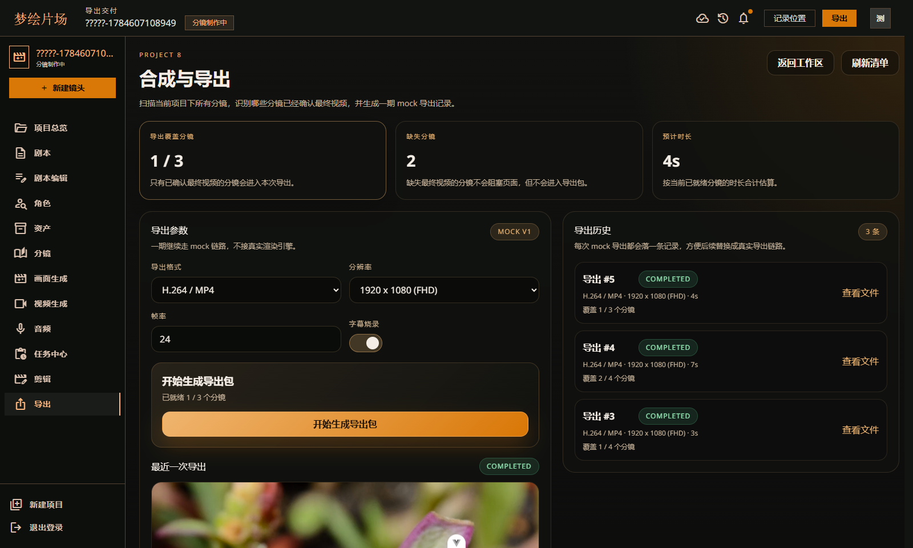


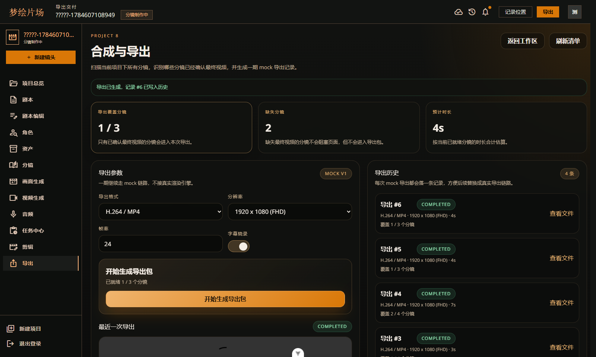

---

## 十四、资产模块问题与解决方案

> 当前详细问题记录后续再迁入本文档；模块命名与章节顺序已先统一，当前阶段进展可先参考《项目开发推进清单与问题记录模板》。

---

## 十五、音频模块问题与解决方案

> 当前详细问题记录后续再迁入本文档；模块命名与章节顺序已先统一，当前阶段进展可先参考《项目开发推进清单与问题记录模板》。

---

## 十六、任务中心模块问题与解决方案

> 当前详细问题记录后续再迁入本文档；模块命名与章节顺序已先统一，当前阶段进展可先参考《项目开发推进清单与问题记录模板》。

---

## 十七、成片编辑模块问题与解决方案

> 详见文末“补充记录：成片编辑模块（2026-07-21）”，并参考 `截图/成片编辑模块/`

---

## 十八、第一阶段全链路验收与收尾修 bug

> 详见文末“补充记录：第一阶段全链路验收与收尾修 bug（2026-07-21）”

---

## 十九、后续补充规则

后续每完成一个模块，就按下面的结构继续往本文档中补充：

```md
### 问题 X：xxx

- 问题现象：
- 原因分析：
- 排查过程：
- 解决方案：
- 最终结果：
```

建议保持统一格式，这样后面整理项目总结、答辩文档或课程报告时会非常方便。

---

## 补充记录：故事总纲模块（2026-07-20）

### 1. 模块目标

故事总纲模块的目标是：

- 基于项目基础信息生成项目级故事总纲
- 输出三幕结构与场景预览
- 为后续场景拆解、单场景剧本、分镜生成提供统一上游语义

---

### 2. 本轮实现内容

本轮围绕以下能力完成闭环：

1. 获取项目最新总纲
2. 生成项目级总纲
3. 展示总纲空态、加载态、成功态、异常态
4. 展示 `outline.scenes` 形式的预览场景
5. 将预览场景落库为正式场景
6. 为后续剧本生成与分镜生成保留版本化上下文

---

### 3. 遇到的问题与解决方案

#### 问题 1：重新生成总纲后，旧场景与新总纲会产生语义错位

- 问题现象：
  已经生成过正式场景后，如果再次生成总纲，旧场景仍然停留在页面或数据库里，用户可能继续基于旧场景写剧本，导致内容与新总纲不一致。
- 原因分析：
  总纲是项目级上游数据，一旦版本变化，依赖它拆出来的场景、剧本、分镜理论上都应该视为失效。
- 排查过程：
  复查前后端链路后发现，生成新总纲时前端只更新了 `outline`，而旧 `scenes` 没有被完整视为失效数据。
- 解决方案：
  后端在重新生成总纲前清空该项目下已有正式场景；
  前端在生成成功后同步清空当前 `scenes`，并重置当前选中场景。
- 最终结果：
  “重做项目总纲”后不会再残留旧场景，避免了旧数据继续流入后续模块。

---

#### 问题 2：总纲阶段声明了“场景预览”，但页面一开始并没有真正展示

- 问题现象：
  页面文案说明总纲会带出场景预览，但用户只生成总纲时，界面却仍可能表现为空列表，容易误以为功能没生效。
- 原因分析：
  页面原先主要依赖正式场景列表 `script_scenes` 渲染，没有把 `outline.scenes` 当作独立的预览数据源来处理。
- 排查过程：
  检查页面数据流后确认，总纲接口虽然已经返回了预览场景，但前端没有完整区分“预览场景”和“正式场景”两种状态。
- 解决方案：
  增加展示层场景视图，统一处理两种数据源：
  - 有正式场景时，优先展示正式场景
  - 没有正式场景时，展示总纲中的预览场景
  同时在页面上明确标记 `PREVIEW` 状态。
- 最终结果：
  用户在总纲生成后即可看到场景预览，并能理解“生成场景（落库）”与预览的关系。

---

#### 问题 3：预览场景和正式场景混用选中逻辑，导致选中错乱

- 问题现象：
  切换到正式场景后，点击第二场、第三场时有时仍然回到第一场，场景选中表现不稳定。
- 原因分析：
  预览场景没有数据库 ID，只能用数组下标；正式场景有真实 `scene.id`。如果两者共用一套“选中值”语义，就容易混乱。
- 排查过程：
  代码复查时发现，部分地方把正式场景也按数组下标处理，导致正式场景查找失败后回退到第一项。
- 解决方案：
  明确拆分选中规则：
  - 正式场景使用 `scene.id`
  - 预览场景使用数组下标
  并在模板与计算属性中统一这套规则。
- 最终结果：
  场景选择行为恢复稳定，正式场景与预览场景切换时不再串状态。

---

#### 问题 4：预览态错误开放“生成剧本”，会错误调用正式场景接口

- 问题现象：
  在只有预览场景、尚未落库时，页面仍可点击“生成剧本”，会把预览下标误当成正式场景 ID 调接口。
- 原因分析：
  预览场景本质上只是总纲中的草案数据，没有真实 `script_scenes` 记录，因此不具备剧本生成目标。
- 排查过程：
  审查按钮禁用条件与脚本生成函数后，确认预览态缺少严格保护。
- 解决方案：
  同时做两层防护：
  - UI 层：预览态禁用“生成剧本”
  - 逻辑层：`onGenerateScript()` 内再次校验，只有正式场景才允许执行
- 最终结果：
  预览态无法误调用单场景剧本接口，模块边界更清晰。

---

#### 问题 5：“重新生成总纲”文案容易让用户误以为是局部微调

- 问题现象：
  用户会自然理解成“只改当前某个 scene 的总纲”，但实际系统执行的是项目级总纲重建，并会让全部正式场景失效。
- 原因分析：
  当前系统中的“总纲”是项目级对象，不是单场级对象；原按钮文案没有把这个层级说清楚。
- 排查过程：
  结合交互体验复查后发现，代码逻辑本身没有错，问题在于产品表达不够明确。
- 解决方案：
  将操作文案改为“重做项目总纲”，并增加二次确认弹窗；
  弹窗中明确说明：
  - 这是项目级操作
  - 会清空当前正式场景
  - 会回到总纲预览阶段
  - 之后需要重新生成场景
  同时在错误态下也统一接入这套确认逻辑。
- 最终结果：
  用户能清楚区分“项目级重做总纲”和“正式场景落库”，不会再把它误解成单场局部修改。

---

### 4. 模块结论

故事总纲模块目前已经完成可用闭环，包含：

- 项目级总纲生成
- 三幕结构展示
- 预览场景展示
- 正式场景落库衔接
- 剧本生成前置保护
- 项目级重做总纲风险提示

可以将“故事总纲模块”标记为已完成，下一步建议进入“场景拆解模块”。

---

### 5. 相关截图

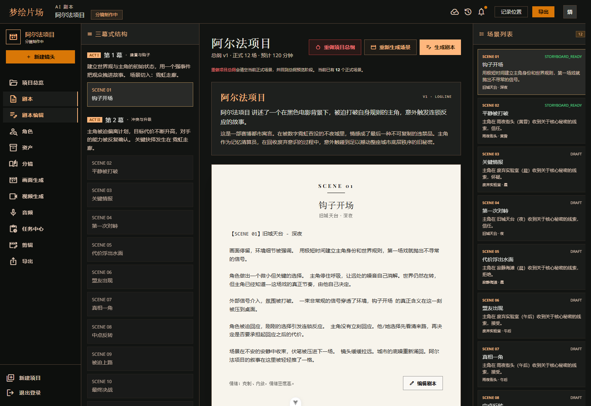

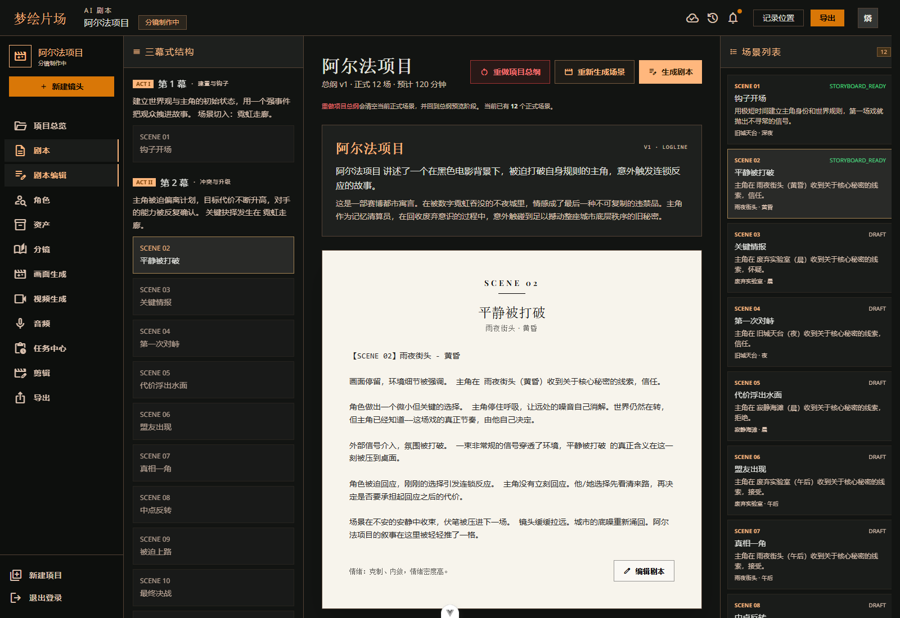


---

## 补充记录：场景拆解模块（2026-07-20）

### 1. 模块目标

场景拆解模块的目标是：

- 基于当前项目的最新总纲生成正式场景列表
- 支持查看、切换、编辑和保存单个正式场景
- 为后续单场景剧本模块提供稳定的 `sceneId` 输入

---

### 2. 本轮实现内容

本轮围绕以下能力完成闭环：

1. 获取当前项目正式场景列表
2. 基于总纲生成正式场景
3. 展示场景空态、无总纲态、加载态、错误态、就绪态
4. 编辑单个场景的基础信息
5. 保存场景标题、摘要、地点、时间、预估时长
6. 从当前场景进入单场景剧本模块

---

### 3. 遇到的问题与解决方案

#### 问题 1：场景模块容易把“没有总纲”和“总纲读取失败”混为一谈

- 问题现象：
  当场景页拉取总纲失败时，页面一开始会直接表现成“请先生成项目总纲”，用户会误以为项目根本没有总纲。
- 原因分析：
  `outline === null` 同时承担了两种语义：
  1. 接口成功但确实没有总纲
  2. 接口异常导致没拿到总纲
- 排查过程：
  复查场景页状态机后发现，总纲拉取失败时直接把 `outline` 置空，后续页面又把空值统一解释成 `no-outline`。
- 解决方案：
  将“总纲读取失败”与“项目没有总纲”分开：
  - 接口失败时进入 `error`
  - 只有接口成功且 `outline === null` 时才进入 `no-outline`
- 最终结果：
  页面状态表达更准确，用户和开发都能更快判断问题来源。

---

#### 问题 2：estimatedDuration 非法值会被写成 0，污染后续模块数据

- 问题现象：
  场景编辑接口里如果传入非法时长、0 或负数，后端有机会把它写成 `0`，这会让场景时长失真。
- 原因分析：
  原本设计意图是“只接受正整数，否则忽略”，但实现里对非法值的过滤不够严格。
- 排查过程：
  检查场景更新接口后发现，数值字段沿用了 `parseId()`，而旧判断条件无法正确拦住 `0` 这种无效值。
- 解决方案：
  在后端更新逻辑里显式约束：
  - `estimatedDuration` 必须 `> 0`
  - 否则直接忽略该字段更新
- 最终结果：
  无效时长不会再落库，后续剧本、分镜、导出模块的数据基础更稳定。

---

#### 问题 3：切换场景时，未保存修改会被静默丢弃

- 问题现象：
  用户在当前场景改了标题、摘要、地点等信息后，如果直接切到另一个场景，修改会丢失，只留下事后提示。
- 原因分析：
  场景切换动作会刷新当前表单草稿，而没有在切换前要求用户确认。
- 排查过程：
  复查切场景逻辑后发现，旧实现只依赖 `infoMsg` 提示，没有真正阻止切换。
- 解决方案：
  新增“未保存修改确认弹窗”：
  - 有 dirty 时先暂存目标 `sceneId`
  - 用户确认“丢弃并切换”后才真正切换
  - 用户取消则继续留在当前场景
- 最终结果：
  避免了静默丢数据，场景编辑体验更符合预期。

---

#### 问题 4：重新生成场景后，用户当前查看上下文容易丢失

- 问题现象：
  用户原本正在看某一场，重新生成场景后页面容易回到第一场，导致操作上下文被打断。
- 原因分析：
  重新生成场景本质上会重建整套 `script_scenes`，旧 `scene.id` 会失效，不能直接用旧 id 恢复选中。
- 排查过程：
  检查生成逻辑后发现，原实现默认回退到第一场，缺少对用户当前场次的恢复策略。
- 解决方案：
  重新生成前记录当前选中的 `sceneNo`；
  生成后优先在新列表中匹配同一 `sceneNo`；
  若未命中，再回退到第一场并给出提示。
- 最终结果：
  重新生成场景后，页面会尽量保留用户原来的场次上下文，而不是无脑跳回 `SCENE 01`。

---

#### 问题 5：重新生成场景是项目级操作，容易被误解成“只改当前场景”

- 问题现象：
  用户在某个场景上点击“重新生成场景”时，很容易以为只是重写当前场景，实际上系统会覆盖整个项目的正式场景列表。
- 原因分析：
  当前接口语义是 `/projects/:id/scenes/generate`，本质上是项目级批量重建，而不是单场级操作。
- 排查过程：
  结合前后端链路复查后确认，当前场景页只是“停留在某个 scene 上”，并不代表生成按钮只作用于当前 scene。
- 解决方案：
  在场景页中增加二次确认弹窗，并明确提示：
  - 会覆盖当前所有正式场景
  - 已有人工修改会丢失
  同时保留“进入剧本”作为真正的单场后续操作入口。
- 最终结果：
  用户能更清楚地区分“项目级重生成场景”和“单场后续编辑”。

---

### 4. 模块结论

场景拆解模块当前已经完成主流程闭环，包含：

- 正式场景生成
- 正式场景列表展示
- 场景切换查看
- 场景基础信息编辑与保存
- 未保存修改保护
- 进入单场景剧本模块

可以将“场景拆解模块”标记为主流程已完成。

需要说明的是：

- 当前“重新生成场景”仍然是项目级操作
- “指定场景的 AI 改写”不属于本模块核心职责，更适合放到后续“单场景剧本模块”中实现

---

### 5. 相关截图

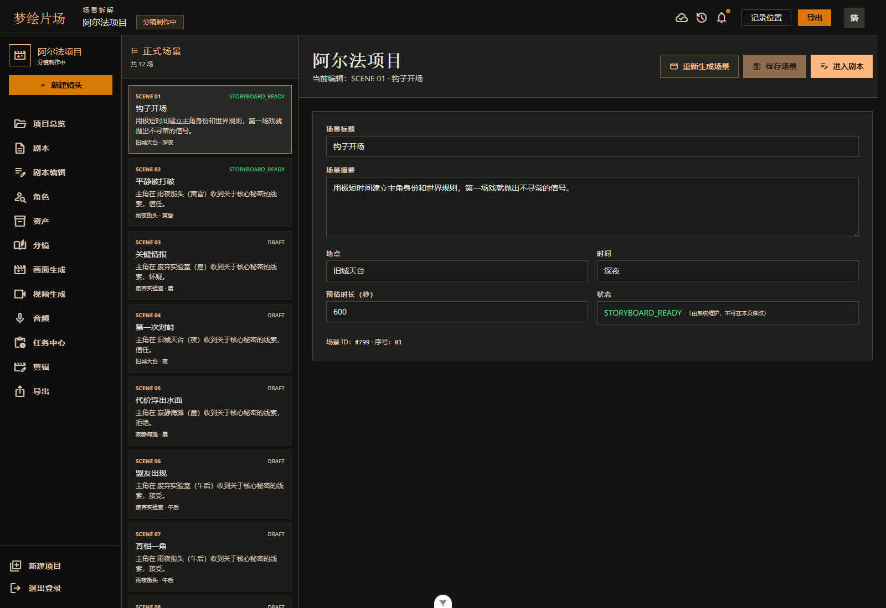

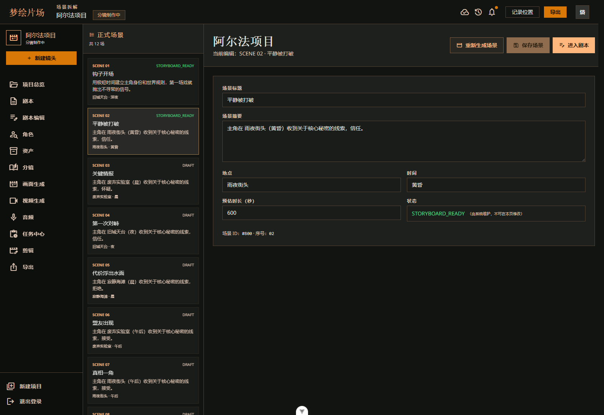

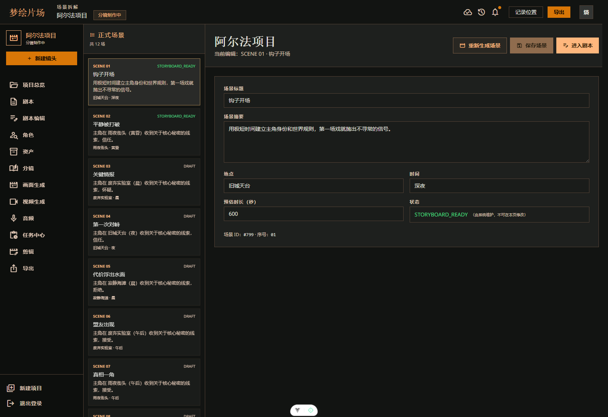

---

## 补充记录：单场景剧本模块（2026-07-20）

### 1. 模块目标

单场景剧本模块的目标是：
- 基于 `projectId + sceneId` 进入单场景剧本工作区
- 支持生成当前场景剧本、重写当前场景剧本
- 支持人工编辑并保存标题、正文、情绪
- 支持从当前场景稳定进入分镜模块

---

### 2. 本轮实现内容

本轮围绕以下能力完成闭环：
1. 读取当前项目和当前场景上下文
2. 加载场景列表与当前场景剧本详情
3. 支持首次生成剧本与重写当前场景剧本
4. 支持人工编辑后保存剧本
5. 支持切换场景并保护未保存修改
6. 支持从当前场景进入分镜模块

---

### 3. 遇到的问题与解决方案

#### 问题 1：首次生成剧本时，用户未保存的标题或情绪修改可能被静默覆盖

- 问题现象：
  当前场景还没有剧本正文时，用户如果先手动改了标题或情绪，再点“生成剧本”，这些改动会被 AI 回包直接覆盖。

- 原因分析：
  旧逻辑只把“已有正文”视为重写场景，才弹二次确认；但实际上“无正文但已有 dirty 草稿”同样属于会丢失人工修改的高风险操作。

- 排查过程：
  复查生成入口后发现，判断条件只依赖 `hasContent`，没有把 `draftTitle`、`draftMood`、`draftContent` 的 dirty 状态纳入覆盖风险判断。

- 解决方案：
  调整生成入口判断逻辑：
  - 只要当前场景已有正文，必须走二次确认
  - 只要当前表单存在未保存修改，也必须走二次确认
  - 只有“无正文 + 无 dirty”时，才允许直接首次生成

- 最终结果：
  首次生成与重写剧本的边界更清晰，用户的人工修改不会再被静默吞掉。

---

#### 问题 2：页面加载失败曾被局部吞掉，容易出现状态假正常

- 问题现象：
  某些接口失败时，页面可能没有正确进入错误态，而是继续停留在可操作页面，导致用户误以为当前数据已经成功加载。

- 原因分析：
  原来的 `loadBase()`、`loadScene()` 在局部处理错误时只写提示，不继续向外抛出，`loadAll()` 无法统一感知失败。

- 排查过程：
  复查加载链路后发现，页面状态机虽然区分了 `loading / error / ready`，但中间步骤失败时并没有真正统一收口到 `error`。

- 解决方案：
  调整为统一加载链路：
  - `loadBase()`、`loadScene()` 失败时直接抛错
  - 由 `loadAll()` 统一兜底，写入 `errorMsg` 并切换到 `error` 状态

- 最终结果：
  页面状态表达更真实，接口异常不会再伪装成“页面可继续使用”。

---

#### 问题 3：路由上下文监听不完整，跨项目切换时可能残留旧数据

- 问题现象：
  当页面复用同一个组件实例时，如果只监听 `sceneId`，而没有监听 `projectId`，就可能出现跨项目切换后场景列表或工作区上下文仍停留在旧项目。

- 原因分析：
  单场景剧本模块的真实上下文不是单独一个 `sceneId`，而是 `projectId + sceneId` 的组合。

- 排查过程：
  复查 `watch` 逻辑后确认，旧实现只关注场景变化，没有把项目变化视为同等重要的重载信号。

- 解决方案：
  将监听逻辑改为同时监听：
  - `route.query.projectId`
  - `route.query.sceneId`
  任一变化都重新执行完整加载流程。

- 最终结果：
  组件在跨项目、跨场景复用时，上下文同步更稳定，不容易残留旧项目数据。

---

#### 问题 4：切场景和异步请求并发时，旧回包可能污染当前场景上下文

- 问题现象：
  用户在保存、生成剧本、生成分镜或页面加载过程中切到别的场景时，旧请求回包有机会把当前页面又改回旧场景，甚至把分镜跳到错误页面。

- 原因分析：
  异步请求返回时，如果不校验“当前页面还是不是发请求时那个 `projectId + sceneId`”，就会出现典型的上下文串场问题。

- 排查过程：
  这一轮复查时先后暴露出两类问题：
  - `loadAll()` 里旧请求虽然会被判定过期，但状态写入发生得太早
  - 保存/生成/进入分镜这些操作在回包后缺少统一上下文校验

- 解决方案：
  最终收口为两层保护：
  - 引入 `snapshotContext()`，发请求前记录 `projectId + sceneId`
  - 回包后先用 `isContextChanged()` 校验，上下文变了就直接丢弃结果
  同时把 `loadBase()` 和 `loadScene()` 改成纯取数函数，不直接写页面状态，统一由 `loadAll()` 在 snapshot 校验通过后一次性提交。

- 最终结果：
  单场景剧本模块不再轻易出现“切到 B，A 的回包又把页面拉回去”的串场问题。

---

#### 问题 5：当前 scene 不属于当前 project 时，页面可能进入混合上下文

- 问题现象：
  如果用户手动改 URL，或者前端某处传参出错，可能出现 `projectId` 属于项目 A、`sceneId` 却属于项目 B 的情况，页面会变成“项目 A 列表 + 项目 B 剧本内容”的混合状态。

- 原因分析：
  旧逻辑分别读取项目和场景，但没有在前端加载时额外确认 `scene.projectId === projectId`。

- 排查过程：
  复查上下文链路后发现，虽然接口本身有所有权校验，但仍然需要在页面层再做一次归属校验，避免错误组合被当成正常上下文继续使用。

- 解决方案：
  在加载当前场景成功后，显式校验：
  - `scene.projectId` 必须等于当前 `projectId`
  - 不满足时直接进入错误态，不写入工作区上下文

- 最终结果：
  页面上下文边界更清晰，错误 URL 不会再悄悄混入正常工作流。

---

#### 问题 6：丢弃修改并切场景时，草稿重置代码一度被同一行注释吞掉

- 问题现象：
  在“丢弃修改并切场景”的收尾逻辑里，标题草稿一度没有真正重置，导致放弃修改后的表单行为不完全一致。

- 原因分析：
  某一行赋值代码跟在注释后面，实际执行时被当成注释内容吞掉了。

- 排查过程：
  这是在第二轮复查里发现的，表面上看逻辑已经存在，但展开行号后发现真正执行的只有部分草稿字段重置。

- 解决方案：
  把三个草稿字段的重置逻辑拆成独立代码行：
  - `draftTitle`
  - `draftContent`
  - `draftMood`

- 最终结果：
  “丢弃修改并切场景”的行为恢复一致，草稿状态不会再部分残留。

---

### 4. 模块结论

单场景剧本模块当前已经完成主流程闭环，包含：

- 单场景剧本加载
- 首次生成与重写剧本
- 人工编辑与保存
- 未保存修改保护
- 异步回包上下文保护
- 进入分镜模块前的前置校验

可以将“单场景剧本模块”标记为已完成。

下一步建议进入“分镜生成模块”，重点先跑通：
- 当前场景分镜列表加载
- 基于当前场景剧本生成分镜
- 重新生成分镜时的覆盖与提示
- 从分镜列表进入单镜头编辑器

---

### 5. 相关截图

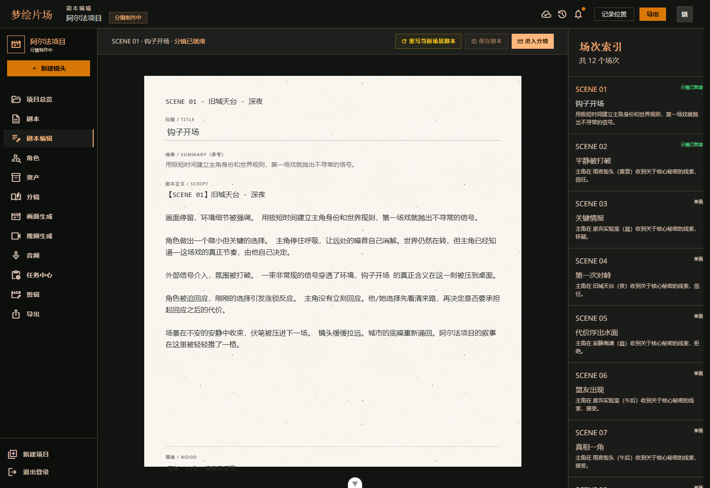

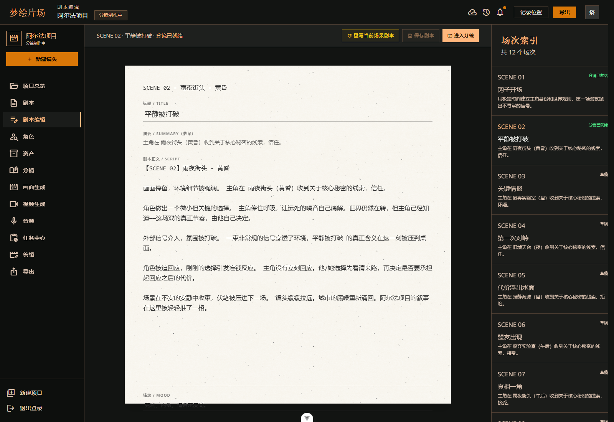


---

## 补充记录：分镜生成模块（2026-07-20）

### 1. 模块目标

分镜生成模块的目标是：
- 基于 `projectId + sceneId` 进入当前场景的分镜页
- 加载当前场景已有分镜列表
- 支持首次生成分镜与重新生成分镜
- 让分镜生成结果稳定衔接到后续单镜头编辑模块

---

### 2. 本轮实现内容

本轮围绕以下能力完成闭环：
1. 读取当前项目和当前场景上下文
2. 加载当前场景的分镜列表
3. 没有分镜时支持生成分镜
4. 已有分镜时支持重新生成并覆盖旧分镜
5. 点击分镜卡片进入单镜头编辑页
6. 补齐空态、错误态、缺少上下文态与生成中状态

---

### 3. 遇到的问题与解决方案

#### 问题 1：分镜生成依赖具体场景，但页面在缺少上下文时容易进入无效状态

- 问题现象：
  如果没有 `projectId` 或 `sceneId`，页面就不知道当前应该展示哪个项目、哪个场景的分镜，但旧实现容易直接停在无效页面，或者依赖用户自己猜下一步该去哪。

- 原因分析：
  分镜模块不是项目级总入口，而是建立在“某个具体场景”之上的子模块，上下文缺失时必须明确给出引导。

- 排查过程：
  复查页面入口后发现，分镜页需要同时依赖项目和场景两个参数，缺任意一个都不应该继续走正常加载链路。

- 解决方案：
  在前端建立明确状态机：
  - `missing-project`
  - `missing-scene`
  - `loading`
  - `error`
  - `empty`
  - `ready`
  同时为缺少上下文场景提供友好提示与返回入口。

- 最终结果：
  分镜页在上下文缺失时不再进入模糊状态，用户能清楚知道该先回哪一步补齐条件。

---

#### 问题 2：当前 scene 不属于当前 project 时，可能出现混合上下文

- 问题现象：
  如果路由参数被手动改坏，可能出现 `projectId` 属于项目 A，但 `sceneId` 实际属于项目 B，页面就会混入错误上下文。

- 原因分析：
  分镜页同时读取项目和场景，如果不额外做归属校验，就可能出现“项目信息和场景信息不属于同一条链”的问题。

- 排查过程：
  复查加载逻辑后确认，单靠“场景存在”还不够，还需要校验 `scene.projectId === projectId`。

- 解决方案：
  在加载当前场景后显式校验场景归属：
  - 当前 scene 必须属于当前 project
  - 不满足时直接进入错误态，不继续写入工作区上下文

- 最终结果：
  分镜模块的项目上下文和场景上下文保持一致，不会悄悄加载错误场景。

---

#### 问题 3：旧请求回包可能污染当前分镜页上下文

- 问题现象：
  用户在加载或生成分镜过程中切换场景时，旧请求回包可能把当前页面状态改回旧场景的数据。

- 原因分析：
  分镜页和前面的剧本页一样，都存在异步请求和路由上下文同时变化的问题；如果不做上下文快照校验，就会发生典型串场。

- 排查过程：
  复查 `loadAll()` 和生成分镜逻辑后发现，分镜页同样需要“请求发起时上下文”和“回包时上下文”一致性保护。

- 解决方案：
  引入：
  - `snapshotContext()`
  - `isContextChanged()`
  并将项目、场景、分镜列表加载改为纯取数函数，由 `loadAll()` 在快照校验通过后统一提交状态。

- 最终结果：
  分镜模块不会因为过期回包而污染当前场景的数据。

---

#### 问题 4：重新生成分镜实际是覆盖旧分镜，但产品语义一开始不够明确

- 问题现象：
  用户看到“重新生成分镜”时，容易误以为是增量追加，实际上后端语义是清空旧分镜后重建。

- 原因分析：
  “重新生成”这个操作名称本身不够直观，如果没有明确提示“覆盖旧分镜”，用户很容易误判风险。

- 排查过程：
  复查后端实现后确认，接口本质是：
  - `DELETE old storyboards`
  - `INSERT new storyboards`
  不是在原有基础上补几个镜头。

- 解决方案：
  前端补上二次确认弹窗，并明确写清楚：
  - 重新生成会覆盖当前分镜
  - 不是追加
  - 当前已有镜头会被替换

- 最终结果：
  用户在重新生成前能清楚理解风险，避免误操作。

---

#### 问题 5：规则要求“必须先有剧本才能生成分镜”，但最初只有前端拦截，后端规则没有真正封死

- 问题现象：
  虽然前端页面会提示“请先编辑或生成剧本”，但如果绕过前端直接调接口，后端一开始仍可能继续生成分镜。

- 原因分析：
  业务规则是在前端形成的，但后端 route 层最初没有把“剧本正文不能为空”当作硬前提。

- 排查过程：
  多轮复查中发现：
  - 前端已经用 `scene.content` 控制了按钮禁用
  - 但后端 route 入口一开始没有对空剧本直接 `fail(...)`
  - AI 服务甚至还保留过 `summary` 的兜底

- 解决方案：
  最终收口成三层一致规则：
  - 前端：空剧本时禁用生成按钮并提示回到剧本页
  - 后端：`scene.content` 为空时直接返回错误，不允许继续走 AI
  - AI 服务：只接受正式剧本正文，不再回退到 `summary`

- 最终结果：
  “先有剧本，再生成分镜”从提示规则变成了真正的系统规则。

---

#### 问题 6：分镜重新生成是覆盖式写库，必须放进事务，避免留下半套数据

- 问题现象：
  如果重新生成分镜时中途失败，就可能出现旧分镜已经被删掉，但新分镜只写进去一部分的脏数据状态。

- 原因分析：
  这个流程天然是一个整体操作：
  - 删除旧分镜
  - 插入新分镜
  - 更新场景状态
  - 更新项目状态
  任何一步失败，都不应该让前面的部分结果落地。

- 排查过程：
  复查后端实现时发现，最初这段逻辑虽然能跑通，但没有事务保护，理论上会留下半套新数据。

- 解决方案：
  将 `DELETE + INSERT + UPDATE` 整体放进事务：
  - `beginTransaction()`
  - 中途失败 `rollback()`
  - 全部成功后 `commit()`

- 最终结果：
  分镜重新生成要么完整成功，要么完全回滚，不会再留下半成品数据。

---

#### 问题 7：上游提示文案和当前业务规则一度不一致，误导用户以为可以跳过剧本直接生成分镜

- 问题现象：
  在场景选择提示中，一度存在“进入剧本编辑或直接为它生成分镜”的文案，这和“必须先有剧本”的实际规则冲突。

- 原因分析：
  业务规则已经收口，但上游引导文案没有同步更新，导致用户认知仍停留在旧流程。

- 排查过程：
  这是在模块收尾阶段通过页面走查发现的，不是核心逻辑 bug，而是产品表达和当前实现之间存在错位。

- 解决方案：
  将提示文案改成与当前规则一致的说法，明确表达：
  - 先选择场景
  - 先进入剧本编辑
  - 完成剧本后再生成分镜

- 最终结果：
  页面引导与业务规则保持一致，用户不会再被“可直接生成分镜”的旧提示误导。

---

### 4. 模块结论

分镜生成模块当前已经完成主流程闭环，包含：

- 当前场景分镜列表加载
- 首次生成分镜
- 重新生成分镜并覆盖旧分镜
- 空剧本前置校验
- 事务化重生成功能
- 进入单镜头编辑页

可以将“分镜生成模块”标记为已完成。

下一步建议进入“分镜编辑模块”，重点先跑通：
- 单镜头详情加载
- 单镜头字段编辑与保存
- 镜头间切换
- 单镜头页的上下文保护

---

### 5. 相关截图

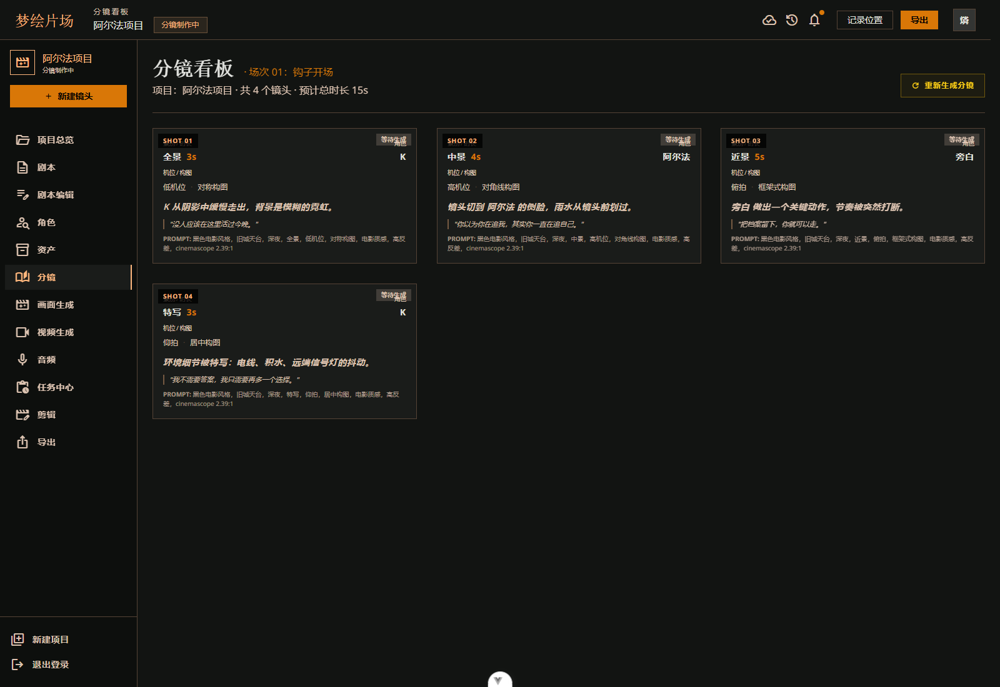

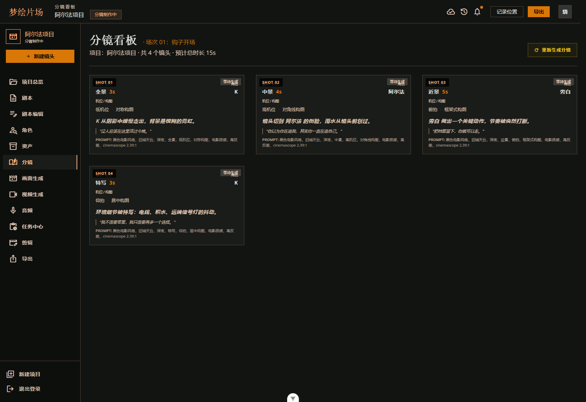

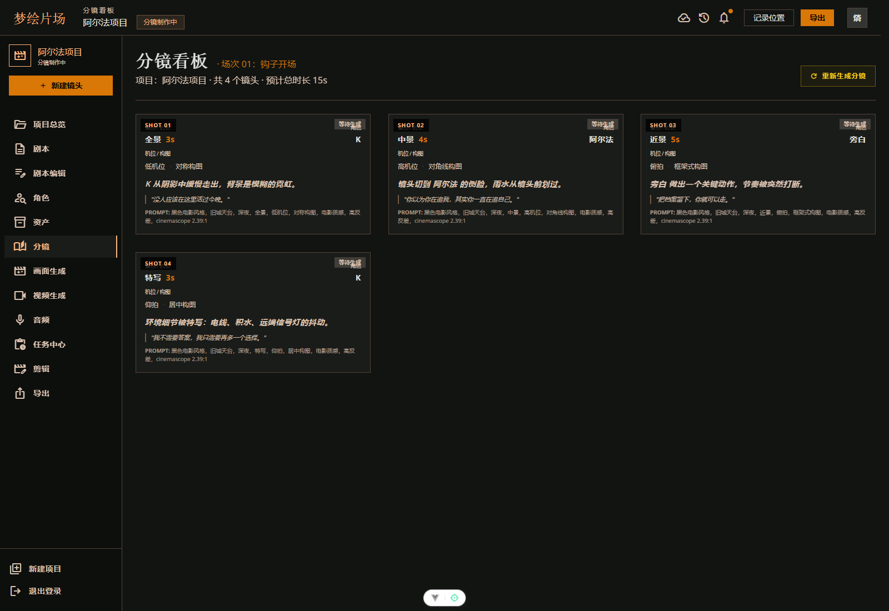

## 补充记录：分镜编辑模块（2026-07-20）
### 1. 模块目标

分镜编辑模块的目标是：
- 稳定加载单个分镜详情
- 支持编辑并保存分镜基础字段
- 支持镜头间切换与未保存确认
- 支持将当前分镜标记为已完成
- 保证切换、保存、回包都不污染当前上下文

### 2. 本轮实现内容

本轮围绕以下能力完成闭环：
1. 加载单个分镜详情
2. 加载同场景分镜列表
3. 支持字段编辑与保存
4. 支持“标记为已完成”
5. 支持同页镜头切换确认
6. 支持路由变化时的未保存保护
7. 支持图片 URL 直接编辑并联动预览

### 3. 遇到的问题与解决方案

#### 问题 1：标记完成会覆盖未保存草稿
- 问题现象：用户修改了分镜字段但没点保存，直接点“标记为已完成”时，草稿会被服务端旧值覆盖。
- 原因分析：旧实现只提交 `{ status: 'done' }`，成功后又用后端回包同步整份草稿，未保存字段会丢失。
- 解决方案：`markDone()` 改为在存在 dirty 草稿时一并提交当前草稿，再统一标记 `done`。
- 最终结果：完成动作不再吞掉未保存修改。

#### 问题 2：imageUrl 可配置但页面不能编辑
- 问题现象：页面说明里包含图片 URL，但 UI 只有预览，没有输入框，用户无法修改。
- 原因分析：字段虽然已经参与保存和回显，但缺少真正的编辑入口。
- 解决方案：在预览区下方补充 `draft.imageUrl` 输入框，并保持与预览联动。
- 最终结果：图片地址可以直接编辑并保存。

#### 问题 3：路由变化时未保存保护不完整
- 问题现象：浏览器前进/后退或外部改 query 时，未保存草稿可能被直接冲掉。
- 原因分析：原先只在同页镜头点击时做了确认，`watch(route.query...)` 仍会直接 `loadAll()`。
- 解决方案：增加路由回滚标记 `isRollingBack`，并把路由变更与同页切镜头都纳入统一确认流。
- 最终结果：取消切换会留在当前镜头，确认后才真正跳转。

### 4. 模块结论

分镜编辑模块已经完成主流程闭环，包含：
- 单镜头详情加载
- 字段编辑与保存
- 标记完成
- 镜头切换确认
- 路由变化时的未保存保护
- 图片 URL 编辑与预览联动

可以将“分镜编辑模块”标记为已完成。
下一步建议进入“角色库模块”。

---

### 5. 相关截图

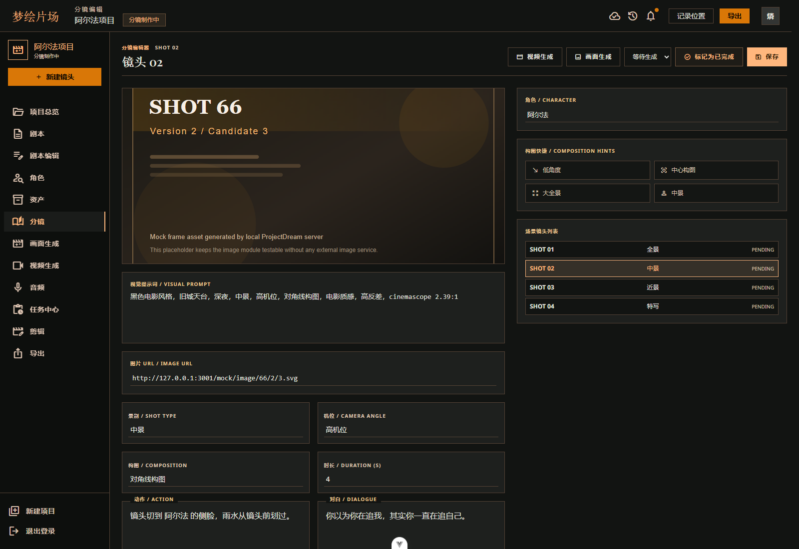


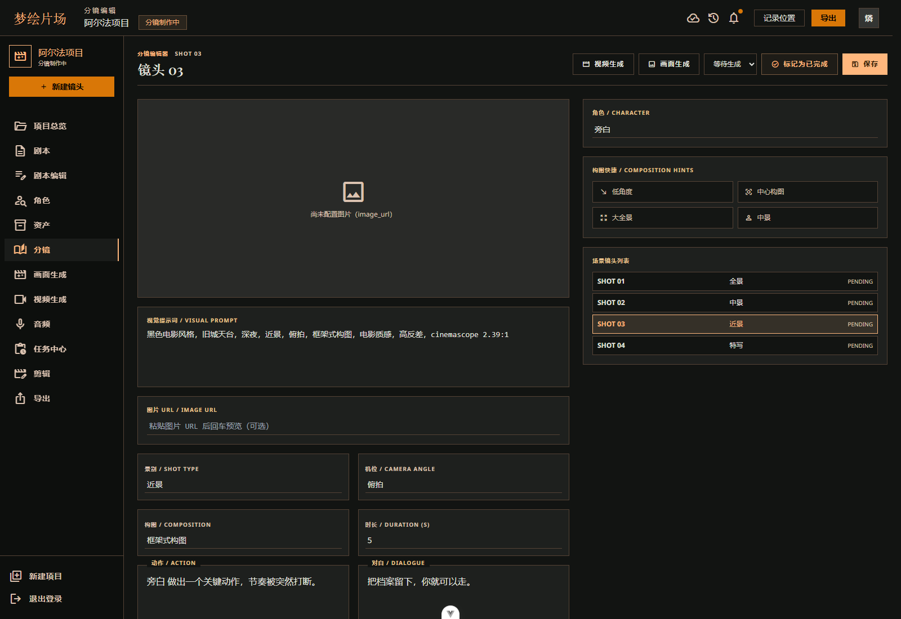

---

## 补充记录：成片编辑模块（2026-07-21）

### 1. 模块目标

成片编辑模块这一阶段的目标是：

- 基于当前项目读取已确认视频和已确认音轨
- 支持项目级时间线查看与基础编辑
- 支持成片草稿保存与恢复
- 在导出前对当前成片草稿进行一致性校验

---

### 2. 本轮实现内容

本轮围绕以下能力完成闭环：

1. 新增项目级成片聚合接口
2. 新增 `final_edit_drafts` 草稿存储
3. 支持片段排序、启用 / 禁用、音轨开关
4. 支持成片草稿保存与恢复
5. 支持导出前读取当前成片草稿做校验

---

### 3. 遇到的问题与解决方案

#### 问题 1：成片编辑一期只有聚合展示，没有“编辑结果持久化”

- 问题现象：
  页面虽然能看到已确认视频和音频，但用户调整片段顺序、启用状态后，刷新页面就会全部丢失。

- 原因分析：
  一期成片页更像只读预览页，没有独立的项目级草稿表来保存当前编辑结果。

- 排查过程：
  复查前后端链路后发现，成片页缺少“按项目保存当前时间线草稿”的后端承载层。

- 解决方案：
  新增 `final_edit_drafts`，按 `project_id` 保存当前时间线草稿 JSON，并补 `PUT /api/projects/:projectId/final-edit-draft`。

- 最终结果：
  成片编辑现在具备最小可编辑闭环，刷新后可以恢复上一版项目级草稿。

---

#### 问题 2：如果导出仍只看项目下全部 confirmed 视频，会忽略当前成片草稿

- 问题现象：
  用户在成片页里关闭了某个片段，或者调整了顺序，但导出时如果仍按“项目下所有 confirmed 视频”组装，就会把未启用片段也一起带出去。

- 原因分析：
  成片编辑和导出模块的“真相源”如果不统一，就会出现“编辑页看到的是一套，导出结果又是另一套”的错位。

- 排查过程：
  复查导出构建逻辑后确认，旧实现没有优先读取成片草稿，只是简单聚合 confirmed 视频。

- 解决方案：
  导出构建流程改为：
  - 优先读取 `final_edit_drafts`
  - 按草稿顺序和启用状态组装导出包
  - 再做导出前校验

- 最终结果：
  导出结果会跟随当前成片草稿，不会再把已经关闭的片段误导出去。

---

#### 问题 3：视频确认时设置的 `durationSeconds` 没有稳定传到成片编辑和导出

- 问题现象：
  视频模块里确认候选视频时已经有 `durationSeconds`，但到了成片编辑和导出统计里，一度还是回退到 storyboard 的旧时长。

- 原因分析：
  聚合逻辑最初优先读取 `storyboards.duration_seconds`，没有把 confirmed `video_assets.duration_seconds` 作为更高优先级的真实来源。

- 排查过程：
  在全链路验收中发现成片编辑时间线、导出统计和视频资产详情三处时长不一致。

- 解决方案：
  统一聚合规则：
  - 优先使用 confirmed `video_assets.duration_seconds`
  - 没有时再回退到 storyboard 时长

- 最终结果：
  成片编辑、导出模块和视频资产详情的时长表达保持一致。

---

### 4. 模块结论

成片编辑模块当前已经完成第二阶段最小闭环，包含：

- 项目级时间线聚合
- 成片草稿保存与恢复
- 片段启用 / 禁用与顺序调整
- 音轨开关
- 导出前校验

当前可以将“成片编辑模块”标记为已完成（二期）。

---

### 5. 相关截图

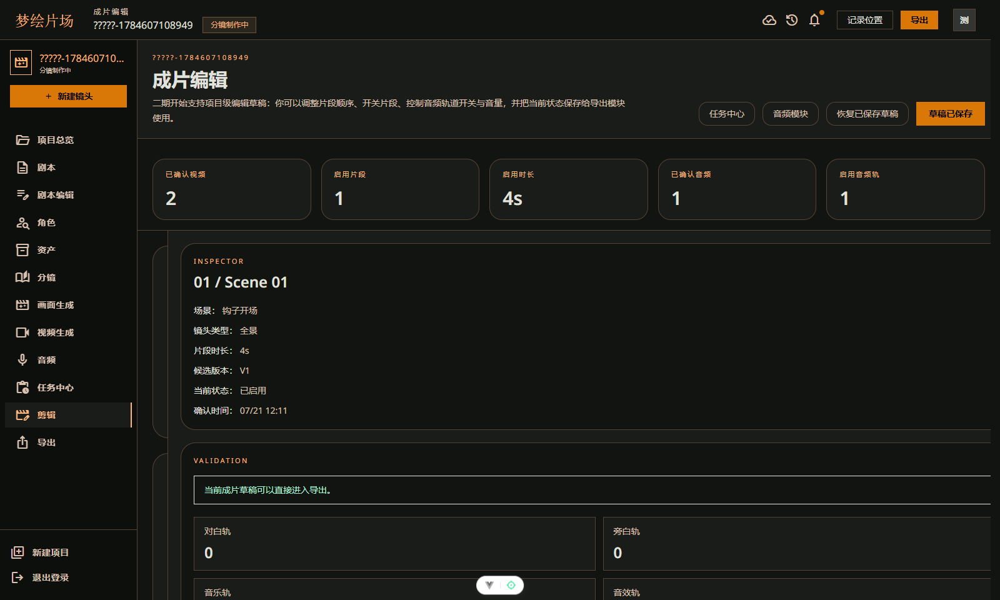

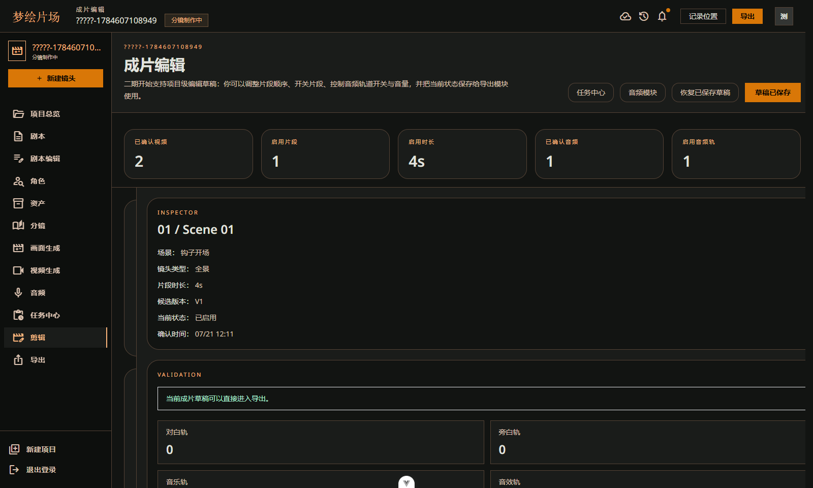


---

## 补充记录：第一阶段全链路验收与收尾修 bug（2026-07-21）

### 1. 验收范围

本轮主要回归以下链路：

- 认证
- 项目
- 总纲
- 场景
- 单场景剧本
- 分镜
- 静帧
- 视频
- 成片编辑
- 合成与导出
- 资产 / 任务中心聚合读取

---

### 2. 本轮发现并修掉的关键问题

#### 问题 1：导出仍然把未启用片段也算进 `readyCount / durationSeconds`

- 问题现象：
  用户已经在成片编辑里关闭某些片段，但导出记录和导出前统计仍把这些片段算进去。

- 原因分析：
  导出构建逻辑没有优先读取 `final_edit_drafts`，导致导出统计仍然基于“项目下全部 confirmed 视频”。

- 排查过程：
  通过成片编辑页和导出记录页对照后确认，导出侧并没有真正尊重当前成片草稿。

- 解决方案：
  调整 `buildExportPackage(projectId)`：
  - 构建导出清单时优先读取成片草稿
  - 只统计草稿里仍启用的片段
  - 按草稿顺序计算最终导出结果

- 最终结果：
  导出统计和当前成片编辑草稿保持一致，不会再把已关闭片段算进去。

---

#### 问题 2：视频确认时设置的 `durationSeconds` 没有稳定传到成片编辑和导出

- 问题现象：
  视频模块里确认候选视频后，成片编辑页和导出记录页显示的时长一度和视频模块不一致。

- 原因分析：
  聚合时长时优先级设置不对，错误地把 storyboard 时长当成主来源。

- 排查过程：
  在同一项目里对照视频资产、成片时间线、导出统计后确认，是聚合逻辑本身优先级问题。

- 解决方案：
  统一规则为：
  - 优先使用 confirmed `video_assets.duration_seconds`
  - 没有时再回退 `storyboards.duration_seconds`

- 最终结果：
  视频模块、成片编辑模块、导出模块三者的时长口径保持一致。

---

### 3. 本轮结论

这一轮验收后可以明确：

- 第一阶段主链路已经不只是“页面能点通”
- 而是完成了一轮从主链路到横向聚合的真实回归
- 当前版本已经适合继续做项目演示、简历整理和后续 AI 接入准备
