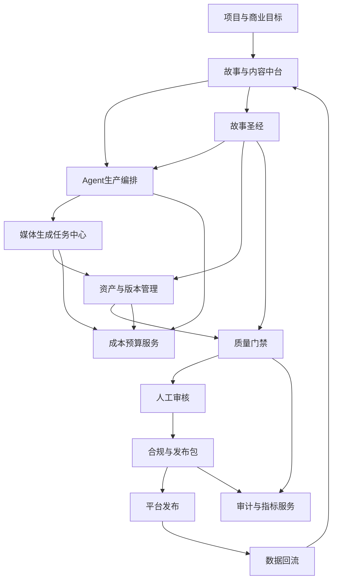
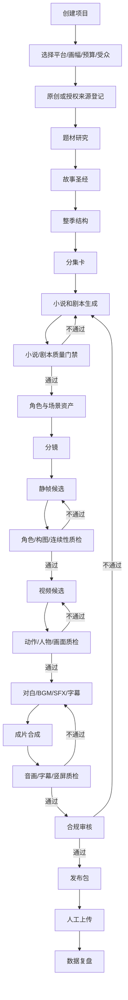
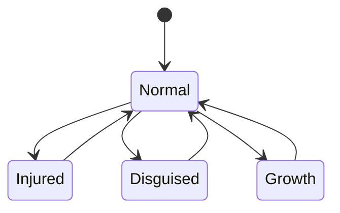

# ProjectDream AI 漫剧商业化质量保障 PRD V2

**产品名称**：帧心帧意（ProjectDream）  
**文档版本**：V2.1  
**文档定位**：面向商业化生产的详细产品需求、质量合同和验收标准  
**适用范围**：原创 AI 漫剧、已取得改编授权的小说漫剧、红果/抖音等平台的竖屏短剧视频  
**当前版本日期**：2026-09-14  
**文档状态**：待架构确认后进入分阶段开发

> 本文档不承诺任何平台一定推荐、签约、分账或产生固定收入。  
> 本文档的作用是把内容质量、生产稳定性、人物一致性、合规和经营指标变成可实施、可测试、可追踪的系统要求，最大限度降低“生成出来但不能发布、发布后没有留存、成本高于收入”的风险。

> 本版新增市场方向：ProjectDream 第一阶段定位为“3D 竖屏系列漫剧内容工厂”，先服务自己的内容生产和商业验证；暂不把“面向所有创作者的 SaaS 平台”作为第一阶段目标。

## 1. 先说清楚：这份 PRD 能保证什么

### 1.1 可以通过工程保证的内容

如果严格按照本文档开发并通过验收，系统应当能够：

- 按固定流程生产多集竖屏 AI 漫剧。
- 保存小说、人物、场景、分镜、声音和资产版本。
- 在生成前检查故事和预算，在生成后检查画面、音频、字幕和合规。
- 核心人物使用固定身份、参考资产和状态版本。
- 任务失败后重试、降级、暂停、恢复和局部返工。
- 生成多个候选并按质量评分，不把首个结果直接当成成片。
- 记录模型、提示词、素材来源、费用和人工修改。
- 输出视频、封面、标题、简介、标签、版权摘要和审核报告。
- 对每一集和每一部剧计算实际成本与质量指标。

### 1.2 不能通过工程保证的内容

以下事项不能被 PRD 绝对保证：

- 故事一定成为爆款。
- 观众一定喜欢某个题材。
- 平台一定给流量或收益。
- 生成模型每次都能得到完美动作。
- 角色在所有极端角度、遮挡和复杂动作中百分之百不变。
- 平台审核政策不会变化。
- 收入一定高于成本。

因此，本项目必须采用：

```text
系统自动化
+ 模型候选生成
+ 自动质量评分
+ 人工关键节点审核
+ 小规模真实发布验证
+ 数据反馈后再扩大产量
```

## 2. 商业目标

### 2.1 产品目标

把 ProjectDream 建成一套可以持续管理以下业务的生产系统：

```text
原创题材
 -> 故事圣经
 -> 整季小说/分集结构
 -> 高质量剧本
 -> 角色和场景资产
 -> 分镜和画面
 -> 配音、BGM、SFX、字幕
 -> 竖屏成片
 -> 发布审核包
 -> 平台发布
 -> 数据复盘
 -> 下一轮内容决策
```

### 2.2 商业化目标

系统最终服务的不是“生成一个视频”，而是形成以下可验证能力：

1. 能够连续生产 10-30 集的剧集。
2. 能够保持核心角色、世界观和剧情状态一致。
3. 能够把低质量内容拦截在发布前。
4. 能够知道每一集花了多少钱、返工多少次、花了多少人工时间。
5. 能够通过真实发布数据判断题材是否值得继续。
6. 能够把成功的角色、镜头、音乐和生产模板复用到新项目。

### 2.3 产品定位和商业路线

#### 第一阶段：内部内容工厂

优先使用 ProjectDream 生产自己的原创或已授权漫剧，验证：

- 哪些题材能够持续生产。
- 哪些视觉风格最稳定。
- 哪些开头、角色和剧情结构能获得真实留存。
- 单集成本是否低于可归因收入。
- 人工审核和返工是否可接受。

#### 第二阶段：半开放生产平台

在内部生产流程稳定后，再开放：

- 项目模板。
- 角色资产模板。
- 故事圣经模板。
- 分集生产模板。
- 平台发布包模板。

#### 第三阶段：SaaS 化平台

只有当内部内容工厂满足质量、成本和稳定性门槛后，才考虑多租户、计费、团队协作和外部客户服务。

不允许在内部内容能力尚未验证时，先把大量资源投入通用 SaaS 功能。

## 3. 关键经营模型

### 3.1 收入不是系统单变量

```text
经营结果 =
内容质量
× 合规可发布率
× 稳定更新量
× 平台分发
× 观众留存与转化
- 内容生产成本
- 运营成本
- 返工损失
```

系统主要负责前四项中的生产和质量部分，平台分发和收益还需要真实运营验证。

### 3.2 单集利润核算

```text
单集总成本 =
文本模型费用
+ 图片模型费用
+ 视频模型费用
+ TTS 与口型同步费用
+ BGM/SFX/字体授权费用
+ 存储和流量费用
+ 渲染费用
+ 人工审核费用
+ 返工损失
```

```text
单集预估利润 =
可归因收入
- 单集总成本
```

系统不得只显示模型 API 费用，必须把人工返工和失败任务也纳入成本。

### 3.3 经营闸门

当以下条件不满足时，不允许自动批量扩产：

- 连续试制集的平均质量达到项目门槛。
- 角色一致性错误率低于项目门槛。
- 单集成本低于项目预算。
- 版权和合规材料完整。
- 真实发布数据达到项目设定的继续实验门槛。

## 4. 产品定位和用户

### 4.1 产品定位

ProjectDream 是：

> 面向个人创作者、小型内容团队和 AI 漫剧工作室的项目级多 Agent 漫剧生产与质量管理平台。

它不是：

- 一键保证爆款的按钮。
- 自动绕过平台审核的工具。
- 无需人工判断的全自动内容工厂。
- 自动抓取、改写、复刻他人作品的系统。

### 4.2 用户角色

| 角色 | 主要职责 | 必须拥有的能力 |
|---|---|---|
| 制片人 | 项目目标、预算、平台和最终决策 | 立项、锁定版本、发布批准 |
| 主编 | 题材、小说、人物和剧情质量 | 故事圣经、改稿、分集审核 |
| 漫剧导演 | 分镜、视觉风格和镜头节奏 | 角色状态、镜头模板、画面审核 |
| 后期制作 | 配音、音乐、字幕、成片 | 时间线、混音、导出和技术验收 |
| 合规审核 | 版权、标识、敏感内容和发布资料 | 审核报告、风险处理和否决 |
| 运营人员 | 发布、数据和实验 | 发布包、数据录入、复盘 |
| 系统管理员 | 模型、队列、存储、权限和成本 | 配置、监控、审计和故障处理 |

## 5. 总体产品架构



## 6. 多 Agent 组织关系

### 6.1 推荐关系

采用：

```text
总控 Agent
    ↓
专业 Agent
    ↓
质量 Agent
    ↓
人工审批
    ↓
下一阶段
```

不是所有 Agent 平级自由聊天，而是由编排器管理任务和状态。

### 6.2 Agent 列表

| Agent | 输入 | 输出 | 自动等级 |
|---|---|---|---|
| 制片总控 Agent | 商业目标、平台、预算 | 生产计划、检查点 | 自动规划，关键节点人工确认 |
| 题材研究 Agent | 题材、受众、竞品观察 | 选题分析、差异化建议 | 自动 |
| 故事圣经 Agent | 题材、人物、世界观 | 设定、关系、时间线、伏笔 | 自动，锁定需人工 |
| 小说策划 Agent | 故事圣经、集数、时长 | 整季结构、分集卡 | 自动，锁定需人工 |
| 编剧 Agent | 分集卡、人物状态 | 剧本、对白、动作、旁白 | 自动，发布前人工 |
| 剧本质检 Agent | 剧本和故事圣经 | 质量报告、修改建议 | 自动 |
| 连续性 Agent | 版本、时间线、角色状态 | 矛盾报告 | 自动 |
| 分镜导演 Agent | 剧本、视觉风格 | 镜头表、镜头提示词 | 自动 |
| 角色资产 Agent | 角色圣经、参考图 | 定妆图、状态图、参考资产 | 半自动 |
| 画面生成 Agent | 分镜、参考资产 | 静帧、视频候选 | 自动调度 |
| 画面质检 Agent | 画面候选、角色参考图 | 一致性和技术报告 | 自动 |
| 音频 Agent | 对白、声线、时间轴 | TTS、BGM、SFX、字幕 | 自动 |
| 成片 Agent | 视频、音频、字幕 | 预览片、主版本片 | 自动 |
| 合规 Agent | 素材台账、成片、剧本 | 合规报告、待办 | 自动提示，人工裁决 |
| 发布包 Agent | 成片、平台预设、版权资料 | 发布包 | 自动生成，人工发布 |
| 复盘 Agent | 真实发布数据 | 选题和制作优化建议 | 自动建议 |

### 6.3 Agent 不能做的事情

- 不能绕过质量门禁。
- 不能修改已经锁定的故事圣经。
- 不能覆盖主版本资产而不留下新版本。
- 不能调用未登记的外部接口。
- 不能无限重试高成本任务。
- 不能把不确定的事实写成平台规则。
- 不能自行决定发布。

## 7. 核心生产流程



## 8. 内容质量系统

### 8.1 故事圣经

每个项目必须有可锁定的故事圣经：

- 一句话卖点。
- 目标受众和情绪承诺。
- 世界观规则。
- 时间线。
- 地点和空间关系。
- 主角目标、恐惧、秘密、底线和成长弧。
- 反派目标、资源和弱点。
- 人物关系图。
- 关键道具和视觉符号。
- 主线和支线。
- 伏笔、铺垫、回收集数。
- 每集冲突、转折、爽点和结尾钩子。
- 禁止改变的事实。
- 可以调整的设定。

### 8.2 整季结构

每一季需要生成：

- 季主题。
- 主线冲突。
- 起承转合或多幕结构。
- 每集一句话卖点。
- 每集起始状态。
- 每集不可逆变化。
- 每集核心冲突。
- 每集结尾钩子。
- 伏笔分布和回收计划。
- 人物阶段性变化。

### 8.3 分集质量评分

| 维度 | 权重 | 低分原因 |
|---|---:|---|
| 开场钩子 | 15% | 前段没有事件、危险、秘密或强情绪 |
| 核心冲突 | 15% | 角色没有目标，冲突靠误会硬拖 |
| 人物动机 | 15% | 行为没有原因，人物只为推动剧情 |
| 情绪曲线 | 15% | 全程平铺或重复受压，没有释放 |
| 反转与伏笔 | 10% | 反转无铺垫，信息凭空出现 |
| 主角主动性 | 10% | 主角一直被动等待 |
| 对白质量 | 10% | 说明书对白、角色说话没有差异 |
| 可视化程度 | 5% | 只能通过文学叙述，无法形成画面 |
| 连续性 | 5% | 时间、空间、人物状态互相矛盾 |

建议门槛：

- 80 分以下：不得进入视频生产。
- 80-89 分：允许进入低成本预览。
- 90 分以上：允许进入正式生产。
- 核心硬伤存在时，即使总分达标也必须返工。

### 8.4 小说和剧本硬性规则

- 每集必须存在明确目标。
- 每集至少有一个不可逆变化。
- 每集结尾必须有悬念、危机、反转或情绪钩子。
- 重要反转必须能在前文找到线索。
- 角色不能因为剧情需要突然改变性格。
- 对白必须能被声音表达，不使用大段无法表演的说明。
- 旁白不得重复画面已经表达的信息。
- 每个镜头必须可以拆成明确动作。
- 不得用“突然出现”“突然恢复”“突然爱上”代替因果。
- 不得批量生成没有人工锁定的整季正文。

### 8.5 人工主编闸门

以下内容必须人工确认：

- 一句话卖点。
- 主角和反派设定。
- 整季结构。
- 第 1 集和第 2 集。
- 每集结尾钩子。
- 重要反转。
- 关键对白。
- 结局方向。

## 9. 人物一致性系统

### 9.1 角色身份模型

每个角色拥有唯一 `characterId`，不能只依赖角色名称。

角色必须记录：

- 身份信息。
- 年龄段。
- 性别表达。
- 体型。
- 脸部关键特征。
- 肤色。
- 发型和发色。
- 服装和配饰。
- 常用表情。
- 声线和语速。
- 人物关系。
- 当前剧情状态。
- 参考图版本。
- 禁止出现的变化。

### 9.2 角色参考资产

核心角色至少需要：

```text
正面半身
侧面半身
三分之四侧脸
全身
近景表情
常态服装
特殊服装
受伤/成长/伪装状态
```

每张参考图必须记录：

- 生成模型和模型版本。
- 提示词版本。
- 生成时间。
- 资产来源。
- 是否经过人工确认。
- 是否属于当前主版本。

### 9.3 角色状态机



每个镜头必须绑定角色状态。系统不得使用“角色默认图”覆盖已经声明的特殊状态。

### 9.4 一致性评分

画面质检至少检查：

- 脸部关键特征。
- 发型和发色。
- 服装颜色和版型。
- 配饰。
- 年龄感。
- 体型。
- 角色数量。
- 角色位置。
- 当前剧情状态。

建议评分：

```text
角色一致性 =
脸部特征 30%
+ 发型 15%
+ 服装 15%
+ 配饰 10%
+ 年龄/体型 10%
+ 状态连续性 10%
+ 角色数量与位置 10%
```

建议处理：

- 90 分以上：可进入下一阶段。
- 80-89 分：允许人工确认后使用。
- 80 分以下：自动标记返工。
- 核心角色严重变脸：无论总分多少都必须返工。

分数只是辅助，最终主版本由人工确认。

### 9.5 视觉生成策略

系统必须支持：

- 角色参考图锁定。
- 多参考图。
- 角色 ID 绑定。
- 场景和风格参考图。
- 上一镜头承接。
- 起始帧/结束帧。
- 静帧先确认、视频后生成。
- 候选图对比。
- 局部返工。
- 角色版本回退。

不允许默认直接“文本到视频”批量生产全部镜头，因为无法稳定控制人物身份和镜头承接。

## 10. 音频、对白和口型同步

### 10.1 声音锁定

核心角色必须锁定：

- 音色。
- 音域。
- 语速。
- 语气。
- 情绪表达。
- 停顿习惯。
- 禁用表达。

角色一旦进入正式生产，换声线必须生成新版本并提示影响范围。

### 10.2 口型和时间轴

系统必须检查：

- 对白音频长度。
- 镜头可承载时长。
- 口型视频输入是否为公开可访问或供应商要求的对象存储地址。
- 当前说话角色是否唯一。
- 字幕起止时间。
- 口型与音频偏移。
- 多人对白是否拆分为独立说话镜头。

### 10.3 音频质量门槛

- 人声不能被 BGM 覆盖。
- 不得出现明显爆音、断裂和长静音。
- 字幕必须和对白一致。
- 角色名、说话人和声线不能错配。
- BGM/SFX 必须有来源和授权状态。

## 11. 稳定批量生产系统

### 11.1 任务架构

成熟版本必须拆分：

```text
API 服务
    ↓
任务队列
    ↓
图片 Worker
视频 Worker
音频 Worker
导出 Worker
质检 Worker
    ↓
对象存储
```

现有单进程任务机制可以作为过渡，但不能作为长期批量生产架构。

### 11.2 任务字段

每个任务至少保存：

- `taskId`
- `projectId`
- `episodeId`
- `taskType`
- `sourceId`
- `status`
- `priority`
- `attemptCount`
- `maxAttempts`
- `idempotencyKey`
- `provider`
- `providerTaskId`
- `inputSnapshot`
- `outputAssetId`
- `errorCode`
- `errorMessage`
- `costEstimate`
- `actualCost`
- `startedAt`
- `finishedAt`

### 11.3 稳定性要求

- 任务必须幂等。
- 服务重启后可以恢复。
- 供应商超时需要轮询或降级。
- 失败必须分类，不允许所有错误都无限重试。
- 同一项目可限制并发。
- 视频模型必须设置速率限制。
- 高费用任务需要预算确认。
- 单个镜头失败不能让整集状态丢失。
- 所有中间结果必须可查看和回退。

### 11.4 候选生成策略

每个关键镜头至少支持：

```text
生成 N 个候选
 -> 技术检查
 -> 角色一致性评分
 -> 构图评分
 -> 动作评分
 -> 人工确认主版本
```

对低风险镜头可以减少候选数量，对主角近景、关键反转和封面必须提高候选数量。

## 12. 成片质量系统

### 12.1 技术检查

- 文件可播放。
- 时长正确。
- 分辨率正确。
- 画幅正确。
- 编码正确。
- 音轨存在。
- 字幕存在且时间正确。
- 无黑屏、花屏、花帧。
- 无明显卡顿和音画不同步。

### 12.2 内容检查

- 角色是否正确。
- 服装和场景是否连续。
- 动作是否表达剧本意图。
- 对白是否和画面人物一致。
- 情绪是否和剧情一致。
- 关键道具是否出现。
- 结尾钩子是否完整。

### 12.3 竖屏检查

- 核心人物不被裁切。
- 字幕不被平台 UI 遮挡。
- 封面重点位于安全区域。
- 多人同框时人物不被挤出画面。
- 画面内文字没有乱码。

## 13. 平台发布适配

### 13.1 平台预设配置化

平台规则不得写死在代码中，必须具有版本号和确认时间：

```ts
interface PlatformPreset {
  platformId: string
  ruleVersion: string
  verifiedAt: string
  aspectRatio: '9:16' | '16:9' | '1:1'
  width: number
  height: number
  maxDurationSeconds?: number
  subtitleSafeArea: SafeArea
  requiredFields: string[]
  aiDisclosure: 'required' | 'configurable' | 'unknown'
  manualUpload: boolean
}
```

### 13.2 通用发布包

每集发布包至少包含：

- 竖屏 MP4。
- 主封面。
- 备用封面。
- 标题候选。
- 简介候选。
- 标签候选。
- 作品名、集数和作者信息。
- AI 生成标识状态。
- 版权摘要。
- 审核报告。
- 成本报告。
- 版本号。

### 13.3 红果和抖音适配原则

- 不假定两个平台规则完全相同。
- 不假定一次核验永久有效。
- 不自动代替人工提交。
- 平台字段和视频规格通过配置管理。
- 发布前必须显示“规则最后核验日期”。
- 如果系统未核验最新规则，发布包状态只能是“待确认”。

与 AI 生成内容标识、网络微短剧管理、版权和平台规则相关的要求，必须由运营人员在发布前按当时有效的官方规则重新核验。文档中的平台适配要求不是法律意见，也不是平台永久规则；系统应将 AI 标识作为产品能力而不是可选装饰。

## 14. 合规和版权

### 14.1 必须建立版权台账

- 原始小说来源。
- 作者和权利人。
- 授权范围。
- 授权期限。
- 改编权和信息网络传播权。
- 参考图片来源。
- 音乐和音效授权。
- 字体授权。
- 模型商用条款核验。
- 真人形象和声音授权。
- AI 生成和人工修改记录。

### 14.2 发布前否决项

出现以下任何情况，不得标记为可发布：

- 无法说明小说或素材来源。
- 使用未确认商用权利的素材。
- 角色明显指向真实人物且无授权。
- 使用未经核验的音乐、字体或音效。
- 存在明显敏感、违法或高风险内容。
- 缺少要求的 AI 生成内容提示。
- 片头、片尾、字幕、标题和内容不一致。
- 平台规则未完成最近一次核验。

## 15. 成本、预算和利润

### 15.1 预算控制

项目创建时设置：

- 单集预算。
- 整季预算。
- 单镜头最高重试次数。
- 图片、视频、音频模型预算。
- 存储空间预算。
- 人工审核时间预算。

### 15.2 成本记录

每次模型调用记录：

- 模型名称和版本。
- 输入输出数量。
- Token 或媒体时长。
- 供应商返回任务 ID。
- 成功或失败。
- 重试次数。
- 实际费用。
- 归属的项目、集、镜头和资产。

### 15.3 继续生产规则

当某一集出现以下情况，系统必须提示暂停：

- 实际成本超过预算 120%。
- 返工次数超过项目上限。
- 角色错误率持续超标。
- 合规问题重复出现。
- 人工审核时间超过预估 2 倍。

## 16. 数据模型

```text
projects
seasons
episodes
story_versions
story_bibles
story_facts
story_timeline_events
plot_threads
characters
character_states
character_asset_versions
locations
style_bibles
scenes
storyboards
assets
asset_versions
audio_tracks
timeline_versions
agent_runs
agent_steps
quality_reports
quality_issues
compliance_records
copyright_records
platform_presets
release_packages
release_records
model_usage_records
cost_ledger
audit_logs
```

### 16.1 关键约束

- 所有资产必须关联项目和版本。
- 所有镜头必须关联角色和状态。
- 所有正式成片必须关联故事版本。
- 所有发布包必须关联合规报告。
- 所有模型调用必须关联费用记录。
- 锁定版本不可被静默覆盖。

## 17. 核心接口边界

```ts
interface ProductionOrchestrator {
  createRun(input: CreateProductionRunInput): Promise<ProductionRun>
  pauseRun(runId: number, reason: string): Promise<void>
  resumeRun(runId: number): Promise<void>
  retryStep(input: RetryStepInput): Promise<void>
  approveCheckpoint(input: ApproveCheckpointInput): Promise<void>
}

interface StoryQualityService {
  evaluateStory(storyVersionId: number): Promise<StoryQualityReport>
  evaluateEpisode(episodeId: number): Promise<EpisodeQualityReport>
  requestRevision(reportId: number, issues: QualityIssue[]): Promise<void>
  lockVersion(versionId: number): Promise<void>
}

interface CharacterConsistencyService {
  compare(input: CharacterCompareInput): Promise<CharacterConsistencyReport>
  approveAsset(assetVersionId: number): Promise<void>
  rejectAsset(assetVersionId: number, reason: string): Promise<void>
}

interface MediaJobService {
  enqueue(input: MediaJobInput): Promise<MediaJob>
  cancel(jobId: number): Promise<void>
  retry(jobId: number, mode: RetryMode): Promise<void>
  getStatus(jobId: number): Promise<MediaJob>
}

interface ReleaseService {
  validateEpisode(episodeId: number, platformId: string): Promise<ReleaseValidationReport>
  createPackage(episodeId: number, platformId: string): Promise<ReleasePackage>
  markPublished(input: PublishedRecordInput): Promise<void>
}
```

## 18. 质量报告结构

```ts
interface QualityReport {
  targetType: 'story' | 'script' | 'storyboard' | 'image' | 'video' | 'audio' | 'episode'
  targetId: number
  score: number
  decision: 'approved' | 'needs_revision' | 'rejected' | 'human_review'
  hardFailures: QualityIssue[]
  warnings: QualityIssue[]
  evidence: QualityEvidence[]
  modelVersion: string
  createdAt: string
}
```

每个评分必须可以查看证据，不能只显示一个没有解释的分数。

## 19. 测试和验收方案

### 19.1 自动化测试

- Agent 输入输出结构测试。
- 故事事实冲突测试。
- 角色状态转换测试。
- 资产版本和回滚测试。
- 任务幂等测试。
- 供应商超时和重试测试。
- 服务重启恢复测试。
- 成本累计测试。
- 导出规格测试。
- 字幕时间轴测试。
- 发布包字段完整性测试。

### 19.2 角色一致性测试集

必须建立固定回归集：

- 至少 5 个核心角色。
- 每个角色至少 10 种姿态/表情/构图。
- 至少 3 个场景。
- 至少 3 套服装状态。
- 至少 5 个连续镜头组。
- 至少 2 组多人同框。

每次更换模型、提示词模板、参考图或视频参数，都必须重新跑回归集。

### 19.3 内容质量测试集

建立人工标注集，至少包含：

- 优秀剧本。
- 普通剧本。
- 逻辑矛盾剧本。
- 无钩子剧本。
- 对白生硬剧本。
- 角色动机不足剧本。
- 不适合视频表达的剧本。

自动评分必须和人工评分进行对照，连续偏差过大时不能直接用于自动放行。

### 19.4 批量稳定性测试

最低测试目标：

- 连续生成 100 个图片任务。
- 连续生成 30 个视频任务。
- 连续生成 30 个音频任务。
- 连续导出 20 集预览片。
- 模拟供应商超时、失败、重复回调和服务重启。
- 验证无任务重复扣费、无资产丢失、无状态错乱。

## 20. 最终质量验收门槛

### 20.1 内容质量

- 第 1 集剧本评分 >= 90。
- 其他正式集剧本评分 >= 85。
- 关键对白和结尾钩子人工确认率 100%。
- 重大逻辑矛盾为 0。
- 每集至少一个明确不可逆变化。

### 20.2 人物一致性

- 核心角色参考资产完整率 100%。
- 核心角色严重变脸为 0 容忍。
- 角色服装、发型和配饰错误率低于项目门槛。
- 关键镜头人工确认率 100%。
- 连续镜头组必须通过回归检查。

### 20.3 音视频质量

- 严重音画不同步为 0。
- 严重字幕错误为 0。
- 严重黑屏、花屏、破损文件为 0。
- 对白、BGM、SFX 经过人工抽检。
- 所有成片可在目标平台允许的播放器中正常播放。

### 20.4 生产稳定性

- 任务恢复成功率 >= 99%。
- 资产丢失率为 0。
- 重复扣费事件为 0。
- 失败任务原因可追溯率 100%。
- 发布包生成成功率 >= 99%。

### 20.5 合规

- 版权记录完整率 100%。
- AI 标识状态明确率 100%。
- 未确认授权素材进入正式发布包的数量为 0。
- 合规审核报告和人工确认记录完整率 100%。

## 21. 试运营验证计划

不要直接把系统做完后批量生产几十部剧，应该按以下顺序验证。

### 阶段一：单集验证

- 一个原创题材。
- 一个主角和一个反派。
- 一集 30-60 秒预览。
- 至少生成 3 版开头。
- 记录成本、时间和返工。

### 阶段二：三集连续性验证

- 同一故事连续 3 集。
- 验证人物、服装、场景、伏笔和结尾承接。
- 验证统一声音和字幕。
- 实际生成发布包。

### 阶段三：十集小季验证

- 10 集连续生产。
- 验证批量队列和断点恢复。
- 验证平均成本和人工时长。
- 进行小范围真实发布。

### 阶段四：多题材验证

- 至少 3 种题材。
- 比较不同题材的质量、成本和数据。
- 判断是否存在只能做某一种题材的问题。

### 阶段五：商业继续与停止决策

继续投入的依据：

- 合规发布稳定。
- 质量门槛持续达标。
- 生产成本可控。
- 观众留存和互动出现可重复趋势。
- 人工返工时间下降。

暂停或换题材的依据：

- 连续多个项目都没有达到最低留存。
- 返工成本高于生产预算。
- 角色一致性长期无法达标。
- 平台审核风险无法解决。
- 收入模型明显无法覆盖成本。

## 22. 开发阶段

### P0：质量底座

1. 整季、分集、故事版本。
2. 故事圣经、人物关系、伏笔和时间线。
3. 小说和剧本评分。
4. 角色资产版本和角色状态。
5. 9:16 导出。
6. 质量报告和人工审核闸门。

### P1：人物和批量稳定性

1. 角色一致性服务。
2. 固定测试集和回归测试。
3. 队列与 Worker。
4. 对象存储。
5. 候选生成和局部返工。
6. 成本账本。

### P2：完整漫剧后期

1. BGM 和 SFX 素材库。
2. 混音和响度检查。
3. 字幕安全区。
4. 口型同步质量检查。
5. 连续镜头质量检查。

### P3：Agent 编排

1. 总控 Agent。
2. 小说和剧本 Agent。
3. 分镜和视觉 Agent。
4. 质检和合规 Agent。
5. 发布包 Agent。
6. 暂停、恢复、重试和人工审批。

### P4：运营和收入验证

1. 平台发布记录。
2. 数据录入。
3. 封面、标题和开头实验。
4. 复盘 Agent。
5. 成本和收益报表。

## 23. 开发完成的定义

只有同时满足以下条件，才称为“商业化成熟版本”：

- 可以管理至少一部 20 集剧集。
- 有完整故事圣经和版本锁定。
- 小说和剧本有评分、证据和人工确认。
- 核心人物有参考资产、状态和回归测试。
- 关键镜头支持多个候选和局部返工。
- 视频、音频、字幕和导出任务可恢复。
- 9:16 发布包完整。
- 版权和 AI 标识可追踪。
- 每集成本可核算。
- 连续试制 10 集没有严重任务丢失。
- 至少完成 3 集真实发布测试。
- 已根据真实数据做过至少一轮改稿和生产优化。

## 24. 对小泽的最终承诺边界

我不能承诺：

```text
做完系统 = 一定优秀
做完系统 = 一定爆款
做完系统 = 一定稳定收入
```

我能承诺的工程目标是：

```text
不把低质量结果伪装成高质量
不把没有版权的内容当成可发布内容
不把一次成功当成稳定生产能力
不让 Agent 无限制烧钱
不让角色版本和资产来源失控
不让关键问题没有证据、没有日志、没有返工入口
```

真正进入商业化前，必须用原创内容完成小规模真实验证。系统负责提高生产效率、质量稳定性和试错速度；好故事、人工主编判断、平台运营和市场反馈仍然决定最终收入。

## 25. 市场参考和内容工厂策略

### 25.1 参考原则

市场研究只用于提取可复用的方法，不用于复制具体作品：

- 不复制他人的小说正文、人物名称、画面、配音、音乐或提示词。
- 不抓取没有授权的小说并批量改编。
- 不把公开榜单当成收益保证。
- 不把一次热门结果当成永久规律。
- 平台规则、榜单和题材偏好必须记录核验日期。

详细的市场拆解、采样方法和内容工厂方案见：

`项目开发文档/商业化继续开发/ProjectDream_市场参考与内容工厂策略_PRD.md`

### 25.2 当前产品方向假设

当前版本以以下假设作为试验方向，而不是硬编码结论：

1. 竖屏、系列化和连续更新比单条短片更适合作为商业内容资产。
2. 3D 漫剧视觉需要优先验证角色稳定性、镜头连续性和成本。
3. 红果方向优先验证玄幻、穿越、重生、逆袭和长线 IP 结构。
4. 抖音方向优先验证都市冲突、女性成长、身份反转和强开头结构。
5. 两个平台不能共用一套固定标题、节奏和发布字段。
6. 题材假设必须通过小样本试制和真实数据更新。

这些方向只代表第一轮实验，不代表平台官方规则，也不代表任何题材必然获得流量。

### 25.3 市场研究 Agent

新增 `市场研究 Agent`，负责把人工观察和公开资料结构化为可执行的创作假设。

输入：

- 平台和账号。
- 观察周期。
- 题材范围。
- 目标受众。
- 可用原创/IP资源。
- 预算和生产能力。

输出：

- 题材机会卡。
- 热门结构拆解。
- 开头冲突模式。
- 人物身份模式。
- 视觉风格模式。
- 评论区需求摘要。
- 同质化风险。
- 版权风险。
- 建议试制题材。
- 试制成本和难度估计。

输出必须区分：

```text
已观察事实
模型归纳
人工假设
需要验证的结论
```

### 25.4 内容实验 Agent

新增 `内容实验 Agent`，不直接决定长期方向，而是设计低成本试验：

```text
3 个题材方向
× 2 个开头版本
× 2 个封面/标题版本
× 3 集连续样片
```

每个实验记录：

- 题材和版本。
- 一句话卖点。
- 开头类型。
- 主角身份。
- 视觉风格。
- 生成模型。
- 单集成本。
- 人工返工次数。
- 发布数据。
- 继续、修改或停止结论。

### 25.5 平台策略假设

| 方向 | 第一轮验证重点 | 不应直接假设 |
|---|---|---|
| 红果 | 系列化、3D视觉、玄幻/穿越/逆袭、长线人物关系 | 不应假设所有热门题材都能分账 |
| 抖音 | 前几秒冲突、都市身份反转、女性成长、标题封面实验 | 不应假设红果有效结构可以原样搬运 |
| 多平台 | 同一资产的不同剪辑、标题、封面和简介 | 不应把同一发布包完全复制到所有平台 |

### 25.6 内容工厂的最小生产单元

第一阶段不以“单个视频”作为核心，而以以下单元管理：

```text
一个题材实验
 -> 一部短剧
 -> 一季
 -> 三集试制
 -> 十集小规模验证
 -> 继续扩产或停止
```

系统必须支持从实验结论反向更新：

- 题材模板。
- 故事圣经模板。
- 角色模板。
- 分镜模板。
- 视觉风格模板。
- 发布文案模板。
- 成本预算模板。

### 25.7 市场策略验收标准

- 至少保存 20 部人工研究样本的结构化记录。
- 每个样本包含题材、开头、人物、冲突、画幅、视觉风格和评论观察。
- 至少设计 3 个原创试制方向。
- 每个方向至少完成 3 集样片或明确记录停止原因。
- 系统可以比较题材、开头、封面、成本和留存数据。
- 市场研究结论带有来源和核验日期。
- 无授权内容不得进入正式生产资产。

## 26. 新增接口和数据对象

```ts
interface MarketResearchService {
  createObservation(input: MarketObservationInput): Promise<MarketObservation>
  analyzeTopic(input: TopicResearchInput): Promise<TopicResearchReport>
  compareTopics(topicIds: number[]): Promise<TopicComparisonReport>
}

interface ContentExperimentService {
  createExperiment(input: ContentExperimentInput): Promise<ContentExperiment>
  createVariant(experimentId: number, input: ExperimentVariantInput): Promise<ExperimentVariant>
  recordMetric(input: ExperimentMetricInput): Promise<void>
  decide(experimentId: number, decision: 'continue' | 'revise' | 'stop'): Promise<void>
}

interface RevenueAnalysisService {
  recordPlatformMetrics(input: PlatformMetricsInput): Promise<void>
  calculateUnitEconomics(projectId: number): Promise<UnitEconomicsReport>
  generateReview(projectId: number): Promise<BusinessReviewReport>
}
```

新增逻辑对象：

```text
market_observations
topic_opportunities
content_experiments
experiment_variants
experiment_metrics
platform_release_records
business_review_reports
```

## 27. 文档和开发顺序同步

后续开发顺序调整为：

1. 市场研究记录和题材实验模型。
2. 故事圣经、整季结构和分集质量门禁。
3. 角色资产版本和一致性回归集。
4. 3D 竖屏视觉模板和多候选生成。
5. 任务队列、对象存储和成本账本。
6. 音频、字幕、合规和平台发布包。
7. 真实发布数据录入和复盘 Agent。
8. 内部内容工厂稳定后，再评估 SaaS 化。

本顺序的核心原则是：

```text
先证明内容能卖
再证明系统能稳定生产
最后才把能力产品化卖给别人
```
