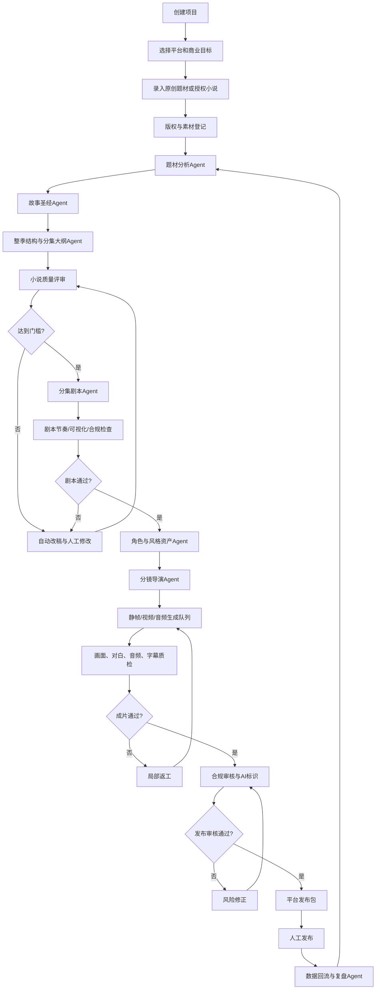
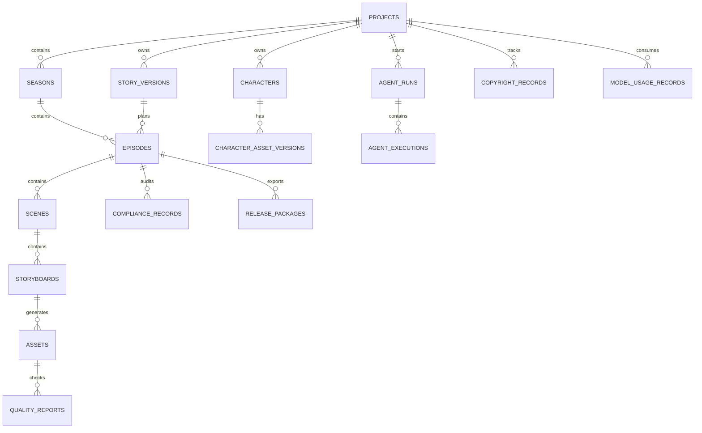

# ProjectDream AI 漫剧成熟生产系统 PRD

**文档版本**：V1.1  
**制定日期**：2026-09-09  
**产品名称**：帧心帧意（ProjectDream）  
**文档性质**：商业化生产系统产品需求文档  
**适用对象**：产品、架构、Claude Code 开发、内容运营、审核和后期制作人员

> 方向同步说明：2026 年 9 月 14 日起，本 PRD 与《ProjectDream AI 漫剧商业化质量保障 PRD V2》统一采用“3D 竖屏系列漫剧内容工厂”作为第一阶段产品方向。优先服务自己的原创/授权内容生产，先验证题材、质量、成本和真实发布数据，再评估 SaaS 化。

> 本文档的目标是把 ProjectDream 从“可以完成一次 AI 漫剧制作”升级为“可以持续生产、质检、发布和复盘的 AI 漫剧生产系统”。  
> 系统可以提高稳定产能和内容命中率，但不能承诺红果、抖音或其他平台一定通过审核、获得推荐或产生固定收入。最终收入取决于作品质量、版权和合规、平台政策、运营数据、账号权重以及市场竞争。

## 1. 项目判断

### 1.1 当前项目基础

当前项目已经具备以下闭环：

```text
项目 -> 总纲 -> 场景 -> 剧本 -> 角色 -> 分镜 -> 静帧 -> 视频 -> 音频 -> 成片编辑 -> 导出 -> 任务中心
```

现有基础包括：

- Vue 3 + TypeScript + Vite 前端。
- Node.js 原生 HTTP 后端。
- MySQL 数据库存储。
- 文本模型、图片模型、视频模型、TTS 和口型同步接口。
- 角色参考图、角色绑定、角色一致性校验。
- 导演关键帧、分镜拆分、多人对白拆分。
- 静帧、视频、对白/旁白、字幕、FFmpeg 混合导出。
- 任务状态、失败、重试、取消和供应商任务 ID 持久化。

### 1.2 距离成熟商业系统的差距

当前项目更接近“可演示、可试制的生产工作台”，还不是成熟的内容工业化系统。主要差距如下：

| 能力 | 当前状态 | 商业化要求 |
|---|---|---|
| 小说质量 | 可生成总纲和剧本 | 有题材研究、长篇故事圣经、分集节奏、评分和改稿闭环 |
| 多集生产 | 以项目和场景为主 | 支持整季、分集、版本、伏笔和人物状态持续管理 |
| Agent | 主要是人工点击各模块 | 有可恢复的计划、工具调用、质量门禁和自动返工 |
| 角色一致性 | 有绑定和基础校验 | 有角色圣经、参考资产版本、相似度评分和异常回退 |
| 竖屏发布 | 当前导出偏横屏 | 原生支持 9:16、字幕安全区、封面和平台预设 |
| 音频 | 对白、旁白已有基础 | BGM、SFX、混音、响度和版权记录完整 |
| 任务执行 | 数据库任务和单机恢复 | 独立队列、Worker、并发控制、幂等、可观测和成本统计 |
| 素材存储 | 本地 `.codex-runtime` | 对象存储、CDN、签名 URL、备份和生命周期管理 |
| 合规 | 主要依靠人工复核 | AI 标识、版权证据、敏感内容检查和发布前审核包 |
| 运营复盘 | 基本没有 | 发布记录、数据回流、题材实验和版本对照 |

## 2. 产品目标和非目标

### 2.1 产品目标

在一个项目中完成以下工作：

1. 从原创题材或已授权小说出发，建立可持续管理的故事圣经。
2. 生成高质量、多集、可视化、适合短剧节奏的小说和剧本。
3. 通过 Agent 协调分集大纲、剧本、分镜、画面、音频和剪辑。
4. 对每个阶段执行质量评分、合规检查和成本检查。
5. 失败任务可以重试、断点恢复、局部返工，不必整部剧重做。
6. 输出适合红果、抖音等平台的竖屏视频、封面、标题、简介和审核资料。
7. 记录每个模型、素材、音频、字体和人工修改的来源，形成版权和生产证据链。
8. 发布后回收数据，帮助内容团队调整题材、节奏、封面和开头。

### 2.2 非目标

以下事项不在系统可承诺范围内：

- 不承诺任何平台保证推荐、签约、分账或固定收入。
- 不自动绕过平台审核、版权审核或内容安全审核。
- 不默认抓取和复刻受版权保护的热门小说、影视剧或真人形象。
- 不把一次生成结果直接视为可发布成片。
- 不在第一阶段自建大模型、训练视频基础模型或建设复杂的云渲染集群。

## 3. 商业结果定义

### 3.1 稳定收入的正确定义

本产品把“稳定赚钱”拆成可验证的生产指标，而不是直接承诺收入：

```text
合规可发布率
    × 有效发布量
    × 平台分发效率
    × 观众留存和转化
    - 单集生产成本
    = 可持续经营结果
```

其中只有前半部分由系统直接改善，平台分发和收益仍需要运营实验验证。

### 3.2 成熟版本建议目标

以下是内部目标，不是平台官方标准：

| 指标 | 目标 |
|---|---:|
| 项目从题材到第一集粗剪 | 1-2 个工作日内 |
| 20 集项目从立项到首轮成片 | 7-14 个工作日内 |
| 单集可发布成片人工返工次数 | 平均不超过 2 次 |
| 生成任务可恢复率 | >= 99% |
| 因系统故障导致的素材丢失 | 0 |
| 角色关键特征保持率 | >= 90%（以内部抽检集为准） |
| 单集发布包完整率 | 100% |
| 合规风险项可追溯率 | 100% |
| 每集生成成本可核算率 | 100% |
| 重大错误漏检 | 0 容忍 |

> “角色关键特征保持率”和“可发布成片”必须通过人工抽检集校准，不能只用模型自评分。

## 4. 目标用户和权限

### 4.1 用户角色

| 角色 | 主要职责 |
|---|---|
| 制片人/项目负责人 | 立项、预算、平台目标、最终发布决策 |
| 主编/编剧 | 题材、小说、故事圣经、分集大纲和剧本 |
| 漫剧导演 | 角色、风格、分镜、镜头运动和画面审核 |
| 后期制作 | 音频、字幕、剪辑、导出和技术质检 |
| 合规审核员 | 版权、敏感内容、AI 标识和发布前检查 |
| 运营人员 | 标题、封面、简介、发布记录和数据复盘 |
| 系统管理员 | 模型、队列、存储、权限、费用和审计 |

### 4.2 权限原则

- 项目级隔离，用户只能访问自己有权限的项目。
- 生成任务和资产必须关联用户、项目、版本和来源。
- API 密钥只显示配置状态，不在前端明文返回。
- 发布操作必须由具备发布权限的用户确认。
- 合规未通过时，系统只能导出“内部预览包”，不能标记为“可发布”。

## 5. 总体业务流程



## 6. 产品信息架构

```text
工作台
├── 项目与剧集
│   ├── 项目设置
│   ├── 平台目标
│   ├── 季/部管理
│   └── 分集管理
├── 内容中台
│   ├── 题材库
│   ├── 小说/原始素材
│   ├── 故事圣经
│   ├── 人物关系
│   ├── 伏笔与回收
│   └── 分集大纲
├── 漫剧生产
│   ├── 剧本
│   ├── 角色与声线
│   ├── 场景与风格
│   ├── 分镜
│   ├── 静帧
│   ├── 视频
│   ├── 音频
│   └── 成片编辑
├── Agent 中心
│   ├── 生产计划
│   ├── Agent 运行记录
│   ├── 待确认节点
│   ├── 失败与返工
│   └── 规则与提示词版本
├── 质量与合规
│   ├── 内容评分
│   ├── 画面质检
│   ├── 音频质检
│   ├── 版权台账
│   ├── AI 标识检查
│   └── 发布审核
├── 发布与运营
│   ├── 平台预设
│   ├── 发布包
│   ├── 发布记录
│   ├── 数据录入
│   └── 复盘报告
└── 系统中心
    ├── 模型设置
    ├── 队列和Worker
    ├── 成本账本
    ├── 对象存储
    ├── 日志监控
    └── 权限审计
```

## 7. 核心功能需求

### 7.1 项目、剧集和平台目标

#### 功能说明

项目不能只代表一条短片，需要升级为“部/季/集/镜头”的层级结构。

#### 必填字段

- 项目名称、项目类型、题材、目标受众。
- 原创/授权来源、版权负责人、授权有效期。
- 目标平台：红果、抖音、快手、视频号或自定义平台。
- 画幅：默认 9:16，可选 16:9 和 1:1。
- 单集目标时长、集数、更新频率。
- 内容级别、审核状态、预算上限。
- 视觉风格、声音风格、字幕风格。

#### 业务规则

- 每个项目可以包含多个季，每季包含多集。
- 每集必须绑定一个故事版本和一个视觉风格版本。
- 平台目标改变时，系统提示重新检查画幅、时长、字幕和发布字段。
- 预算超出阈值时，Agent 不得继续自动批量生成，必须人工确认。

#### 验收标准

- 可以创建一部 20 集的项目，并分别查看季、集、场景和镜头。
- 修改项目画幅为 9:16 后，新建镜头默认使用竖屏构图约束。
- 项目可以保存多个平台目标，但每个平台生成独立的发布包。

### 7.2 题材研究和选题

#### 功能说明

系统提供“灵感整理和结构分析”，不直接复制热门作品。

#### 功能

- 输入题材、受众、情绪、禁用元素和期望时长。
- 保存人工收集的市场观察、竞品标题、评论痛点和题材标签。
- 输出题材机会分析、常见冲突结构和差异化方向。
- 对每个选题生成一句话卖点、核心冲突、目标受众和风险提示。
- 记录选题版本，允许比较不同题材方案。

#### 质量要求

- 输出必须区分“事实资料”“模型推断”和“创作建议”。
- 不允许把未经核验的热度、收益或平台政策写成事实。
- 题材建议必须给出同质化风险和原创差异点。

### 7.3 小说和故事圣经系统

这是本项目最重要的升级模块。

#### 故事圣经内容

- 世界观规则。
- 时间线和地理空间。
- 主角、配角、反派、群像角色。
- 人物目标、恐惧、秘密、底线和成长弧。
- 人物关系图。
- 关键道具和视觉符号。
- 主线、支线、伏笔、回收点。
- 每集冲突、爽点、反转、情绪目标和结尾钩子。
- 已确定事实、可修改设定和禁止改变设定。

#### 小说生产流程


#### 小说质量评分

评分由规则、模型和人工三部分组成：

| 维度 | 建议权重 | 检查内容 |
|---|---:|---|
| 核心卖点 | 15% | 一句话是否清晰，前置冲突是否成立 |
| 人物动机 | 15% | 角色行为是否有目标和代价 |
| 冲突推进 | 15% | 每集是否有实质变化，不原地重复 |
| 情绪曲线 | 15% | 压抑、释放、反转、悬念是否有节奏 |
| 反转与伏笔 | 10% | 反转是否有铺垫，伏笔是否可回收 |
| 可视化程度 | 10% | 是否能被画面、动作和声音表达 |
| 对白质量 | 10% | 是否口语化、区分人物、避免说明书对白 |
| 连续性 | 10% | 时间、空间、人物状态和道具是否一致 |

#### 必须设置的硬门槛

- 第 1 集前 10 秒必须有明确事件、问题或情绪冲击。
- 每集至少有一个不可逆变化。
- 每集结尾必须存在悬念、反转、危机或强情绪回落。
- 主角不能只被动接受事件，必须有主动选择。
- 重要反转必须能在前文找到可解释线索。
- 不能用“突然出现”“突然恢复”“突然爱上”等方式代替因果。
- 不能让旁白重复画面已经表达的内容。
- 生成视频前，小说/剧本分数不得低于项目配置门槛。

### 7.4 分集剧本系统

#### 每集结构

建议默认提供以下结构模板，由项目负责人可调整：

```text
0-3秒：钩子或结果先行
3-15秒：交代冲突和人物处境
15-40秒：冲突升级或信息揭示
40-55秒：主角选择、反击或代价
55-60秒：悬念、反转或下一集入口
```

实际时长由项目配置决定，不把以上时间当成平台硬规则。

#### 剧本字段

- 集标题和一句话卖点。
- 场景顺序、时间、地点、天气和空间关系。
- 镜头可视化动作。
- 角色对白、旁白、内心独白。
- 表演情绪和语气。
- 道具、服装和角色状态。
- 镜头时长建议、景别、机位和运动。
- 音效、BGM 情绪和字幕文本。
- 与上一集、下一集的连续性约束。

#### 剧本审核

- 台词是否适合 TTS 和口型同步。
- 台词是否超过镜头可承载时长。
- 是否存在多人同时说话。
- 是否存在无法用现有模型稳定表现的复杂动作。
- 是否存在高风险内容、版权风险或未经授权的真人指向。
- 是否可拆成可生产的镜头，而不是文学化描述。

### 7.5 Agent 生产编排中心

#### Agent 角色

| Agent | 职责 | 默认是否自动执行 |
|---|---|---|
| 选题 Agent | 题材分析、差异化和风险提示 | 是 |
| 故事圣经 Agent | 维护人物、世界观、时间线和伏笔 | 是，关键变更需确认 |
| 小说策划 Agent | 整季结构、分集卡和章节规划 | 是 |
| 编剧 Agent | 分集剧本、对白、旁白和镜头动作 | 是 |
| 剧本质检 Agent | 节奏、动机、连续性、可视化评分 | 是 |
| 角色资产 Agent | 角色定妆、声线、服装和状态版本 | 半自动 |
| 分镜导演 Agent | 景别、机位、运动和镜头拆分 | 是 |
| 生成调度 Agent | 选择模型、提交任务和控制并发 | 是 |
| 画面质检 Agent | 角色、手部、文字、构图和风格检查 | 是 |
| 音频后期 Agent | TTS、BGM、SFX、混音和字幕 | 是 |
| 合规 Agent | AI 标识、版权、敏感内容和发布材料 | 是，最终需人工确认 |
| 成本 Agent | 预算、调用量、异常消耗和成本预估 | 是 |
| 发布包 Agent | 封面、标题、简介、标签和文件打包 | 是，人工发布 |
| 复盘 Agent | 读取人工录入数据并提出下一轮实验 | 是 |

#### Agent 运行原则

- Agent 不能直接修改已锁定的故事、角色和主版本资产。
- 每次执行必须保存输入快照、提示词版本、模型版本、工具调用和输出。
- Agent 输出必须区分“建议”“已执行”“需要人工确认”。
- 任何高成本批量任务执行前必须经过预算检查。
- Agent 失败时保存中间状态，支持从最后一个成功节点继续。
- 不能让 Agent 自由调用任意 HTTP 接口；所有工具必须登记、授权和限额。

#### 核心接口

```ts
interface ProductionRunService {
  createRun(input: CreateProductionRunInput): Promise<ProductionRun>
  pauseRun(runId: number, reason: string): Promise<ProductionRun>
  resumeRun(runId: number): Promise<ProductionRun>
  cancelRun(runId: number, reason: string): Promise<ProductionRun>
  approveCheckpoint(runId: number, checkpointId: string): Promise<ProductionRun>
}

interface AgentRuntime {
  execute(input: AgentExecutionInput): Promise<AgentExecutionResult>
  retry(executionId: number, mode: 'same' | 'fallback' | 'manual'): Promise<AgentExecutionResult>
}

interface QualityGateService {
  evaluateStoryVersion(storyVersionId: number): Promise<StoryQualityReport>
  evaluateEpisode(episodeId: number): Promise<EpisodeQualityReport>
  evaluateAsset(assetId: number): Promise<AssetQualityReport>
  decide(reportId: number, decision: 'approve' | 'reject' | 'needs_revision'): Promise<void>
}

interface ComplianceService {
  auditProject(projectId: number): Promise<ComplianceReport>
  auditEpisode(episodeId: number): Promise<ComplianceReport>
  createReleasePackage(episodeId: number, platformId: string): Promise<ReleasePackage>
}

interface CostLedgerService {
  estimateRun(input: CostEstimateInput): Promise<CostEstimate>
  recordUsage(input: ModelUsageRecord): Promise<void>
  getProjectCost(projectId: number): Promise<ProjectCostReport>
}
```

### 7.6 角色、风格和连续性

#### 角色资产版本

每个角色至少保存：

- 角色身份和唯一 ID。
- 年龄段、性别表达、体型、肤色、发型、服装、配饰。
- 正面、侧面、半身、全身参考图。
- 表情参考图。
- 声线、语速、语气和禁用表达。
- 不同剧情状态：正常、受伤、伪装、成长、特殊服装。
- 参考图来源、生成模型、生成时间和授权状态。

#### 连续性检查

- 角色脸部和关键特征相似度。
- 发型、服装、配饰连续性。
- 场景光线、时间和天气连续性。
- 道具位置和状态连续性。
- 人物空间位置和视线关系。
- 上一镜头和下一镜头的动作承接。
- 字幕和画面内文字是否出现乱码。

#### 返工策略

优先局部修复：

1. 重新生成当前静帧。
2. 更换参考图或增强角色约束。
3. 重做起始帧/结束帧。
4. 更换镜头运动模板。
5. 最后才重新生成整段视频。

### 7.7 音频和后期

必须补齐：

- BGM 素材库和授权状态。
- SFX 音效库和授权状态。
- 对白、旁白、BGM、SFX 独立轨道。
- 音量标准化、削峰和混音。
- TTS 语速、停顿和情绪控制。
- 字幕断句、角色名处理、时间轴对齐。
- 竖屏字幕安全区和遮挡检测。
- 片头、片尾、集数和 AI 生成提示。

系统不得使用来源不明的音乐、字体、图片或音效作为默认发布素材。

### 7.8 竖屏成片和平台预设

#### 必须支持的通用规格

- 画幅：9:16。
- 主预设：1080 x 1920。
- 输出：H.264 MP4。
- 可配置帧率、码率、音频编码和响度。
- 封面：独立生成和裁切，避免重要人物被平台裁掉。
- 字幕：上、中、下安全区可配置。

#### 平台适配

平台规则必须配置化，不得写死在业务代码中：

```ts
interface PlatformPreset {
  platformId: string
  version: string
  aspectRatio: string
  resolution: { width: number; height: number }
  durationRule?: { minSeconds?: number; maxSeconds?: number }
  subtitleSafeArea: { top: number; right: number; bottom: number; left: number }
  requiredReleaseFields: string[]
  aiDisclosureRule: 'required' | 'configurable' | 'unknown'
  manualReviewRequired: boolean
}
```

红果、抖音的具体投稿、审核、分账和活动规则可能随时间、账号类型和后台权限变化。系统只保存已核验的规则版本，并要求运营人员在发布前确认平台后台最新要求。

### 7.9 合规、版权和发布审核

#### 版权台账

每个项目必须记录：

- 原始小说或题材来源。
- 作者、授权人、授权合同或授权凭证位置。
- 模型和供应商名称、版本、商用条款确认时间。
- 参考图、字体、音乐、音效、素材的来源和许可证。
- 真人肖像、声音、名称或相似形象的授权状态。
- AI 生成和人工修改的比例记录。
- 发布平台、账号、发布时间和审核结果。

#### 发布前检查

- 是否存在未经授权的改编内容。
- 是否使用未经授权的音乐、字体和素材。
- 是否涉及真实人物、品牌、影视角色或公众事件。
- 是否存在血腥、色情、诈骗、违法、极端或未成年人风险内容。
- 是否已按当时有效规定添加 AI 生成内容提示或标识。
- 是否需要备案、审核或其他平台材料。
- 视频、封面、标题和简介是否一致。
- 文件是否能正常播放，字幕是否完整，音画是否同步。

#### 合规结论

合规 Agent 只能输出风险判断和待办项，不能替代平台审核、法律意见或人工发布决策。

### 7.10 任务、队列和成本

#### 架构要求

当前单机数据库任务状态可以作为过渡，但成熟版本需要：

- API 服务和 Worker 分离。
- 图片、视频、音频、导出、质检分别设置任务类型。
- 幂等键、优先级、重试次数、退避策略和超时。
- 供应商任务 ID 与本地任务状态双向映射。
- 用户、项目和供应商级并发限制。
- 任务取消、暂停和恢复。
- 失败原因分类和人工介入状态。
- 任务日志、耗时、模型、Token、文件大小和费用记录。

#### 成本模型

```text
单集成本 =
文本模型成本
+ 静帧生成成本
+ 视频生成成本
+ TTS/口型成本
+ 存储与下载成本
+ 渲染成本
+ 人工审核与返工成本
```

每次生成前显示预计成本区间；生成后写入实际成本。超过项目预算时必须人工确认。

### 7.11 对象存储和资产管理

成熟版本不得依赖单机本地目录作为唯一存储：

- 使用 S3 兼容对象存储或云厂商对象存储。
- 数据库存储资产元数据，不把二进制塞进 MySQL。
- 原始文件、代理文件、缩略图和发布文件分层。
- 使用签名 URL，避免长期公开暴露。
- 记录校验和、媒体时长、分辨率、编码和生成来源。
- 设定临时文件、失败文件和正式资产的生命周期策略。
- 至少保留项目级备份和导出包。

### 7.12 发布包和运营复盘

一个完整发布包应包括：

- 指定平台的视频文件。
- 封面图和备用封面。
- 标题候选、简介候选、标签候选。
- 集数、作品名、作者名和版权信息。
- AI 生成标识状态。
- 版权台账摘要。
- 审核报告。
- 生成成本和版本号。
- 发布记录表。

发布后支持人工录入：

- 播放量、完播率、平均观看时长。
- 3 秒、5 秒和首集留存。
- 点赞、评论、转发、收藏。
- 关注、付费或广告转化数据。
- 投诉、限流、驳回和下架原因。

复盘 Agent 只能基于已录入数据生成下一轮实验建议，例如：

- 开头冲突是否需要提前。
- 封面人物和标题是否需要替换。
- 对白是否过密。
- 哪类角色关系带来更高留存。
- 哪类镜头造成大量返工和成本。

## 8. 数据模型建议

以下为逻辑模型，具体表名可结合现有数据库迁移方式实现：

```text
projects
seasons
episodes
story_versions
story_bible_versions
characters
character_asset_versions
scenes
storyboards
assets
asset_versions
audio_tracks
timeline_versions
agent_runs
agent_executions
agent_checkpoints
quality_reports
compliance_records
copyright_records
platform_presets
release_packages
release_records
model_usage_records
cost_ledger
audit_logs
```

关键关系：



## 9. 关键状态机

### 9.1 故事版本

```text
draft -> reviewing -> needs_revision -> approved -> locked -> archived
```

### 9.2 资产版本

```text
generated -> reviewing -> rejected
generated -> reviewing -> approved -> primary
primary -> superseded
```

### 9.3 Agent 运行

```text
created -> planning -> waiting_approval -> running
running -> paused -> running
running -> failed -> retrying -> running
running -> completed
running -> canceled
```

### 9.4 发布包

```text
draft -> technical_checked -> compliance_checked -> approved
approved -> published
published -> data_recorded -> reviewed
```

## 10. 质量门禁

### 10.1 小说门禁

- 故事卖点明确。
- 主要人物动机成立。
- 分集有冲突和不可逆变化。
- 伏笔和反转可解释。
- 每集结尾有钩子。
- 章节之间没有明显事实矛盾。
- 内容符合目标受众和平台风险要求。

### 10.2 剧本门禁

- 每句对白有明确说话人。
- 对白长度与镜头时长匹配。
- 复杂动作已拆镜。
- 角色状态和道具状态连续。
- 旁白不重复画面。
- 镜头能够被当前模型和资产能力实现。

### 10.3 成片门禁

- 视频无黑屏、花屏、无故跳帧和严重变脸。
- 关键人物在连续镜头中可识别。
- 音画同步。
- 对白清晰，BGM 不压对白。
- 字幕无错字、乱码、遮挡和越界。
- 竖屏安全区符合平台预设。
- AI 标识、片尾信息和版权信息完整。

### 10.4 发布门禁

- 发布包字段完整。
- 版权凭证已归档。
- 平台规则版本已确认。
- 需要人工提交的事项已列清。
- 发布账号和作品版本可追溯。

## 11. 技术架构要求

### 11.1 推荐分层

```text
前端工作台
    |
API/BFF
    |
领域服务
├── Story Service
├── Agent Orchestrator
├── Asset Service
├── Media Generation Service
├── Quality Service
├── Compliance Service
├── Release Service
└── Cost Service
    |
任务队列 + Worker
    |
模型供应商 / FFmpeg / 对象存储
    |
MySQL + 日志监控 + 备份
```

### 11.2 架构原则

- 保留现有 Node.js 和 MySQL 作为第一阶段基础，先拆边界再换框架。
- Agent 编排和媒体生成解耦。
- 所有外部供应商调用必须有统一适配层。
- 所有长任务必须异步化。
- 所有结果必须版本化和可追踪。
- 前端展示状态不能代替后端真实状态。
- 平台规则、模型配置和成本价格必须配置化。

## 12. 开源项目借鉴边界

可重点参考以下项目的公开思路，但不能直接复制受许可限制的代码、提示词、素材或模型：

- [MoneyPrinterTurbo](https://github.com/harry0703/MoneyPrinterTurbo)：短视频流水线、任务管理、字幕、音频和多种运行入口。
- [StoryDiffusion](https://github.com/HVision-NKU/StoryDiffusion)：长序列角色一致性和连续画面生成研究。
- [ComfyUI](https://github.com/comfyanonymous/ComfyUI)：节点工作流、局部重跑、异步队列和扩展生态。

ProjectDream 的差异化不应只是“接更多模型”，而应是：

```text
高质量原创故事
+ 多集连续性
+ Agent 生产编排
+ 可解释的质量门禁
+ 版权与合规证据链
+ 平台发布包
+ 成本和数据复盘
```

## 13. 分阶段开发计划

### 阶段 0：商业验证，1-2 周

目标：先证明“内容流程能跑”，避免先做大量基础设施。

- 选定一个原创题材。
- 确定 3 集试制范围。
- 建立故事圣经和角色表。
- 按 9:16 完成 1 集样片。
- 人工记录生成成本、返工次数和耗时。
- 用真实平台账号后台核对当前投稿和 AI 标识要求。

验收：至少有 1 集可以由人工审核后提交测试，不把内部样片直接当商业成片。

### 阶段 1：内容质量底座，3-5 周

- 整季、分集和故事版本模型。
- 故事圣经、人物关系、伏笔和时间线。
- 小说/剧本质量评分。
- 分集节奏模板和结尾钩子检查。
- 剧本版本、锁定和回滚。

验收：一个 10-20 集项目可以生成分集卡和剧本，并能指出低质量原因和修改建议。

### 阶段 2：Agent MVP，4-6 周

- Agent 运行记录。
- 生产计划和检查点。
- 故事、剧本、分镜、成本和质检 Agent。
- 人工审批节点。
- 自动返工和断点恢复。

验收：从故事版本开始，一次运行可以自动推进到待人工确认的分镜或成片节点；失败后能从最后成功步骤恢复。

### 阶段 3：漫剧量产底座，4-6 周

- 9:16 原生构图和导出预设。
- 角色/风格/场景资产版本。
- 对象存储和 CDN。
- 独立队列与 Worker。
- BGM、SFX、字幕和混音。
- 成本账本和预算拦截。

验收：连续生成 3 集，系统不因单个供应商失败而中断整条生产链，所有费用和资产都可追溯。

### 阶段 4：合规与发布，2-4 周

- 版权台账。
- AI 标识检查和导出。
- 敏感内容检查。
- 发布包。
- 平台规则版本管理。
- 人工审核清单。

验收：每集都能导出视频、封面、文案、版权摘要、审核报告和成本报告。

### 阶段 5：运营复盘，持续迭代

- 发布记录。
- 数据录入。
- 首集和开头实验。
- 标题、封面和片段版本对照。
- 复盘 Agent。
- 题材和制作成本数据库。

验收：完成一个项目后，系统可以生成“内容表现、成本、返工、合规和下一轮建议”报告。

## 14. 研发任务拆分

### P0：不上线就不能稳定生产

- 整季/分集/故事版本模型。
- 故事圣经和连续性约束。
- 小说和剧本质量门禁。
- 9:16 导出。
- 对象存储。
- 任务幂等、重试、恢复和费用记录。
- AI 标识、版权台账和发布审核状态。

### P1：影响生产效率和质量

- Agent 编排中心。
- 角色资产版本和相似度质检。
- BGM、SFX、混音。
- 平台发布包。
- 质量报告和局部返工。

### P2：影响规模化和长期竞争力

- 多人协作。
- 多模型自动路由。
- 云端 Worker 扩缩容。
- 发布数据接入。
- A/B 实验。
- 内容资产复用和跨项目模板。

## 15. 风险与真实边界

| 风险 | 影响 | 处理方式 |
|---|---|---|
| 平台政策变化 | 作品不能投稿或收益变化 | 规则版本化，发布前人工确认 |
| 小说同质化 | 播放和留存低 | 原创题材、差异化设定、人工主编 |
| AI 画面不稳定 | 返工多、观感差 | 参考资产、镜头模板、局部返工 |
| 生成成本过高 | 有播放但没有利润 | 预算、模型路由、低成本预览 |
| 版权证据不足 | 下架、投诉、无法分账 | 版权台账、授权凭证和发布审计 |
| 供应商波动 | 任务失败或耗时不可控 | 适配层、降级模型、断点恢复 |
| 过度自动化 | 质量错误被批量放大 | 高风险节点强制人工确认 |
| 单平台依赖 | 政策或流量变化导致收入波动 | 多平台发布和内容资产复用 |

## 16. 最终验收标准

当以下条件全部满足，才可以称为“较成熟生产系统”：

- 能管理一部至少 20 集的多集 AI 漫剧。
- 能维护故事圣经、角色状态、伏笔和分集版本。
- 能从选题推进到剧本、分镜、资产、音频和成片。
- Agent 能执行计划、调用工具、暂停、恢复、重试和返工。
- 所有生成资产、模型调用、费用和人工修改可追溯。
- 有 9:16 竖屏成片和平台预设。
- 有 BGM、SFX、字幕和音画质检。
- 有版权、AI 标识、敏感内容和发布审核流程。
- 供应商失败不会导致整部剧丢失。
- 能导出完整发布包和项目复盘报告。
- 至少用真实原创内容完成 3 集以上试制，并经过人工审核和平台实际反馈。

## 17. 结论

ProjectDream 值得继续开发，但下一阶段重点不是继续增加“生成按钮”，而是建立：

```text
原创高质量故事生产系统
+ 多集连续剧管理
+ Agent 编排与质量门禁
+ 稳定的媒体任务基础设施
+ 版权与平台合规
+ 发布数据复盘
```

建议的现实路径是：

1. 先用一个原创题材完成 3 集验证。
2. 再开发小说质量底座和 Agent MVP。
3. 再补队列、对象存储、成本和平台发布能力。
4. 最后用真实发布数据决定继续投入的题材和制作方式。

只有当“内容质量、合规、产能、成本、数据复盘”同时成立，才有机会形成稳定收入。系统本身只能提高成功概率，不能替代好故事、持续运营和平台规则适配。

## 18. 市场参考方向同步

本版本新增以下产品约束：

- 增加市场研究 Agent，记录题材、开头、人物、节奏、封面、标题和评论观察。
- 增加内容实验管理，以“三集连续样片”作为第一轮最小验证单元。
- 优先验证 3D 竖屏系列漫剧，不把单条视频作为长期生产单位。
- 红果和抖音分别维护平台预设、标题、封面、节奏和数据记录。
- 增加发布后的数据回流和复盘 Agent。
- 内部内容工厂稳定之前，不优先建设面向外部客户的 SaaS。

详细需求见：

`项目开发文档/商业化继续开发/ProjectDream_市场参考与内容工厂策略_PRD.md`

后续开发顺序调整为：

```text
市场研究与题材实验
 -> 故事圣经与分集质量
 -> 角色资产与一致性回归
 -> 3D竖屏生产模板
 -> 稳定队列与成本账本
 -> 平台发布与数据复盘
 -> 内部内容工厂验证
 -> SaaS化评估
```
