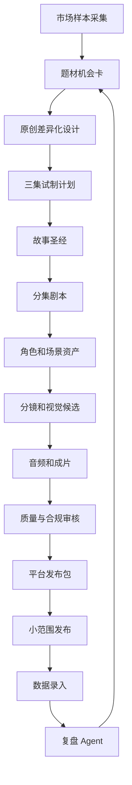
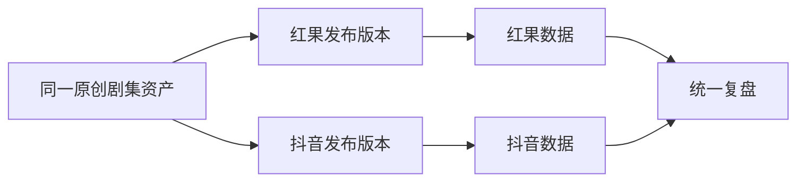

# ProjectDream 市场参考与内容工厂策略 PRD

**文档版本**：V1.0  
**制定日期**：2026-09-14  
**文档定位**：把平台热门漫剧的公开特征转化为 ProjectDream 的产品策略和试制流程  
**适用范围**：红果、抖音等平台的 AI 漫剧/漫剧视频内容生产  
**文档状态**：市场假设，必须通过真实试制和平台数据持续修正

> 本文档研究的是公开可观察的内容结构和生产方法，不复制具体作品。  
> 榜单、平台规则和用户偏好会变化，所有结论都要记录观察日期，并在发布前重新核验。

## 1. 为什么要做市场参考层

ProjectDream 当前已经具备从剧本到成片的基础闭环，但如果只继续增加模型和生成按钮，容易出现三个问题：

1. 生产效率提高了，但生产的是观众不看的内容。
2. 能做单集演示，但无法持续做系列。
3. 作品看起来像 AI 批量生成，人物、画面和故事都缺乏辨识度。

因此，市场研究必须进入生产系统，而不是停留在人工聊天和临时笔记中。

## 2. 产品定位

### 2.1 第一阶段定位

```text
3D 竖屏系列漫剧内容工厂
```

服务对象首先是 ProjectDream 自己的内容生产，而不是外部 SaaS 客户。

第一阶段要证明：

- 能找到适合自己的题材。
- 能做出连续多集。
- 能保持人物和视觉风格。
- 能控制单集成本。
- 能完成合规发布。
- 能通过真实数据判断是否继续。

### 2.2 第二阶段定位

内部内容工厂稳定后，提炼为：

- 题材模板。
- 故事圣经模板。
- 角色资产模板。
- 分镜模板。
- 竖屏后期模板。
- 平台发布包模板。

### 2.3 第三阶段定位

当内部内容已经连续验证成功后，再考虑：

- 多租户。
- 团队协作。
- 模型计费。
- 模板市场。
- 角色资产市场。
- 外部创作者服务。

## 3. 市场研究的边界

### 3.1 可以参考

- 题材方向。
- 人物身份结构。
- 开头冲突方式。
- 单集节奏。
- 视觉风格趋势。
- 角色关系。
- 标题和封面结构。
- 评论区提出的情绪需求。
- 连载、分季和更新方式。

### 3.2 不可以复制

- 小说原文。
- 具体人物姓名和关系。
- 受版权保护的角色形象。
- 影视剧、漫画或小说的画面。
- 未经授权的音乐和音效。
- 未经授权的真人脸和声音。
- 他人的提示词、素材包和生产资产。

### 3.3 研究结论的可靠性

每条市场结论必须标记：

```text
事实观察
公开资料转述
模型归纳
人工假设
待验证结论
```

系统不能把“可能热门”显示成“已经证明赚钱”。

## 4. 第一轮市场假设

这些是需要试验的方向，不是永久结论。

### 4.1 形式假设

- 竖屏更适合移动端连续观看。
- 系列化比单条短片更适合积累人物和观众关系。
- 3D 漫视觉需要重点验证人物稳定性和生产成本。
- 强冲突和强情绪更容易支撑短时长内容。
- 同一部剧需要多个版本的封面、标题和开头进行实验。

### 4.2 题材假设

红果方向第一轮可以验证：

- 玄幻。
- 穿越。
- 重生。
- 逆袭。
- 身份反转。
- 长线人物成长。

抖音方向第一轮可以验证：

- 都市冲突。
- 女性成长。
- 身份反转。
- 现实情绪。
- 强开场事件。
- 单集高密度反转。

这里的差异只是第一轮内容实验假设，不代表平台官方分类，也不代表题材必然产生收入。

## 5. 热门漫剧的结构化拆解

### 5.1 样本采集

每周采集 20-30 个公开样本，保存以下字段：

- 平台。
- 观察日期。
- 账号。
- 作品名。
- 集数或是否系列。
- 题材。
- 视觉风格。
- 主角身份。
- 反派身份。
- 第一个冲突出现时间。
- 第一个身份变化出现时间。
- 结尾钩子类型。
- 标题结构。
- 封面结构。
- 评论区高频反馈。
- 是否疑似 IP 改编。
- ProjectDream 是否允许借鉴该结构。

### 5.2 开头拆解

系统至少识别以下开头类型：

```text
结果先行
危机先行
身份揭露
复仇宣言
关系破裂
重大误会
超自然事件
反常行为
```

记录：

- 0-3 秒发生了什么。
- 3-10 秒观众知道了什么。
- 10-20 秒冲突如何升级。
- 第一个悬念是什么。

### 5.3 单集结构拆解

```text
开场钩子
 -> 人物处境
 -> 冲突升级
 -> 信息揭露
 -> 主角选择
 -> 情绪释放
 -> 下一集悬念
```

每集至少要有一次不可逆变化，不能只是重复争吵、重复解释和重复等待。

### 5.4 角色拆解

重点记录：

- 主角的初始弱点。
- 主角的隐藏资源。
- 主角面对的核心压迫。
- 主角的主动选择。
- 反派的现实利益。
- 主角与反派的关系升级。
- 观众为什么希望主角赢。

## 6. 内容实验系统

### 6.1 实验最小单元

```text
一个题材
 -> 一句话卖点
 -> 两个开头
 -> 两个封面
 -> 两组标题
 -> 三集连续样片
 -> 平台数据
 -> 继续/修改/停止
```

### 6.2 实验变量

- 题材。
- 主角身份。
- 开头事件。
- 视觉风格。
- 角色关系。
- 单集时长。
- 字幕样式。
- 封面。
- 标题。
- 配音风格。

一次实验不能同时修改所有变量，否则无法判断什么造成了结果变化。

### 6.3 实验记录

```ts
interface ContentExperiment {
  id: number
  projectId: number
  platformIds: string[]
  topic: string
  audience: string
  promise: string
  hypothesis: string
  budget: number
  status: 'draft' | 'running' | 'reviewing' | 'continued' | 'revised' | 'stopped'
  startedAt?: string
  endedAt?: string
}

interface ExperimentVariant {
  id: number
  experimentId: number
  openingType: string
  coverVersionId: number
  titleVersion: string
  visualStyleVersionId: number
  episodeIds: number[]
}
```

### 6.4 实验决策

系统输出：

- 内容质量是否达标。
- 生产成本是否可接受。
- 人工返工是否过多。
- 哪个变量值得继续。
- 哪个变量需要停止。
- 是否扩展为十集小季。

系统不根据单条视频的偶然高播放直接决定扩产。

## 7. 内容工厂生产流程



## 8. 市场研究 Agent

### 8.1 职责

- 管理市场观察样本。
- 提取题材、角色和结构模式。
- 判断内容同质化风险。
- 形成原创差异化建议。
- 生成试制方案。
- 标注需要人工核验的结论。

### 8.2 不允许的职责

- 不直接复制热门作品。
- 不下载和复用未经授权的素材。
- 不保证播放量。
- 不伪造平台热度。
- 不把评论区少量声音当成整体市场结论。

### 8.3 接口

```ts
interface MarketResearchService {
  createObservation(input: MarketObservationInput): Promise<MarketObservation>
  analyzeTopic(input: TopicResearchInput): Promise<TopicResearchReport>
  compareTopics(topicIds: number[]): Promise<TopicComparisonReport>
  createExperimentPlan(input: ExperimentPlanInput): Promise<ExperimentPlan>
}
```

## 9. 复盘 Agent

### 9.1 输入指标

- 3 秒留存。
- 5 秒留存。
- 平均观看时长。
- 完播率。
- 点赞率。
- 评论率。
- 转发率。
- 收藏率。
- 关注转化。
- 负面评论比例。
- 审核通过率。
- 单集成本。
- 人工返工时长。

### 9.2 输出内容

- 开头是否需要重做。
- 哪个角色最有潜力。
- 哪类对白导致掉人。
- 哪类镜头返工最高。
- 封面和标题是否需要替换。
- 是否值得继续做第二季。
- 下一轮应该只改什么。

### 9.3 复盘原则

- 播放量不等于内容质量。
- 完播率不等于收入。
- 单集高播放不等于系列成功。
- 必须同时看质量、成本、合规和收益。

## 10. 资产和模板复用

实验成功后，允许沉淀：

- 角色模板。
- 服装模板。
- 场景模板。
- 镜头模板。
- 对白节奏模板。
- 字幕模板。
- 封面模板。
- 发布文案模板。

模板必须记录：

- 来源项目。
- 是否原创。
- 是否有授权限制。
- 适用题材。
- 成本。
- 质量表现。
- 最近更新时间。

## 11. 多平台内容策略

### 11.1 统一资产

- 故事圣经。
- 角色资产。
- 场景资产。
- 原始视频。
- 原始对白。
- 原始字幕。

### 11.2 平台差异化版本

- 不同开头。
- 不同剪辑节奏。
- 不同封面。
- 不同标题。
- 不同简介。
- 不同标签。
- 不同字幕安全区。



## 12. 第一轮试制方案

### 12.1 题材数量

建议选择 3 个方向：

1. 3D 玄幻/逆袭。
2. 3D 穿越/身份反转。
3. 现代都市/女性成长。

### 12.2 试制规模

每个方向：

- 1 个主角。
- 1 个核心对手。
- 3 集连续样片。
- 每集 30-90 秒的内部版本。
- 至少 2 个开头版本。
- 至少 2 套封面和标题。

### 12.3 选择标准

优先选择：

- 角色容易统一。
- 场景数量可控。
- 动作复杂度适中。
- 冲突清楚。
- 可以持续扩展。
- 版权来源清楚。

暂时避开：

- 大量群像。
- 大规模战争。
- 超复杂多人打斗。
- 需要大量真实历史资料的题材。
- 角色状态变化极多的题材。

## 13. 验收标准

### 13.1 市场研究

- 有 20-30 个结构化样本。
- 样本都有观察日期。
- 有题材、开头、角色、节奏和评论记录。
- 事实和假设分开保存。
- 无授权作品素材进入生产库。

### 13.2 内容实验

- 完成 3 个题材方向。
- 每个方向完成 3 集连续样片或记录停止原因。
- 每个方向至少有两个开头版本。
- 每个方向记录成本和返工。
- 能生成继续、修改或停止结论。

### 13.3 生产系统

- 核心角色通过一致性回归测试。
- 任务失败可以恢复。
- 正式成片都有质量报告。
- 发布包和版权台账完整。
- 平台版本可独立导出。

### 13.4 商业决策

只有在以下条件同时满足时，才扩大到十集以上：

- 内容质量达标。
- 角色一致性达标。
- 生产成本可控。
- 合规材料完整。
- 实际发布数据支持继续试验。

## 14. 后续开发任务

### P0

- `market_observations` 数据表。
- 题材机会卡。
- 内容实验记录。
- 三集试制工作流。
- 平台版本和发布记录。

### P1

- 市场研究 Agent。
- 复盘 Agent。
- 题材对比报告。
- 封面/标题/开头版本管理。
- 多平台数据对照。

### P2

- 内容模板市场。
- 资产复用。
- 多租户。
- 计费和外部创作者工作区。

## 15. 最终原则

```text
先研究市场
再做原创试验
再做三集验证
再做十集小季
最后决定是否规模化
```

ProjectDream 的竞争力不应只是“生成速度快”，而应该是：

```text
更懂题材
+ 更懂连续剧
+ 人物更稳定
+ 质量更可控
+ 成本更透明
+ 失败能返工
+ 数据能反哺创作
```

