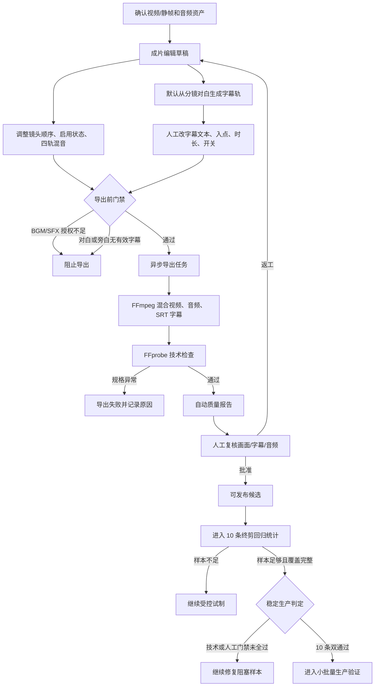
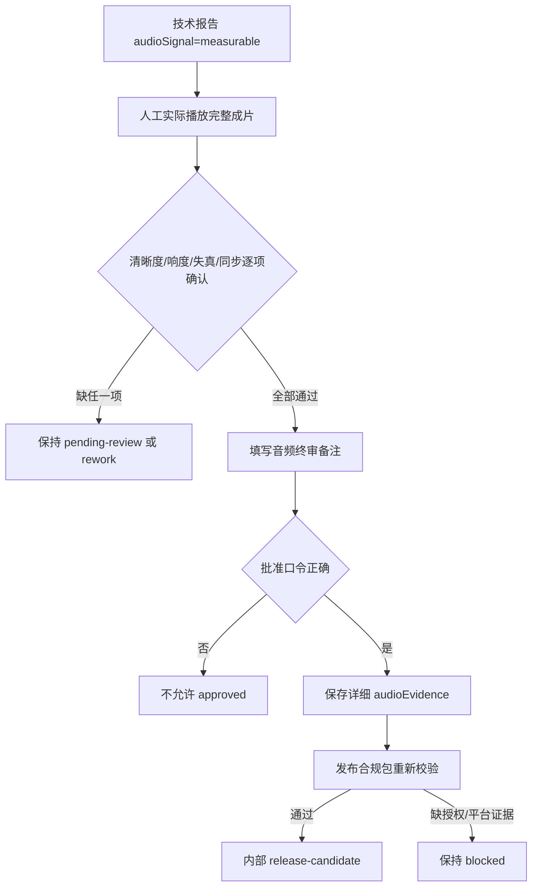

# 3D 竖屏生产模板、音频和成片质检开发流程

## 1. 功能目标

本功能把 ProjectDream 的成片交付从“可导出视频”升级为“固定竖屏规格、可追溯音频授权、可编辑字幕、自动技术检查和人工签核”的发布候选流程。

第一阶段统一规格：

```text
1080 x 1920 / 9:16 / 24fps / H.264 MP4 / AAC
```

它提高成片进入发布环节前的可控性，但不承诺平台审核、推荐、分账或稳定收入。

## 2. 已实现范围

- 通用 `1080x1920` 竖屏模板，不绑定红果、抖音的动态投稿规则。
- BGM/SFX 授权素材库：来源、授权状态、授权凭证、文件信息。
- 对白、旁白、BGM、SFX 四轨混音。
- 项目级可编辑字幕：文本、镜头绑定、入点、显示时长、开关。
- 导出前与后台渲染前双重门禁。
- FFprobe 验证成片尺寸、视频编码、音频编码和容器。
- 自动技术报告加人工画面、字幕、音频三项签核。
- 10 条终剪回归报告：只读汇总已有导出、质检和成本证据，判断样本是否足够、批准率、平均耗时、平均成本和返工原因。
- 10 条终剪回归覆盖标签人工入口：可从回归样本中选择具体导出，标记空镜头、单人、双人、对白、旁白、动作六类覆盖，并保存备注。
- 10 条终剪回归样本复核清单：逐条展示技术状态、人工复核状态、发布状态、覆盖标签和待补缺口。
- 10 条终剪回归缺口摘要：汇总未标记覆盖、技术阻塞、待人工复核、人工返工和人工通过数量，便于先定位批量风险。
- 10 条终剪回归样本筛选视图：支持按全部、未标记、技术阻塞、待复核、返工、已通过过滤样本。
- 10 条终剪回归下一步处理建议：每条样本按技术阻塞、人工返工、待人工复核、缺覆盖标签、样本已就绪给出只读处理建议。
- 稳定生产判定：与覆盖门禁分离，只有 10 条样本全部技术通过且人工批准时才显示 `ready`。
- 人工复核证据缺口：逐样本列出人工结论、画面、字幕、音频和人物一致性证据缺失项，并纳入稳定生产阻塞。
- 人工证据分组筛选：按人工结论、画面、字幕、音频、人物一致性五类统计缺口，并可一键筛出对应样本。
- 人物一致性终审门禁：批准成片为发布候选前，必须勾选人物一致性复核并填写证据备注。
- 单条回归样本人工复核工作台：可从 10 条终剪回归样本中指定一条，单条生成技术质量报告，回填已有人工证据，保存返工或批准结论。
- 待补样本导航：统计缺技术报告、技术阻塞和人工证据缺口，并一键定位下一条需要处理的样本。
- 当前样本待补项、已留存终审证据、审批前缺口、保存影响范围、复核历史、当前输入保存状态和终审摘要只读面板：把“后端已保存证据”“当前表单仍缺什么”“点击保存会影响什么”“历史上发生过什么”“当前输入是否已保存”和“如何留档讲解”拆开展示，避免把未保存输入误认为已留存或已批准。
- 终剪回归样本口径修正：只有 `completed` 和 `failed` 才算真实终剪尝试；`canceled`、`queued`、`running` 不占用 10 条样本名额，但仍保留在导出历史和审计记录中。数据库查询直接筛选真实终剪状态，排除状态通过独立计数查询统计，不再依赖混合状态候选窗口。

不包含：

- 自动上传或发布到平台。
- 对象存储、CDN、签名 URL、文件生命周期。
- 自动响度、ASR 对齐、字幕遮挡、审美或人物相似度评分。
- 平台审核通过、播放量、收益保证。

## 3. 总体业务流程



## 4. 模块职责

| 模块 | 文件 | 职责 |
| --- | --- | --- |
| 竖屏模板与门禁 | `server/services/vertical-production-template.mjs` | 固化规格、检查授权音频与有效字幕、检查渲染结果 |
| 字幕轨 | `server/services/subtitle-cues.mjs` | 默认字幕、草稿规范化、SRT 生成 |
| 授权音频库 | `server/services/audio-library.mjs` | 校验来源、授权凭证和音频 Data URL |
| 质量签核 | `server/services/final-quality-review.mjs` | 自动门禁和人工批准规则 |
| 终剪回归 | `server/services/final-quality-regression.mjs` | 统计 10 条样本、通过率、耗时、成本、覆盖类型、返工原因、人工复核证据缺口和稳定生产判定 |
| 终剪页面 | `src/views/FinalEdit.vue` | 镜头、音轨、字幕与授权素材操作 |
| 导出页面 | `src/views/Export.vue` | 固定导出规格、技术报告、人工签核、10 条回归统计和覆盖标签入口 |
| 服务端编排 | `server/index.mjs` | 草稿读写、导出门禁、FFmpeg、FFprobe、报告落库 |

## 5. 字幕开发流程

### 5.1 默认生成

1. 从当前启用分镜的 `dialogueText` 提取可说出的对白。
2. 排除“无对白”“无台词”等占位文本。
3. 生成 `cueId`、`storyboardId`、`enabled`、`startOffsetSeconds`、`durationSeconds`、`text`。
4. 默认字幕仅作为终剪初稿，人工编辑不会回写分镜原始对白。

### 5.2 编辑和保存

终剪页可对每条字幕：

- 启用或停用。
- 绑定当前启用镜头。
- 修改相对镜头的入点秒数和显示时长。
- 修改字幕文本。
- 新增人工字幕。

字幕与镜头顺序、镜头开关、四轨混音一起保存到：

```text
final_edit_drafts.draft_json
```

规范化规则：

1. 只能绑定当前启用镜头。
2. 入点不能小于 `0` 或超出镜头。
3. 时长最小 `0.25s`，最大为镜头剩余时长。
4. 空白文本不是有效字幕。
5. 禁用镜头对应字幕会在后端最终草稿中移除。

### 5.3 导出使用

最终字幕链路：

```text
final_edit_drafts.subtitleCues
  -> normalizeSubtitleCues
  -> buildSubtitleTextFromCues
  -> subtitles.srt
  -> FFmpeg subtitles filter
```

因此最终烧录的是人工修改后的字幕，而不是页面上临时显示的文本。

## 6. 授权音频流程

### 6.1 入库字段

每个 BGM/SFX 必须记录：

- `assetType`：`music` 或 `sfx`。
- 素材名称。
- 来源名称。
- 授权状态：`authorized`、`owned`、`public-domain`。
- 授权凭证：合同、订单、许可证或内部编号。
- 文件名、媒体类型、文件大小、备注。

开发阶段文件位于：

```text
.codex-runtime/audio-library
```

P7 必须迁移到对象存储，不能长期依赖本机目录。

### 6.2 挂载与门禁

1. 从授权素材库选择 BGM 或音效。
2. 服务端确认素材属于当前项目。
3. 创建已确认 `audio_assets` 音轨，并复制来源和授权字段。
4. 成片草稿控制该轨道开关与音量。
5. 导出只检查当前启用 BGM/SFX；未授权会阻止导出，被关闭的音轨不参与本次检查。

## 7. 成片质检流程

### 7.1 导出前与后台双重门禁

`POST /api/projects/:projectId/exports` 会先检查：

1. 成片编辑草稿完整性。
2. 当前启用 BGM/SFX 是否有授权。
3. 当前启用对白或旁白是否有有效字幕。

后台 Worker 在真正渲染前会再次运行同一门禁，避免排队后草稿变化绕过检查。

### 7.2 渲染后技术检查

FFprobe 读取：

- 视频宽高。
- 视频编码。
- 音频编码。
- 容器格式。

合格条件：

```text
1080x1920 / h264 / aac / mp4
```

任一不符，导出任务失败并记录具体原因。

### 7.3 人工签核

自动检查通过后，人工必须完成：

- 画面与人物表现复核。
- 字幕文本与安全区复核。
- 对白、BGM、音效复核。
- 人物外貌、发型、服装、体型和同屏角色数量一致性复核。

四项齐全且结论 `approved`，成片状态才进入：

```text
release-candidate
```

自动技术检查不能替代人物一致性、错别字、口型、节奏和审美的人工判断。批准为 `release-candidate` 时，人物一致性必须有结构化复核证据。

### 7.4 10 条终剪回归

回归报告只读取已有记录，不启动 Worker、不调用模型、不创建新导出。

统计口径：

1. 数据库直接读取最近的 `completed` / `failed` 导出记录，再取最近 10 条有效样本；不会先把取消、排队和运行中记录混入候选窗口。
2. 少于 10 条时返回 `insufficient-samples`，不能判断稳定生产。
3. 样本达到 10 条后，还必须覆盖 `空镜头`、`单人镜头`、`双人镜头`、`对白镜头`、`旁白镜头`、`动作镜头` 六类；缺任一类时返回 `coverage-incomplete`。
4. 统计完成数、失败数、自动质检通过数、人工批准数、返工数、缺少人工复核数。
5. 按导出创建和更新时间估算平均耗时。
6. 从成本台账读取已计价成本，未计价时不虚构金额。
7. 优先展示人工返工原因，再展示自动技术阻塞原因。

有效样本状态固定为：

```text
includedStatuses: completed / failed
excludedStatuses: canceled / queued / running
```

响应中的 `sampleScope` 返回上述状态口径和 `excludedCount`。取消、排队和运行中记录不会挤掉较早的真实完成/失败尝试，但会继续保留在导出历史、回滚审计和任务排查中。`excludedCount` 来自数据库独立计数，不会因为有效样本查询只取最近 N 条而被截断；有效样本查询的上限仍由接口 `limit` 控制，当前最大 50 条。

该报告只用于内部回归复盘，不等于人物一致性视觉模型评分、平台审核结果或收益预测。

覆盖类型可由人工在导出页为指定回归样本保存，保存规则：

1. 只写入 `export_records.config_json` 的 `regressionTags` 和 `finalQualityRegression` 元数据。
2. 必须勾选至少一个有效覆盖类型。
3. 必须输入精确确认口令：

```text
CONFIRM_FINAL_QUALITY_REGRESSION_TAGS
```

4. 保存后刷新 10 条终剪回归报告。
5. 该操作不会启动 Worker、不会调用模型、不会创建新导出，也不会改变导出状态。
6. 页面允许在当前回归样本中切换目标导出，避免只能标记最新一条而无法补齐 10 条样本覆盖。
7. 样本复核清单只读取已有报告，帮助人工定位“技术阻塞、待人工复核、标签缺失”等缺口，不做自动人物识别或自动审美判断。
8. 缺口摘要只从当前 10 条回归样本计算数量，不写库、不保存、不改变任何导出状态；用于指导人工先补标签、技术阻塞或复核缺口。
9. 样本筛选视图只改变当前页面显示范围，不保存筛选状态、不改数据库；用于快速定位需要人工处理的样本。
10. 下一步处理建议由服务端报告统一计算，前端只展示建议文案；它不会自动重试、不会自动批准、不会替代人工审美和人物一致性判断。
11. `productionReadiness` 独立于 `status`：`status=ready` 只代表样本数和覆盖类型达标；`productionReadiness.ready=true` 还要求 10 条样本全部自动技术通过、人工批准且没有返工或缺复核。
12. 稳定生产判定为 `blocked` 时，页面必须展示阻塞原因，例如覆盖不足、技术通过样本不足、人工批准不足、存在返工或缺人工复核。
13. `reviewEvidenceGaps` 逐样本列出人工证据缺口：人工结论、画面证据、字幕证据、音频证据和人物一致性证据；任一缺口都会计入 `summary.reviewEvidenceGapCount`，并阻断 `productionReadiness.ready`。
14. `reviewEvidence.buckets` 按五类人工证据缺口汇总数量，导出页展示“人工证据分组”，点击任一分组只筛出缺该类证据的样本；该筛选不保存状态、不写库、不触发 Worker 或模型。
15. 单条样本人工复核工作台优先使用已有 `FinalQualityReport`：选择样本后回填画面、字幕、音频、人物一致性四项证据和复核备注；返工可直接留痕，批准仍必须输入 `APPROVE_FINAL_QUALITY_REVIEW`；保存后刷新 10 条回归统计。
16. 当选中样本是已完成导出且缺少技术质量报告时，页面可对这一条调用 `POST /api/exports/:exportId/quality-report` 生成报告；该操作只检查这一条已完成导出，不创建新导出、不启动 Worker、不调用模型。
17. 待补样本导航按“缺技术报告、技术阻塞、人工证据缺口、未批准”的顺序定位下一条样本；它只切换当前复核目标，不保存、不启动 Worker、不调用模型。
18. 当前样本待补项只读清单按选中样本展示缺少技术质量报告、技术质检阻塞、画面证据、字幕证据、音频证据、人物一致性证据和人工批准缺口；它不保存、不启动 Worker、不调用模型。
19. 已留存终审证据面板只读取 `FinalQualityReport.reviewChecklist` 中已经保存的画面、字幕、音频和人物一致性证据；当前表单里尚未保存的输入不会显示为“已留存”。
20. 审批前缺口面板按当前表单实时提示缺技术报告、技术门禁、四项勾选/备注和批准口令；它只是批准按钮的可解释说明，不会自动保存或自动批准。
21. 保存影响范围面板在返工/批准控件前提示“只更新当前质量报告、不会发布到平台、不会创建新导出、不会启动 Worker 或模型”；它只解释当前保存动作，不改变后端复核门禁。
22. 复核历史面板只读取当前质量报告的人工结论、复核时间、最后更新和内部发布状态；`pending-review`、`blocked` 或 `release-candidate` 都只是内部证据链状态，不代表平台审核通过或可稳定盈利。
23. 当前输入保存状态面板只对比当前表单草稿与已保存质量报告快照，逐项提示“尚未保存的改动”或“与报告一致”；它不保存、不发布、不启动 Worker 或模型。
24. 终审摘要面板支持复制或下载当前单条样本摘要，摘要包含项目/导出/质量报告、技术状态、人工结论、覆盖类型、当前输入保存状态、证据保存状态和审批前缺口；它只用于本地留档和讲解，不保存、不发布、不启动 Worker 或模型。
25. 终审摘要面板增加“打印签核清单”入口：只调用浏览器 `window.print()`，打印内容包含项目/导出/质量报告、技术状态、覆盖类型、四项人工证据保存状态、当前输入保存状态、审批前缺口、复核历史和签核空栏。
26. 打印版签核清单默认隐藏，进入打印媒体后只显示白底清单，隐藏视频播放器、输入框和操作按钮；打印操作不保存、不发布、不启动 Worker 或模型。
27. 单条样本复核、报告生成、导航定位、摘要复制/下载/打印或只读缺口说明不代表 10 条整体回归、人物一致性审美判断或平台发布已经通过。

## 8. 接口与数据结构

### 成片编辑

- `GET /api/projects/:projectId/final-edit`
- `PUT /api/projects/:projectId/final-edit-draft`

```ts
interface FinalEditDraftDTO {
  videoClips: Array<{ storyboardId: number; enabled: boolean; order: number }>
  audioMix: {
    dialogue: { enabled: boolean; volume: number }
    narration: { enabled: boolean; volume: number }
    music: { enabled: boolean; volume: number }
    sfx: { enabled: boolean; volume: number }
  }
  subtitleCues: Array<{
    cueId: string
    storyboardId: number
    enabled: boolean
    startOffsetSeconds: number
    durationSeconds: number
    text: string
  }>
}
```

### 授权素材与质检

- `GET /api/projects/:projectId/audio-library`
- `POST /api/projects/:projectId/audio-library`
- `POST /api/projects/:projectId/audio-library/:assetId/attach`
- `GET /api/projects/:projectId/final-quality-reports`
- `GET /api/projects/:projectId/final-quality-regression`
- `PUT /api/exports/:exportId/final-quality-regression-tags`
- `POST /api/exports/:exportId/quality-report`
- `PUT /api/final-quality-reports/:id/review`

```ts
interface FinalQualityRegressionTagUpdateDTO {
  tags: string[]
  note?: string | null
  confirm: true
  confirmationToken: 'CONFIRM_FINAL_QUALITY_REGRESSION_TAGS'
}

interface FinalQualityRegressionProductionReadinessDTO {
  status: 'ready' | 'blocked'
  ready: boolean
  requiredPassedSampleCount: number
  passedSampleCount: number
  blockers: Array<{
    code: string
    message: string
    count?: number
  }>
}

interface FinalQualityRegressionSampleDTO {
  exportId: number
  qualityGapCodes: string[]
  reviewEvidenceGaps: Array<{
    code: string
    label: string
    message: string
  }>
}

interface FinalQualityRegressionReviewEvidenceDTO {
  totalGapCount: number
  buckets: Array<{
    code: string
    label: string
    message: string
    count: number
    missing: boolean
  }>
}
```

## 9. 测试与验收

开发按 Red -> Green -> Refactor 完成字幕和门禁规则：

1. 先写默认字幕、规范化、SRT 输出的失败测试。
2. 实现字幕轨服务。
3. 为无授权 BGM/SFX、无有效字幕、禁用轨道过滤写门禁测试。
4. 接入导出创建和后台渲染。
5. 运行全量自动化、类型检查、构建、浏览器和只读 API 冒烟。

2026-09-15 验证结果：

```text
npm test
126 passed, 0 failed

npm run type-check
passed

npm run build
passed

node --check server/index.mjs
passed

git diff --check
passed
```

项目 `#12` 只读接口：

```text
GET /api/projects/12/final-edit
200，返回 31 条有效字幕

GET /api/projects/12/audio-library
200

GET /api/projects/12/final-quality-reports
200

GET /api/projects/12/final-quality-regression
200，返回最近导出的回归样本统计；样本不足 10 条时保持 `insufficient-samples`
```

2026-09-17 追加验证：

```text
node --test server/services/final-quality-regression.test.mjs
7/7 通过

node --test src/views/Export.final-quality-review.test.mjs
27/27 通过

npm test
305/305 通过

npm run type-check
通过

npm run build
通过

node --check server/index.mjs
通过

node --check server/services/final-quality-review.mjs
通过

node --check server/services/final-quality-regression.mjs
通过

C:\Users\杨志泽民\.codex\skills\impeccable\scripts\impeccable.cmd detect --json src/views/Export.vue
[]，未发现机械设计问题

git diff --check
通过，仅有既有 CRLF warning
```

浏览器验收：

- 终剪页加载真实项目：57 个片段、25 条音频、31 条字幕。
- `390px` 手机视口没有横向溢出。
- 导出页显示固定 `1080 x 1920 (vertical)`、`24 fps`、`H.264 / MP4`。
- 旧横屏导出是既有历史数据；P6 新导出入口已固定为竖屏模板。
- 项目 12 导出页显示“稳定生产判定 blocked”，技术和人工双通过样本 `0 / 10`，阻塞原因包含覆盖不足、技术通过不足、人工批准不足、人工复核缺口和人工证据缺口。
- 单条样本人工复核工作台新增“当前样本待补项”只读清单，会按当前选中样本展示缺少技术质量报告、技术质检阻塞、画面证据、字幕证据、音频证据、人物一致性证据和人工批准缺口；该清单只读，不保存、不启动 Worker、不调用模型。
- 单条样本人工复核工作台新增“已留存终审证据”“审批前缺口”“保存影响范围”“复核历史”“当前输入保存状态”和“终审摘要”只读面板：桌面和 `390px` 视口均能清楚展示四项证据状态、当前审批阻塞项、保存动作边界、当前质量报告审计摘要、当前表单是否存在未保存改动，以及可复制/下载的终审摘要；没有横向溢出或遮挡。
- 终审摘要新增“打印签核清单”：项目 12 页面能看到入口，点击只触发 `window.print()` 且 API 请求数保持 `22 -> 22`；打印媒体下签核清单为 `display:block/visible`，视频为 `hidden`；`390px` 视口下 `document.body.scrollWidth=380`，没有横向溢出。

未执行真实写入冒烟：

- 未上传临时音频、创建临时音轨、创建临时导出或触发真实 FFmpeg 成片。
- 这些操作会写入项目数据，且测试后需要删除项目、文件、音轨、导出记录和报告；删除前必须由用户确认。

## 10. 当前限制和下一步

1. 音频仍保存在本机运行目录。
2. 字幕安全区已有配置，尚未逐帧检查遮挡或越界。
3. 默认字幕来自分镜文本，不是实际配音的逐字转写。
4. 自动技术检查不评价剧情、人物一致性、口型自然度或观众留存。
5. 10 条终剪回归只统计已有样本；覆盖标签入口、人工证据缺口、当前样本待补项、已留存终审证据、审批前缺口、保存影响范围、复核历史、当前输入保存状态、终审摘要、打印签核清单和稳定生产判定只保存/读取或导出内部证据，不能替代真实三集/十集试制和平台数据复盘。
6. P7 应补队列、对象存储、成本账本、版权台账、AI 标识和平台发布包。
7. 平台规则会变化，发布当天仍需在官方后台人工核验。

### 10.1 `export #31 -> #33` 真实终审记录

本轮必须区分已回滚导出和当前有效导出：

| 导出 | 状态 | 处理 |
| --- | --- | --- |
| `#31` | `canceled` | 已按回滚规则保留对象、配置和回滚证据，不能再批准为发布候选。 |
| `#32` | `canceled` | 字幕安全区不合格，保留失败证据。 |
| `#33` | `completed` | 当前有效成片，对应质量报告 `#5`。 |

`export #33` 的独立技术证据：

- `1080x1920 / 24fps / H.264 + AAC / MP4 / 5.0s`。
- `loudnorm input_i=-22.27 LUFS`，音轨被检测为 `measurable`。
- 字幕文件为 `十。`，时间轴覆盖 `00:00:00,000-00:00:05,000`。
- 抽帧显示主体为广播机特写，未看到实体人物；因此人物一致性必须记录为“不适用”，不能写成“人物一致性通过”。

代理终审保存为 `rework`，原因是当前环境只能确认音频存在有效技术信号，不能替代真实听感对对白清晰度、爆音、底噪、混音和对嘴的人工确认。该结论不会生成 `release-candidate`，也不会代表红果、抖音平台审核通过或能够稳定盈利。

本轮新增：

1. 人物一致性“不适用”证据状态。空镜头可以明确说明没有可见人物，不被迫伪造人物一致性通过。
2. 前端导出页的不适用选项、保存状态和审计摘要同步支持。
3. 回归统计不再把“不适用”计入人物一致性缺口，但仍要求其留有说明。
4. `export #33` 已保存 `empty-scene` 与 `dialogue` 覆盖标签；标签只用于回归统计，不改变 `rework` 结论。

验证结果：

```text
npm test                         310/310 passed
node --test final-quality-review  8/8 passed
node --test final-quality-regression 8/8 passed
node --test Export.final-quality-review 29/29 passed
npm run type-check              passed
npm run build                   passed
node --check server/index.mjs   passed
git diff --check                passed
```

## 11. 复盘

本轮把“导出一个视频”拆成了可验证的生产约束：

```text
镜头草稿 + 授权素材 + 可编辑字幕 + 技术规格 + 人工签核
= 可发布候选

本轮再把人工终审拆成“证据状态、审批缺口、保存范围、复核历史、摘要留档和打印签核”六个可讲解部分；其中打印只生成纸面/浏览器打印视图，不改变任何生产状态。
```

重点收获：

- 字幕改动真正进入 SRT 和最终渲染。
- 授权信息既留在素材库，也复制到实际音轨，方便追溯。
- 导出前和后台执行时都有后端门禁。
- 空镜头必须把“无实体人物”记录为“不适用”，而不是为了满足表单勾选伪造人物一致性结论。

下一步重点训练：

- 真实成片集成测试。
- 可靠队列和对象存储。
- 音画、字幕安全区、角色一致性的自动质检。

## 12. 音频人工听感复核门禁（2026-09-18）

### 12.1 为什么要单独增加这一层

`ffprobe` 只能证明容器中存在可测量的音频信号，不能证明对白听得清、BGM/SFX 没有压住对白、没有爆音/明显失真，也不能证明对白与画面同步。此前只填写一段“音频正常”备注，仍可能把技术信号误当成人工听感。

因此，新的 `approved` 终审必须同时保存以下音频证据：

1. `listeningConfirmed`：人工实际完整播放过成片。
2. `clarityReviewed`：对白清晰、没有明显底噪影响理解。
3. `loudnessReviewed`：对白、BGM、SFX 的响度平衡可接受。
4. `clippingReviewed`：没有爆音或明显失真。
5. `syncReviewed` 或 `syncNotApplicable`：对白与画面同步；没有可见说话人物时，明确记录同步不适用。

### 12.2 保存流程



### 12.3 代码和接口边界

- `server/services/final-quality-review.mjs`
  - `hasCompleteAudioHumanEvidence(checklist)`：统一判断详细音频听感证据是否完整。
  - 新的 `approved` 请求缺少完整字段时直接返回错误，不会保存为发布候选。
  - 旧的泛化音频记录仍可保留作历史返工证据，但不能升级为新的 `approved`。
- `server/services/final-quality-regression.mjs`
  - 10 条回归统计将旧音频备注判定为 `audio-evidence-missing`。
  - 因此不会因为历史字段不完整而错误计算为稳定生产。
- `server/services/release-compliance.mjs`
  - 发布合规包再次检查完整音频听感证据。
  - 即使数据库里存在旧的 `approved`，缺少详细音频字段仍保持 `blocked`。
- `src/views/Export.vue`
  - 最新导出和单条回归样本复核工作台都展示相同的六个音频子项。
  - 批准按钮在字段未齐时保持禁用，并在“审批前缺口”中显示具体原因。
  - 保存影响范围不变：只更新当前质量报告，不启动 Worker、不调用模型、不发布平台。

### 12.4 验收证据

```text
node --test server/services/final-quality-review.test.mjs
10/10 通过

node --test server/services/final-quality-regression.test.mjs
9/9 通过

node --test server/services/release-compliance.test.mjs
10/10 通过

node --test src/views/Export.final-quality-review.test.mjs
31/31 通过

npm test
316/316 通过

npm run type-check
通过

npm run build
通过

node --check server/services/final-quality-review.mjs
通过

node --check server/services/final-quality-regression.mjs
通过

node --check server/services/release-compliance.mjs
通过
```

这次实现只完善“证据门禁和记录能力”，没有伪造对 `export #33` 的真实听感结论，也没有把它改成可发布候选。`export #33` 仍需人工实际播放后填写上述字段。

### 12.5 发布候选快照中的音频证据

发布候选快照不再只保存 `audio` 文本备注，同时保存：

- `listeningConfirmed`
- `clarityReviewed`
- `loudnessReviewed`
- `clippingReviewed`
- `syncReviewed`
- `syncNotApplicable`

导出页在内部“发布候选快照”区域逐项展示这些状态。它们只是内部证据快照，不代表红果、抖音已经审核通过；平台发布当天仍需人工核对官方后台规则和实际听感。

### 12.6 播放完成与音频听感确认门禁

为避免把“看到音频轨存在”误填成“已经完成听感审核”，导出页的两个人工复核入口都采用以下流程：

1. 最新导出和选中回归样本都必须提供可播放的成片播放器。
2. 播放器触发 `ended` 事件后，才允许勾选“实际完整播放过成片”。
3. 切换回归样本或重新加载人工复核表单时，本地播放完成状态清零；数据库里已有的人工证据仍按原值展示。
4. “对白与画面同步”和“对白同步不适用”互斥，避免同一份证据同时声明两种结论。
5. 该前端门禁只是减少误操作，服务端 `normalizeFinalQualityReview`、10 条回归统计和发布合规包仍会再次校验详细字段。

这不能证明审核人确实认真听完或平台会接受成片，只能保证系统不会把普通技术信号直接伪装成完整听感证据。

### 12.7 本轮验收

```text
node --test src/views/Export.final-quality-review.test.mjs
34/34 通过

npm test
320/320 通过

npm run type-check
通过

npm run build
通过

node --check server/index.mjs
通过

node --check server/services/final-quality-regression.mjs
通过

git diff --check
通过

C:\Users\杨志泽民\.codex\skills\impeccable\scripts\impeccable.cmd detect --json src/views/Export.vue
[]

浏览器只读检查
项目 12 导出页播放器正常出现；
播放完成前听感确认复选框为 disabled；
页面 scrollWidth=1078，viewport=1088，无横向溢出。
```

### 12.8 本轮回归样本口径修正验收

本轮修正了回归统计直接取最新 10 条混合状态记录造成的失真：数据库直接筛选 `completed` / `failed`，取消、排队和运行中记录不再占用真实终剪样本名额；排除状态数量通过独立计数查询返回，较早的真实尝试不会被取消记录挤出固定候选窗口。服务端返回 `sampleScope`，导出页展示纳入状态和排除数量；页面在回归数据尚未加载时不读取空对象，避免首屏类型和运行时错误。

本轮验证：

```text
node --test server/services/final-quality-regression.test.mjs
11/11 通过

node --test src/views/Export.final-quality-review.test.mjs
34/34 通过

npm test
321/321 通过

npm run type-check
通过

npm run build
通过

Impeccable detect
[]
```

本轮只修正统计查询口径和页面空态保护，没有启动 Worker、调用模型、创建真实导出、修改项目 12 的 `export #33` 人工结论，也没有把真实 10 条终剪回归宣称为已完成。
