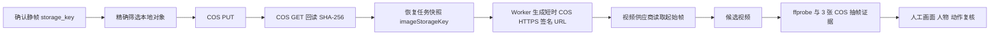

# COS 精确回填与恢复源图接入开发流程

## 1. 目标

解决历史视频恢复时，外部视频模型无法访问本机 `127.0.0.1` 起始帧的问题。



## 2. 关键原则

首批 5 个对象按 Key 排序回填后，实际是历史导出成片，不是恢复所需起始帧。因此：

```text
“COS 写入成功”不等于“恢复源图已就绪”。
恢复任务必须按确认静帧的完整对象 Key 回填。
```

## 3. 模块边界

| 模块 | 职责 |
| --- | --- |
| `storage-replication.mjs` | 按项目范围和显式 Key 清单选择对象，复制并回读哈希校验 |
| `replicate-local-media-to-cos.mjs` | 解析 `--projects`、`--keys`、`--limit`、`--apply`，输出审计报告 |
| `expired-video-recovery.mjs` | 在恢复任务快照中保留 `projectId`、`imageStorageKey` 和 `autoConfirm=false` |
| `queue-expired-video-recovery.mjs` | 从确认静帧读取 `storage_key` 并创建稳定 `retry-N` 任务 |
| Worker | 优先依据 `imageStorageKey` 生成 COS 签名 URL，再调用视频供应商 |
| `recovery-video-inspection.mjs` | 校验恢复候选媒体规格、三张不同抽帧 Key 与确认门禁 |
| `inspect-recovery-video-candidates.mjs` | 为历史恢复候选生成 dry-run 或写回抽帧检查报告 |

## 4. 操作流程

先生成只读计划：

```powershell
npm run replicate:local-media-to-cos -- --projects=12 --keys=projects/12/frames/storyboards/168/v1/c159.png --limit=1
```

确认计划后显式上传：

```powershell
npm run replicate:local-media-to-cos -- --projects=12 --keys=projects/12/frames/storyboards/168/v1/c159.png --limit=1 --apply
```

上传结果必须为：

```text
result = copied-and-verified
```

该过程不删除本地文件、不修改数据库、不调用模型。`--keys` 不会绕过项目范围，其他项目或本地不存在的对象不会被选中。

## 5. TDD 验收

新增失败测试后实现最小逻辑：

```text
storage-replication.test.mjs
  - 仅选择明确指定且属于项目的对象 Key

expired-video-recovery.test.mjs
  - 恢复任务快照保留 imageStorageKey
```

2026-09-16 验证：

```text
npm test：196 项通过
npm run type-check：通过
npm run build：通过
脚本语法检查：通过
进度看板 HTTP：200
```

## 6. 项目 12 的真实证据

| 事项 | 结果 |
| --- | --- |
| 历史导出成片小批量回填 | 5/5 上传后回读 SHA-256 一致 |
| 恢复起始帧精确回填 | 16/16 上传后回读 SHA-256 一致 |
| 恢复任务入队 | 16 条，job 254-269，状态均为 `queued` |
| 任务快照抽检 | job 254 保存 `projects/12/frames/storyboards/168/v1/c159.png` |
| 自动确认 | 关闭，`autoConfirm=false` |

追加真实链路验收：

| 事项 | 结果 |
| --- | --- |
| job 254 | 成功生成候选视频，但空景出现陌生人物，不能放行 |
| job 255 | 空景提示词强化后成功生成资产 193，仍为 `candidate` |
| job 255 源图 | `projects/12/frames/storyboards/180/v1/c174.png`，COS `HeadObject` 成功 |
| job 255 成片 | `projects/12/videos/storyboards/180/v2/c1.mp4`，COS `HeadObject` 成功，2,107,212 bytes |
| job 255 规格 | `1920x1088 / 30fps / H.264 + AAC / 5.1s`，仍不满足竖屏终剪规格 |
| 空景人工抽帧 | 0.5s、4.5s 未见人物、脸或人体轮廓；仅为单样本证据 |
| 历史候选检查回填 | 资产 192、193 各生成 3 张 COS 抽帧，6/6 `HeadObject` 成功 |
| 历史对象缺失 | 资产 187-191 在 COS 找不到源视频，均写入 `failed` 检查报告并继续阻断确认 |

## 7. 当前边界

- 已证明 COS 写入、回读、任务快照以及 2 条受控 Worker 消费链路正确；剩余 14 条任务尚未消费。
- job 255 的结果证明 COS 签名源图可被视频供应商读取，但不能据此推断所有源图、人物镜头和模型批次都可稳定生成。
- 视频生成成功后仍必须经过人物一致性、画面、动作连续性、竖屏终剪、字幕、音频和发布合规检查。
- COS 抽帧报告只能证明媒体规格和人工证据可读取，不能自动判定人物一致、空景无人物或剧情质量。
- 这不是稳定收益已实现的证据，而是解除本地源图恢复链路的一项关键工程阻塞。

## 8. 上台讲解顺序

1. 临时视频链接会过期，不能把供应商地址当永久资产。
2. 云端视频模型也不能读取本机 `127.0.0.1` 图片。
3. 稳定对象 Key 加私有 COS 签名 URL，解决素材可追溯与安全访问。
4. 先 dry-run，上传后强制回读哈希，避免“看似成功”的假象。
5. 任务只入队不自动确认，质量仍由人工复核与终剪门禁控制。
