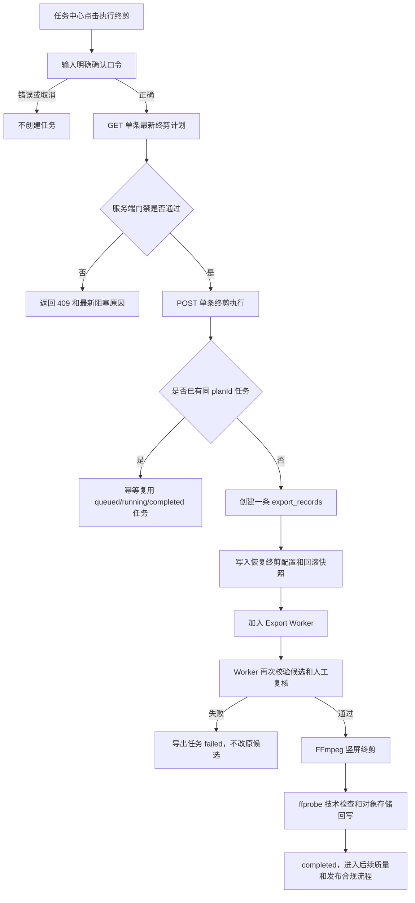

# 单条竖屏终剪执行与回滚开发流程

## 1. 功能目标

本功能只处理已经完成自动技术检查、人工画面复核、人物一致性复核和动作连续性复核的单条恢复候选视频。

它的目标是把候选视频送入项目现有的竖屏终剪 Worker，输出：

- `1080x1920`
- `9:16`
- `24fps`
- `H.264 + AAC`
- `MP4`
- 字幕烧录

本功能不批量消费任务，不覆盖原恢复候选，不自动把候选设为分镜主版本，也不宣称已经满足红果或抖音发布要求。

## 2. 状态前提

执行入口只有在以下条件全部满足时才允许创建任务：

1. 视频属于 `recover-video-*` 过期恢复任务。
2. 视频资产当前仍为 `candidate`。
3. 自动技术检查状态为 `ready`。
4. 人工画面检查为通过。
5. 人物一致性检查为通过。
6. 动作连续性检查为通过。
7. 每个预期角色均有 `matched` 结论，没有漏项或 `rework`。
8. 当前候选仍需要竖屏终剪。
9. 请求携带最新的 `planId`。
10. 请求携带精确确认口令 `START_RECOVERY_FINAL_EDIT`。

终剪任务真正被 Worker 消费时会再次执行第 2 至第 7 项校验，防止任务入队后审核状态发生变化仍继续处理。

## 3. 业务流程



## 4. 接口合同

### 4.1 查询单条最新计划

```text
GET /api/videos/{videoId}/recovery-final-edit-plan
```

服务端重新查询视频、任务、项目归属、检查报告和人工复核记录，不信任前端缓存状态。

返回重点字段：

```json
{
  "videoId": 194,
  "finalEditReadiness": {
    "status": "ready-for-final-edit",
    "canStartFinalEdit": true
  },
  "finalEditPlan": {
    "planId": "recovery-final-edit-video-194",
    "status": "ready",
    "canStart": true,
    "executionMode": "manual-gate",
    "target": {
      "width": 1080,
      "height": 1920,
      "frameRate": 24,
      "videoCodec": "h264",
      "audioCodec": "aac",
      "container": "mp4",
      "burnSubtitle": true
    }
  },
  "canStart": true
}
```

### 4.2 明确确认并执行单条终剪

```text
POST /api/videos/{videoId}/recovery-final-edit/execute
```

请求体必须包含：

```json
{
  "planId": "recovery-final-edit-video-194",
  "confirm": true,
  "confirmationToken": "START_RECOVERY_FINAL_EDIT"
}
```

服务端行为：

- 只允许一条 `videoId`。
- `confirm` 不是 `true` 或确认口令不精确时直接返回 `400`。
- 计划状态不再是 `ready` 时返回 `409`。
- 相同 `planId` 已有 `queued`、`running` 或 `completed` 任务时直接复用，不重复创建任务。
- `export_records.idempotency_key` 保存本次计划的稳定幂等键，并建立唯一约束；即使两个确认请求并发到达，也只允许一条记录成功写入，另一请求会读取并复用已创建任务。
- 新任务写入 `export_records`，配置中保存源候选 ID、计划 ID、目标规格和回滚快照。
- 原 `video_assets` 保持 `candidate`，不修改 `storyboards.video_url`，不切换主版本。

### 4.3 回滚终剪任务

```text
POST /api/exports/{exportId}/recovery-final-edit/rollback
```

请求体必须包含：

```json
{
  "confirm": true,
  "confirmationToken": "ROLLBACK_RECOVERY_FINAL_EDIT"
}
```

回滚策略是“状态回滚，不删除媒体”：

- 服务端会再次校验精确回滚口令；页面确认框不能替代接口门禁，缺少确认或口令错误时返回 `400`。
- `queued`、`running`、`completed` 可以转为 `canceled`。
- 回滚配置会记录 `rolledBackAt`。
- 回滚同时清空数据库幂等键，保留配置中的计划 ID，允许后续重新发起新的执行尝试。
- 原恢复候选保持不变，仍可重新复核或重新创建终剪任务。
- 已生成的对象文件保留，便于审计和后续人工清理。
- 不执行 `DELETE`，避免误删源候选或审计证据。
- Worker 在最终写回时要求记录仍为 `running`；如果期间已回滚，最终写回不会把任务重新标记为 `completed`。

## 5. Worker 执行

终剪任务复用现有 Export Worker，但配置使用专用流水线标识：

```text
pipeline: recovery-final-edit-v1
executionMode: manual-confirmed-single
sourceMode: single-recovery-candidate
```

Worker 只读取指定候选视频，并只加载该分镜已确认的对白、旁白、音乐和音效。它不会把整个项目的其他镜头混入本次单条终剪。

对白和旁白在进入 FFmpeg 混音前还必须逐条通过语音源预检：

- 已确认的分镜归属音频必须可下载；
- `loudnorm` 必须检测到可测声音；
- 下载失败、静音或无法检测时，任务直接 `failed`，不会用静音底轨生成“成功”成片；
- BGM/SFX 的下载问题不会被伪装成对白通过，但仍受授权门禁约束。

终剪输出仍需继续经过：

1. `ffprobe` 技术规格检查。
2. 最终质量报告。
3. 人工质量签核。
4. 音频授权检查。
5. AI 生成标识确认。
6. 红果、抖音等平台发布合规检查。

`ffprobe` 技术检查必须同时验证 `1080x1920`、`24fps`、H.264、AAC 和 MP4；如果帧率未知或不是 24fps，即使分辨率和编码正确，也必须阻断发布候选。

## 6. 测试与验收

### 自动化测试

- 精确确认口令校验。
- 精确回滚口令校验，缺失或错误时不改变任务状态。
- `ffprobe` 帧率门禁会拒绝 30fps 和未知帧率输出。
- 终剪配置固定为 `1080x1920 / 24fps / H.264 + AAC / MP4`。
- 配置保存可回滚快照。
- 同一 `planId` 只复用，不重复创建。
- 路由要求登录和资源归属。
- 路由只允许恢复候选。
- Worker 消费前重新校验 `candidate` 状态和人工复核门禁。
- 回滚只更新 `export_records` 状态，不删除媒体。
- 任务中心只对恢复终剪导出显示回滚入口，回滚前需要人工确认；回滚后刷新任务状态并保留原候选和媒体。
- Worker 重启时，已经处于 `running` 的导出任务会继续执行；只有记录不存在、已取消或状态不允许时才退出。
- 恢复终剪导出完成后仍保留 `pipeline=recovery-final-edit-v1`，不能被普通 `hybrid-mvp` 覆盖，否则完成态会丢失回滚和合规识别能力。
- 并发确认由数据库唯一约束兜底，不能只依赖应用层的“先查询再插入”。
- Worker 传入已解析配置对象时，恢复终剪识别仍必须生效；若 `pipeline` 被异常覆盖，但 `version`、`sourceMode`、`videoId` 与 `planId` 仍构成合法单条计划，系统必须保留恢复终剪身份用于隔离和回滚。
- API 与 Worker 必须加载同一对象存储环境；启动脚本使用 `.env.local` 加 `--env-file-if-exists=.env.production`，避免 COS 媒体被错误当作本地对象读取。
- `failed` 的恢复终剪也必须可经明确确认回滚，以释放幂等键；不能要求手工改数据库才能重试。
- 成片还必须用 FFmpeg `loudnorm` 读取音频综合响度。检测到 `input_i=-inf` 时标记为静音并阻断；旧报告没有 `audioSignal=measurable` 证据时同样不能人工批准，避免“有 AAC 轨但实际无声”被误放行。
- 对白/旁白源文件也必须在混音前经 `loudnorm` 预检；不能等到完成导出后才发现源音频下载失败或静音。
- 成片还会抽样比较上下边与画面中心亮度。仅当上下边接近黑、中心明显更亮且差异稳定时，判定为横版内容塞入竖版画布的持续黑边并阻断；该规则不替代人工画面审美签核。
- 终剪素材统一采用“填满目标 `9:16` 后居中裁切”而非“等比缩小后补黑边”。横版源片因此会损失部分左右画面，执行前后的人工复核必须确认主体没有被裁掉。

### 当前验证结果

```text
npm test                 267/267 通过
npm run type-check       通过
生产构建                 通过
node --check server/index.mjs 通过
项目 12 export #31        单条恢复终剪真实完成
ffprobe                  1080x1920 / 24fps / H.264 + AAC / MP4 / 5.0s
声音检测                 input_i=-22.27，可测声音信号通过
黑边检测                 未触发持续黑边
```

### 尚未声称完成的内容

- 项目 12 已用 `videoId=193` 跑通“授权代理抽帧复核 -> 单条终剪 -> ffprobe -> 声音检测”的受控闭环；`export #28` 的范围错误和 `export #29` 的 COS 环境错误均已回滚留证，`export #30` 的静音问题也已回滚并用单条语音修复后重剪为 `export #31`。
- `export #31` 已通过自动技术门禁；人工终审批准入口已补精确口令 `APPROVE_FINAL_QUALITY_REVIEW` 和画面、字幕、音频三项证据备注门禁，但真人签核和 AI 标识确认仍未实际完成，因此发布合规包保持 `blocked`。
- 已针对 `export #30` 的本地源片生成只读居中裁切预览：三帧不再有上下黑边，规格为 `1080x1920 / 24fps / H.264`；预览未混入音频、未写回数据库或 COS，不可替代正式终剪和人工构图签核。
- 尚未证明连续多条终剪的稳定性、成本上限、跨机器恢复和最终发布收益。
- 终剪任务完成不等于可以直接上传红果或抖音，发布前仍要通过合规包和人工质量审核。

### `videoId=197 / export #36` 最新单条终剪记录

2026-09-20，项目 `12` 的 `videoId=197` 已完成一次新的单条受控竖屏终剪：

- 导出记录：`export #36`
- COS 对象：`projects/12/exports/36/final.mp4`
- 规格：`1080x1920 / 24fps / H.264 + AAC / 48kHz / stereo / MP4 / 5.0s`
- 自动技术门禁：通过
- 角色证据：使用 `林夏 v7`
- 回滚与源候选：保留
- 人工复核：未完成，`reviewDecision=null`

为修复旧完成记录的证据字段，增加受控脚本：

```powershell
npm run refresh:single-video-final-edit-evidence -- `
  --export-id=36 `
  --report-path=.codex-runtime/market-quality-reports/<已验证报告>.json `
  --confirm=REFRESH_SINGLE_VIDEO_FINAL_EDIT_EVIDENCE
```

脚本只允许刷新明确属于 `videoId=197` 的单条终剪记录，只更新 pipeline 和自动技术报告，不重跑模型、不删除源候选、不覆盖人工复核结论。

### `videoId=198 / export #44` 最新终剪验收记录

2026-09-21，项目 `12` 的 `videoId=198` 完成新的单条受控终剪，作为当前机器门禁样本：

- 导出记录：`export #44`
- COS 对象：`projects/12/exports/44/final.mp4`
- 规格：`1080x1920 / 24fps / H.264 + AAC / 48kHz / stereo / MP4 / 3.0s`
- 流水线：`single-video-final-edit-v1`
- 源片段数：`1`
- 真实视频数：`1`
- 字幕：`2` 条 cue，字幕像素探针可见，文字与时间轴机器比对通过
- 音频：`-15.98 LUFS / -5.44 dBTP / 0 clipped samples`
- 角色证据：角色版本缺失 `0`、不匹配 `0`
- 自动技术门禁：通过
- 人工终审：未完成，`reviewDecision=null`

本条成片已经证明“单条竖屏终剪 -> COS -> 独立 ffprobe -> 自动质检”的机器闭环可用，但没有证明真人听感、字幕审美、人物表演、平台审核或稳定收入。

当前项目 12 的严格审计结果为：选取 `10` 条、可审计 `6/10`、缺失对象 `4`、技术机器通过 `5/10`、完整发布代理 `0/10`。因此仍需按 `actionQueue` 修复缺失对象并完成其余终剪回归，不能把 `export #44` 当成批量生产或发布通过的证明。

## 12. 口型补偿校准与 `export #47`

2026-09-21，小泽实际播放后反馈声音仍早于嘴型。原实现只使用固定 `0.32s` 补偿，无法覆盖当前口型源的额外起始延迟。按 TDD 先更新失败测试，再将策略调整为：

- `lip_sync` 未显式配置时默认 `speechSyncOffsetSeconds=0.52`。
- 显式校准值限制在 `-0.5s` 到 `0.8s`。
- 对白音频和对白字幕使用同一补偿，避免声音和字幕互相错位。
- 历史导出不覆盖；`export #37` 只回滚留证，`export #44/#46` 保留，新版本写入 `export #47`。

`export #47` 真实结果：

```text
COS: projects/12/exports/47/final.mp4
1080x1920 / 24fps / H.264 + AAC / 48kHz / stereo / MP4 / 3.0s
speechSyncOffsetSeconds: 0.52
第一段混音可听起点: 约 0.605s
综合响度: -15.99 LUFS
真峰值: -5.46 dBTP
字幕: 2 条，像素探针通过，白色粗体 + 黑色描边 + 水平居中 + 底部安全区
```

自动门禁通过只证明时间轴参数、媒体规格、字幕像素和音频信号满足机器条件；仍必须由小泽完整播放确认真实嘴型、音质、对白清晰度和声音是否急促。若 `0.52s` 仍不合适，下一次只允许通过明确校准值重新创建单条导出，不得批量调整或覆盖历史证据。

## 13. `videoId=198 / export #53` 源时钟修正

2026-09-21，小泽再次反馈 `export #52` 的声音仍未与嘴型同步，且字幕不明显。对 `#51/#52` 的真实媒体做了复核：

- 原始口型视频的提供方音频在约 `0.086s` 开始出现有效声音；
- 视频抽帧显示首次有效张嘴动作约在 `0.1s` 附近；
- `export #52` 因 `speechSyncOffsetSeconds=0.52`，最终对白约在 `0.605s` 才进入混音，源时钟被错误推迟；
- 因此本次修复不是继续增加延迟，而是恢复 lip-sync 默认源锁定。

实现规则：

- `lip_sync` 未显式指定时，`speechSyncOffsetSeconds=0`；
- 仍允许单条任务显式传入 `-0.5s` 到 `0.8s` 的校准值；
- 对白字幕只在显式校准时跟随对白偏移，默认与源时钟一致；
- 历史 `#47/#52` 不覆盖，先回滚幂等记录，再通过单条确认入口生成 `#53`；
- Worker 使用 `EXPORT_WORKER_ONLY_EXPORT_ID=53`，只消费该条导出，不处理其他队列。

`export #53` 真实证据：

```text
COS: projects/12/exports/53/final.mp4
1080x1920 / 24fps / H.264 + AAC / 48kHz / stereo / MP4 / 3.0s
speechSyncOffsetSeconds: 0
第一段混音可听起点: 约 0.085s
综合响度: -16.01 LUFS
真峰值: -5.17 dBTP
字幕: 2 条，00:00:00,000 开始，像素探针通过
字幕样式: 64px 白色粗体 + 5px 黑色描边 + 水平居中 + MarginV=300
```

机器门禁已通过，但仍不能代替小泽完整播放确认声音、嘴型、字幕观感和对白自然度。

## 14. 广播旁白的非人物视觉源

当单条候选包含广播、喇叭或控制台旁白时，不能继续使用正在说话的人物口型画面，否则会出现“声音属于苏岚、画面却是林夏张嘴”的语义错误。

当前实现位于：

- `server/services/media-timeline.mjs`
- `server/index.mjs`

处理流程：

```text
确认旁白音频
  -> 读取旁白起始时间
  -> 切分原人物画面与广播画面
  -> 广播段应用显式 crop preset
  -> 合并为单条竖屏视频
  -> 继续执行字幕、混音、48kHz 和机器质检
```

约束：

- 广播视觉源缺失时抛出 `narration-visual-source-missing`。
- `source-video-crop` 默认使用 `left-control-panel`。
- 旧的 `right-device` 预设保留兼容，但不再作为默认值。
- 旧导出不覆盖，重新生成必须创建新的导出记录，失败时可按原记录回滚。

本轮测试：

```text
media-timeline.test.mjs：9/9
全量 npm test：439/439
node --check server/index.mjs：通过
node --check server/services/media-timeline.mjs：通过
git diff --check：通过
```

`export #54` 已完成旧裁切版本的真实机器闭环，但抽帧显示右侧裁切偏暗，因此不能直接作为发布候选。新裁切策略完成代码和测试后，还必须重新执行单条受控终剪，才能产生可审计的新导出。

## 15. 广播旁白视觉段必须绑定真实旁白时长

当一个视频镜头包含“人物对白 + 广播旁白”时，视觉切换不能从旁白起点一直持续到镜头结束。正确的单条终剪时间线是：

```text
原始人物视频
  -> 旁白开始
  -> 广播控制台/非人物视觉源
  -> 旁白结束
  -> 恢复原始人物视频
```

`buildSpeechVisualSegments()` 现在使用旁白资产的 `startOffsetSeconds + durationSeconds` 计算广播段结束时间，并在镜头仍有剩余时追加 `original-video` 段。这样不会因为镜头总时长较长而把广播裁切画面错误延长。

真实验证记录：

- `export #57` 已回滚为 `canceled`，媒体对象保留；
- 新建 `export #58`，仅绑定 `videoId=198`；
- Worker 使用 `EXPORT_WORKER_ONLY_EXPORT_ID=58`，只消费该条；
- COS 成片通过独立 `ffprobe`：`1080x1920 / 24fps / H.264 + AAC / 48kHz / stereo / MP4 / 3.0s`；
- 市场机器审计 `technicalProxyPassed=true`；
- 真人完整播放、听感、口型同步、人物表演和平台合规仍必须由人工完成。

## 16. Lip-sync 终剪必须沿用生成时对白音频

为避免“口型视频用了一版对白、终剪又混入另一版 TTS”造成明显后期配音感，单条和项目级终剪现在共享 `lip-sync-audio-binding` 门禁。

终剪 payload 对 `lip_sync` 视频必须显式保存：

```text
id
syncSourceType: lip_sync
audioAssetId
syncAudioAssetId
```

Worker 渲染前会检查：

1. `syncAudioAssetId` 存在；
2. 该 ID 在同一分镜的已确认 `dialogue` 音轨中存在；
3. 终剪只保留这个对白资产，同一分镜其它确认对白版本不参与混音；
4. `narration` 仍可按自己的时间轴作为独立音轨；
5. 校验失败时导出状态为 `failed`，不会上传成片。

真实验证：

- `export #59` 因单条 payload 遗漏绑定字段被 `lip-sync-audio-source-missing` 阻断；
- 修复后重新创建 `export #60`；
- `video #198` 的 `audio_asset_id=170` 与终剪 `renderedDialogueAudioAssetId=170` 一致；
- `sameSource=true`；
- `export #60` 通过独立 `ffprobe`：`1080x1920 / 24fps / H.264 + AAC / 48kHz / stereo / 3.0s`；
- `npm test` 为 `446/446`，类型检查、生产构建、服务端语法和 diff 检查通过。

该门禁解决的是“终剪是否换音频”的工程问题，不替代真人对声音自然度、情绪、对白清晰度和嘴型同步的完整播放确认。
