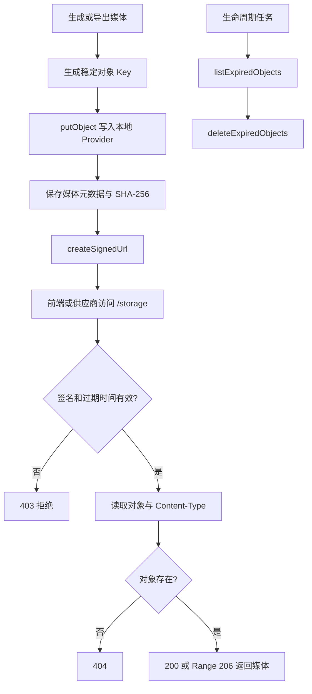

# 对象存储与签名媒体访问开发流程

## 1. 功能目标

把生成图片、音频、视频和导出文件从“只能在当前机器目录里读取”升级为：

```text
媒体二进制
    -> 对象 Key
    -> 本地或腾讯云 COS 对象存储适配器
    -> 元数据和校验和
    -> 签名 URL
    -> 安全媒体访问
```

本阶段先稳定接口和本地 Provider，再逐步迁移真实媒体链路。当前实现不宣称已经接入云 OSS/S3，也不宣称已经完成跨机器部署。

## 2. 本轮实现范围

- 安全对象 Key 规范化。
- 禁止空 Key、绝对路径、路径穿越、反斜杠和控制字符。
- 本地对象存储 Provider。
- 媒体文件和 JSON 元数据分离保存。
- SHA-256 ETag、大小、内容类型、创建时间和更新时间。
- 同一个对象 Key 在服务重启后仍可读取。
- 稳定公开 URL 生成。
- HMAC 签名 URL 生成和过期验证。
- `/storage/:objectKey` 签名访问接口。
- 媒体字节范围访问，支持视频/音频断点加载。
- 按对象前缀和修改时间列出、清理过期对象。
- 音频库上传首个迁移样板：新文件同时保留旧本地兼容文件，并写入 `storage_key`。
- 真实 TTS 生成音频迁移：生成文件写入对象存储，`audio_assets.storage_key` 保存对象 Key。
- 分镜静帧迁移：生成候选图片写入对象存储，`image_assets.storage_key` 保存对象 Key。
- 角色定妆图迁移：生成候选图片写入对象存储，`character_images.storage_key` 保存对象 Key。
- 角色确认时同步写入 `characters.reference_image_storage_key`。
- 图生视频和口型同步输出写入对象存储，`video_assets.storage_key` 保存对象 Key。
- 导出成片和字幕中间文件写入对象存储，`export_records.storage_key` 保存最终成片 Key。
- 视频、口型同步、终剪和导出读取媒体时优先动态生成签名 URL；历史记录没有 `storage_key` 时回退原 URL。
- 任务请求和角色快照保存稳定 `storage_key`，不把短期签名 URL 作为新数据永久写入数据库。
- 明确拒绝未实现的 `s3`、`oss` 等 Provider，避免把本地目录伪装成云对象存储。
- 腾讯云 COS Provider：`putObject`、`headObject`、`getObject`、`deleteObject`、按前缀扫描和短时签名 URL。
- COS 桶保持私有；图片、音频、视频和导出素材通过签名 URL 按需访问，不把访问密钥或永久公开 URL 写入数据库。
- COS 签名图片 URL 是公网 HTTPS 地址，视频/图片模型会直接读取它，不再触发 ToAPI 图片上传中转。
- 历史远程媒体恢复：精确域名白名单、HTTP/HTTPS 限制、URL 过期检查、最大文件大小、Content-Length 校验和媒体文件头校验；下载成功后才写入对象存储和数据库。

仍不包含：

- CDN 与跨地域网络验证。
- S3、OSS 等其他云 Provider。
- CDN 回源、刷新和带宽策略。
- 其他项目的历史媒体批量 `--apply` 和全量校验。
- 对已过期供应商 URL 的自动重生成、重新授权和版权留痕闭环。
- 供应商账单对账。
- 自动备份、跨区域复制和灾备演练。

## 3. 业务流程



## 4. 对象 Key 规则

### 4.1 合法形式

建议按业务域组织：

```text
projects/{projectId}/frames/{frameId}/v{version}.png
projects/{projectId}/audio/{audioAssetId}/v{version}.mp3
projects/{projectId}/videos/{videoAssetId}/v{version}.mp4
projects/{projectId}/exports/{exportId}/final.mp4
```

### 4.2 必须拒绝的形式

```text
../secret.txt
projects/../secret.txt
..%2Fsecret.txt
/absolute.txt
C:\absolute.txt
projects\12\cover.png
包含控制字符的 Key
```

Key 先进行有限次数的 URL 解码，再检查路径片段。不能直接把用户输入拼接到文件系统路径。

## 5. 模块接口

文件：`server/services/object-storage.mjs`

```js
createObjectStorageFromEnv(env)
createLocalObjectStorage(options)
normalizeObjectKey(key)
verifySignedUrl({ key, expires, signature, signingSecret, now })
```

Provider 实例：

```js
putObject({ key, bytes, contentType })
getObject(key)
headObject(key)
deleteObject(key)
publicUrl(key)
createSignedUrl({ key, expiresInSeconds, now })
listExpiredObjects({ prefix, before })
deleteExpiredObjects({ prefix, before })
```

返回的媒体对象至少包含：

```json
{
  "key": "projects/12/exports/77/final.mp4",
  "size": 1024,
  "contentType": "video/mp4",
  "etag": "sha256",
  "createdAt": "2026-09-15T00:00:00.000Z",
  "updatedAt": "2026-09-15T00:00:00.000Z"
}
```

## 6. 本地 Provider 的持久化规则

默认目录：

```text
.codex-runtime/object-storage/
```

对象内容直接按 Key 保存，元数据使用同名文件追加：

```text
exports/77/final.mp4
exports/77/final.mp4.meta.json
```

写入使用临时文件再原子重命名，避免进程中断后留下半个媒体文件。第二个 Provider 实例只要使用同一个根目录，就能通过同一个 Key 恢复对象。

当前本地 Provider 的“跨机器恢复”只证明了接口和目录结构具备恢复能力，不等于机器之间已经同步。换机器前必须复制对象目录，正式生产应替换为云对象存储 Provider。

腾讯云 COS 已实现为可选生产 Provider。配置 `OBJECT_STORAGE_PROVIDER=cos` 后，服务使用 `COS_BUCKET`、`COS_REGION`、`COS_SECRET_ID`、`COS_SECRET_KEY` 创建 COS SDK 客户端；数据库仍只保存稳定 `storage_key`，接口返回时才生成默认 900 秒有效的 COS V4 签名 URL。

## 7. 签名 URL 规则

环境变量：

```text
OBJECT_STORAGE_PROVIDER=local
OBJECT_STORAGE_ROOT=.codex-runtime/object-storage
OBJECT_STORAGE_PUBLIC_BASE_URL=http://127.0.0.1:3001/storage
OBJECT_STORAGE_SIGNING_SECRET=请替换为高强度随机密钥
OBJECT_STORAGE_SIGNED_URL_TTL_SECONDS=900
```

COS 生产环境变量：

```text
OBJECT_STORAGE_PROVIDER=cos
COS_SECRET_ID=...
COS_SECRET_KEY=...
COS_BUCKET=projectdream-1250000000
COS_REGION=ap-guangzhou
COS_DOMAIN=
COS_PROTOCOL=https:
OBJECT_STORAGE_PUBLIC_BASE_URL=https://projectdream-1250000000.cos.ap-guangzhou.myqcloud.com
```

桶必须保持私有。`OBJECT_STORAGE_PUBLIC_BASE_URL` 只用于构造对象地址，实际业务读取使用 COS SDK 生成的短时签名 URL；外部视频模型读取该 HTTPS URL 后，会被 `resolveVideoImageInput()` 判定为公网来源并直接透传，不再尝试访问 `toapis.com` 上传源图。

签名内容为：

```text
objectKey + "\n" + expiresUnixSeconds
```

签名算法为 HMAC-SHA256。访问接口必须同时校验：

1. Key 规范化成功。
2. `expires` 是有效整数。
3. 当前时间早于过期时间。
4. HMAC 签名完全匹配。
5. 对象真实存在。

响应策略：

| 情况 | HTTP |
| --- | --- |
| 签名缺失、错误或过期 | `403` |
| 对象不存在 | `404` |
| 正常完整读取 | `200` |
| 合法字节范围 | `206` |
| 非法字节范围 | `416` |

签名 URL 只应短期传给浏览器或外部供应商，不应把长期签名地址写入公开页面或日志。

## 8. TDD 开发顺序

### RED

先写 `server/services/object-storage.test.mjs`，覆盖：

1. Key 规范化和路径穿越拒绝。
2. 保存、读取、检查、删除和内容元数据。
3. 稳定 URL 和签名 URL。
4. 错误 Provider 拒绝。
5. 前缀范围内的过期对象清理。
6. 新 Provider 实例恢复旧对象。

先运行：

```text
node --test server/services/object-storage.test.mjs
```

预期先因 `object-storage.mjs` 不存在而失败。

### GREEN

只实现本地 Provider 和 HMAC 验签，使上述测试通过，再接 HTTP 路由。

### REFACTOR

保持 Provider 接口稳定，为后续 OSS/S3/COS 适配器留下边界；不在本阶段把所有生成链路一次性重写。

## 9. 验收证据

本轮已经验证：

```text
node --test server/services/object-storage.test.mjs 通过（10 项，含 COS 环境门禁）
npm test 通过（188 项）
npm run type-check 通过
npm run build 通过
docker compose --env-file .env.production.example config --quiet 通过
node --check server/index.mjs 通过
node --check server/services/object-storage.mjs 通过
git diff --check 通过
npm audit --omit=dev --json：0 漏洞
npm audit --json：0 漏洞
```

COS 真实只读预检已通过：使用私有桶 `projectdream-media-1454726250`、地域 `ap-guangzhou` 生成 HTTPS 签名地址并执行 `HeadObject`。默认预检 Key 不存在，返回 `objectStatus: "missing"`，这表示凭证、桶、地域、签名和读取权限均已生效；本次预检没有执行 PUT、DELETE 或迁移。

本地只读预检已通过：

```text
node scripts/verify-object-storage.mjs --object-key=__projectdream_preflight__/read-only-check
provider：local
objectStatus：missing
```

生产环境在填入真实 `.env.production` 后执行：

```text
node --env-file=.env.production scripts/verify-object-storage.mjs
```

命令会先拒绝空值或“请替换”占位符，再生成签名 URL 并执行一次 `HeadObject`。默认检查一个不存在的预检 Key，返回 `objectStatus: "missing"` 仍表示认证、区域和读取权限检查通过；它不会输出签名 URL、不会写入、删除或迁移任何媒体。

真实 HTTP 验证：

```text
签名对象读取：200
Range bytes=1-3：206，Content-Range 正确
过期签名：403
编码路径穿越：403
```

远程历史媒体恢复已验证：

```text
专项测试：17 项通过
项目 12 远程恢复报告：23 条 remote-download，成功 23，失败 0
远程恢复类型：image_asset 13、character_image 6、character_reference 2、video_asset 2
恢复字节数：34975532 bytes
```

项目 12 数据库回读（2026-09-16）：

| 表/业务对象 | 总记录 | 已有 `storage_key` |
| --- | ---: | ---: |
| `image_assets` | 70 | 70 |
| `character_images` | 6 | 6 |
| 角色参考图 | 2 | 2 |
| `audio_assets` | 126 | 126 |
| `video_assets` | 80 | 22 |
| `export_records` | 20 | 19 |

签名媒体真实访问：

```text
远程恢复图片 projects/12/frames/storyboards/151/v1/c131.png：HTTP 200
远程恢复视频 projects/12/videos/storyboards/178/v1/c66.mp4：Range bytes=0-3，HTTP 206
Content-Range：bytes 0-3/4759284
```

幂等性：

```text
首次远程 apply：23 条远程媒体成功、0 失败
再次 apply：0 条重复下载，0 条重复写库
```

## 10. 当前限制和下一步

当前已经完成：

- 签名媒体播放链路支持浏览器 `GET`、`HEAD` 和 Range 请求；`HEAD` 只返回媒体元信息，不返回正文，避免 Chrome 媒体探测因 404 卡在 `stalled`。
- 项目 12 的 `export #35` 已从 API 返回短时签名 `playbackUrl`，Vite `/storage` 代理和前台 Chrome 真实播放到结尾均已验证通过。

- Provider 抽象的第一版。
- 本地持久化和重启恢复。
- 签名访问和 Range 响应。
- 过期对象扫描和清理规则。
- 音频库上传写入对象存储，数据库保存 `storage_key`，接口按请求动态生成签名 URL。
- 真实 TTS 音频候选写入对象存储；API、终剪和口型同步读取时动态生成签名 URL。
- 分镜静帧和角色定妆图候选写入对象存储；图片资产 API、角色资产 API、视频任务、口型任务、终剪和导出读取时动态生成签名 URL。
- 新建分镜任务保存参考图 `storage_key`，执行时再生成签名 URL；旧数据继续支持原始参考图 URL。
- 新生成图生视频、口型同步视频和导出成片写入对象存储；对应 API 按请求动态生成签名 URL，旧 `/generated/video` 和 `/generated/export` 地址继续兼容。
- 历史媒体迁移规划器和默认 dry-run 命令：识别本地旧 URL、生成确定性对象 Key、跳过已有 Key，并把远程或丢失文件列为 unresolved。
- 远程媒体恢复器：只允许配置的精确域名，拒绝过期 URL；下载后校验大小、Content-Length 和媒体容器文件头。
- COS 配置门禁与只读预检：环境缺少真实凭证、Bucket 或区域时在创建 COS 客户端前失败；部署前可用 `HeadObject` 检查配置、签名与读取权限。

仍未完成：

- 其他项目的历史迁移 `--apply`、数据库回读校验和失败重试任务。
- 项目 12 剩余 59 条 unresolved 的重生成或重新取得有效地址；其中 58 条是过期 URL，1 条是 `pending://hybrid-export`。
- 对 21 条已确认过期视频执行恢复队列的人工预算确认和结果质检；`--apply` 会触发视频模型，不能把 dry-run 当作已恢复。
- 远程恢复失败后的自动重生成和版权留痕闭环。
- 所有媒体统一补齐校验和、生命周期状态和清理策略。
- 真实 COS Bucket 的 PUT/GET/HEAD/DELETE 小批量验收。
- CDN 和供应商临时上传地址。
- 供应商账单对账。

本轮新增“本地对象存储回填到 COS”工具，专门解决已生成媒体的跨机器恢复基础：

```text
本地对象 Key 扫描
    -> 指定项目过滤
    -> COS HeadObject 比较 SHA-256
    -> dry-run 报告
    -> 显式 --apply + --limit 分批上传
    -> COS GetObject 回读
    -> SHA-256 二次验证
```

命令：

```text
npm run replicate:local-media-to-cos -- --projects=12 --limit=5
npm run replicate:local-media-to-cos -- --projects=12 --limit=5 --apply
```

默认不上传；即使使用 `--apply` 也必须同时指定 `--limit`。该工具不会删除本地对象、不写数据库、不调用模型。报告保存在 `.codex-runtime/replication-reports/`。对象在 COS 中已存在且 `x-cos-meta-sha256` 与本地一致时会跳过；缺失或校验不一致时才列为复制候选，复制后必须读回字节重新计算 SHA-256 才记为成功。

历史迁移命令：

```text
npm run migrate:legacy-media -- --projects=12
npm run migrate:legacy-media -- --projects=12 --apply
```

第一条命令只扫描并生成带时间戳和进程号的 `.codex-runtime/migration-reports/legacy-media-12-dry-run-*.json`，不会修改数据库、对象存储或旧媒体文件。第二条命令才会把本地旧媒体或允许的远程媒体写入对象存储，并在校验 ETag、文件大小和远程媒体签名后补写对应 `storage_key`；它同样不会删除旧文件，也不会处理已有 `storage_key` 的记录，报告保存为 `legacy-media-12-apply-*.json`。

本轮真实 dry-run 证据（2026-09-16，项目 12，报告 `legacy-media-12-dry-run-20260916011712979-3592.json`）：

```text
扫描记录：304
已有对象 Key 跳过：245
新的本地迁移候选：0
新的远程下载候选：0
远程或不可自动恢复：59
数据库修改：0
```

59 条 unresolved 不是“迁移成功”，其中 58 条是过期供应商 URL，1 条是 `pending://hybrid-export`。过期地址必须重新生成或重新取得有效地址，不能把原 URL 直接伪装成已入对象存储。

真实 COS 小批量写入已在 2026-09-16 完成：

```text
第一批：历史导出成片 5 个，上传后 COS 回读 SHA-256 全部一致
第二批：过期视频恢复所需起始帧 16 个，上传后 COS 回读 SHA-256 16/16 一致
本地文件：未删除
数据库：未修改
模型调用：0
```

第一批按对象排序选择，实际覆盖的是历史导出成片，不能作为恢复源图已回填的证据。为避免此类误判，复制工具新增 `--keys`，仅选择完整匹配且仍位于 `--projects` 指定范围内的对象：

```text
npm run replicate:local-media-to-cos -- --projects=12 --keys=projects/12/frames/storyboards/168/v1/c159.png --limit=1
```

第二批使用 16 个确认静帧的完整 Key 执行；报告 `local-to-cos-12-apply-20260916074543556-22832.json` 记录全部 `copied-and-verified`。这证明 COS 的 PUT、GET 回读与 SHA-256 校验链路可用，但不等于视频模型已经成功消费这些起始帧。

此前对项目 12 执行了小批量 `--apply`，结果如下：

```text
本地媒体写入对象：222
本地媒体写入总大小：550353333 bytes（约 0.51 GB）
远程媒体写入对象：23
远程媒体下载并校验总大小：34975532 bytes
远程 apply 失败：0
远程恢复类型：静帧 13、角色候选图 6、角色参考图 2、视频 2
数据库回读：image_assets 70/70、character_images 6/6、角色参考图 2/2、audio_assets 126/126、video_assets 22/80、export_records 19/20
签名图片 HTTP 200；视频 Range HTTP 206
再次 apply：0 条待处理，未重复下载，未重复写库
```

远程 apply 报告为 `.codex-runtime/migration-reports/legacy-media-12-apply-20260916011021545-9572.json`。报告的 `appliedPlans` 中 23 条均为 `remote-download` 且结果为 `remote-downloaded`；后续重新执行的 apply 报告为 `legacy-media-12-apply-20260916011841593-14900.json`，说明幂等复跑没有新的待处理计划。

过期视频恢复产生的 5 个新对象也已完成文件级检查：

```text
projects/12/videos/storyboards/151/v4/c1.mp4
projects/12/videos/storyboards/152/v2/c1.mp4
projects/12/videos/storyboards/153/v2/c1.mp4
projects/12/videos/storyboards/157/v2/c1.mp4
projects/12/videos/storyboards/159/v2/c1.mp4
```

5 个对象均存在对应 `.meta.json`，`ffprobe` 可解析为 MP4 / H.264 / AAC，大小约 1.2-2.6 MB。注意：它们的实际分辨率为 `1920x1088`，属于可播放的横向恢复候选，不满足终剪发布要求的 `1080x1920` 竖屏规格。

过期视频恢复 dry-run（2026-09-16）：

```text
npm run recover:expired-videos -- --projects=12
已确认且 URL 过期的视频：21
稳定恢复候选：21，全部为 retry-2
候选/归档过期视频：37，不自动重生成
pending 导出：1，不进入视频恢复队列
实际模型调用：0
数据库写入：0
```

恢复队列详情见：

[过期视频恢复队列开发流程.md](过期视频恢复队列开发流程.md)

Agnes 入队验证结果（2026-09-16）：

```text
入队任务：21（job 228 至 248）
首批失败：4
暂停取消：17
失败原因：本机到 toapis.com:443 的图片上传连接超时
Agnes 视频任务实际创建：未确认成功
```

本机对象存储 URL 不能被外部视频 Provider 直接访问，现有链路会先上传源图到公共图片服务。公共上传服务不可达时，必须暂停恢复队列；不能把入队或失败尝试写成视频恢复成功。

下一步按以下顺序推进：

1. 对 21 条已确认过期视频完成人工预算确认后，再执行恢复队列 `--apply`；生成结果仍需经过人工确认和质检。
2. 处理其余 38 条 unresolved：候选/归档视频按保留策略处理，pending 导出回到导出任务链路。
3. 对其他项目按小批量执行 `--apply`，每批核对报告和数据库回读。
4. 增加远程供应商失败重试、重生成和版权留痕流程。
5. 接入一个真实云对象存储 Provider 后再做跨机器验收。
6. 增加 CDN 回源、缓存刷新和供应商临时上传地址。

## 11. 复盘

本轮练到的能力：

- 先用测试固定安全边界，再实现文件系统和 COS 两种适配器。
- 把“能保存文件”和“能安全对外访问”拆成两个可验收问题。
- 用真实 HTTP 验证签名、过期、路径穿越和 Range 行为。

当前最需要加强的是 COS 签名 URL 的真实供应商消费、历史媒体迁移和跨机器恢复。COS 真实只读预检及 21 个对象的小批量上传回读均已通过；下一步必须让受控 Worker 实际消费带 `imageStorageKey` 的恢复任务并核对候选视频。只有真实恢复、CDN、备份和账单对账都完成，P7 才能升级为“可部署的生产媒体存储能力”。

## 12. `export #47` 的对象存储播放证据

本轮终剪没有使用旧公网视频地址作为唯一来源。Worker 优先从 COS 读取源视频、对白音频和静帧，成片写入：

```text
projects/12/exports/47/final.mp4
projects/12/exports/47/subtitles.srt
```

导出接口返回短时签名播放地址：

```text
/storage/projects/12/exports/47/final.mp4?expires=<短时过期时间>&signature=<签名>
```

`export #47` 的 COS 对象已由独立 `ffprobe` 读取并确认 `1080x1920 / 24fps / H.264 + AAC / 48kHz`。对象存储链路只证明文件可以被安全读取和播放，不证明字幕审美、口型同步、人耳听感、平台审核或收入稳定性。
