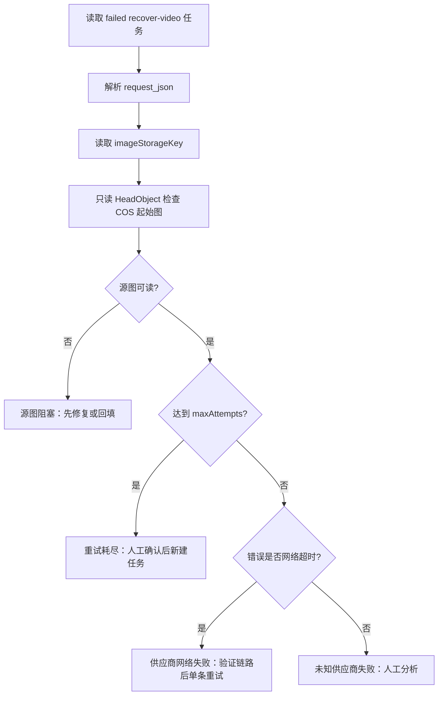

# 恢复 Worker 失败任务分诊与受控重试开发流程

## 1. 目标

把恢复 Worker 的失败记录分成可执行类别，避免把“供应商网络超时”“源图缺失”“重试次数耗尽”混在一起，更不能直接对全部失败任务批量重试。

## 2. 分诊流程



## 3. 代码边界

| 模块 | 作用 |
| --- | --- |
| `server/services/recovery-worker-failure-triage.mjs` | 纯函数分类失败原因和下一步动作 |
| `server/services/recovery-worker-failure-triage.test.mjs` | 网络超时、源图阻塞、重试耗尽和汇总测试 |
| `scripts/triage-recovery-worker-failures.mjs` | 只读查询数据库和 COS，生成 JSON 分诊报告 |

脚本只执行：

- `SELECT` 查询失败的 `recover-video-*` 任务；
- 解析任务中的 `imageStorageKey`；
- 对 COS 起始图执行 `HeadObject`；
- 写入本地 `.codex-runtime/recovery-worker-failure-reports/` 报告。

脚本不会执行：

- 不重新入队；
- 不修改 `generation_jobs`；
- 不启动 Worker；
- 不调用视频模型；
- 不删除或覆盖对象存储文件。

## 4. 使用方式

```powershell
npm run triage:recovery-worker-failures -- --projects=12
```

可选限制扫描数量：

```powershell
npm run triage:recovery-worker-failures -- --projects=12 --limit=1
```

## 5. 分类规则

| 分类 | 条件 | 建议 |
| --- | --- | --- |
| `provider-network-timeout` | COS 源图可读，错误包含连接超时或网络失败 | 先验证供应商链路，再单条受控重试 |
| `source-image-blocked` | 缺少 `imageStorageKey` 或 COS 对象不可读 | 先修复/回填源图，不允许直接重试 |
| `retry-exhausted` | `attempt_count >= max_attempts` | 人工确认后再决定是否新建任务 |
| `unknown-provider-failure` | 其他未识别供应商错误 | 人工分析，不自动重试 |

## 6. 真实核对记录

2026-09-18 对项目 12 执行：

```text
npm run triage:recovery-worker-failures -- --projects=12
```

结果：

- 总失败任务：17；
- `provider-network-timeout`：13；
- `source-image-blocked`：4；
- 推荐单条受控重试候选：job 257-269；
- 4 条旧任务缺少 `imageStorageKey`，不能直接重试；
- 报告：`.codex-runtime/recovery-worker-failure-reports/recovery-worker-failures-12-20260918071058527-27700.json`。

该结果只说明失败原因和源图可读性，不代表供应商当前已经恢复，也不代表任何任务可以批量重试。

## 7. 受控重试验收

对推荐候选只能按以下顺序执行：

1. 先确认供应商网络和 API 配置；
2. 选择一条任务；
3. 检查该任务仍满足可重试条件；
4. 执行 `--dry-run`；
5. 人工确认后执行 `--apply`；
6. 检查 `queueBoundary.boundarySafe`；
7. 核对任务状态、候选视频、COS 对象、`ffprobe`、抽帧、技术报告和成本台账；
8. 通过后再决定下一条，禁止直接批量放行。

## 8. 单条控制重试入口

失败记录不能直接复用普通任务中心的“重试”接口，因为普通接口会清空原失败证据并把原任务的尝试次数归零。恢复任务使用独立的单条控制重试入口：

```powershell
npm run retry:recovery-once -- --job-id=257
```

默认是只读预检，检查：

- 原任务仍为 `failed` 的 `recover-video-*` `video_image` 任务；
- `request_json.imageStorageKey` 存在；
- COS `HeadObject` 可读且是非空图片；
- 签名 URL 为公网 HTTPS 输入，且不输出签名参数；
- 失败分类为可重试的供应商网络问题；
- 没有已经处于 `queued`、`running` 或 `success` 的控制重试任务。

预检通过时会生成计划，但不会写库、启动 Worker 或调用视频模型。报告保存在：

```text
.codex-runtime/recovery-worker-retry-reports/
```

只有明确执行以下命令才会创建一条新的 `queued` 控制重试任务：

```powershell
npm run retry:recovery-once -- `
  --job-id=257 `
  --apply `
  --confirm=CONFIRM_RECOVERY_SINGLE_RETRY
```

该操作的约束：

- 原失败任务保留，不覆盖错误信息、尝试次数或请求快照；
- 新任务使用唯一的 `recover-video-controlled-retry-original-...` job key；
- 新任务 `max_attempts=1`，避免一次确认扩散成自动批量重试；
- 新请求保存 `controlledRetry.originalJobId` 和原 job key；
- 只创建任务，不启动 Worker；创建后仍必须单独执行受控 Worker `--dry-run`；
- 如果原任务状态在写入前变化，事务会放弃创建；
- 已存在活动或成功控制重试时拒绝重复创建。

2026-09-18 对项目 12 的 `job 257` 已完成真实只读预检：

- COS 源图 `projects/12/frames/storyboards/186/v1/c178.png` 可读，`1,316,484` bytes，`image/png`；
- 签名 URL 域名为 `projectdream-media-1454726250.cos.ap-guangzhou.myqcloud.com`，Provider 输入 `providerInputReady=true`；
- 分诊为 `provider-network-timeout`，剩余原任务尝试次数 `2`；
- 计划 job key 为 `recover-video-controlled-retry-original-257-project-12-storyboard-186-retry-1`；
- 报告：`.codex-runtime/recovery-worker-retry-reports/controlled-recovery-retry-257-20260918074433500-17256.json`；
- 本轮没有创建新任务、没有启动 Worker、没有调用视频模型。
