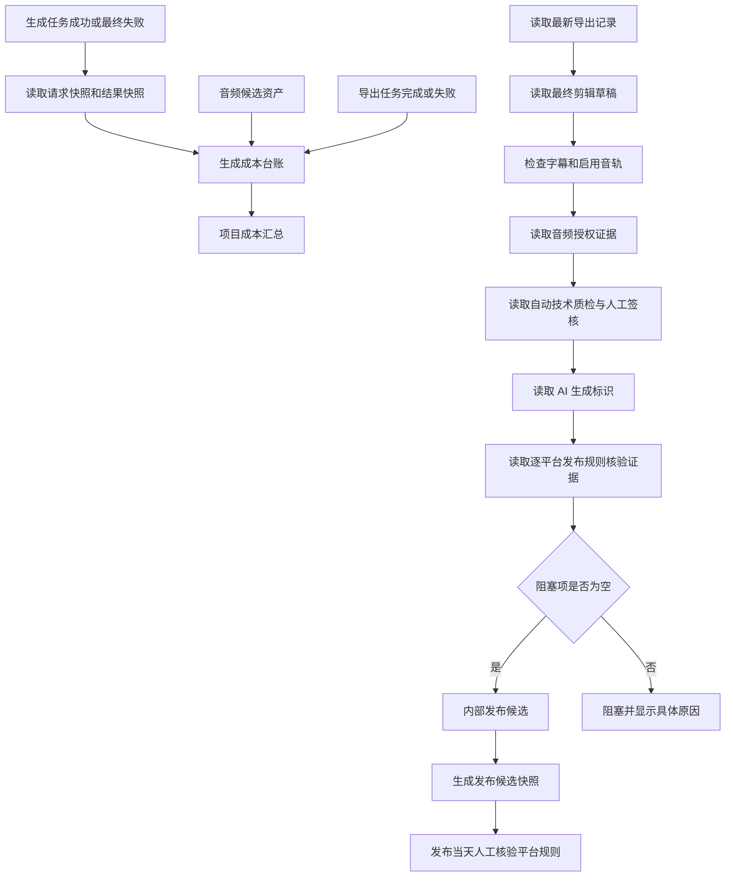

# 成本台账与发布合规包开发流程

## 1. 功能目标

本功能把“生成了一个视频”拆成两类可审计结果：

```text
生产任务 / 音频资产 / 导出记录
    -> 成本证据
    -> 项目成本汇总

成片规格 / 字幕 / 音频授权 / 人工签核 / AI 标识
    -> 发布前检查
    -> 内部可发布候选
```

它用于控制生产成本和发布风险，不承诺平台审核通过、播放量、分账或稳定收入。

## 2. 本轮实现范围

- 生成任务成本台账：图片、角色图、视频、口型同步。
- 音频资产成本台账：对白、旁白、BGM、SFX。
- 导出任务成本台账：FFmpeg 混合导出。
- 项目级成本汇总：按成本类型、币种、已计价/未计价记录汇总。
- 成本证据：模型、数量、单价、任务 ID、导出 ID、资产 ID、任务状态和执行次数。
- 发布合规包：成片规格、字幕、BGM/SFX 授权、自动质检、人工签核和 AI 生成标识。
- 发布合规包支持保存目标平台：默认红果、抖音。
- 发布合规包支持逐平台核验证据：每个目标平台都必须单独确认 AI 标识、版权/投稿字段和规则核验备注。
- 保存 AI 标识和逐平台合规证据时必须携带 `confirm=true` 和精确口令 `CONFIRM_RELEASE_COMPLIANCE_REVIEW`，防止误勾选或脚本误写入。
- 发布合规包返回稳定证据指纹 `audit.evidenceHash`，用于人工终审、截图留证和复盘时确认“同一份证据包”。
- 发布合规包只有在 `status=release-candidate` 且 `canPublish=true` 时才返回 `releaseCandidateSnapshot`，用于内部归档发布候选证据；`blocked` 状态不生成快照。
- 发布合规状态分为 `blocked` 和 `release-candidate`。
- 对象存储第一版：本地 Provider、对象 Key、元数据、签名 URL、Range 访问和过期清理规则。
- 音频库上传首个迁移样板：新上传对象同时写入本地兼容目录和对象存储，数据库保存 `storage_key`。
- 真实 TTS 生成音频已接入对象存储，API 和终剪读取动态签名 URL。
- 分镜静帧、角色定妆图、图生视频、口型同步和导出成片已接入对象存储，数据库保存 `storage_key`；视频、口型、终剪和导出读取时动态签名，历史数据回退旧 URL。

不包含：

- 云 OSS/S3/COS Provider 和 CDN。
- 现有媒体生成链路的整体迁移。
- 自动上传红果、抖音或其他平台。
- 自动判断平台审核结果。
- 自动确认版权法律事实。
- 自动保证 AI 标识填写方式符合发布当天的平台页面。

## 3. 业务流程



## 4. 成本台账设计

### 4.1 记录粒度

每条台账对应一个可追溯生产对象：

| 来源 | 成本类型 | 唯一关联 |
| --- | --- | --- |
| `generation_jobs` | `image` / `video` / `lip_sync` | `generation_job_id` |
| `audio_assets` | `audio` | `audio_asset_id` |
| `export_records` | `export` | `export_id` |

同一个关联 ID 使用唯一键，重复读取项目汇总时会更新原记录，不会重复累加。

### 4.2 台账字段

- `entry_type`：成本类型。
- `model_name`：模型或执行引擎。
- `quantity`：候选数、视频数、音频秒数或导出次数。
- `unit`：`candidate`、`video`、`second`、`export` 等。
- `unit_price`：单价；没有配置时为 `NULL`。
- `estimated_cost`：估算成本；没有单价时为 `NULL`。
- `currency`：默认 `CNY`。
- `pricing_status`：`estimated` 或 `unpriced`。
- `source`：任务、音频资产或导出记录。
- `evidence_json`：任务状态、执行次数、素材类型等证据。

### 4.3 价格配置

通过环境变量配置模型或类型价格：

```text
COST_PRICING_CATALOG={"image-model-v1":0.18,"video-model-v1":2.5,"tts-v1":0.03,"export":0}
```

当前实现只把配置价格作为估算，不把估算冒充供应商账单。未配置价格的记录必须在页面显示“未计价”。

## 5. 发布合规包

### 5.1 自动检查项

1. 导出状态为 `completed`。
2. 导出视频 URL 存在。
3. `technicalQuality.status` 为 `passed` 且无阻塞项。
4. 有对白或旁白时，存在有效字幕，并且正式导出启用字幕烧录。
5. 当前启用的 BGM/SFX 具有 `authorized`、`owned`、`public-domain` 之一的授权状态。
6. 每个启用 BGM/SFX 都有授权凭证。
7. 自动技术质检通过。
8. 人工画面、字幕、音频三项均勾选，结论为 `approved`。
9. 人工画面、字幕、音频三项均填写具体终审证据备注；只有勾选没有备注时，合规包仍保持 `blocked`。
10. 批准为发布候选时必须携带 `confirm=true` 和精确口令 `APPROVE_FINAL_QUALITY_REVIEW`。
11. AI 生成内容已确认展示标识文案。
12. 每个目标平台都必须有独立核验证据：`aiLabelReviewed=true`、`copyrightFieldsReviewed=true`，并填写非空 `ruleReviewNote`。缺少任一平台证据时返回 `platform-evidence-incomplete`，合规包保持 `blocked`。
13. 保存 AI 生成标识或逐平台合规证据时必须输入发布合规确认口令 `CONFIRM_RELEASE_COMPLIANCE_REVIEW`；口令错误时接口返回 400，不写入导出配置。
14. 合规包会基于规范化后的技术、字幕、授权、人工终审、AI 标识和逐平台证据生成 SHA-256 证据指纹；同一份证据重复生成指纹一致，证据变化时指纹变化。
15. 发布候选快照只在所有门禁通过后生成，包含导出 ID、项目 ID、目标平台、技术规格、字幕摘要、人工终审证据、AI 标识和与合规包一致的 `evidenceHash`；任何阻塞项存在时返回 `null`。

### 5.2 状态含义

```text
blocked
    = 存在至少一个内部阻塞项，不能作为发布候选

release-candidate
    = 当前系统收集到的内部证据齐全
    ≠ 平台审核通过
    ≠ 一定获得推荐或收入
```

### 5.3 平台规则提醒

当前默认目标平台为红果、抖音。合规包会保留平台列表和 `platform-rules-recheck-required` 提醒。发布当天仍需人工核验官方后台的 AI 标识、版权、投稿字段、视频规格和活动/分账规则。

逐平台证据只证明“内部已按目标平台逐项复核并留痕”，不等于平台审核通过，也不等于平台规则不会在发布当天变化。

证据指纹只用于内部审计和复盘，不能替代平台审核、版权法律判断或收益证明。

发布候选快照只代表“这一次内部合规证据包已经完整”，方便上台讲解、人工归档、截图留证和后续复盘。它不代表红果、抖音或其他平台已经审核通过，也不能作为稳定收益证明。

## 6. 接口

```text
GET /api/projects/:projectId/cost-ledger
GET /api/projects/:projectId/release-compliance
GET /api/projects/:projectId/release-compliance?exportId=:exportId
PUT /api/exports/:exportId/release-compliance
PUT /api/final-quality-reports/:reportId/review
```

保存请求示例：

```json
{
  "aiDisclosure": {
    "isAiGenerated": true,
    "disclosureConfirmed": true,
    "label": "本内容包含 AI 生成内容",
    "platformEvidence": [
      {
        "platform": "hongguo",
        "aiLabelReviewed": true,
        "copyrightFieldsReviewed": true,
        "ruleReviewNote": "已按红果发布页确认 AI 标识和版权字段"
      },
      {
        "platform": "douyin",
        "aiLabelReviewed": true,
        "copyrightFieldsReviewed": true,
        "ruleReviewNote": "已按抖音发布页确认 AI 标识和版权字段"
      }
    ]
  },
  "platforms": ["hongguo", "douyin"],
  "confirm": true,
  "confirmationToken": "CONFIRM_RELEASE_COMPLIANCE_REVIEW"
}
```

人工终审批准请求示例：

```json
{
  "decision": "approved",
  "checklist": {
    "visualReviewed": true,
    "subtitleReviewed": true,
    "audioReviewed": true,
    "visualNote": "画面无拉伸、无明显黑边，主体裁切可接受",
    "subtitleNote": "字幕文本准确，位置在安全区内",
    "audioNote": "对白清晰，响度正常，无明显爆音"
  },
  "note": "画面、字幕和音频复核通过",
  "confirm": true,
  "confirmationToken": "APPROVE_FINAL_QUALITY_REVIEW"
}
```

返工留痕不需要批准口令，但不能进入发布候选。

## 7. 文件和模块边界

| 模块 | 文件 | 职责 |
| --- | --- | --- |
| 成本规则 | `server/services/cost-ledger.mjs` | 规范化、成本项生成、汇总 |
| 合规规则 | `server/services/release-compliance.mjs` | 检查发布阻塞项、发布候选状态、发布合规保存确认口令和发布候选快照 |
| 终审规则 | `server/services/final-quality-review.mjs` | 校验自动质检、可听声音、三项人工签核、三项证据备注和批准口令 |
| 数据落库 | `server/index.mjs` | 表结构、任务完成时落账、接口和项目派生汇总 |
| 前端接口 | `src/api/project.ts` | 成本和合规 DTO、读写请求 |
| 导出工作台 | `src/views/Export.vue` | 成本摘要、阻塞项、人工终审证据、批准口令、AI 标识确认、逐平台合规证据、证据指纹和发布候选快照展示 |

## 8. TDD 和验收

本轮先写规则测试并确认模块缺失导致失败，再实现规则：

```text
node --test server/services/cost-ledger.test.mjs server/services/release-compliance.test.mjs
```

验证结果：

```text
8 项规则测试通过
163 项全量测试通过
npm run type-check 通过
npm run build 通过
node --check server/index.mjs 通过
git diff --check 通过
GET /api/health 返回 code=0
```

追加验证：

```text
node --test server/services/final-quality-review.test.mjs 5/5 通过
node --test server/services/release-compliance.test.mjs 4/4 通过
node --test src/views/Export.final-quality-review.test.mjs 2/2 通过
npm test 267/267 通过
npm run type-check 通过
npm run build 通过
node --check server/index.mjs 通过
node --check server/services/final-quality-review.mjs 通过
node --check server/services/release-compliance.mjs 通过
git diff --check 通过
```

逐平台合规证据追加验证：

```text
node --test server/services/release-compliance.test.mjs 7/7 通过
node --test src/views/Export.final-quality-review.test.mjs 5/5 通过
npm test 273/273 通过
npm run type-check 通过
npm run build 通过
node --check server/index.mjs 通过
node --check server/services/release-compliance.mjs 通过
git diff --check 通过，仅有既有 CRLF warning
```

发布候选快照追加验证：

```text
node --test server/services/release-compliance.test.mjs 9/9 通过
node --test src/views/Export.final-quality-review.test.mjs 6/6 通过
blocked 合规包不生成 releaseCandidateSnapshot；release-candidate 快照的 evidenceHash 与 audit.evidenceHash 一致
npm test 276/276 通过
npm run type-check 通过
npm run build 通过
node --check server/index.mjs 通过
node --check server/services/release-compliance.mjs 通过
git diff --check 通过，仅有既有 CRLF warning
```

对象存储专项：

```text
node --test server/services/object-storage.test.mjs 通过（6 项）
签名读取 200、Range 206、过期 403、路径穿越 403 已完成真实 HTTP 验证
```

## 9. 当前限制和下一步

当前仍未完成：

- 历史视频、口型同步输出和导出仍可能依赖旧的本机 `/generated/*` 目录；新生成媒体已经写入对象存储，旧 URL 作为兼容回退。
- 对象存储已具备本地 Provider 和签名访问，但历史媒体批量迁移尚未实现。
- 云对象存储、CDN、跨机器同步和备份尚未实现。
- 价格目录还没有后台管理页面，当前通过环境变量配置。
- 成本是估算值，不是供应商账单对账。
- 合规包不自动上传平台。
- 逐平台合规证据仍需要真人根据发布当天官方后台填写；系统只做证据完整性和内部门禁，不替代法律审核和平台审核。
- 发布候选快照只是内部归档证据，不能当作平台审核结果或收入证明。

下一步：

1. 增加历史媒体迁移、校验和比对、失败重试和生命周期任务。
2. 接入真实云对象存储 Provider、CDN 和跨机器恢复。
3. 供应商账单对账。
4. P7 全量验收：队列、对象存储、成本、合规包一起验证。
5. 进入 P8：三集/十集原创试制和平台数据复盘。

## 10. 复盘

本轮把“成本”和“能不能发布”从口头判断变成了带证据的系统状态：

```text
生产证据 -> 成本估算
发布证据 -> 内部发布候选
```

做得比较稳的地方：

- 未配置价格时明确显示未计价，没有虚构金额。
- 合规包把 AI 标识、版权和人工签核分开检查。
- 任务、音频资产和导出记录都保留关联 ID。

下一步需要加强：

- 真实对象存储和跨机器恢复。
- 供应商账单与成本台账对账。
- 真实发布后，把成本、返工、留存和收入放到同一个复盘闭环。
