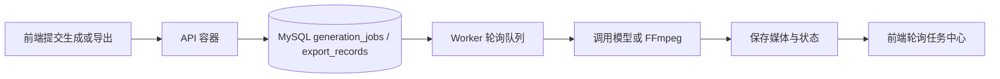

# 独立 Worker 队列执行器开发流程

## 1. 目标

将长耗时任务从 HTTP API 进程拆出，避免图片、视频、口型同步、FFmpeg 导出占满 API 进程后影响登录、保存分镜和任务查询。



## 2. 运行角色

| 角色 | 环境变量 | 职责 | 是否监听端口 |
| --- | --- | --- | --- |
| API | `APP_RUNTIME_ROLE=api` | 鉴权、项目读写、任务入队、任务查询 | 是，3001 |
| Worker | `APP_RUNTIME_ROLE=worker` | 恢复任务、轮询、执行生成和导出 | 否 |

默认角色是 `api`。未知角色会在启动时失败，避免 API 和队列调度被意外混跑。

## 3. 队列流程

```text
API 创建 generation_jobs / export_records
    -> 状态 queued
    -> Worker 每 15 秒扫描
    -> 原子 UPDATE 抢占 queued 任务
    -> status=running + attempt_count+1
    -> 生成 / 导出
    -> success 或按退避策略回到 queued / failed
```

生成任务使用已有的 `generation_jobs` 抢占条件，导出任务使用 `export_records` 的 `queued/running` 状态恢复。当前生产环境只启动一个 Worker，避免两台进程同时竞争 FFmpeg 和供应商请求额度。

## 4. 开发与部署

本地：

```text
npm run dev:full
```

会启动 Vite、API 和 Worker 三个进程。仅调接口时可以运行 `npm run server`；此时任务会保持 `queued`，直到再启动 `npm run worker`。

本机受控验收一条过期视频恢复任务时，需要同时提供本机数据库配置和 COS 配置：

先做只读预检：

```powershell
npm run worker:recovery-once -- --job-id=256 --dry-run
```

预检会检查目标任务是否为 `queued` 的 `recover-video-*` 视频任务、起始图是否可从 COS 读取、视频 Provider 是否已配置且 mock 回退关闭，并写入本地 JSON 报告；不会启动 Worker、不会调用模型、不会修改任务状态。

预检通过后，才允许明确执行：

```powershell
npm run worker:recovery-once -- --job-id=256 --apply
```

该命令会合并 `.env.local` 与 `.env.production`，并要求同时满足：目标是 `queued` 的 `recover-video-*` 视频任务、起始图可从 COS 读取、视频 Provider 已配置且 mock 回退关闭。它固定注入 `GENERATION_WORKER_CONCURRENCY=1`、`GENERATION_WORKER_MAX_JOBS=1`、`GENERATION_WORKER_ONLY_JOB_ID={jobId}`；Worker 启动时恢复 running 状态和后续拉取 queued 任务都会受此 ID 限制，且不会恢复导出队列。

`--apply` 与 `--dry-run` 互斥；两者都省略时脚本拒绝执行。`.env.local` 单独启动时使用本地对象存储，不能替代该命令。

Docker Compose：

```text
backend: APP_RUNTIME_ROLE=api
worker:  APP_RUNTIME_ROLE=worker
```

Worker 不暴露公网端口，只连接 `backend_net`，并和 API 共享 `runtime_data` 卷。

## 5. 验收

```text
controlled-recovery-worker.test.mjs：3 项通过
queue-policy.test.mjs：9 项通过
npm test：228/228 通过
npm run type-check：通过
npm run build：通过
```

2026-09-16 已使用 `GENERATION_WORKER_MAX_JOBS=1` 完成两次真实单条 Worker 验收：job 254、job 255 各自完成后退出，未消费后续队列任务。job 255 的第一次尝试因为错误地仅使用 `.env.local` 而在读取本地源图时失败；改用组合环境后成功写入 COS 候选视频。该事实不代表队列已具备多机高并发能力，也不代表候选视频已通过发布质检。

2026-09-16 的第三次验收改用指定任务的受控启动器：

```text
预检：14 条 queued 恢复任务的 COS 起始图均可读
目标：job 256 / storyboard 183
控制：并发 1、最大 1、仅 job 256
结果：Agnes 成功；Worker 退出码 0；job 256 success，attempt_count=1
产物：video_asset 194，candidate；视频对象与 3 张 COS 抽帧均可读
技术检查：ready；1920x1088 / 30fps / H.264 + AAC / 5.1s
队列：其余 13 条恢复任务仍为 queued
```

这验证了“指定恢复任务 -> COS 签名起始图 -> Provider -> COS 候选视频 -> 自动技术检查”的单条闭环。它没有验证人物外貌一致性、人工三项复核、竖屏终剪或批量稳定性。

### 4.2 当前数据库状态复核（2026-09-18）

对项目 12 的 `generation_jobs` 做只读核对：

- `job 256`：`success`，说明该次单条受控消费已经完成。
- 当前没有 `queued` 的 `recover-video-*` 任务，因此不能继续对 `job 256` 执行 `--dry-run` 或 `--apply`。
- `job 257-269`：13 条为 `failed`，错误均为 `GENERATION_PROVIDER_ERROR`，具体为 `ToAPI request failed (fetch failed, UND_ERR_CONNECT_TIMEOUT)`。

这批失败记录证明当时的源图公网中转链路不稳定，不能证明 COS 签名 URL 批量消费稳定，也不能直接把失败任务重新入队。下一步应先做失败任务分诊，确认当前 Worker 是否已经稳定优先读取 `imageStorageKey`，再选 1 条失败任务做明确确认、可回滚的受控重试。

### 5.1 受控 Worker 预检边界

`run-recovery-worker-once.mjs` 现在要求显式选择一种模式：

| 模式 | 命令 | 是否启动 Worker | 是否调用模型 | 是否修改任务 |
| --- | --- | --- | --- | --- |
| 只读预检 | `--job-id=256 --dry-run` | 否 | 否 | 否 |
| 单条执行 | `--job-id=256 --apply` | 是，且固定 1 个槽位 | 是，最多执行目标任务 | 是 |

预检报告会保存目标项目、分镜、任务状态、任务尝试次数、COS 起始图可读性、签名 URL 是否生成、Provider 和模型配置摘要，并附带 `queueSnapshotBefore` / `queueSnapshotAfter`：目标项目恢复任务总数、queued/running 数量、目标任务状态、其他活跃任务 ID，以及 `onlyTargetWillRun` 边界判断。`--dry-run` 的前后快照相同；`--apply` 会在 Worker 退出后再次查询，方便核对“只消费目标任务，其他恢复任务仍保持队列状态”。报告另外提供 `queueBoundary`，只允许目标任务状态变化；如果其他恢复任务新增、消失或状态变化，`boundarySafe=false`，脚本返回非零退出码。报告不会保存密钥，也不会把“预检通过”写成 `success`。如果同时传入 `--apply --dry-run`，脚本会在启动前拒绝。

`queueSnapshotBefore` / `queueSnapshotAfter` 和 `queueBoundary` 只读查询 `generation_jobs`，不会锁定、修改或取消其他任务。它们是审计证据，不等同于 Worker 已成功消费；`--apply` 完成后仍必须结合最终任务状态、候选视频、`ffprobe`、抽帧、质量报告和成本台账复核。

### 5.2 job 257 的单条控制重试真实验收（2026-09-18）

小泽明确确认后，按以下顺序执行：

1. `job 257` 只读分诊确认 COS 源图可读、签名 HTTPS 输入有效、失败分类为供应商网络超时；
2. 使用 `CONFIRM_RECOVERY_SINGLE_RETRY` 创建独立控制重试 `job 270`；
3. 原失败记录 `job 257` 保留为 `failed`，没有覆盖错误、尝试次数或请求快照；
4. 对 `job 270` 执行 `--dry-run`，确认目标唯一、`onlyTargetWillRun=true`、`queueBoundary.boundarySafe=true`；
5. 对 `job 270` 执行真实 `--apply`，Worker 并发 1，退出码 0；
6. `job 270` 最终为 `success`、`attempt_count=1/1`，生成 `videoAsset=195`，状态为 `candidate`；
7. COS 视频对象和三张抽帧均可读，自动检查报告为 `ready`；
8. 独立 `ffprobe`：`1920x1088 / 30fps / H.264 + AAC / 5.1s`；
9. 该结果仍然不是发布成片：报告明确要求人工角色复核和 `1080x1920 / 24fps` 竖屏终剪；
10. 成本台账已写入 Agnes 视频生成记录，但模型单价未配置，金额保持 `unpriced`；
11. 前后队列快照显示没有其他恢复任务新增、消失或状态变化。

这次结果证明“COS 签名起始图 -> Agnes -> COS 候选视频 -> 自动抽帧检查”的单条链路可再次工作，但不证明 13 条失败任务可以批量稳定重试，也不证明人物一致性、人工审核、竖屏终剪或平台收入已经通过。

## 6. 终剪前置分流

恢复视频进入任务中心后，系统会基于自动技术检查、人工复核状态和发布规格状态计算 `finalEditReadiness`：

| 状态 | 含义 | 是否自动执行 |
| --- | --- | --- |
| `ready-for-final-edit` | 技术检查、人工三项复核和逐角色复核均通过，可以进入 1080x1920 / 24fps 终剪计划 | 否 |
| `waiting-manual-review` | 技术检查通过，但尚未完成全部人工复核 | 否 |
| `blocked-by-rework` | 人工复核要求返工 | 否 |
| `needs-technical-check` | 视频对象、规格或抽帧证据尚未就绪 | 否 |
| `not-required` | 已满足发布技术规格，不需要再进入竖屏终剪 | 否 |

该字段只是前置分流和统计，不会自动创建导出任务、不启动 FFmpeg、不调用视频模型，也不会产生供应商费用。项目 12 的真实只读核算为：恢复候选 8 条、复核后终剪 3 条、技术阻塞 5 条、可直接进入终剪 0 条、可直发平台 0 条。

每条恢复候选同时返回 `finalEditPlan`，固定记录：

```text
executionMode=manual-gate
1080x1920 / 9:16 / 24fps / H.264 + AAC / MP4
burnSubtitle=true
```

只有完整人工批准的候选才会返回 `status=ready`；其他候选返回 `status=blocked` 和明确阻塞码。该计划不是导出任务，不写 `export_records`，不会触发 Worker、FFmpeg 或模型费用。

## 7. 后续限制

- 仍是单 Worker，没有 Redis/BullMQ、多 Worker 租约、死信队列或 Worker HTTP 健康检查。
- Worker 重启会按现有规则把 `running` 任务恢复为 `queued` 或 `failed`。
- 在 COS Bucket、CDN、真实任务回填完成前，不应把该架构描述为已完成跨机器生产验证。
