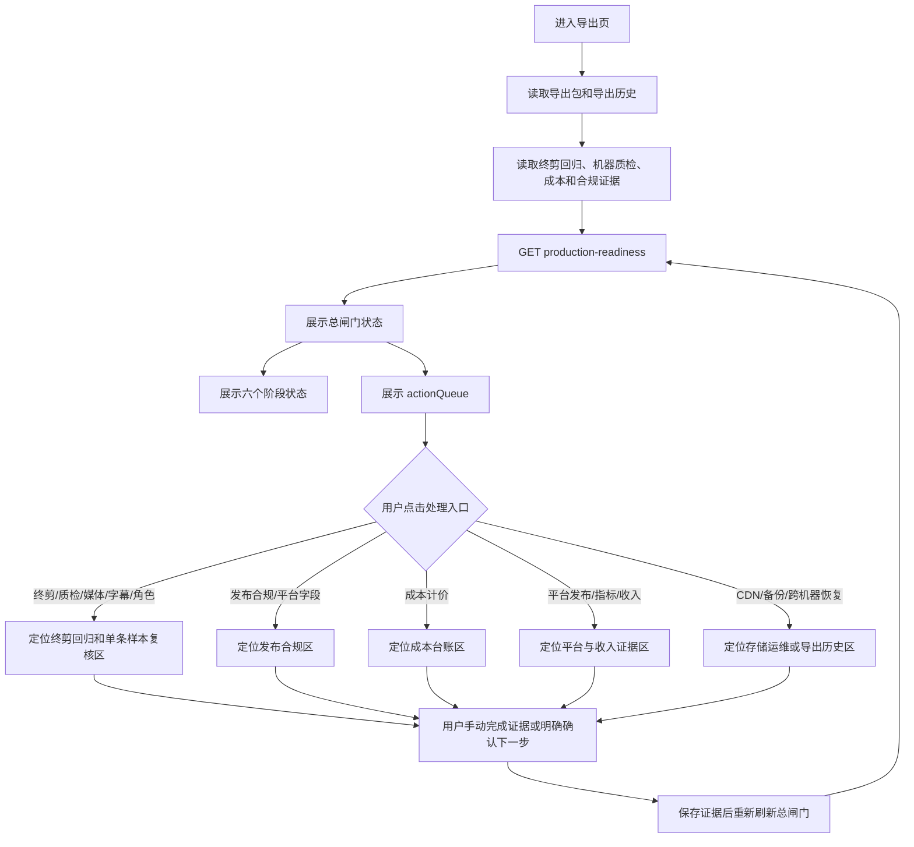

# 生产发布准备度总闸门与 actionQueue 导出页开发流程

## 1. 功能目标

把后端已经聚合的生产发布准备度结果，展示到导出页的第一屏，并把 `actionQueue` 变成可操作的“下一步导航”。

这个功能解决的是：

- 用户能否一眼看到当前项目距离受控试发布还有哪些阻塞。
- 终剪回归、机器质检、发布合规、存储运维、成本和平台收入证据是否分别通过。
- 用户点击某个阻塞项后，能否直接定位到正确的处理区。
- 页面是否明确区分“系统已知证据”和“仍需真人/平台提供的证据”。

这个功能不做：

- 自动启动 Worker。
- 自动调用视频、图片、音频或文本模型。
- 自动批量修复媒体。
- 自动填写人工听感、人物一致性、平台审核或收入结果。
- 自动发布到红果、抖音或其他平台。

## 2. 业务流程



## 3. 后端数据契约

接口：

```text
GET /api/projects/:projectId/production-readiness
```

核心响应：

```ts
interface ProductionReadinessDTO {
  projectId: number
  generatedAt: string
  status: string
  releaseCandidateReady: boolean
  stableRevenueReady: boolean
  stages: {
    finalEditRegression: ProductionReadinessStageDTO
    marketMachineQuality: ProductionReadinessStageDTO
    releaseCompliance: ProductionReadinessStageDTO
    storageOperations: ProductionReadinessStageDTO
    costControl: ProductionReadinessStageDTO
    platformValidation: ProductionReadinessStageDTO
  }
  blockers: ProductionReadinessBlockerDTO[]
  actionQueue: Array<{
    code: string
    label: string
    message: string
  }>
  disclaimer: string
}
```

后端状态含义：

| 状态 | 含义 |
| --- | --- |
| `blocked` | 至少一个生产证据阶段仍有阻塞 |
| `ready-for-controlled-publish` | 内部技术、合规、存储和成本证据齐，可进入受控试发布准备 |
| `stable-revenue-evidence-ready` | 真实平台发布、平台指标和收入证据均已入库 |

`stable-revenue-evidence-ready` 不是收益承诺，只代表系统中已经存在真实收入证据。

## 4. 前端实现

### 4.1 状态和计算属性

文件：`src/views/Export.vue`

新增状态：

```ts
const productionReadiness = ref<ProductionReadinessDTO | null>(null)
```

新增展示计算：

- `productionReadinessStatusText`：把后端状态转成页面可读文案。
- `productionReadinessStageRows`：把六个阶段统一成列表结构，便于渲染。

刷新函数：

```ts
async function refreshProductionReadiness(): Promise<void>
```

以下证据变化后必须刷新总闸门：

- 导出页首次加载。
- 刷新导出历史和回归清单。
- 保存发布合规证据。
- 保存终剪回归覆盖标签。
- 生成单条技术质量报告。
- 保存单条样本人工复核。
- 保存最新导出人工终审。

### 4.2 页面展示顺序

导出页按以下顺序展示：

1. 导出包摘要。
2. 生产发布总闸门。
3. 六维机器预审。
4. 最新导出和人工终审区。
5. 导出历史。
6. 10 条终剪回归。
7. 成本台账、发布合规和平台/收入证据。

总闸门放在机器预审之前，目的是先让用户看到“当前是否能继续推进”，再看具体技术证据。

### 4.3 总闸门面板

面板展示：

- 当前状态：仍有阻塞 / 可进入受控试发布 / 已有收入验证证据。
- 发布候选：只代表内部证据是否齐。
- 收入验证：没有真实平台收入证据时显示“未完成”。
- 阻塞项数量。
- 六个生产阶段：终剪回归、机器质检、发布合规、存储运维、成本计价、平台与收入。
- 完整展示 `actionQueue`，按后端排序逐条处理，不隐藏后续阻塞项。
- 不替代人工审核、平台审核或收入证明的明确声明。

### 4.4 actionQueue 定位映射

`actionQueue` 的按钮只负责页面定位和当前样本选择，不负责执行生产动作。

| action code | 定位区域 | 是否写库 | 是否启动模型 |
| --- | --- | --- | --- |
| `complete-ten-final-edit-regression` | `#final-quality-regression-gate` | 否 | 否 |
| `tag-or-produce-missing-coverage` | `#final-quality-regression-gate` | 否 | 否 |
| `repair-missing-media` | `#final-quality-regression-gate` | 否 | 否 |
| `fix-subtitle-cues` | `#final-quality-regression-gate` | 否 | 否 |
| `regenerate-character-evidence-sample` | `#final-quality-regression-gate` | 否 | 否 |
| `rerun-market-quality-gates` | `#final-quality-regression-gate` | 否 | 否 |
| `complete-release-compliance-package` | `#release-compliance-gate` | 否 | 否 |
| `complete-platform-evidence` | `#release-compliance-gate` | 否 | 否 |
| `complete-cost-ledger-pricing` | `#cost-ledger-gate` | 否 | 否 |
| `publish-controlled-episodes` | `#platform-validation-gate` | 否 | 否 |
| `import-platform-metrics` | `#platform-validation-gate` | 否 | 否 |
| `record-revenue-evidence` | `#platform-validation-gate` | 否 | 否 |
| 其他存储运维动作 | `#storage-operations-gate` | 否 | 否 |

终剪、质检、缺失媒体、字幕和角色证据类 action 会先调用已有的 `focusNextRegressionReviewTarget()`，选中下一条需要处理的样本，再滚动到终剪回归区域。

## 5. 关键代码边界

### 5.1 只读总闸门

`refreshProductionReadiness()` 只读取接口，不修改数据库。接口失败时保留上一份已读取结果，不用空对象覆盖已有状态。

### 5.2 定位不等于执行

`focusProductionReadinessAction(action)` 只做三件事：

1. 根据 `action.code` 选择页面锚点。
2. 对回归类 action 选择下一条待补样本。
3. 写入页面提示，明确“只定位处理区，不保存、不发布、不启动 Worker 或模型”。

它不会调用：

- `createProjectExport`
- Worker 启动器
- 模型 Provider
- 平台发布接口
- 批量恢复脚本

### 5.3 证据刷新

人工复核、合规证据、覆盖标签和技术质量报告保存成功后，必须重新读取总闸门。这样用户处理一条 action 后，页面会展示最新阻塞数量和状态，而不是继续显示旧快照。

## 6. 测试驱动开发流程

先在 `src/views/Export.final-quality-review.test.mjs` 增加红灯测试，验证：

- 导出页读取 `getProjectProductionReadiness`。
- 页面存在“生产发布总闸门”。
- 页面展示 `actionQueue`。
- 每个 action 有独立定位函数。
- 关键 action code 映射到正确锚点。
- 页面明确不会保存、发布、启动 Worker 或模型。

然后实现最小前端逻辑，最后执行：

```text
node --test src/views/Export.final-quality-review.test.mjs
npm test
npm run type-check
npm run build-only
node --check server/index.mjs
node --check server/services/production-readiness.mjs
git diff --check
C:\Users\杨志泽民\.codex\skills\impeccable\scripts\impeccable.cmd detect --json src/views/Export.vue
```

本轮验证结果：

```text
Export.final-quality-review.test.mjs：40/40 通过
npm test：401/401 通过
npm run type-check：通过
npm run build-only：通过
node --check server/index.mjs：通过
node --check server/services/production-readiness.mjs：通过
git diff --check：通过，仅有既有 CRLF warning
Impeccable detector：[]
```

真实浏览器验证：

```text
地址：http://127.0.0.1:5173/workspace/export?projectId=12
页面实际渲染的 production-action-row：13 条
总闸门状态：blocked
```

机器审计样本清单验收：

```text
真实审计样本：10/10 可审计
缺失媒体对象：0
技术机器门禁通过：0/10
完整发布代理通过：0/10
导出页机器审计行：10 条
每行检查：画面规格、字幕时间轴、音频检测、角色证据、发布材料
页面行为：只读展示，不自动修复、不启动 Worker、不调用模型
```

当前真实阻塞统计以审计报告为准：`character-version-evidence-missing=10`、`platform-evidence-incomplete=10`、`human-listening-required=10`、`audio-sample-rate=9`、`subtitle-text-mismatch=9`、`subtitle-timeline-drift=9`、`speech-sync-out-of-tolerance=9`、`invalid-vertical-spec=8`、`freeze-frame-risk=5`、`subtitle-cue-count-mismatch=8`、`pacing-shot-density-low=4`。旧文档中的“8 条技术阻塞”属于历史口径，不能继续作为当前状态。

## 7. 验收标准

- 导出页能展示项目级生产发布总闸门。
- 页面能区分内部发布候选和稳定收入证据。
- 页面能显示六个阶段的通过/阻塞状态。
- 页面能显示 `actionQueue` 的 label 和 message。
- 点击 action 后能定位到正确区域。
- 回归类 action 能选中下一条待补样本。
- 点击 action 不创建导出、不保存表单、不启动 Worker、不调用模型。
- 证据保存后总闸门会重新刷新。
- 桌面和窄屏布局不产生横向溢出。
- 所有自动化测试、类型检查、构建和机械 UI 检测通过。

## 8. 当前真实状态

本轮完成了“总闸门展示、完整 actionQueue 定位和 10 条真实样本技术报告补齐”闭环。项目 12 仍然是 `productionReadiness=blocked`，原因包括：

- 10 条样本虽然都有技术质量报告，但技术机器门禁仍为 0/10；当前真实统计包含角色版本证据、平台材料、44.1kHz 音频、横屏历史成片、字幕不一致和冻结帧风险等阻塞，尚未形成 10 条通过的竖屏终剪回归。
- 六类样本覆盖没有完成。
- 历史角色版本证据仍有缺口。
- 人工完整播放、听感、人物一致性和发布合规结论尚未由真人保存。
- CDN、跨机器恢复、账单对账尚未完成。
- 红果/抖音真实发布、播放数据和收入证据尚未入库。

因此，本功能完成的是“可审计的下一步导航”，不是“已经可以稳定赚钱”的证明。

## 10. 2026-09-21 真实审计状态校准

上一版文档中的“10/10 可审计、技术通过 0/10”属于旧数据，不能继续作为当前状态。重新执行：

```powershell
npm run audit:market-quality -- --project-id=12 --limit=10
```

报告：

```text
.codex-runtime/market-quality-reports/market-quality-project-12-20260921010916805-14788.json
```

当前真实结果：

| 指标 | 当前值 |
| --- | --- |
| 选取样本 | `10` |
| 可审计样本 | `6/10` |
| 缺失媒体对象 | `4` |
| 技术机器门禁通过 | `5/10` |
| 完整发布代理通过 | `0/10` |
| 总闸门 | `blocked` |

其中 `export #44` 属于项目 12 当前最新有效样本，单条技术门禁通过：

```text
1080x1920 / 24fps / H.264 + AAC / 48kHz / MP4
字幕像素可见、字幕文字和时间轴通过、音频 -15.98 LUFS、真峰值 -5.44 dBTP、削波 0、角色版本证据通过
```

这次校准只更新事实，不自动修复其余样本，也不把机器结果转化为人工听感或平台审核结论。当前 `export #44` 仍需要在导出页完整播放并保存人工证据，项目级 `10/10` 回归、六类覆盖、平台合规、CDN/跨机恢复、账单对账和真实发布数据仍未完成。

## 11. 本轮验证记录

本轮只进行了只读审计、自动化验证和文档同步，没有批量启动 Worker、调用模型、发布平台或修改人工终审结论：

```text
npm test                 431/431 通过
npm run type-check       通过
npm run build-only       通过
node --check server/index.mjs 通过
node --check server/services/audio-loudness.mjs 通过
git diff --check         通过（仅既有 CRLF 提示）
```

下一步处理顺序固定为：

1. 小泽在导出页完整播放并复核 `export #44`。
2. 逐条修复 `actionQueue` 中的 4 条缺失对象和剩余技术阻塞。
3. 将真实可用样本扩展到 10 条，并覆盖空镜、单人、双人、对白、旁白、动作六类。
4. 再处理平台合规证据、存储运维、成本对账和三集真实发布数据。

## 9. 复盘

本轮做得比较稳的地方：

- 把总闸门放在导出页顶层，用户不需要翻到页面底部才能判断状态。
- actionQueue 按动作类型定位，不把所有问题都粗暴地跳到同一个样本。
- 定位入口与执行入口分离，避免用户一次点击意外触发模型费用。
- 测试先行，新增行为在实现前先确认红灯，再以 39/39 通过收口。
- 机器审计数据直接来自后端只读报告，并在导出页按样本逐条展示；没有把机器测量冒充人工听感或人物审美结论。

下一步重点：

1. 先按机器审计清单处理 10 条样本的真实 blocker，优先修复可自动验证的规格、音频和字幕问题。
2. 对技术通过样本逐条完成真人完整播放、字幕、音频听感和人物一致性复核，保存结构化证据。
3. 补齐六类覆盖、发布合规、存储运维和成本台账后，再进入三集受控发布和平台数据验证。

## 12. 最新口型校准样本

2026-09-21，针对实际播放反馈新增 `export #47` 作为单条技术回归样本：

- `videoId=198`
- `speechSyncOffsetSeconds=0.52`
- `1080x1920 / 24fps / H.264 + AAC / 48kHz`
- 字幕两条，像素、文字和时间轴机器检查通过
- 音频综合响度 `-15.99 LUFS`，真峰值 `-5.46 dBTP`

导出页应该把这一条继续显示为“机器技术通过、等待人工口型/听感复核”，不能因为补偿参数变更就自动清除 `human-listening-required`、平台证据或十条回归阻塞。`actionQueue` 仍以项目级最新审计报告为准。
