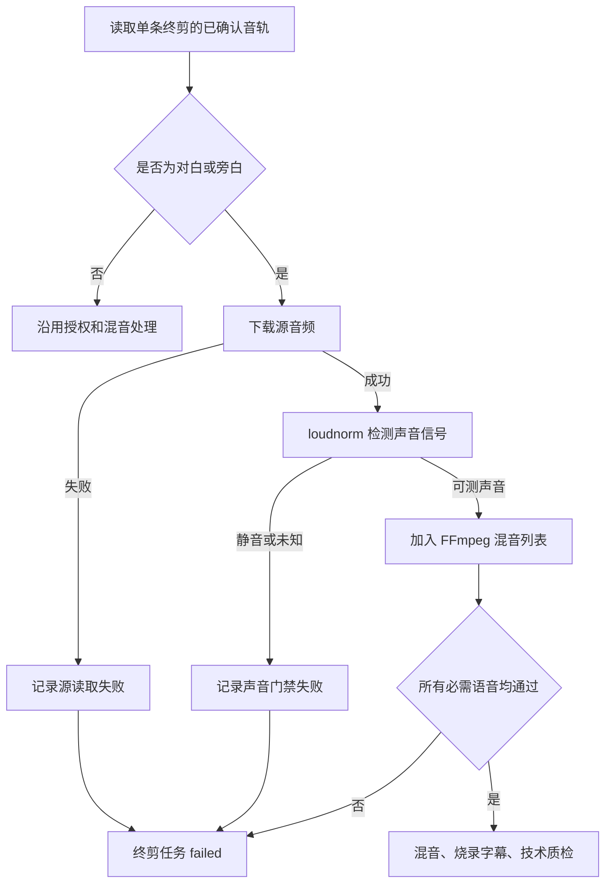

# 终剪语音源可读性与可听性门禁开发流程

## 1. 功能目标

本功能保护单条竖屏终剪中的对白和旁白，防止“音频资产数据库存在，但实际下载失败或文件静音”时，系统仍输出带 AAC 空音轨的假成功成片。

它不生成新的 TTS，不上传 COS，不修改项目资产，也不自动重试任何任务。

## 2. 问题来源

项目 `12` 的 `export #30` 对应候选 `videoId=193`。该分镜已有已确认对白 `audioAsset #120`，但 Worker 当时读取该资源返回 `HTTP 404`。旧流程跳过了该源文件、加入静音底轨并完成输出，因此容器规格正确却没有真实声音。

## 3. 处理流程



## 4. 模块边界

| 模块 | 责任 |
| --- | --- |
| `server/services/speech-audio-readiness.mjs` | 将语音源状态标准化为可审计的阻塞项 |
| `server/index.mjs` | 下载实际需要的语音源、执行 `loudnorm`、在 FFmpeg 前调用门禁 |
| `server/services/final-quality-review.mjs` | 对已生成成片继续执行最终声音证据门禁 |

源文件门禁解决“不要开始错误混音”；成片门禁解决“最终输出不能是假声音”。两层都需要保留。

## 5. 状态合同

| 源状态 | 结果 | 阻塞码 |
| --- | --- | --- |
| `measurable` | 可进入混音 | 无 |
| `download-failed` | 终剪失败 | `speech-audio-download-failed` |
| `silent` | 终剪失败 | `speech-audio-silent` |
| `missing` 或 `unknown` | 终剪失败 | `speech-audio-signal-unverified` |

阻塞项始终带 `audioId`、`storyboardId` 和可读标题，便于定位到单条分镜资产。

## 6. 验收与边界

自动化测试覆盖：

- 必需对白返回 `HTTP 404` 时被阻断；
- 旁白源文件检测为静音时被阻断；
- 只有 `measurable` 语音源可以通过。

本轮验证：

```text
npm test                 255/255 通过
node --check server/index.mjs 通过
```

尚未完成：

- 已通过 COS `HeadObject` 确认 `audioAsset #120` 对象缺失，且旧本地音频文件不存在，不能执行伪回填；
- 未执行新的单条 TTS 重生成或新终剪；
- 未进行画面、字幕、音频人工签核；
- 未将任何成片标记为可发布或可稳定盈利。
