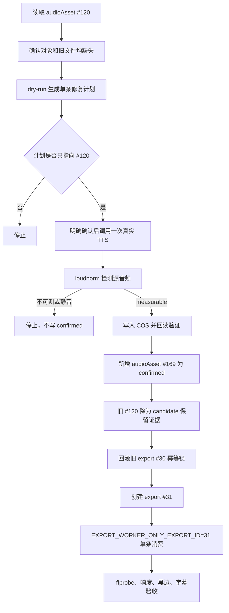

# 缺失对白单条重生成与受控终剪验证记录

## 1. 背景

项目 `12` 的 `videoId=193` 在 `export #30` 中完成过一次单条竖屏终剪，但正式音轨为静音。复查发现分镜 `180` 的已确认对白 `audioAsset #120` 在 Worker 下载时返回 `HTTP 404`。

只读核验结果：

- COS `HeadObject`：对象缺失；
- 旧本地音频目录：不存在对应文件；
- 不能把缺失对象伪装成已修复，也不能继续用静音底轨生成成片。

## 2. 修复流程

## 3. 新增能力

| 能力 | 文件 | 说明 |
| --- | --- | --- |
| 缺失语音修复计划 | `server/services/speech-audio-repair.mjs` | 判断是否只能单条重生成，拒绝 mock、非语音轨和仍可回填的对象 |
| 缺失语音修复脚本 | `scripts/repair-missing-speech-audio.mjs` | 默认 dry-run；`--apply --confirm=REGENERATE_MISSING_SPEECH_AUDIO` 才调用一次真实 TTS |
| 语音源前置门禁 | `server/services/speech-audio-readiness.mjs` | 对对白/旁白的下载失败、静音、未知声音信号做硬阻断 |
| 单导出 Worker | `EXPORT_WORKER_ONLY_EXPORT_ID` | 只消费指定导出，跳过普通生成队列，完成后退出 |

## 4. 真实执行结果

| 项目 | 结果 |
| --- | --- |
| 旧坏音频 | `audioAsset #120` 降为 `candidate`，未删除 |
| 新语音 | `audioAsset #169`，`confirmed` |
| TTS 文本 | “十。” |
| 声线 | `Serena` |
| 模型 | `qwen3-tts-instruct-flash` |
| 源音频响度 | `measurable` |
| 新终剪 | `export #31` |
| Worker 范围 | 只消费 `export #31` |
| 源片段数 | `1` |
| 真实视频数 | `1` |
| 绑定语音数 | `1` |
| 字幕 | `00:00:00,000 --> 00:00:05,000`，文本“十。” |
| 独立 `ffprobe` | `1080x1920 / 24fps / H.264 + AAC / MP4 / 5.0s` |
| 成片响度 | `input_i=-22.27` |
| 黑边检测 | 未触发持续黑边 |

## 5. 仍未完成

`export #31` 只代表“单条技术闭环通过”，还不能等同于正式发布：

- 真人还没完成画面、字幕、音频三项终审；
- AI 标识文案和目标平台字段还没确认；
- 没做 10 条受控终剪回归；
- 没做三集试制和真实平台数据复盘；
- 不能宣称已经能稳定发布或稳定赚钱。
