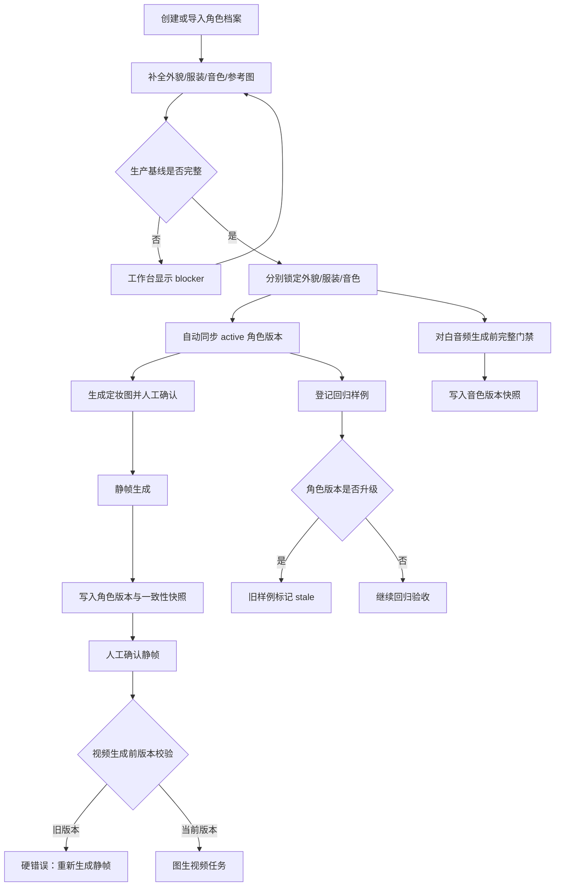

# 角色资产与一致性回归开发流程

## 1. 功能目标

本功能把角色从一次性文本描述升级为可长期复用的生产资产，服务于 AI 漫剧的静帧、图生视频、对白音频和后续回归验收。

核心目标：

1. 为每个角色建立固定的外貌、服装、音色和参考图基线。
2. 角色生产字段发生变化时自动创建新版本，旧版本只保留历史记录，不被覆盖。
3. 静帧、视频和对白音频在生成时记录所使用的角色版本和约束快照。
4. 角色版本落后时阻止新视频生成，避免旧人物资产继续扩散。
5. 允许历史资产作为回归样例，但角色升级后将旧样例标记为过期。
6. 通过项目级工作台集中查看角色准备度、锁状态、版本和阻塞项。

## 2. 功能边界

本阶段包含：

- 角色档案中的外貌、服装与随身物件、年龄、性别、音色和参考图。
- 外貌锁、服装锁、音色锁。
- `character_versions` 角色版本表。
- 静帧 `character_snapshot` 快照。
- 视频任务中的静帧角色快照与角色版本记录。
- 对白音频中的角色版本和角色生产快照。
- 回归样例登记与过期检测。
- 项目级角色一致性工作台。

本阶段暂不包含：

- 自动视觉相似度评分。
- 自动换脸或自动修复人物五官。
- 对所有第三方视觉模型的绝对一致性承诺。
- 红果、抖音等平台的自动发布和收入保证。

## 3. 总体流程



## 4. 数据模型

### 4.1 `characters`

角色当前状态表，保存当前生产基线：

- `appearance`：固定外貌。
- `costume`：固定服装和随身物件。
- `reference_image_url`：确认后的定妆图。
- `age_group`、`gender`：年龄段和性别。
- `voice_profile_key`、`voice_setting`、`voice_style`：音色配置。
- `appearance_locked`、`costume_locked`、`voice_locked`：三个独立锁。
- `status`：`draft` 或 `finalized`。

### 4.2 `character_versions`

不可变角色版本：

- `character_id`
- `version_no`
- `status`：当前版本为 `active`，历史版本为 `superseded`。
- `snapshot_json`：角色完整生产快照。
- `constraint_text`：给生成模型使用的固定约束文本。
- `production_ready`：创建版本时的生产就绪状态。
- `change_reason`
- `created_by`

版本原则：

1. 首次发现没有版本时创建 `v1`。
2. 生产字段变化时追加新版本。
3. 旧版本只更新状态为 `superseded`。
4. 不通过更新旧行的方式伪造历史。

### 4.3 `image_assets.character_snapshot`

静帧生成时写入：

- 快照 schema 版本。
- 主要角色 ID。
- 是否为无角色镜头。
- 角色 ID、姓名、角色版本号。
- 性别、年龄段、外貌、服装、参考图。
- 是否主要主体。

### 4.4 `audio_assets`

对白音频增加：

- `character_version_no`
- `character_snapshot`

音乐和音效没有角色时这两个字段为空。旁白只有在明确绑定角色时才写角色快照。

## 5. 生产就绪门禁

角色进入生产必须同时满足：

1. 有角色名。
2. 有固定外貌。
3. 外貌已锁定。
4. 有已确认定妆图。
5. 有固定服装和随身物件。
6. 服装已锁定。
7. 有年龄段。
8. 有性别。
9. 有有效音色 Profile。
10. 音色已锁定。

以下情况为 warning，不直接阻止生产：

- 缺少性格描述。
- 缺少声音表演风格。

但是 warning 必须在项目工作台和报告中留痕，不能静默忽略。

## 6. 锁失效规则

| 修改字段 | 失效锁 | 是否创建新版本 |
| --- | --- | --- |
| `appearance`、年龄、性别、参考图 | 外貌锁 | 是 |
| `costume` | 服装锁 | 是 |
| `voiceProfileKey`、`voiceSetting`、`voiceStyle`、年龄、性别 | 音色锁 | 是 |
| 姓名、角色标签、性格 | 不强制失效锁 | 是 |

年龄和性别同时影响人物视觉和音色，因此会同时影响外貌/音色基线。

前端保存角色档案时，后端根据请求中实际提交的字段计算影响范围，不能根据白名单全集计算，否则会在用户只修改一个字段时错误清空其他锁。

## 7. 静帧生成流程

1. 根据分镜绑定的 `character_id` 或角色名解析真实角色。
2. 查询项目中未归档角色及其当前 active 版本号。
3. 检查分镜中的人物是否都能映射到角色库。
4. 检查性别、年龄段、外貌、定妆图和生产锁。
5. 构建角色一致性提示词：
   - 固定外貌单独输出。
   - 固定服装与随身物件单独输出。
   - 追加角色版本号。
   - 指定参考图与角色序号的对应关系。
6. 创建后台任务。
7. 每张候选图写入 `character_snapshot`。
8. 用户确认候选图后，更新分镜的主图或结束帧。

无角色环境镜头可以跳过角色约束，但如果视觉描述出现人物且没有绑定真实角色，必须阻止生成。

## 8. 视频生成流程

1. 查找分镜已确认的起始/主静帧。
2. 读取静帧中的 `character_snapshot`。
3. 查询角色当前 active 版本。
4. 对比静帧快照版本和当前版本：
   - 相同：允许创建视频任务。
   - 静帧版本更旧：返回 `409`，要求重新生成并确认静帧。
   - 历史快照缺少版本号：兼容放行，但在任务中记录 warning。
5. 视频提示词复用确认静帧的角色约束，不能只根据当前角色表重新拼接。
6. 任务 `request_json` 固化：
   - `imageAssetId`
   - `characterSnapshot`
   - `characterVersionNos`
   - `characterVersionWarnings`
   - 源图地址、动作模式、时长、模型和提示词
7. 视频生成结果继续关联源静帧，不允许脱离确认静帧直接生成。

## 9. 对白音频生成流程

1. 对白轨必须绑定角色。
2. 查询角色完整档案和锁状态。
3. 调用统一角色生产门禁。
4. 确认有效的 active voice profile。
5. 获取当前角色版本。
6. 生成音频候选。
7. 每条对白音频写入：
   - `character_id`
   - `voice_profile_key`
   - `character_version_no`
   - `character_snapshot`
8. 角色音色、年龄、性别或声音风格变化后，后续对白必须使用新版本重新生成。

音乐和音效不强制绑定角色。旁白是否绑定角色由业务调用参数决定。

## 10. 回归样例流程

支持的样例类型：

- `character_image`：角色定妆图。
- `storyboard_image`：确认后的分镜静帧。
- `video_frame`：视频关键帧或代表帧。

登记样例时必须提供：

- 角色 ID。
- 角色版本号。
- 样例类型。
- 样例地址。
- 可选来源 ID和备注。

角色新版本生成后，样例不会被删除，而是根据 `version_no` 与当前版本比较，报告为：

```text
STALE_REGRESSION_SAMPLE
```

过期样例不能继续作为当前生产基线，用户需要重新生成或重新确认新版本样例。

## 11. API 接口

### 角色档案

- `GET /api/characters/:id`
- `POST /api/projects/:projectId/characters`
- `PUT /api/characters/:id`
- `POST /api/projects/:projectId/characters/generate`
- `POST /api/characters/:id/generate-profile`

### 角色版本和锁

- `GET /api/characters/:id/versions`
- `POST /api/characters/:id/versions`
- `PUT /api/characters/:id/locks`
- `PUT /api/characters/:id/voice-binding`

### 回归样例

- `GET /api/characters/:id/regression-samples`
- `POST /api/characters/:id/regression-samples`

### 一致性工作台

- `GET /api/projects/:projectId/character-consistency`
- `POST /api/projects/:projectId/character-consistency/reports`

### 媒体生产

- `POST /api/shots/:shotId/images/generate`
- `POST /api/images/:imageId/confirm`
- `POST /api/storyboards/:storyboardId/videos/generate`
- `POST /api/projects/:projectId/audio/generate`

## 12. 前端页面流程

### 角色详情页

角色详情页负责：

1. 编辑角色名、角色标签、性格。
2. 编辑固定外貌。
3. 编辑固定服装和随身物件。
4. 生成和确认定妆图。
5. 试听、绑定和锁定音色。
6. 锁定外貌和服装。
7. 修改生产字段后提示用户重新确认受影响的基线。

### 一致性工作台

工作台负责：

- 显示项目是否可进入角色生产。
- 显示角色准备数和阻塞数。
- 显示当前版本。
- 显示外貌、服装、音色三类锁。
- 显示阻塞项和 warning。
- 显示过期回归样例。
- 保存一份可追溯的一致性报告。

## 13. 测试流程

开发采用 Red -> Green -> Refactor：

1. 先写角色快照解析、版本比对、音频快照和视频约束测试。
2. 确认测试因模块不存在或行为缺失而失败。
3. 实现最小规则模块。
4. 接入数据库接口。
5. 运行完整测试、类型检查和构建。

当前已验证：

```text
node --test server/services/asset-version-consistency.test.mjs
node --test server/services/frame-character-consistency.test.mjs
node --test src/views/CharacterDetail.responsive.test.mjs
npm run smoke:character-consistency
npm run smoke:character-consistency:mutation
npm test
npm run type-check
npm run build
```

当前结果：

- `npm test`：111 passed，0 failed。
- `npm run type-check`：通过。
- `npm run build`：通过。
- `npm run smoke:character-consistency`：通过。已验证未登录 `401`、演示账号登录、7 个项目的一致性报告和角色版本返回结构；脚本只读，不修改业务数据。
- `npm run smoke:character-consistency:mutation`：通过。脚本创建隔离临时项目和临时入侵账号，并经真实 HTTP 登录接口验证角色锁定后的版本从 `v5` 升至 `v7`；旧确认静帧请求视频生成被 `409` 拦截；对白音频的 `characterVersionNo` 和 `characterSnapshot.characterVersionNo` 均为 `v7`。入侵账号读取项目一致性报告、读取角色、修改角色、提交分镜视频生成这 4 个跨用户请求，均返回 `404` 和业务码 `4004`。测试结束后临时项目及其子数据、临时账号和会话均已清理。
- 浏览器验收：角色一致性工作台和角色详情页已在桌面与 `390px` 手机视口验证。工作台的生产状态、角色版本、锁状态、阻塞项与角色入口均可读可操作；修复了全局 `100vw` 在稳定滚动条下造成的横向溢出，以及角色详情页头在窄屏下的面包屑换行问题。
- `src/views/CharacterDetail.responsive.test.mjs`：覆盖手机页头纵向布局、可收缩面包屑与“角色库”不换行约束。

权限隔离验收范围：

- `GET /api/projects/:projectId/character-consistency`
- `GET /api/characters/:id`
- `PUT /api/characters/:id`
- `POST /api/storyboards/:storyboardId/videos/generate`

以上端点已用临时非所有者账号验证，均不会泄露目标项目或角色资产，也不会接受跨用户写入或生成请求。

## 14. 已知限制和商业化边界

1. 角色版本和提示词快照只能提高一致性，不能保证第三方视觉模型输出绝对一致。
2. 定妆图质量、参考图能力、模型上下文长度和供应商策略都会影响最终人物一致性。
3. 多角色同框、遮挡、转身、极端表情和大幅服装变化仍需要人工抽检。
4. 当前回归样例主要是版本规则回归，还没有接入真实视觉 embedding 或人脸相似度评分。
5. 真实生产仍需要人工确认关键静帧、视频和对白音频。
6. 本功能不能保证红果、抖音等平台的稳定播放量、稳定收入或商业化结果。
7. 正式发布前还需要版权审查、平台规则检查、字幕质量检查、音乐/音效授权和数据复盘。

## 15. 复盘要点

本功能的关键工程能力是：把“角色一致性”从提示词习惯升级为可追踪的版本资产和生产门禁。后续最值得加强的是：

- 真实数据库接口自动化测试。
- 真实视觉模型的相似度评估。
- 多角色同框和动作连续性评测集。
- 角色版本与成片发布包的关联。
- 结合平台数据的内容质量和成本回归。
