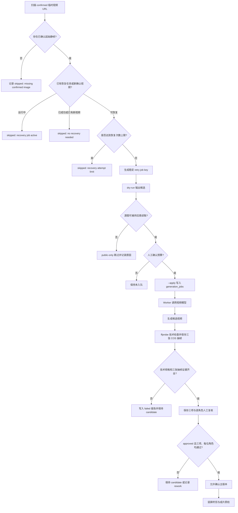

# 过期视频恢复队列开发流程

## 1. 功能目标

当供应商临时视频 URL 过期时，不能把失效地址继续当作可播放成片，也不能无控制地重复调用视频模型。本功能只为“当前已确认的视频”创建可审计、可限次、可复跑的恢复候选。

它不保证恢复后画面质量与历史视频完全相同，也不代表已经完成发布；新生成视频默认先保存为候选，必须经过人工确认和终剪质检。

## 2. 适用边界

自动恢复候选必须同时满足：

1. 视频属于目标项目。
2. 视频状态为 `confirmed`。
3. 视频 URL 命中已知的临时供应商 URL 前缀。
4. 对应分镜存在已确认的起始静帧。
5. 没有运行中的恢复任务。
6. 没有成功的恢复任务，也没有新的已确认可用视频。
7. 未达到 `EXPIRED_VIDEO_RECOVERY_MAX_ATTEMPTS` 上限，默认 3 次。

以下记录不会自动重生成：

- `candidate` 或 `archived` 视频资产。
- 没有已确认静帧的分镜。
- 已存在成功恢复任务、运行中任务或新确认视频的分镜。
- `pending://hybrid-export` 等导出待处理记录。

## 3. 业务流程



## 4. 稳定任务键与幂等规则

恢复任务键固定为：

```text
recover-video-project-{projectId}-storyboard-{storyboardId}-retry-{retryNumber}
```

例如：

```text
recover-video-project-12-storyboard-168-retry-2
```

同一项目和分镜的重跑会得到同一 retry 编号，不再使用时间戳随机键。这样可以在脚本重跑、服务重启或人工复核后保持可追溯性。

判断规则：

| 条件 | 结果 |
| --- | --- |
| 已有 `queued` 或 `running` 恢复任务 | 跳过 |
| 已有 `success` 恢复任务 | 跳过 |
| 已有新的确认视频或对象 Key 视频 | 跳过 |
| 历史恢复任务数达到上限 | 跳过 |
| 其他情况 | 创建下一次 `retry-N` 候选 |

## 5. 命令与配置

环境变量：

```text
EXPIRED_VIDEO_RECOVERY_MAX_ATTEMPTS=3
```

只读扫描：

```text
npm run recover:expired-videos -- --projects=12
```

实际入队：

```text
npm run recover:expired-videos -- --projects=12 --apply
```

修复已排队空景任务的提示词快照：

```text
npm run refresh:queued-recovery-prompts -- --projects=12
npm run refresh:queued-recovery-prompts -- --projects=12 --apply
```

该脚本默认只读。它只会处理 `queued` 状态、且 `job_key` 以 `recover-video-` 开头的任务；`success`、`running`、`failed` 以及普通生成任务不会被改写。空景静帧（`character_snapshot.characterFree=true`）会追加以下强约束，且重复执行不会重复拼接：

```text
保持空景，禁止新增任何人、脸、人体轮廓、倒影、影子。
Keep the scene empty. Do not add people, faces, human silhouettes, reflections, or shadows.
```

只使用供应商可直接读取的公网起始帧：

```text
npm run recover:expired-videos -- --projects=12 --public-only
npm run recover:expired-videos -- --projects=12 --public-only --apply
```

`--public-only` 会把 `localhost`、`127.*`、私网地址和非 HTTP(S) 地址记录为 skipped，不创建任务；不带该参数时仍允许进入常规上传链路，但外部 Provider 能否读取本地源图取决于上传服务和网络。

`--apply` 会写入 `generation_jobs`。服务 Worker 启动后会按现有队列策略调用视频模型，因此可能产生供应商费用。必须先审阅 dry-run、确认预算和模型配置，再执行。

恢复请求会把 `projectId`、分镜、源图 URL、源图 `imageStorageKey`、版本号和提示词写入完整快照。Worker 会优先依据 `imageStorageKey` 生成 COS HTTPS 签名 URL；只有 Key 缺失时才回退到旧 URL 和公共上传链路。视频生成默认 `autoConfirm=false`，先保存为 `candidate`，由人工确认接口和终剪质检决定是否进入正式确认状态。

### 恢复视频人工复核门禁

恢复任务生成的视频通过 `generation_job_id -> generation_jobs.job_key` 识别，只有 `job_key` 以 `recover-video-` 开头时才启用该门禁。普通视频与口型同步视频保持原有确认流程。

复核接口：

```text
PUT /api/videos/{videoId}/recovery-review
```

复核数据会写入 `video_assets`：

```text
recovery_review_decision
recovery_review_checklist_json
recovery_review_note
recovery_reviewed_by
recovery_reviewed_at
```

允许的结论只有：

| 结论 | 处理 |
| --- | --- |
| `approved` | 三项检查必须全部为 `true`，且每位预期角色均标记“通过”，才允许点击“确认最终版本” |
| `rework` | 可保存未通过项和备注，视频保持 `candidate`，不会进入终剪 |

三个必填检查项：

1. 画面构图、主体与明显瑕疵。
2. 人物外貌、服装与已确认静帧的一致性。
3. 动作起止、镜头运动与场景连续性。

对每位预期出镜角色，页面还必须保存一条 `characterChecks` 记录：

| 角色结论 | 要求 |
| --- | --- |
| `matched` | 人物外貌、服装、主体身份和镜头表现经人工核对通过 |
| `rework` | 必须填写具体返工原因，例如发型、服装、主体数量或动作异常 |

预期角色只从恢复视频绑定的确认静帧 `character_snapshot` 推导。`approved` 时不能漏角色、不能出现 `rework`；`rework` 时也必须逐个记录所有预期角色的当前结论。结果与三项全局勾选一起保存在 `recovery_review_checklist_json.characterChecks`。

`POST /api/videos/{videoId}/confirm` 会再次在服务端检查该记录；任何未保存、未批准、漏角色或角色返工的恢复视频均返回 `409`。因此浏览器禁用按钮只是减少误操作，不能绕过后端门禁。

### 恢复视频自动检查与抽帧证据

每个新的恢复候选写入前都会运行 `ffprobe`，并从视频的约 10%、50%、90% 位置截取三张 JPG，上传到私有 COS：

```text
projects/{projectId}/videos/storyboards/{storyboardId}/v{versionNo}/review/c{candidateNo}-s{sampleNo}.jpg
```

检查结果写入 `video_assets.recovery_inspection_json`，包含：

- 分辨率、帧率、时长、视频/音频编码和容器格式。
- 三张不同对象 Key 的抽帧证据及页面签名 URL。
- 横版或方形素材的竖屏终剪警告。
- 空景或人物镜头的人工复核重点。
- 检查失败原因。

`POST /api/videos/{videoId}/confirm` 会重新校验报告中的技术规格和三个不同的抽帧 Key；仅有数据库里的 `status=ready` 字样不足以放行。这个模块**不做人物、人脸或一致性的自动识别**，三张图是人工复核证据，不是自动视觉判定。

### 角色快照辅助核对

恢复候选的页面 DTO 会读取起始确认静帧的 `character_snapshot`，生成每位预期出镜角色的核对卡：

- 角色名称和主体标记。
- 静帧锁定时保存的角色版本号。
- 固定外貌和独立服装字段。
- 定妆参考图的短时签名 URL。

新的恢复检查报告会把这份清单写入 `recovery_inspection_json.characterChecklist`。对于早于该字段的历史报告，服务端只在读取时从原始静帧快照补齐清单，不改写旧报告，也不回填当前角色版本，避免把后来修改过的角色资料错误地当作历史生产基线。

如果旧静帧快照本身缺少版本号或独立服装字段，页面会明确显示“历史快照未记录版本”或“历史快照未独立记录”，不能把它当作完整一致性证据。人工仍必须结合定妆参考和三项复核决定返工或批准。

该功能是**规则和证据展示辅助**：它没有调用视觉模型，也没有自动判定人脸、人物数量、服装相似度或动作连续性。

逐角色人工复核页面验证（2026-09-16）：

```text
页面样本：项目 12 / 场景 886 / 分镜 151 / 视频资产 187
预期角色：林夏、周衡
页面控件：两人各有“未复核 / 通过 / 返工”结论和角色备注输入
前端约束：任何一人未选择结论时，“保存人工复核”禁用并显示准确提示
服务端约束：批准漏角色时拒绝；角色返工没有原因时拒绝；确认主版本会重新校验
```

本次页面验证不保存用户的复核数据。资产 187 的 COS 源视频仍缺失，技术检查为 `failed`，因此无论角色表单如何填写都不能确认主版本。

历史恢复候选回填命令：

```text
npm run inspect:recovery-videos -- --projects=12
npm run inspect:recovery-videos -- --projects=12 --apply --limit=7
```

默认 dry-run 会读取 COS 视频、解析技术规格并输出抽帧计划，不上传、不更新数据库。`--apply` 才会上传抽帧并写回检查报告；不会调用模型，也不会删除视频对象。

旧任务状态纠偏：

```text
npm run reclassify:recovery-videos -- --projects=12
npm run reclassify:recovery-videos -- --projects=12 --apply
```

该脚本默认只读扫描。`--apply` 只处理恢复任务、请求快照中 `autoConfirm=true` 且当前视频为 `confirmed` 的记录，把视频改为 `candidate`，并在分镜主视频仍指向该记录时清空 `storyboards.video_url`。它不删除视频对象、不删除生成任务、不修改供应商结果证据。

## 6. 项目 12 验收证据

2026-09-16 dry-run：

```text
已确认且 URL 过期的视频：21
恢复候选：21
每条候选：retry-2
skipped：0
数据库写入：0
视频模型调用：0
```

这 21 条的上一轮恢复记录均为 `canceled`，所以当前候选统一从第 2 次恢复开始。其余 37 条过期视频是候选或归档资产，不会被脚本自动生成。

Agnes 入队验证：

```text
Provider：agnes
Model：agnes-video-v2.0
入队：21 条（job 228 至 248）
首批失败：4 条
安全暂停：17 条 canceled
```

阻塞原因：

```text
ToAPI 图片上传域名：toapis.com:443
DNS：可解析
TCP：超时
HTTP：超时
```

16 条恢复候选使用本机对象存储里的起始帧。外部视频 Provider 无法直接读取 `127.0.0.1` 地址，必须先经公共上传服务或改接公网对象存储/CDN。该链路未恢复前，不应重启 Worker 继续跑恢复队列。

2026-09-16 的后续修复和真实回填：

```text
问题：恢复入队脚本只写 imageUrl，遗漏 imageStorageKey
风险：即使源图已回填 COS，Worker 仍会使用旧 127.0.0.1 URL 并回退 ToAPI 上传
修复：buildExpiredVideoRecoveryRequest() 保存 imageStorageKey；入队脚本从 image_assets.storage_key 透传
测试：expired-video-recovery.test.mjs 覆盖恢复快照保留对象 Key
```

项目 12 的 16 个确认起始帧已使用精确对象 Key 回填 COS，16/16 上传后回读 SHA-256 一致；随后已写入 16 条 `retry-3` 恢复任务（job 254-269）。任务 254 的数据库快照已回读确认：

```text
projectId=12
storyboardId=168
imageStorageKey=projects/12/frames/storyboards/168/v1/c159.png
autoConfirm=false
```

这些任务当前均为 `queued`。尚未启动真实 Worker，因此不能把“已入队”表述成“视频已生成”或“视频已通过人物一致性复核”。

空景约束与受控 Worker 验收（2026-09-16）：

```text
发现：job 254 的空景起始帧仍生成了陌生女性，不能通过复核。
修复：恢复提示词改为读取 image_assets.character_snapshot.characterFree；
      空景追加中英双语“禁止新增人物/脸/轮廓/倒影/影子”强约束。
回写：dry-run 只命中 job 255；--apply 只更新这条 queued 任务，254 和 256-269 未修改。
首次运行错误：使用 .env.local 单独启动 Worker，读到本地存储地址而非 COS；
              job 255 在提交模型前失败。该次失败保留 attempt_count=1 记录。
正确验证：使用 .env.local + .env.production 组合配置，以 GENERATION_WORKER_MAX_JOBS=1 运行。
结果：job 255 success，attempt_count=2；资产 193 为 candidate，未自动确认。
COS：projects/12/videos/storyboards/180/v2/c1.mp4，HeadObject 成功，2,107,212 bytes。
编码：1920x1088 / 30fps / H.264 + AAC / 5.1s。
抽帧：0.5s、4.5s 均为广播设备空景，未观察到人物、脸或人体轮廓。
队列：job 256-269 保持 queued，未被此次 Worker 消费。
```

这只是一个空景样本的人工抽帧结果，不等同于所有空景都已稳定通过，也不等同于人物镜头的一致性已经验证。

公网源图恢复验证（2026-09-16）：

```text
public-only dry-run：5 条 queued，16 条 skipped
实际入队：5 条，job 249 至 253
Agnes 任务创建与轮询：5/5 完成
对象存储写入：5/5 成功，均有 storage_key 和 meta.json
ffprobe：5/5 可解析，H.264 + AAC，约 5.1 秒
```

本轮曾出现并已修复的真实缺陷：

```text
错误：invalid generated video storage key
原因：恢复请求快照遗漏 projectId，视频已经由 Agnes 生成，但本地对象存储 Key 构造失败
修复：集中使用 buildExpiredVideoRecoveryRequest() 构造请求，并由测试锁定 projectId
```

技术规格复核：

```text
实际输出：1920x1088 / 30fps / H.264 + AAC / MP4
项目终剪目标：1080x1920 / 24fps / H.264 + AAC / MP4
结论：视频可播放，但不是可直接发布的竖屏终剪成片
```

早期 job 249-253 曾在修复前使用 `autoConfirm=true`。2026-09-16 已通过纠偏脚本将 5 条结果回退为 `candidate`；后续恢复请求默认 `autoConfirm=false`。这 5 条仍需按项目质量流程实际完成画面、人物一致性、动作连续性、字幕、音频和竖屏终剪复核，不能仅凭任务成功状态认定为合格成片。

状态纠偏结果（2026-09-16）：

```text
dry-run 命中：5 条，资产 187-191，任务 249-253
apply 修改：5 条 video_assets -> candidate
分镜主视频指针：5 条清空
对象文件：保留
generation_jobs：保留且仍为 success
```

人工复核门禁验证（2026-09-16）：

```text
数据库迁移：video_assets 的 5 个 recovery_review_* 字段已存在
页面样本：项目 12 / 场景 886 / 分镜 151 / 视频资产 187
初始状态：candidate + 恢复待复核 + “确认最终版本”禁用
未完成检查时保存：后端返回“批准前必须完成画面、人物一致性和动作连续性复核”
未复核时确认主版本：`POST /api/videos/187/confirm` 返回 `409 / 4093`
桌面与 390px 宽度：复核区、候选状态与禁用按钮均可见，无文本重叠
```

项目级复核清单验证（2026-09-16）：

```text
接口：GET /api/projects/12/recovery-video-reviews
真实汇总：total=5，pendingCount=5，reworkCount=0，approvedCount=0
资产：187-191，均为 candidate
排序：待复核 -> 返工 -> 完整批准
任务中心：显示 5 条“待复核”，并包含场景、镜头、版本、模型、时长
首条跳转：/workspace/video?projectId=12&sceneId=886&storyboardId=151
跳转页面：恢复视频人工复核区和“待人工复核”禁用确认按钮均可见
390x844：复核区、候选状态、表单和预览无重叠
```

该清单只提供定位和排队信息。它不会保存复核、修改候选状态或确认主版本；实际放行仍由复核接口与 `POST /api/videos/{videoId}/confirm` 的服务端门禁负责。

任务中心审核口径一致性回归（2026-09-16）：

```text
风险：逐角色复核门禁上线后，确认接口会拦截漏角色的 approved；
      但任务中心旧逻辑只检查三项全局勾选，可能把同一条记录显示为“已批准”。
修复：任务中心按 recovery_inspection_json 与确认静帧 character_snapshot 推导预期角色；
      只有三项全局检查通过，且每位预期角色都存在 matched 记录，才显示“已批准”。
兼容：没有预期角色的空景记录不额外要求角色结论。
回归：缺少任意角色结论的 approved 记录会显示“待复核”；
      所有预期角色均 matched 时才显示“已批准”。
```

这项修复只统一人工审核状态的展示和放行口径。它不进行人物、人脸、服装或动作的自动视觉判断，仍不能替代人工查看抽帧和候选视频。

角色复核进度可视化复验（2026-09-16）：

```text
页面：/workspace/ai-tasks?projectId=12
旧页面验证快照：total=7，pendingCount=7，reworkCount=0，approvedCount=0
当前只读核算：total=8，pendingCount=8，reworkCount=0，approvedCount=0
角色镜头示例：场景 5 / 镜头 01 / V4 显示“角色复核 0/2 · 待补 2”
单角色镜头示例：场景 5 / 镜头 02 / V2 显示“角色复核 0/1 · 待补 1”
空景或历史无角色快照候选：不显示角色复核数字，避免把“无预期角色”误读为“审核完成”
```

队列服务会返回 `characterReviewSummary`，只统计当前恢复检查报告与确认静帧快照中推导出的预期角色。页面使用它展示通过、返工或待补数量；它不改变候选排序、保存复核或确认主版本的权限。

### 竖屏终剪前置分流

恢复候选在技术检查和人工复核之后，还会计算终剪前置状态 `finalEditReadiness`。它只回答“当前是否具备进入竖屏终剪计划的条件”，不代表已经生成竖屏成片：

| 状态 | 条件 | 是否允许进入终剪计划 |
| --- | --- | --- |
| `ready-for-final-edit` | 技术检查 `ready`、发布规格为 `needs-vertical-final-edit`、人工三项检查完成、全部预期角色 `matched` | 是 |
| `waiting-manual-review` | 技术检查 `ready`，但人工复核尚未完整批准 | 否 |
| `blocked-by-rework` | 人工结论为 `rework` | 否 |
| `needs-technical-check` | 自动技术检查未完成或已失败 | 否 |
| `not-required` | 已满足 `1080x1920 / 24fps / H.264 + AAC / MP4` | 否 |

任务中心同时显示以下汇总：

- `readyForFinalEditCount`：可进入终剪计划的候选数。
- `waitingManualReviewBeforeFinalEditCount`：技术 ready 但必须先人工复核的候选数。
- `finalEditBlockedCount`：技术阻塞或人工返工导致不能进入终剪的候选数。

这个分流不会自动创建导出任务、不会启动 FFmpeg、不会调用模型，也不会扣供应商费用。项目 12 当前真实只读结果：

```text
恢复候选：8
技术可人工复核：3
复核后终剪：3
技术阻塞：5
可直接进入终剪：0
可直发平台：0
```

因此“技术检查 ready”仍不能表述为“可发布”；必须先完成人工画面、人物一致性、动作连续性复核，再生成符合项目竖屏模板的真实终剪文件，并继续通过字幕、音频授权、最终质检和发布合规包。

### 受控竖屏终剪计划合同

每条恢复候选都会生成一份只读的 `finalEditPlan`，用于把“是否可以进入终剪”与“终剪应该产出什么规格”固定下来：

```text
planId：recovery-final-edit-video-{videoId}
executionMode：manual-gate
target：1080x1920 / 9:16 / 24fps / H.264 + AAC / MP4 / 字幕烧录
```

只有 `finalEditReadiness.status=ready-for-final-edit` 且 `canStartFinalEdit=true` 时，计划才是 `status=ready`；其他情况均为 `blocked`，并记录以下类型的阻塞原因：

- `technical-check-incomplete`：自动技术检查或抽帧证据未完成。
- `manual-review-incomplete`：画面、人物一致性或动作连续性人工复核未完成。
- `manual-review-rework`：人工复核要求返工。
- `final-edit-not-required`：候选已经满足平台发布技术规格。

该合同当前只做接口返回和任务中心展示，不写数据库、不创建 `export_records`、不启动 FFmpeg、不调用模型。真正执行终剪时，仍必须复用现有字幕、音频授权、竖屏规格、最终质检和发布合规门禁。

### 单条终剪执行入口

人工复核完整通过后，终剪不允许由列表批量触发，而是通过单条、明确确认的受控入口执行：

```text
GET  /api/videos/{videoId}/recovery-final-edit-plan
POST /api/videos/{videoId}/recovery-final-edit/execute
POST /api/exports/{exportId}/recovery-final-edit/rollback
```

执行接口要求 `confirm=true` 且 `confirmationToken=START_RECOVERY_FINAL_EDIT`。服务端会重新读取候选、检查报告、人工复核和角色结论；相同 `planId` 已存在 `queued/running/completed` 任务时幂等复用，不重复创建导出任务。

新建的 `export_records` 使用 `pipeline=recovery-final-edit-v1`，只保存单条候选的源视频 ID和回滚快照。原恢复候选仍为 `candidate`，不会切换 `storyboards.video_url`。回滚只把终剪记录标记为 `canceled` 并保留媒体对象，不删除源候选、抽帧证据或终剪输出。

详细接口、Worker 再校验、回滚竞态处理和验收标准见《单条竖屏终剪执行与回滚开发流程》。

技术检查就绪度分流复验（2026-09-16）：

```text
问题：旧任务中心只按“待复核 / 返工 / 已批准”排列。
      技术检查失败的候选也会显示“待复核”，容易让人工先点到没有可读视频或抽帧证据的记录。

接口：GET /api/projects/{projectId}/recovery-video-reviews
新增字段：
- inspectionReadiness: ready | pending-inspection | blocked
- inspectionBlockingReason: failed 报告中的首条 blockingIssues.message

分类：
- recovery_inspection_json.status = ready -> 可人工复核
- 没有检查报告 -> 待技术检查
- 有检查报告但状态不是 ready -> 技术阻塞

排序：先按待复核 / 返工 / 已批准；同一审核状态内再按
      可人工复核 -> 待技术检查 -> 技术阻塞；最后按创建或复核时间。

项目 12 页面：/workspace/ai-tasks?projectId=12
旧页面验证快照：total=7，pendingCount=7，reworkCount=0，approvedCount=0
当前只读核算：total=8，pendingCount=8，reworkCount=0，approvedCount=0
技术状态：可人工复核=3，待技术检查=0，技术阻塞=5
页面：前两条为“可人工复核 / 去复核”；技术阻塞项显示具体原因，并显示“查看阻塞”。
```

该状态只代表技术检查证据是否齐全，不代表画面、人物外貌、服装、动作连续性已经由 AI 判定合格。人工三项复核、逐角色结论和竖屏终剪门禁均保持不变。

技术阻塞处理指引复验（2026-09-16）：

```text
问题：仅展示“技术阻塞”和首条报错时，制作人员知道有问题，但不知道优先检查什么。

队列字段：
- inspectionBlockingCode：首条自动检查问题的 code
- inspectionGuidance：由队列服务生成的保守人工处理建议

处理映射：
- recovery-video-metadata-missing
  -> 检查视频文件、编码与容器信息；无法恢复时重新生成候选视频。
- recovery-review-samples-incomplete
  -> 检查视频对象和抽帧；证据无法补齐时重新生成候选视频。
- recovery-video-inspection-failed
  -> 检查视频对象是否可读取；无法恢复时重新生成候选视频。
- 无检查报告
  -> 等待技术检查完成后再进行人工复核。

项目 12 页面：
场景 5 / 镜头 01 / V4 显示
“技术阻塞：候选视频缺少完整技术规格，不能进入人工复核。”
“下一步：查看候选详情，检查视频文件、编码与容器信息；无法恢复时重新生成候选视频。”
按钮：“查看处理详情”
```

处理指引不会自动执行重试、恢复、重新生成或扣费；它只是把用户带到已有的视频详情和人工处理流程。建议也不等同于根因诊断，实际仍需以候选视频和对象存储的可读性检查为准。

技术检查优先于人工批准门禁（2026-09-16）：

```text
问题：历史逻辑允许把三项人工勾选和逐角色 matched 保存为 approved，
      即使 recovery_inspection_json 仍是 failed 或根本不存在。
      此时确认主版本会被后端拦截，但项目级队列可能错误显示“已批准”，
      造成审核排期与真实可放行状态不一致。

队列规则：
- inspectionReadiness 不是 ready 时，reviewDecision=approved 仍按“待复核”处理。
- 只有技术检查 ready、三项人工检查完成且所有预期角色 matched，才是有效 approved。
- DTO 新增 canStartManualReview；只在 inspectionReadiness=ready 时为 true。

接口规则：
- PUT /api/videos/{videoId}/recovery-review 在技术检查未 ready 时拒绝保存 approved，
  返回 409 和“恢复视频必须先完成自动技术检查并保存三张抽帧证据”。
- rework 和备注仍允许保存，方便记录返工原因；它不会放行主版本。

页面规则：
- 技术阻塞且存在预期角色时保留“角色复核 0/x”作为工作量信息，
  状态显示为“先完成技术检查”，不再显示“待补 x”。
- 可人工复核记录仍显示原有的“待补 / 返工 / 已完成”角色状态。

项目 12 页面复验：
- 恢复候选当前共 8 条：可人工复核 3 条，技术阻塞 5 条。
- 场景 5 / 镜头 01 / V4 从“角色复核 0/2 · 待补 2”变为
  “角色复核 0/2 · 先完成技术检查”。
- 页面未触发恢复、重试、生成或扣费。
```

本规则只约束恢复候选的“能否开始人工批准”顺序，不宣称技术检查已完成画面、人物外貌、服装或动作质量判断。接口拒绝行为由契约测试覆盖；页面状态由项目 12 实际页面复验。

自动检查与历史证据回填（2026-09-16）：

```text
数据库迁移：video_assets.recovery_inspection_json 已存在
历史 dry-run：项目 12 曾命中 7 条未检查恢复候选；后续新增资产 194 后，当前真实候选总数为 8。
资产 187-191：COS 视频对象缺失，写入 failed 报告；不会进入人工复核或主版本确认
资产 192、193：ffprobe 均为 1920x1088 / 30fps / H.264 + AAC / 5.1s
抽帧：每条各 3 张，共 6 张，COS HeadObject 6/6 成功
报告状态：192、193 为 ready；仍均为 candidate，未自动批准、未自动确认
```

横版告警仅说明需要进入项目已有的 `1080x1920 / 24fps` 竖屏终剪，不会把候选视频伪装成可发布成片。资产 187-191 的源视频缺失是历史对象完整性问题，后续必须重新生成或从合规备份恢复，不能靠检查报告修复。

角色快照辅助核对页面复验（2026-09-16）：

```text
页面样本：项目 12 / 场景 886 / 分镜 151 / 视频资产 187
历史源快照：林夏、周衡各有定妆参考和外貌描述，但没有角色版本号、独立服装字段或参考对象 Key
页面表现：显示两张定妆参考；明确显示“历史快照未记录版本”“历史快照未独立记录”
复核提示：补入逐人对照角色版本、外貌、服装和定妆参考的人工检查说明
放行状态：COS 源视频仍缺失，技术检查为 failed，确认主版本按钮保持禁用
```

这证明历史兼容展示和确认阻断有效；它不证明人物一致性已经由模型自动识别，也不证明资产 187 可发布。

指定任务受控 Worker 验收（2026-09-16）：

```text
新增入口：npm run worker:recovery-once -- --job-id=256 --apply
前置拒绝：省略 --apply 会拒绝；非 queued、非 recover-video、非 video_image 任务会拒绝
前置检查：COS 起始图 HeadObject 可读；视频 Provider=agnes；mock 回退=false
Worker 控制：GENERATION_WORKER_CONCURRENCY=1
            GENERATION_WORKER_MAX_JOBS=1
            GENERATION_WORKER_ONLY_JOB_ID=256
            指定任务模式不恢复导出队列
运行结果：job 256 success，attempt_count=1，Worker exit=0
候选资产：194 / candidate；COS 视频对象 2,213,883 bytes
自动检查：ready；3 张 COS 抽帧均可读；1920x1088 / 30fps / H.264 + AAC / 5.1s
队列边界：其余 job 257-269 保持 queued，未被消费
```

这次验证证明 Worker 不会因启动而批量消费 queued 队列，并确认 COS 签名起始图、Agnes、候选视频入库和技术检查报告可以完成一条闭环。资产 194 仍是横版候选，尚未做人物视觉一致性识别或人工复核，不能确认主版本、更不能发布到平台。

后续每次真实消费前，先执行同一 job id 的只读预检：

```text
npm run worker:recovery-once -- --job-id=256 --dry-run
```

预检只验证任务状态、`imageStorageKey`、COS `HeadObject`、签名 URL 生成和非 mock Provider 配置，不启动 Worker、不调用模型、不改变 `generation_jobs`。只有预检通过后，才允许使用：

```text
npm run worker:recovery-once -- --job-id=256 --apply
```

`--dry-run` 和 `--apply` 互斥；省略二者或同时传入都会被拒绝。该门禁降低误消费整队列的风险，但不替代真实单条执行后的技术检查、人工复核和成本记录。

## 7. 测试

```text
node --test server/services/expired-video-recovery.test.mjs
node --test server/services/recovery-video-review-queue.test.mjs
node --test server/services/recovery-video-inspection.test.mjs
npm test
npm run type-check
npm run build
```

覆盖：

- 稳定 job key。
- 活跃任务防重。
- 成功恢复或新确认视频防重。
- 取消后递增 retry 编号。
- 恢复次数上限。
- 公网/本地/无效协议源图分类。
- 恢复请求保留 `projectId`，并默认关闭自动确认。
- 恢复人工复核只允许 `approved` / `rework`。
- `approved` 必须完成画面、人物一致性和动作连续性三项检查。
- `rework` 可留痕但不会被当作已批准。
- 批准必须把静帧快照中的每位预期角色标记为 `matched`。
- 角色标记为 `rework` 时必须保留具体返工原因；未知角色、重复角色或漏角色均会被拒绝。
- 项目级复核清单按待复核、返工、完整批准排序；服务端会按恢复检查报告和静帧快照重算预期角色，历史不完整的 `approved` 不会被误判为已完成。
- 同一人工审核状态内，可人工复核候选会排在待技术检查和技术阻塞项之前；`failed` 技术检查会返回首条可读阻塞原因，避免把无法人工查看的候选伪装成正常复核工作。
- 技术阻塞会返回问题代码和面向人工的处理建议；不同建议覆盖媒体规格缺失、抽帧证据不足、检查执行失败和未检查状态，且不会触发自动恢复或新的模型任务。
- 技术检查未就绪时，队列不会把 `approved` 当作有效批准，`canStartManualReview` 为 false；接口拒绝保存 `approved`，但允许保存 `rework` 留痕。
- 三张抽帧必须为不同对象 Key；重复引用同一张图不能通过。
- 伪造或残缺的 `ready` 报告会被确认接口重新校验并阻断。
- 新报告会把角色版本、外貌、服装和定妆参考写入角色核对清单。
- 历史报告中的空角色清单会从源静帧快照补齐；缺少的版本或服装字段必须显式标注，不能伪造。

## 8. 当前限制

- 不自动执行 `--apply`，避免没有预算确认时产生模型费用。
- 不保证新的模型输出与旧视频逐帧一致。
- 后续新恢复任务不自动确认新视频；人工确认和最终质检仍是发布门禁。历史 job 249-253 曾受旧逻辑影响，当前显示 confirmed 不代表已通过终剪质检。
- 后续新恢复任务不自动确认新视频；恢复候选必须通过三项人工复核并由服务端放行后，才可成为主版本。
- 旧任务状态已通过 `reclassify:recovery-videos` 纠偏为候选；后续重跑 dry-run 应不再命中这 5 条。
- 不处理候选、归档视频及 pending 导出。
- 不替代真实云对象存储、CDN、备份和供应商账单对账。
- 本机无法连接 ToAPI 图片上传服务；COS `storage_key` 已为 16 条本地源图提供替代路径，但仍需真实 Worker 消费验证视频供应商是否能读取短时 COS HTTPS 签名 URL。
- 该 COS 签名源图链路已通过 job 256 的单条真实 Worker 验证；剩余 13 条 queued 任务仍未批量执行，不能把单样本成功外推为批量稳定性。
- 当前任务中心的终剪状态只完成前置分流，项目 12 没有任何候选达到 `ready-for-final-edit`；仍不能批量创建终剪导出或宣称已具备平台稳定发布能力。
- Agnes 输出目前是横向 `1920x1088`，还需要通过竖屏终剪模板转换并通过 `1080x1920 / 24fps` 技术门禁。
- 空景强约束已在 job 255 的两张抽帧上避免生成人物，但只覆盖一个供应商结果样本；后续应建立视觉检测或更大样本集的自动回归，不能仅依赖提示词。
- 自动检查只验证媒体规格和抽帧证据存在，不能替代人物、人脸、空景或动作连续性的视觉识别；人工三项复核仍不可跳过。
- 角色核对卡只展示静帧快照证据；对历史快照缺失的字段不会尝试从当前角色资料“补猜”，因此旧资产仍可能需要重新生成才能达到可审计的一致性标准。
- 逐角色结论是人工证据留痕，不是模型的视觉识别结论；它能提高复盘与返工定位能力，但不能替代后续的真实视觉一致性评测和批量样本验收。
