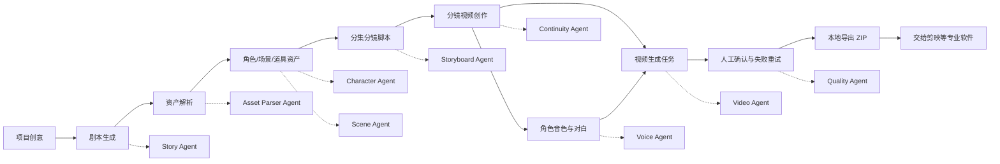
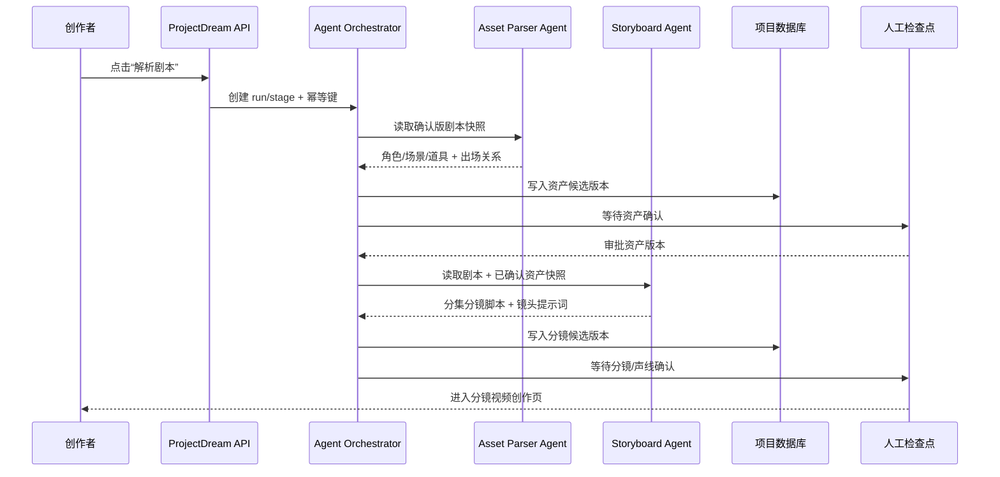

# ProjectDream 多 Agent 协作接入可行性报告

> 评估日期：2026-10-01  
> 评估对象：ProjectDream 当前“剧本 → 资产 → 分镜视频 → 本地导出”主流程  
> 结论：**可以接入多 Agent，但当前完成的是编排骨架与业务闭环，不应把现有状态表述为“多 Agent 已经自动执行”。**

## 1. 结论摘要

当前项目已经具备多 Agent 接入所需的核心业务边界：

- `production_runs` 保存一次单集生产运行，带项目、集数、平台、预算、候选策略和幂等键。
- `production_stage_runs` 保存阶段顺序、`agent_key`、输入快照、输出快照和阶段状态。
- `production_checkpoints` 保存人工确认点，能够阻止未审批结果继续推进。
- `production_agent_executions` 已有 Agent 执行记录表，可保存执行状态、模型、输出、错误和时间。
- 生产运行接口已经做了用户归属校验，支持创建、读取、阶段完成、检查点审批和幂等创建。
- 分镜创作页已经能把分镜脚本、角色/场景/道具图片、`@` 引用、角色音色、视频任务和本地导出放入一个连续工作区。

当前仍然缺少真正接入前必须补齐的执行能力：

- 没有统一的 Agent Executor / Adapter，把 `agent_key` 映射到真实模型或工具调用。
- 没有独立 Worker 或消息队列来执行、重试、恢复和限流 Agent 任务。
- Agent 结果还没有统一的事件流和版本写回协议，无法保证“生成结果只写入对应项目、集数和阶段”。
- 失败重试、暂停恢复、取消、超时、人工接管尚未形成完整状态机。
- 多 Agent 之间的上下文尚未统一为可校验的输入/输出契约。

因此当前判断为：

| 能力 | 当前状态 | 判断 |
| --- | --- | --- |
| 剧本、资产、分镜、视频、导出业务闭环 | 已具备真实接口和页面路径 | 可继续联调 |
| 多 Agent 阶段模型 | 已有阶段、Agent 标识和快照结构 | 可接入 |
| 多 Agent 真实执行 | 只有持久化骨架，未统一执行器 | 尚未接入 |
| 结果回写和人工审批 | 局部已有，尚未覆盖所有 Agent | 需要补齐 |
| 任务恢复、重试、幂等和限流 | 普通媒体任务已有基础，Agent 编排未统一 | 需要补齐 |
| 生产级多 Agent | 需要队列、事件、权限、观测和成本门禁 | 暂不建议直接放量 |

### 一句话判定

**能接，而且不需要推翻当前页面和数据结构；但接入顺序应是“先接统一执行器，再做双 Agent 垂直切片，最后扩展到全链路”，不能直接把现有的阶段记录当成已经完成的自动协作。**

当前代码已经解决了“Agent 应该在哪些业务阶段工作”的问题，尚未完全解决“Agent 如何被可靠调用、如何把结果写回、失败后如何恢复”的问题。这是可实施的工程缺口，不是架构方向错误。

## 2. 目标业务闭环

用户侧只看到三段主路径，内部再由多个 Agent 协作：



## 3. 推荐 Agent 分工

| Agent | 输入 | 输出 | 必须写回 |
| --- | --- | --- | --- |
| `story-agent` | 创意、风格、比例、集数 | 故事圣经、分集大纲、剧本正文 | story bible / season structure / script scenes |
| `asset-parser-agent` | 已确认剧本 | 角色、场景、道具、关系和出场集数 | asset nodes / character links / scene links |
| `character-agent` | 角色档案、剧情上下文 | 外貌、服装、年龄状态、声线建议和角色提示词 | character profile / prompt versions |
| `scene-agent` | 场景正文、时间和空间关系 | 全景、局部、九宫格多角度提示词 | scene asset nodes / prompt versions |
| `storyboard-agent` | 单集剧本、资产引用、全局风格 | 景别、机位、构图、动作、对白、声音和视频提示词 | storyboards |
| `continuity-agent` | 相邻镜头、角色/场景版本 | 连续性约束、上一镜尾帧引用、冲突列表 | continuity contract / blockers |
| `voice-agent` | 角色音色绑定、对白文本 | 试听、对白音频、音色快照 | audio assets |
| `video-agent` | 分镜提示词、资产引用、音色上下文 | 视频生成任务和媒体地址 | video assets / generation jobs |
| `quality-agent` | 生成结果和任务证据 | 画幅、可访问性、连续性、音画同步检查 | quality report / blockers |
| `delivery-agent` | 已确认视频、音频和字幕 | 本地导出包、清单和校验结果 | delivery package / export record |

建议每个 Agent 只负责一个可回滚的阶段，不允许直接修改其他 Agent 的历史版本。

## 4. 现有代码对应关系

### 已存在的基础设施

- 领域阶段和状态规则：`server/services/production-run.mjs`
- 阶段推进和检查点状态机：`server/services/production-stage-transition.mjs`
- 生产运行 API：`server/index.mjs` 中的 `/api/projects/:id/production-runs` 与 `/api/production-runs/:id/*`
- 前端生产运行接口：`src/api/production.ts`
- 分集生产工作区：`src/views/EpisodeWorkbench.vue`
- 分镜视频创作页：`src/views/StoryboardVideoStudio.vue`
- 资产、音色、视频和导出接口：`src/api/project.ts`

### 已验证的页面路径

1. `/dashboard`
2. `/workspace/episodes?projectId=<id>`
3. `/workspace/episodes/studio?projectId=<id>&episodeNo=<n>`
4. 资产点击后打开提示词编辑和角色音色绑定
5. 分镜脚本中输入 `@` 调用当前集资产或工具
6. `立即生成视频` 入队
7. `导出本集` 下载本地交付包

## 5. 接入前必须补的 P0 能力

### 5.1 统一执行器

建议新增：

```ts
interface AgentExecutionContext {
  runId: number
  projectId: number
  episodeNo: number
  stageKey: string
  agentKey: string
  inputSnapshot: Record<string, unknown>
  attempt: number
  idempotencyKey: string
}

interface AgentExecutionResult {
  status: 'completed' | 'blocked' | 'failed'
  outputSnapshot?: Record<string, unknown>
  blockers?: Array<{ code: string; message: string }>
  usage?: { inputTokens?: number; outputTokens?: number; cost?: number }
}

interface AgentAdapter {
  execute(context: AgentExecutionContext): Promise<AgentExecutionResult>
}
```

`agentKey` 只能通过注册表找到 Adapter，未知 Agent 必须阻断，不能静默走 mock。

### 5.2 任务状态机

推荐统一状态：

```text
pending -> queued -> running -> waiting_approval -> completed
                         └-> retryable_failed -> queued
                         └-> terminal_failed
                         └-> canceled
```

每次状态变更写入事件表，事件至少包含：

- `run_id`
- `stage_key`
- `agent_key`
- `attempt`
- `idempotency_key`
- `status`
- `input_snapshot`
- `output_snapshot`
- `error_code`
- `created_at`

### 5.3 上下文契约

多 Agent 不能依赖页面当前文本拼接。每个阶段要读取结构化版本：

- 剧本版本
- 资产版本
- 角色声线版本
- 场景多角度版本
- 分镜版本
- 上一镜连续性版本

视频 Agent 只能消费“已确认或明确允许候选”的资产引用，不能直接读取页面临时输入。

### 5.4 人工确认点

建议保留以下四个检查点：

1. 剧本与分集结构确认
2. 角色/场景资产确认
3. 分镜脚本与声线确认
4. 视频候选与导出前质量确认

用户在页面上修改提示词后，必须产生新版本或新草稿，不覆盖 Agent 原始输出。

## 6. 当前主流程验收标准

在正式接入多 Agent 前，先满足以下闭环：

- 创建项目后可以直接进入剧本创作页。
- 已生成剧本的项目不会再次进入重复创意页。
- 资产解析能同步角色、场景和道具，并且空状态可解释。
- 任意资产可以打开提示词编辑；角色可以绑定、试听和上传参考音频。
- 分集管理能显示“第几集”和集标题，不把集标题冒充场景标题。
- 点击“生成分镜脚本”成功后进入对应集的创作页。
- 左侧资产有图片或清晰的待生成状态；点击资产可修改当前镜头提示词。
- 中间分镜脚本的 `@` 能显示当前集角色、场景、道具和工具，并把图片写入引用条。
- 视频生成不再强制要求镜头静帧；无静帧模式可以正常入队，供应商需要源图时才明确阻断。
- 音色状态和对白角色一致；未绑定时必须显示待处理原因。
- 右侧预览支持等待、失败、成功、放大和字幕处理状态。
- 时间线能按集同步镜头，点击镜头会同步中间脚本和右侧预览。
- 每集完成后只提供真实可用的本地导出，不展示未实现的剪辑入口。
- 页面刷新、切换路由和服务重启后，任务状态不会丢失。

## 7. 风险与结论

### 可以接入的原因

项目已经把“阶段、资产、镜头、音色、任务、导出”拆成了明确的业务对象，且接口已经按项目归属做隔离。后续接入 Agent 主要是补执行器、事件、队列和回写，而不是推翻页面和数据库。

### 不能直接放量的原因

当前 `production_agent_executions` 更像执行计划与结果容器，还不是完整的分布式执行记录；生产运行页可以展示当前 Agent，但真实工具执行、失败重试、暂停恢复和成本扣减尚未贯通。页面因此应继续使用“待接入 / 接入准备度”这类诚实状态。

### 推荐实施顺序

1. 先完成当前三段主路径的真实浏览器回归。
2. 增加统一 Agent Adapter 和单 Agent 可回放测试。
3. 增加队列 Worker、事件表、幂等和重试。
4. 先接 `asset-parser-agent` 与 `storyboard-agent` 做双 Agent 垂直切片。
5. 再接 `voice-agent`、`video-agent` 和 `quality-agent`。
6. 最后接人工检查点、成本门禁、导出和平台发布。

**最终结论：ProjectDream 的业务模型已经适合接入多 Agent，当前最适合进入“受控双 Agent 垂直切片”，不适合直接宣称已经完成全自动多 Agent 生产。**

## 8. 多 Agent 接入落地报告

### 8.1 当前可以直接复用的部分

本项目已有以下可作为 Agent 编排底座的真实对象：

| 现有对象 | 作用 | 接入价值 |
| --- | --- | --- |
| `production_runs` | 记录一次项目/集数生产运行 | 作为 Agent 协作的总上下文和幂等边界 |
| `production_stage_runs` | 记录阶段顺序、阶段 Agent、输入输出快照和状态 | 作为阶段级状态机 |
| `production_checkpoints` | 记录人工审批点 | 阻止未确认结果继续流转 |
| `production_agent_executions` | 记录 Agent 名称、状态、模型、输出和错误 | 作为执行审计起点 |
| 资产、分镜、音色、视频、导出对象 | 记录生产结果及版本 | 作为 Agent 的结构化输入和输出 |

因此，第一阶段不需要重做工作台页面，也不需要让 Agent 直接操作浏览器。Agent 应通过后端登记的工具和领域服务读写结构化对象，前端只负责展示状态、提示待确认项和承接人工修改。

### 8.2 还不能称为“已接入”的部分

当前 `production_agent_executions` 主要是计划和结果容器，不能单独证明真实 Agent 已经执行。正式接入前还需要补齐：

1. **Adapter 注册表**：明确 `agentKey -> 真实模型/工具` 的唯一映射，未知 Agent 直接阻断。
2. **统一执行器**：统一处理超时、取消、错误分类、重试和幂等。
3. **Agent 队列 Worker**：把长耗时模型调用从 HTTP 请求中移出，支持服务重启后恢复。
4. **事件记录**：每次排队、开始、成功、阻塞、失败、重试和人工审批都可追踪。
5. **版本写回协议**：Agent 输出只能生成新版本或候选，不能覆盖用户已确认版本。
6. **成本和权限门禁**：调用前检查预算、项目归属、集数归属和候选数量。

### 8.3 推荐的第一条可验收闭环

先只接两个 Agent，降低风险并验证多 Agent 的核心机制：



这条闭环验证了五件关键事情：

- Agent 能否被真实调度，而不是只在页面上显示名称。
- 上一个 Agent 的结构化输出能否成为下一个 Agent 的输入。
- 每个 Agent 是否只写自己的阶段和版本。
- 人工修改和审批是否能暂停、恢复流程。
- 刷新页面、服务重启、重复点击后，结果是否仍然可追踪且不重复创建。

### 8.4 双 Agent 垂直切片接口建议

建议先实现以下领域接口，接口稳定后再接真实模型：

```ts
type AgentStage = 'asset-parse' | 'storyboard'

interface AgentExecutionContext {
  runId: number
  projectId: number
  episodeNo: number
  stageKey: AgentStage
  agentKey: string
  inputSnapshot: Record<string, unknown>
  sourceVersions: Record<string, number | string>
  attempt: number
  idempotencyKey: string
}

interface AgentExecutionResult {
  status: 'completed' | 'waiting_approval' | 'blocked' | 'retryable_failed' | 'failed'
  outputSnapshot?: Record<string, unknown>
  createdVersionIds?: number[]
  blockers?: Array<{ code: string; message: string }>
  usage?: { inputTokens?: number; outputTokens?: number; cost?: number }
}

interface AgentAdapter {
  key: string
  execute(context: AgentExecutionContext): Promise<AgentExecutionResult>
}

interface AgentExecutor {
  enqueue(context: AgentExecutionContext): Promise<{ executionId: number }>
  cancel(executionId: number): Promise<void>
  retry(executionId: number): Promise<{ executionId: number }>
}
```

建议的后端边界：

- `server/services/agent/registry.mjs`：注册和查找 Agent Adapter。
- `server/services/agent/executor.mjs`：执行、状态转换、错误分类、幂等。
- `server/services/agent/context.mjs`：构造剧本、资产、分镜的版本化输入快照。
- `server/services/agent/events.mjs`：记录事件并提供运行详情。
- `scripts/run-agent-worker.mjs`：消费 Agent 队列，不和普通图片/视频任务混用。

### 8.5 接入顺序与完成标志

| 阶段 | 目标 | 完成标志 |
| --- | --- | --- |
| A | Adapter 注册表和执行器 | 未知 Agent 会阻断；单 Agent 可回放；重复幂等键不会重复执行 |
| B | `asset-parser-agent` | 确认版剧本可解析成角色/场景/道具候选，并能回写版本 |
| C | `storyboard-agent` | 读取确认资产后生成当前集分镜脚本和提示词 |
| D | 人工检查点 | 资产确认、分镜确认能暂停/恢复，用户微调不会覆盖 Agent 原稿 |
| E | `voice-agent` + `video-agent` | 只消费确认资产和确认提示词，失败可重试，结果可追踪 |
| F | `quality-agent` + `delivery-agent` | 质检阻塞能阻止导出，导出包包含真实素材、音频、字幕和清单 |

只有 A～D 通过后，才能对外描述为“已跑通受控多 Agent 闭环”；E～F 通过后，才适合描述为“多 Agent 覆盖分镜视频生产和交付”。

### 8.6 最终建议

当前最稳妥的决策是：**可以立项接入多 Agent，但先做受控双 Agent，不直接做十个 Agent 的并行自动化。**

原因是当前业务页面和数据对象已经足够支撑接入，真正的风险集中在执行可靠性、版本隔离、任务恢复和成本控制。先用“资产解析 → 分镜脚本”验证这些基础能力，成功后再把声音、视频、质检接入同一套执行器，能够最大限度避免出现“页面看起来全自动，后台实际上靠手动补数据”的假闭环。

## 9. 本轮落地与真实验收（2026-10-01）

本轮已把 A～D 受控双 Agent 垂直切片落到真实项目 45，而不是只保留接口占位：

1. 点击第 1 集“生成分镜脚本”后，后端创建 `agent_pipeline_runs`，执行 `asset-parser-agent`，从确认版剧本写入角色、场景和 `asset_nodes`，状态停在 `waiting_approval`。
2. 点击“确认资产并生成分镜”后，后端把资产阶段输出作为 `previousOutputs` 传给 `storyboard-agent`，生成并写入 6 个分镜镜头及镜头提示词，状态再次停在分镜确认。
3. 分镜生成完成后，前端自动进入 `/workspace/episodes/studio?projectId=45&episodeNo=1`，刷新后角色/场景图片、镜头脚本和时间线仍从数据库恢复。
4. 创作页真实验证了 `@` 资产调用：输入 `@` 显示本集角色、场景、道具和工具；选择“时间裂缝”后写入引用条，并携带对应图片/提示词上下文。
5. 浏览器实测图片 URL 的 `complete=true` 且 `naturalWidth=1472`；1440×900 与 390×844 视口均无横向溢出。提示层改为流式布局，避免遮挡人工确认按钮；完成度条改为 `scaleX` 动画，避免宽度动画触发布局重排。
6. 修复了 Agent 执行时间写入 MySQL `DATETIME` 的真实缺陷：ISO 时间先归一化为 `YYYY-MM-DD HH:mm:ss`，避免执行刚开始就因数据库格式错误失败。

本轮证据：

- 真实链路：项目 45 / Pipeline #2，事件顺序为 `queued -> running -> waiting_approval`（资产解析）以及 `queued -> running -> waiting_approval`（分镜生成）。
- 定向测试：12/12 通过，包含注册表、执行器幂等、未知 Agent 阻断、时间格式回归、Pipeline 合同、前端 API 和分集工作台。
- `node --check server/index.mjs`、`npm run type-check`、`npm run build-only`、`git diff --check` 通过。
- Impeccable detector 最终无告警。

边界保持诚实：当前是同步执行的受控双 Agent 闭环，尚未宣称具备独立 Agent Worker、服务重启恢复、自动重试/取消、成本扣减，以及 voice/video/quality/delivery Agent 的全自动编排。下一步应把现有执行器接入独立队列，再扩展声音和视频阶段。
