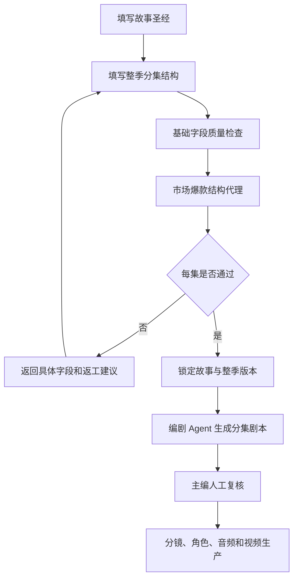

# 市场爆款内容质量门禁模块开发流程

## 1. 模块目标

把“故事字段填写完整”升级为“短剧结构具备可追更基础”的可验证门禁，阻止空泛开场、被动主角、无后果推进和没有结尾悬念的内容进入分镜与视频生产。

这套规则不是爆款预测器，也不能证明播放量、平台推荐或稳定收入。它只把市场上常见的短剧结构要求转成可追踪的内容合同，最终仍需要主编判断、真实观众反馈和平台数据验证。

## 2. 生产流程



## 3. 核心代码边界

### 3.1 规则服务

文件：`server/services/story-market-quality.mjs`

公开函数：

```js
evaluateMarketEpisodeQuality(episode)
evaluateMarketSeasonQuality(season)
```

`evaluateMarketEpisodeQuality()` 输出：

- `score`：单集结构分，满分 100。
- `canPass`：是否达到 80 分且没有硬阻塞。
- `dimensions`：开场钩子、冲突与代价、主角主动性、不可逆变化、信息反转、结尾追更钩子。
- `blockers`：需要返工才能继续的字段。
- `warnings`：不阻断但建议增强的场面或节奏问题。

### 3.2 整季聚合

`evaluateMarketSeasonQuality()` 对每集执行同一套检查，并额外计算：

- 单集结构平均分。
- 反转覆盖率。
- 结尾钩子覆盖率。
- 每集的详细返工字段。

整季只有在所有样本集通过且聚合分达到 80 分时，才允许通过市场结构代理。

### 3.3 故事锁定门禁

文件：`server/services/story-quality.mjs`

整季结构的 `canLock` 同时要求：

1. 基础故事结构没有硬阻塞。
2. 基础结构分达到 90。
3. 市场爆款结构代理 `marketQuality.canPass=true`。

因此“字段齐全但没有钩子”的内容不能锁定给后续生产 Agent。

## 4. 六项单集验收标准

| 维度 | 通过条件 | 典型返工原因 |
| --- | --- | --- |
| 开场钩子 | 第一处事件包含具体异常、目标或立即风险 | “故事开始了”“主角来到现场” |
| 冲突与代价 | 明确阻力、对手、争夺对象或失败代价 | 只有背景介绍，没有谁阻止谁 |
| 主角主动性 | 有可拍摄的选择、拒绝、反击、追查或公开行动 | 主角一直等待信息出现 |
| 不可逆变化 | 每集产生身份、关系、证据、伤害或舆论上的后果 | 这一集结束后局面没有变化 |
| 信息反转 | 有新事实、身份变化或线索方向转移 | 只是重复说明上一集信息 |
| 结尾追更钩子 | 留下新证据、新威胁、秘密、来电或未解决问题 | 以“本集结束”或平淡收束结束 |

至少还要配置一个可以直接转成分镜的视觉场面；只有抽象对白而没有空间、道具或动作记忆点时，系统会阻断。

## 5. 测试策略

测试文件：

- `server/services/story-market-quality.test.mjs`
- `server/services/story-quality.test.mjs`

必须覆盖：

1. 强结构样例通过。
2. 空泛开场、被动主角、缺少反转、缺少结尾钩子被阻断。
3. 整季所有样本集都通过后才允许锁定。
4. 基础故事结构和市场结构任一失败时，整季锁定失败。

## 6. 与视频质量门禁的关系

内容质量门禁发生在视频生产之前；视频市场代理发生在终剪之后。

```text
故事结构门禁
  -> 编剧与分镜
  -> 角色一致性与音频门禁
  -> 竖屏终剪
  -> 48kHz/字幕/对白同步机器门禁
  -> 真人完整播放复核
  -> 平台合规包
  -> 小规模真实发布
  -> 完播、互动、转化和成本数据复盘
```

任何一层通过都不能替代下一层。尤其是：

- 结构分高不等于成片好看。
- 机器质检通过不等于人耳听感通过。
- 人工终审通过不等于平台审核通过。
- 平台发布成功不等于稳定赚钱。

## 7. 当前项目状态

本轮已完成：

- 单集和整季市场结构代理规则。
- 故事结构锁定门禁接入。
- 前端质量工作台展示市场结构分、覆盖数量和维度。
- 强样例、弱样例和整季聚合测试。
- 项目 12 已落库一版原创三集 `draft`：故事圣经和整季结构均为 100 分，市场结构代理通过；未直接锁定，等待主编复核。

仍未完成：

- 项目 12 的故事圣经和三集结构尚未完成主编复核和锁定。
- 真实三集/十集视频生产回归尚未完成。
- 真人完整播放证据、平台合规证据和真实发布数据尚未完成。
- 该门禁不能替代主编对台词自然度、情绪强度和审美完成度的判断。
