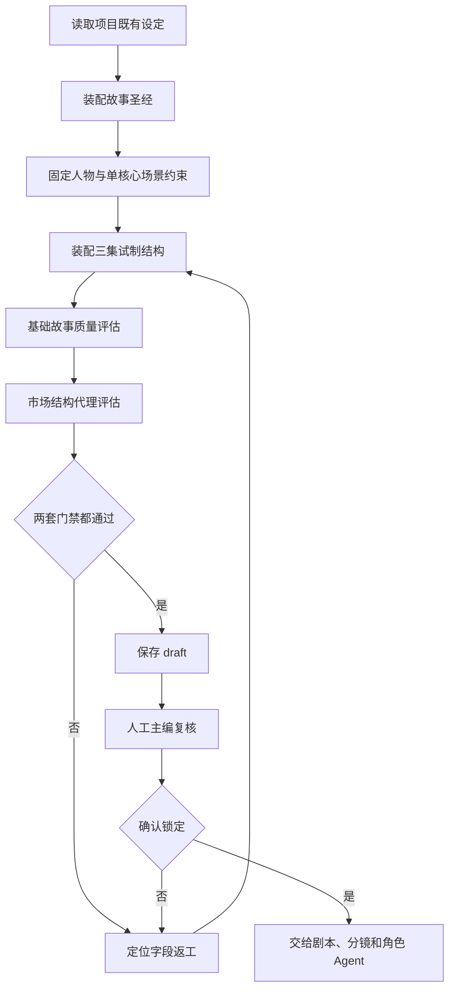

# 原创故事草稿装配与三集试制开发流程

## 1. 模块目标

把项目已有的题材设定整理成一份可以进入分镜生产、但不会绕过人工审稿的原创故事草稿。

本模块解决三个问题：

1. 固定人物姓名、年龄、外貌、服装和角色关系，避免后续 Agent 自由改写人物。
2. 把单集结构写成可评估、可拍摄、可追更的字段，而不是只保存一段长文本。
3. 在真正生成图片、视频和音频前，先用故事圣经门禁和市场结构代理筛掉低质量内容。

本模块不承诺“爆款”、平台推荐或稳定收入。通过内容门禁只代表“具备进入下一阶段试制的结构条件”。

## 2. 生产流程



## 3. 代码边界

### 3.1 故事草稿装配器

文件：`server/services/project-story-draft.mjs`

公开接口：

```js
buildProjectStoryDraft(projectId)
```

当前仅为项目 12 提供经过门禁的原创草稿：

- 故事标题：`零点回声`
- 固定人物：林夏、苏岚、周衡
- 计划集数：3
- 核心场景：废弃地铁站站厅与广播控制台
- 生产约束：不扩展到大规模外景，三集围绕同一夜十二分钟倒计时推进

不支持的项目 ID 会直接抛错，禁止脚本默认为其他项目“编造正典”。

### 3.2 质量评估

文件：`server/services/story-quality.mjs`

故事圣经必须满足：

- 主角和至少一名对立角色资料完整。
- 主线、世界规则、时间线、人物关系和伏笔可追踪。
- 人物视觉描述明确，后续可传递给角色一致性模块。

整季结构必须满足：

- 集数与 episodes 数量一致。
- 每集拥有开场钩子、目标、核心冲突、主动选择、不可逆变化和结尾钩子。
- 每集有反转字段和至少一个可视化场面。
- 整季市场结构代理通过。

### 3.3 市场结构代理

文件：`server/services/story-market-quality.mjs`

当前代理检查：

| 维度 | 目标 |
| --- | --- |
| 开场钩子 | 第一处事件包含异常、目标或立即风险 |
| 冲突与代价 | 观众知道谁阻止谁，以及失败会失去什么 |
| 主角主动性 | 主角做出可拍摄的选择，而不是等待剧情推动 |
| 不可逆变化 | 每集结束后身份、关系、证据或舆论状态发生变化 |
| 信息反转 | 新事实、身份变化或线索方向被明确揭示 |
| 结尾钩子 | 留下新证据、新威胁或必须追更的问题 |
| 可视化场面 | 至少一个可以直接拆成分镜的空间、道具或动作场面 |

代理门槛：

- 单集无硬阻塞且达到 80 分。
- 整季每集通过。
- 整季反转覆盖率和结尾钩子覆盖率为 100%。

## 4. 草稿落库流程

脚本：`scripts/seed-project-story-draft.mjs`

默认只读预览：

```bash
npm run seed:project-story-draft -- --project-id=12
```

真实写入必须显式确认：

```bash
npm run seed:project-story-draft -- \
  --project-id=12 \
  --apply \
  --confirm=SAVE_PROJECT_STORY_DRAFT
```

脚本行为：

1. 读取项目是否存在。
2. 在写库前执行故事圣经和整季结构两套门禁。
3. 默认 `dry-run`，不写数据库。
4. 只有 `--apply` 和精确确认口令同时存在时才写入。
5. 最新版本为 `draft` 时复用并更新该草稿。
6. 最新版本为 `locked` 时新建更高版本的 `draft`，不覆盖历史锁定版本。
7. 使用事务写入故事圣经和整季结构，任一步失败全部回滚。
8. 不启动 Worker、不调用模型、不创建视频导出、不改变角色资产和媒体对象。

## 5. 数据库验收

项目 12 本轮已落库：

| 数据 | 结果 |
| --- | --- |
| `story_bibles.id` | `1` |
| `story_bibles.version_no` | `1` |
| `story_bibles.status` | `locked` |
| `season_structures.id` | `1` |
| `season_structures.version_no` | `1` |
| `season_structures.status` | `locked` |
| 角色数量 | `3` |
| 分集数量 | `3` |
| 故事圣经质量分 | `100` |
| 整季结构质量分 | `100` |
| 市场结构代理分 | `100` |

项目 12 本轮已完成三集内容结构复核，故事圣经和整季结构已锁定。这里的 `locked` 只代表故事正典、人物约束和整季结构可以供后续 Agent 读取，不代表详细剧本台词、配音听感和成片已经完成发布级人工验收。

## 6. 测试策略

测试文件：`server/services/project-story-draft.test.mjs`

已覆盖：

1. 项目 12 的固定人物顺序和故事标题不漂移。
2. 三集结构数量与项目设定一致。
3. 故事圣经质量门禁通过。
4. 市场结构代理通过。
5. 单核心场景约束和可视化场面存在。
6. 不支持的项目 ID 会拒绝执行，不静默生成内容。

验证命令：

```bash
node --test server/services/project-story-draft.test.mjs
npm test
npm run type-check
npm run build
```

## 7. 进入后续生产的条件

内容侧：

- 主编确认三集剧情、台词密度和结尾钩子。
- 锁定故事圣经和整季结构。项目 12 的 `story_bibles.id=1`、`season_structures.id=1` 已完成该步骤。
- 为林夏、苏岚、周衡生成或绑定可复核的角色参考图。
- 分镜 Agent 只能读取 locked 版本，不能自行改名、改年龄或改服装。

成片侧：

- 先做三集试制，不直接批量生产十集。
- 三集每集至少保留一条可审计终剪样本。
- 继续执行角色一致性、字幕、音频、竖屏规格和成本门禁。
- 通过十条终剪回归后，再做真实小规模发布。

## 8. 当前未完成项

以下事项不能由本模块自动宣称完成：

- 人工完整播放：画面、字幕、音质、响度平衡、爆音/失真、对白清晰度和对白同步。
- 十条真实终剪回归。
- 红果、抖音的真实 AI 标识和版权/投稿证据。
- 真实发布后的播放、完播、互动、转化和收入数据。
