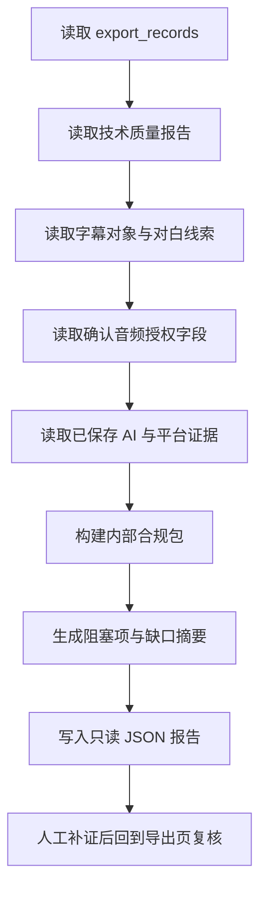

# 发布合规缺口审计开发流程

## 1. 模块目标

在正式投稿前，把当前成片已经具备的技术证据、人工复核证据、AI 生成标识证据和平台字段证据分开列出，避免把机器质检通过误写成“平台可发布”。

本模块是只读审计工具，不负责：

- 自动批准成片
- 自动填写或提交红果、抖音投稿
- 伪造版权、AI 标识或人工听感证据
- 证明平台推荐或稳定收入

## 2. 生产流程



## 3. 代码边界

### 3.1 缺口摘要

文件：`server/services/release-compliance.mjs`

公开接口：

```js
buildReleaseComplianceGapSummary(compliancePackage)
```

返回内容包括：

- 当前 `status` 和 `canPublish`
- 合规证据指纹
- 阻塞项编码
- 缺少平台证据的平台列表
- AI 标识确认状态和展示文案
- 人工复核状态和复核结论
- 已保存的平台证据数量

### 3.2 只读报告脚本

脚本：`scripts/report-release-compliance-gaps.mjs`

命令：

```powershell
npm run audit:release-compliance -- --project-id=12 --export-id=35
```

脚本行为：

1. 只读取指定项目和导出记录。
2. 读取最新 `final_quality_reports`。
3. 读取字幕对象并统计可解析字幕条数。
4. 读取已确认的 BGM/SFX 授权字段。
5. 读取导出配置中已保存的 AI 标识和平台证据。
6. 调用内部合规规则生成缺口摘要。
7. 输出 `.codex-runtime/release-compliance-reports/` JSON。
8. 不写数据库、不创建导出、不启动 Worker、不调用模型、不访问投稿页面。

## 4. 项目 12 验收结果

`export #35` 的真实报告结论：

- 技术规格：已通过 `1080x1920 / 24fps / H.264 + AAC / 48000Hz / MP4` 机器门禁。
- 字幕对象：COS 可读，存在可解析字幕条目。
- 人工终审：浏览器已完成真实完整播放并解锁听感表单，但画面、字幕、音频、人物一致性等人工结论尚未保存，未批准。
- AI 标识：未确认。
- 红果：AI 标识、版权/投稿字段和规则备注缺失。
- 抖音：AI 标识、版权/投稿字段和规则备注缺失。
- 内部状态：`blocked`。

报告只能说明缺口，不能替代真人完整播放、版权材料核验或平台官方审核。

## 5. 测试策略

测试文件：

- `server/services/release-compliance.test.mjs`

新增覆盖：

1. 缺口摘要保留阻塞项编码。
2. 缺失平台证据按平台输出。
3. 摘要保持只读语义，不把 blocked 改成 approved。

验证命令：

```powershell
node --test server/services/release-compliance.test.mjs
npm run audit:release-compliance -- --project-id=12 --export-id=35
```

## 6. 发布前仍需人工完成的步骤

1. 在已解锁的听感表单中保存 `export #35` 的画面、字幕、音频、人物一致性四类结构化人工证据。
2. 按发布当天红果和抖音官方后台字段确认 AI 标识、版权和投稿信息。
3. 保存真实平台投稿截图或后台记录。
4. 继续完成其余 9 条真实终剪回归。

完成上述证据前，系统必须保持 `blocked`，不能生成内部发布候选，也不能宣称能够稳定赚钱。
