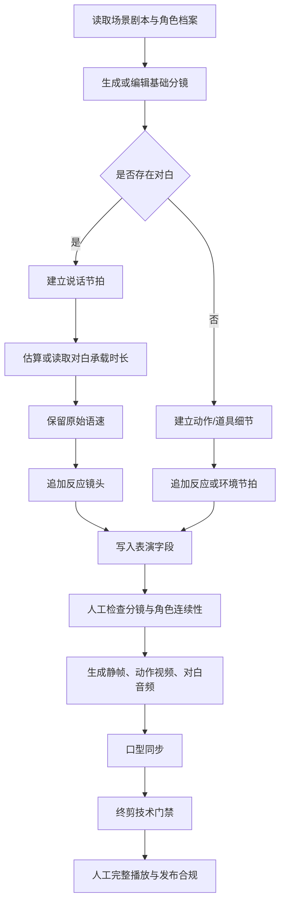

# 表演节拍与对白镜头拆分开发流程

## 功能定位

本模块解决 AI 漫剧中最容易被观众感知的“后期贴音”问题：

- 一个口型镜头不能硬撑完整段对白。
- 对白不能为了塞入短镜头而被 `atempo` 强行加速。
- 说话、听者反应、道具细节和环境镜头需要形成可执行的节拍。
- 角色表演、环境声和对白停顿要在分镜阶段留下生产约束。

本模块不是口型模型，也不是人耳听感审核器。它负责在分镜和终剪之间增加一层“表演结构约束”，降低声音和画面各自生成后再拼接造成的不自然感。

## 目标与非目标

### 目标

1. 长对白默认保留原始语速。
2. 有对白的镜头至少包含一个说话节拍和一个无对白反应节拍。
3. 无对白镜头可拆成道具/动作细节和反应节拍。
4. 让每个节拍拥有镜头目的、表演动作、声音方向和是否承担口型的明确字段。
5. 旧分镜没有新增字段时仍能正常读取，不伪造历史人工审核证据。

### 非目标

- 不自动判断嘴型是否自然。
- 不代替人工完整播放、音质审核和平台合规审核。
- 不自动批量启动视频、TTS 或口型模型。
- 不把规则命中写成“爆款”或“稳定收入”。

## 生产流程



## 数据字段

`storyboards` 表增加或使用以下字段：

| 字段 | 含义 | 生产要求 |
| --- | --- | --- |
| `shot_purpose` | 镜头目的 | `dialogue`、`reaction`、`insert`、`hook` 等 |
| `acting_beat` | 表演节拍 | 写明停顿、视线、吸气、动作结果 |
| `audio_direction` | 声音方向 | 语速、停顿、重音、环境声和静默关系 |
| `speech_duration_policy` | 对白时长策略 | 默认 `preserve`，禁止为塞镜头自动加速 |
| `reaction_shot` | 是否为反应镜头 | 无对白反应镜头必须为 `true` |

旧数据兼容规则：

- `shot_purpose` 缺失时读取为 `story`。
- `speech_duration_policy` 缺失时读取为 `preserve`。
- `acting_beat`、`audio_direction` 缺失时为空，不伪造历史导演记录。
- 只有重新生成或受控拆分后，才会产生新的表演字段。

## 后端实现

核心文件：

- `server/services/storyboard-performance.mjs`
- `server/index.mjs`
- `server/services/ai/prompts/storyboard.mjs`
- `server/services/ai/parsers.mjs`
- `server/services/final-edit-render-policy.mjs`

核心函数：

```js
normalizeStoryboardPerformance(input)
buildPerformanceSubShots({ shot, dialogueDurationSeconds })
ensurePerformanceBeatCoverage(shots, baseShot)
resolveSpeechRenderPolicy({ trackKey, sourceDurationSeconds, availableDurationSeconds })
```

### 1. 规划对白节拍

`buildPerformanceSubShots()` 对有对白镜头返回：

1. `shotPurpose=dialogue` 的说话镜头。
2. `shotPurpose=reaction` 的无对白反应镜头。

说话镜头会保存：

- 原始 `dialogueText`。
- `speechDurationPolicy=preserve`。
- 说话前吸气、关键词重读和句尾停顿。
- 其他角色只能作为倾听或反应人物，不默认张嘴。

反应镜头会保存：

- 空的 `dialogueText`。
- `reactionShot=true`。
- 对白结束后的眼神、身体或现场反应。
- 环境声继续、对白结束后留出半拍静默。

### 2. 规划无对白节拍

无对白镜头返回：

1. `shotPurpose=insert` 的动作或道具细节。
2. `shotPurpose=reaction` 的人物或环境反应。

该路径不会凭空生成台词，也不会把环境镜头误标为口型镜头。

### 3. 模型结果兜底

模型可能只返回说话镜头，因此 `ensurePerformanceBeatCoverage()` 会检查：

- 是否有对白节拍。
- 是否已有反应或插入节拍。

如果有对白但没有反应节拍，后端追加一个无对白反应节拍。这样提示词失效时，生产结构仍不会退化成单镜头长对白。

### 4. 终剪时长门禁

`resolveSpeechRenderPolicy()` 对 `dialogue` 和 `narration` 执行硬门禁：

- 对白超出镜头承载时长：阻断。
- 不自动调用 `atempo` 加速对白。
- 音乐和音效仍可在必要时压缩。
- 阻断提示要求延长镜头或拆分反应镜头。

这条门禁解决“声音很着急”的时间轴问题，但不等于嘴型自然。嘴型自然度仍需真实视频播放确认。

## 前端使用流程

页面：

- `src/views/StoryboardEditor.vue`

操作顺序：

1. 先确认当前对白、角色和视觉提示词。
2. 保存当前分镜。
3. 点击“AI 拆分表演节拍”。
4. 先查看只读“表演节拍预览”：
   - 原始时长、规划总时长和增加时长。
   - 说话节拍、反应节拍和每条节拍的表演说明。
   - 对白是否保留原始语速。
   - 已有图片、视频、音频造成的阻塞原因。
5. 只有 `applyAllowed=true` 时，点击“确认执行拆分”。
6. 检查执行后生成的说话镜头和反应镜头。
7. 检查每条镜头的 `镜头目的`、`表演节拍` 和 `声音方向`。
8. 确认角色外貌、服装、体型和空间关系没有被拆分破坏。
9. 再生成静帧、动作视频、对白音频和口型候选。

### 只读预览接口

```text
GET /api/storyboards/:storyboardId/performance-plan
```

接口使用当前登录用户的分镜归属校验，返回计划、时长变化、素材计数、`applyAllowed` 和 `applyBlockers`。

该接口只读，不调用模型、不写数据库、不创建任务、不启动 Worker。页面确认后才调用已有的：

```text
POST /api/storyboards/:storyboardId/split
```

执行接口仍然复用已有素材阻塞规则：

- 已有视频或音频：返回 `409`，不允许拆分。
- 只有“承接上一镜头”的起始帧：允许继续拆分。
- 普通已生成图片：返回 `409`。
- 预览与执行之间不自动删除、不覆盖历史素材。

已有素材保护：

- 分镜已经存在图片、视频或音频时，拆分接口返回 `409`。
- 不直接覆盖已经生成的素材，避免旧音频、旧视频和新分镜错绑。
- 只有未生成素材的分镜，或仅有允许继承的起始帧时，才允许拆分。

## 测试流程

先写失败测试，再实现：

```powershell
node --test server/services/storyboard-performance.test.mjs
```

当前覆盖：

- 表演字段归一化。
- 无对白镜头识别为反应镜头。
- 长对白生成说话节拍和反应节拍。
- 无对白镜头不凭空生成台词。
- 模型只返回对白节拍时自动补反应节拍。

全量验证：

```powershell
npm test
npm run type-check
npm run build-only
node --check server/index.mjs
node --check server/services/storyboard-performance.mjs
git diff --check
```

## 真实验证记录

2026-09-21：

- 隔离 API 实例在 `3002` 启动，完成 `storyboards` 五个字段的真实数据库迁移。
- 项目 12 分镜列表接口返回新字段，旧记录按兼容默认值读取。
- 对真实 `storyboard #267` 做只读表演规划：
  - 原镜头：3 秒，有对白。
  - 规划结果：3 秒说话节拍 + 2 秒反应节拍。
  - `speechDurationPolicy=preserve`。
  - 未写入数据库，未启动 Worker，未调用模型。
- 新增只读接口 `GET /api/storyboards/267/performance-plan`，真实返回：
  - `hasDialogue=true`。
  - `speechTimingPreserved=true`。
  - `subShots=dialogue,reaction`。
  - `totalDurationSeconds=5`。
  - 当前素材计数为图片 `0`、视频 `0`、音频 `0`，`applyAllowed=true`。
- 编辑页已经改成“预览 -> 明确确认 -> 单条拆分”。
- 小泽确认后已真实执行 `POST /api/storyboards/267/split`：
  - 当前分镜 `01` 保留为说话节拍。
  - 新增子分镜 `01-2` 作为无对白反应节拍。
  - 页面提示“已拆成 2 个短子分镜，后续生成视频会更稳定、更省钱”。
  - 本次只写入分镜结构，没有生成静帧、TTS、动作视频或口型视频。
- 定向测试 `19/19` 通过。
- 全量 `npm test` `457/457` 通过。
- `npm run type-check`、`npm run build-only`、`node --check server/index.mjs` 和 `git diff --check` 通过。

## 人工门禁与剩余风险

该模块完成后，小泽仍需要亲自确认：

- 真实成片完整播放后的嘴型自然度。
- 对白清晰度、响度平衡、爆音、失真和对白同步。
- 字幕文字、时间轴和平台安全区。
- 人物外貌、服装、体型和动作连续性。
- AI 标识、版权和红果/抖音投稿证据。

只有完成这些人工证据，并完成至少 10 条真实终剪回归、三集试制和平台数据复盘，才能判断是否接近稳定生产。当前不能据此宣称可以发布或稳定赚钱。

## 上台讲解话术

```text
我们没有把对白直接贴到一条视频上，而是在分镜阶段增加了表演节拍。
每个长对白至少拆成一个说话镜头和一个反应镜头，终剪阶段也禁止为了塞进短镜头而加速对白。
这样先解决节奏和声音时钟，再进入口型同步和人工完整播放，避免把技术通过误认为内容质量通过。
```
