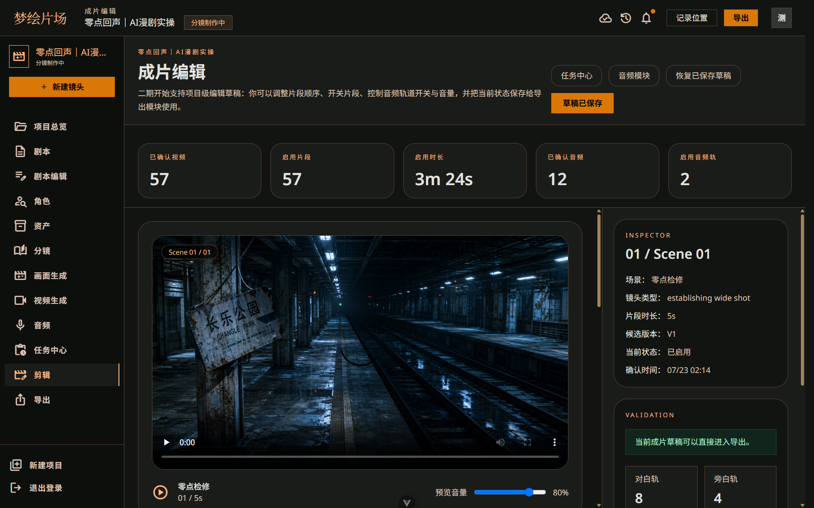
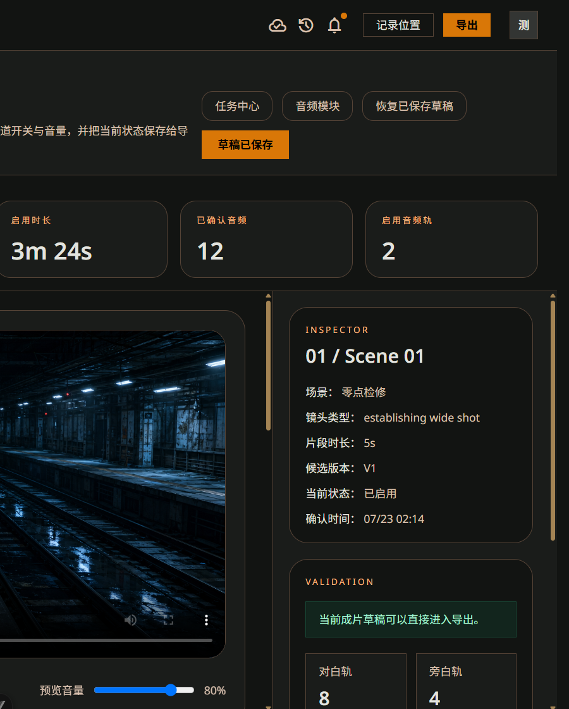
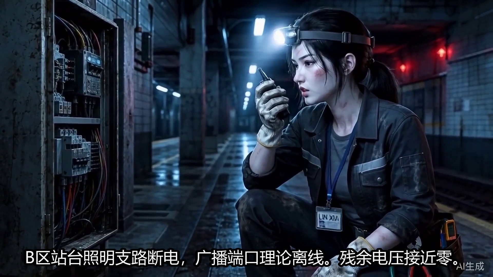

# 混合 MVP 成片导出记录

## 当前实现

- 导出采用后台任务状态：`queued -> running -> completed/failed`。
- 服务重启时会自动恢复 `queued` 和 `running` 的导出任务。
- 每个镜头先下载到 `.codex-runtime/exports/<exportId>/sources`，避免依赖供应商临时链接。
- 当前全项目导出按场景限制真实视频数量；项目 12 使用 `hybridVideoPerScene=4`，避免长项目把所有镜头都交给视频模型。
- 其余有确认静帧的镜头转为动态静帧：统一画布、轻微推近、24fps。
- FFmpeg 统一合并镜头、对白音频、背景音乐底轨和烧录字幕，输出 H.264/AAC MP4。
- 导出文件通过 `/generated/export/<exportId>` 提供，支持 Range 播放和下载。

## 项目 12 早期短片演示

- 导出记录：`#10`
- 文件：`.codex-runtime/exports/export-10.mp4`
- 时长：45 秒
- 分辨率：1920 x 1080
- 真实视频：5 条
- 动态静帧：4 条
- 音频：2 条已确认对白 + 自动生成低音量音乐底轨
- 字幕：`.codex-runtime/exports/10/subtitles.srt`，同时烧录进视频

服务运行时可访问：

`http://127.0.0.1:3001/generated/export/10`

## 首次全项目导出（项目 12）

- Export record: `#11`
- Local file: `.codex-runtime/exports/export-11.mp4`
- Playback URL: `http://127.0.0.1:3001/generated/export/11`
- Duration: `204s` (3m24s)
- Output: `H.264/AAC`, `1920x1080`, `24fps`
- Confirmed storyboards: `57/57`
- Real video clips used: `24` (maximum `4` per scene)
- Dynamic static-frame clips: `33`
- Audio: confirmed dialogue plus full-project TTS narration and generated music bed
- Subtitles: burned into the video; source file at `.codex-runtime/exports/11/subtitles.srt`

导出执行器会先把每个远程视频和图片下载到 `.codex-runtime/exports/11/sources`，再交给 FFmpeg 合成。生成文件支持 HTTP Range，可在前端续播和下载。

## 音频时间线修复

- 根因：对白资产原先从时间线零点开始混音，而且只有场景 5-6 存在对白资产。
- 修复：音轨按 `sceneId` 计算场景起始偏移，`amix` 时保留对白和旁白增益。
- 场景 1-4 已补充角色音色对白；当 Cherry 返回 502 时使用已验证的女性备用音色。
- 修复后导出：`#13`，204 秒，H.264/AAC，1920×1080，24fps。

## 历史全项目导出（#14）

- TTS 请求使用 UTF-8，中文文本、标题和字幕端到端保持正确。
- 文件：`.codex-runtime/exports/export-14.mp4`
- 播放地址：`http://127.0.0.1:3001/generated/export/14`
- 时长：204 秒；文件大小：50,879,919 字节。
- 编码：H.264/AAC，1920×1080，24fps。
- 57/57 个镜头进入成片，其中真实视频 24 条、动态静帧 33 条，每场最多 4 条真实视频。
- 项目存在 12 条已确认音频资产，成片草稿启用 2 类音轨。
- 字幕文件：`.codex-runtime/exports/14/subtitles.srt`，并已烧录进视频。
- 创建时间 08:48:51，完成时间 08:51:37，实际导出约 2 分 46 秒。

## 当前发布候选（#24）

- 项目：`12 / 零点回声｜AI漫剧实操`
- 文件：`.codex-runtime/exports/export-24.mp4`
- 播放地址：`http://127.0.0.1:3001/generated/export/24`
- 时长：`54.36s`；编码：H.264/AAC；分辨率：1920×1080；帧率：25fps。
- 镜头：12 条，按 `168 → 171 → 173 → 180 → 182 → 193 → 197 → 199 → 201 → 158 → 213 → 215` 排列。
- 媒体：11 条真实视频，1 条动态静帧；其中 6 条正面对白使用 VideoReTalk 口型同步。
- 音频：9 条分镜级中文对白；旧场景级音频和 3 条禁用镜头音频均被严格导出规则跳过。
- 字幕：只显示实际台词，已移除角色名、表演提示和“无对白”占位；无问号或替换字符。
- 开头 `0-5.10s` 为纯静默，不再混入旧对白或测试音。
- 浏览器已从 `0s` 原速播放至 `54.36s`，最终状态 `ended=true`，无解码错误。
- 全片抽帧：`.codex-runtime/qa/export-24-contact.png`。

编辑器侧已确认草稿具备导出条件：

导出文件中的实际画面和烧录字幕：

## 质量结论

- 工程闭环已通过：素材本地化、57 镜头拼接、场景音频偏移、字幕烧录、MP4 播放和 Range 下载均可用。
- 204 秒全项目用于压力验证，不建议直接作为单集规格；面向观众时建议收敛到 40-60 秒、8-12 镜头、4-6 条关键视频。
- `completed` 只代表导出成功。角色漂移、肢体变形、动作回弹、供应商 AI 标识、对白情绪和节奏仍需人工全片复核。
- 真实视频优先用于动作、情绪爆点和关键转场；对白、空镜和信息镜头使用动态静帧，通常能得到更稳定的单位成本质量。

完整发布标准见 [AI 漫剧混合成片落地与质量验收指南](AI漫剧混合成片落地与质量验收指南.md)。

## 已知问题

- 导出页已恢复并可直接播放最新成片；项目 12 当前显示记录 `#24`。
- 供应商视频 URL 可能过期，当前导出前会先下载到本地；正式部署需要对象存储。
- 当前真实视频样本可见供应商 AI 标识，公开发布前要按平台规则和商业使用条款确认。

## 后续扩展

1. 在导出页进一步显示真实视频、动态静帧、有效音轨和导出耗时。
2. 在成片编辑器中增加关键视频镜头数量和静帧运动模式配置。
3. 接入对象存储，将 `.codex-runtime/exports` 替换为持久化存储。
4. 为音乐和音效增加真实生成资产后，沿用现有音轨混合接口。
5. 将本次黑帧、静音、画幅、字幕安全区和禁用音频检查固化为自动质检。
