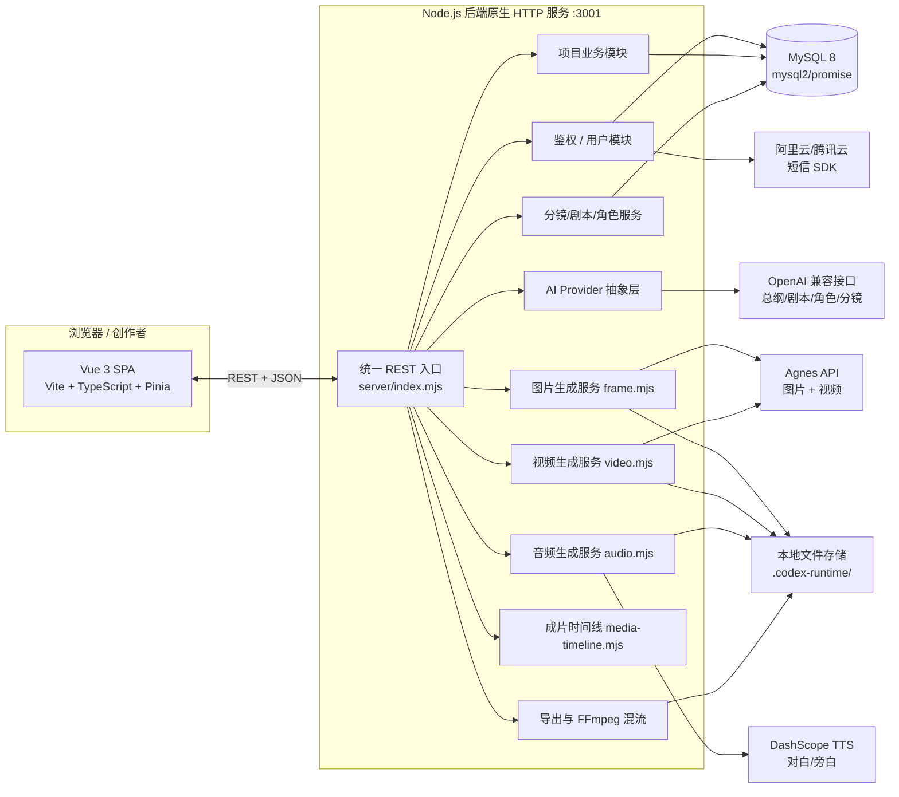
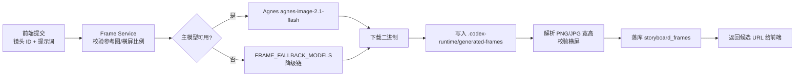
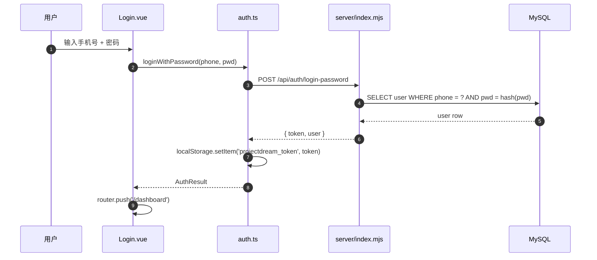
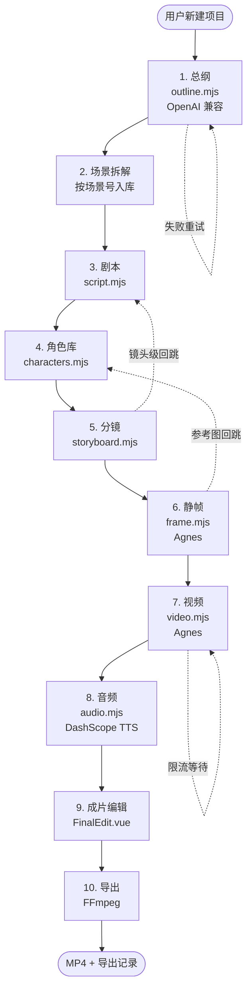
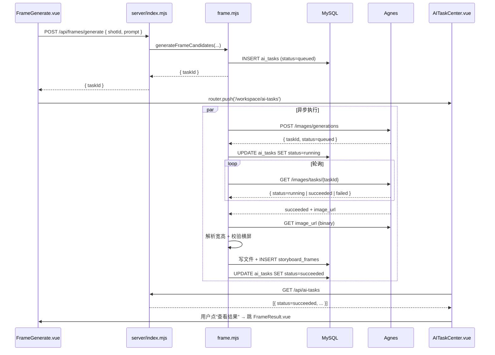
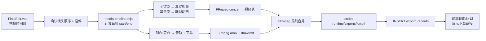
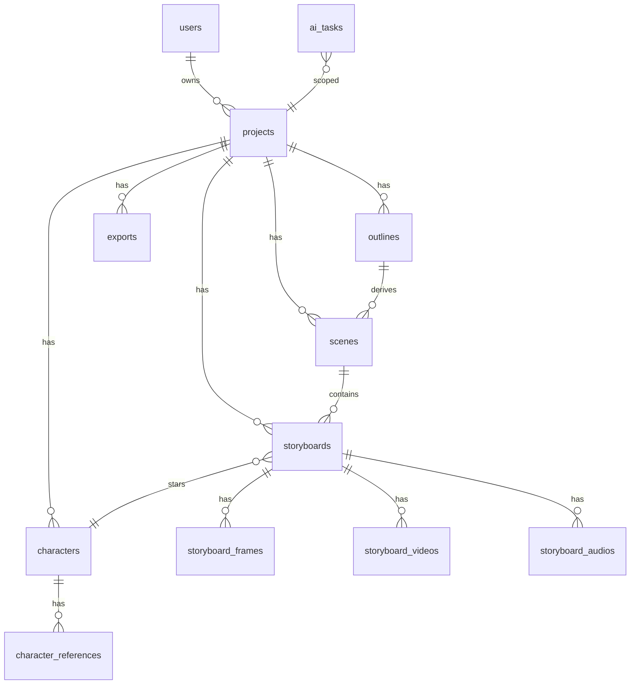

# 帧心帧意（ProjectDream）源码技术讲解

> 面向技术演示的版本：尽量少用术语黑话，重点是把"代码在做什么"和"为什么这么做"讲清楚。
> 阅读对象：技术评审、合作方、需要快速建立全局认知的同事。
> 代码基线：`D:\projectdream\dreamweaver-studio\projectdream`（package.json v0.0.0）。

---

## 0. 一句话定位

**帧心帧意** 是一个"剧本 → 角色 → 分镜 → 静帧 → 视频 → 音频 → 成片"的 AI 漫剧生产工作台。

它不是单纯的生成工具，而是一个**项目级**的协作工作台：每个用户可以建多个项目，每个项目贯穿"总纲—场景—剧本—角色—分镜—静帧—视频—音频—成片—导出"十个生产阶段，并且每个阶段都允许人工介入和版本回跳。

---

## 1. 项目整体架构

### 1.1 顶层架构图



**通俗解读**：

- 前端就是一个"页面集合 + API 客户端"，不直连任何 AI 服务。
- 后端是"一个文件 + 一堆服务"：`server/index.mjs` 是请求入口，里面注册了几十个 `/api/...` 路由，每个路由会调用 `server/services/...` 下的服务模块去办事。
- 数据库（MySQL）存项目数据；本地文件夹 `.codex-runtime/` 存生成出来的图片/视频/音频/导出文件。
- 三个外部 AI 都通过**抽象 Provider 层**接入，方便切换供应商和降级。

### 1.2 目录骨架

| 目录 | 角色 | 关键文件 |
|---|---|---|
| `src/views/` | 前端 20+ 个页面（按工作台命名空间组织） | `Dashboard.vue`、`StoryboardEditor.vue`、`FrameGenerate.vue`、`VideoGenerate.vue`、`AudioStudio.vue`、`FinalEdit.vue`、`Export.vue`、`AITaskCenter.vue` |
| `src/components/` | 通用壳层组件 | `TopNav.vue`、`SideNav.vue`、`WorkspaceLayout.vue`、`BrandPanel.vue`、`Inspector.vue` |
| `src/api/` | 前后端通信的 TypeScript 客户端 | `auth.ts`（登录态 + 重试）、`project.ts`（项目/总纲/场景/分镜 DTO） |
| `src/router/index.ts` | 全部前端路由 + 鉴权守卫 | 23 条路由，区分 `guestOnly` 与 `requiresAuth` |
| `src/stores/` | Pinia 状态（仅 `counter.ts` 一个示例） | — |
| `server/index.mjs` | 全部后端入口（8000+ 行单体服务） | 路由注册 + 业务函数 + SQL 都在这里 |
| `server/services/ai/` | 文本生成抽象层 | `provider.mjs`、`config.mjs`、`outline.mjs`、`script.mjs`、`storyboard.mjs`、`characters.mjs`、`frame-prompt.mjs`、`parsers.mjs` |
| `server/services/ai/prompts/` | 各场景的 prompt 模板 | `outline.mjs`、`script.mjs`、`storyboard.mjs`、`characters.mjs` |
| `server/services/frame.mjs` | 图片生成（Agnes） | 限流、降级、PNG/JPG 解析、横屏比例校验 |
| `server/services/video.mjs` | 视频生成（Agnes / 智谱） | 限流、并发闸、任务状态恢复 |
| `server/services/audio.mjs` | 音频生成（DashScope TTS） | 音色快照、试听、参数校验 |
| `server/services/lip-sync.mjs` | 口型合成（DashScope / 私域 Avatar） | 视频对白口型 |
| `server/services/character-rename.mjs` | 角色改名事务同步 | 跨表 `replace_text`，避免遗漏 |
| `server/services/media-timeline.mjs` | 成片时间线算法 | 镜头对齐、字幕烧录偏移、atempo |
| `server/services/export-validation.mjs` | 导出完整性校验 | 媒体完整度、禁用镜头过滤 |
| `server/services/voice-profiles.mjs` | 音色画像与推荐 | 性别/年龄 → 推荐音库 |
| `scripts/` | 离线脚本 | `migrate-temporary-videos.mjs`、`queue-expired-video-recovery.mjs` |

### 1.3 技术栈一览

```mermaid
flowchart TB
    subgraph FE[前端]
        A1[Vue 3.5<br/>组合式 API + script setup]
        A2[TypeScript 5.9]
        A3[Vite 6]
        A4[Vue Router 4]
        A5[Pinia 3]
        A6[Tailwind CSS 3.4]
    end

    subgraph BE[后端]
        B1[Node.js 22+ 原生 HTTP]
        B2[mysql2/promise]
        B3[node:fs/promises + child_process]
        B4[tencentcloud-sdk-nodejs<br/>@alicloud/* 短信]
    end

    subgraph AI[AI 供应商]
        C1[OpenAI 兼容接口<br/>总纲/剧本/角色/分镜]
        C2[Agnes<br/>图片 + 视频]
        C3[DashScope TTS<br/>对白/旁白]
    end

    subgraph STORE[存储]
        D1[(MySQL 8)]
        D2[本地 .codex-runtime<br/>frames / videos / audio / exports]
    end
```

**为什么这么选**（简短）：

- 前端选 Vue 3 + Vite：单页面 20+ 模块，构建快、热更顺。
- 后端选 Node 原生 HTTP + 模块化：避免 Express 这种"框架税"，所有业务代码以"按路由分函数"组织在一个文件里，方便演示和调试。
- 数据库选 MySQL：项目数据高度关系化（项目-总纲-场景-剧本-角色-分镜-帧-视频-音频 是一条主链）。
- 媒体文件留本地：最小可用阶段不必上对象存储；规划上云见 §8 优化方向。

---

## 2. 前端拆解

### 2.1 路由结构（src/router/index.ts）

整个应用有 23 条路由，按"工作台命名空间"组织：

```
/login, /register, /forgot-password, /reset-password        → 鉴权（guestOnly）
/dashboard, /new                                            → 总览与新建项目
/settings/ai                                                → 模型设置（全局）
/workspace/script/ai                                        → AI 剧本
/workspace/scenes                                           → 场景拆解
/workspace/script                                           → 剧本编辑
/workspace/character, /workspace/character/detail           → 角色库/角色详情
/workspace/assets                                           → 资产库
/workspace/storyboard, /workspace/storyboard/editor         → 分镜看板/分镜编辑
/workspace/frame, /workspace/frame/result                   → 画面生成/镜头结果
/workspace/video                                            → 视频生成
/workspace/audio                                            → 音频工作台
/workspace/ai-tasks                                         → 任务中心
/workspace/edit                                             → 成片编辑
/workspace/export                                           → 导出交付
```

**鉴权守卫**（router/index.ts:171-191）核心逻辑：

```ts
router.beforeEach((to, from) => {
  const authenticated = hasAuthSession()
  if (to.meta.requiresAuth && !authenticated) {
    return { path: '/', query: { redirect: to.fullPath } }
  }
  if (to.meta.guestOnly && authenticated) {
    return '/dashboard'
  }
  return true
})
```

**通俗解读**：
- `hasAuthSession()` 只看 localStorage 里的 token 是否存在（[auth.ts:155-157](file:///d:/projectdream/dreamweaver-studio/projectdream/src/api/auth.ts#L155-L157)）。"前端的鉴权"实际是"判断你有没有带 token"，真正的鉴权在后端校验 token。
- 已登录访问 `/login` 会被踢回 `/dashboard`，未登录访问 `/workspace/*` 会被踢回 `/` 并保留 `redirect=` 参数。
- 路由切换还会向目标路由的 `meta` 注入 `fromName`，让 [App.vue:44-50](file:///d:/projectdream/dreamweaver-studio/projectdream/src/App.vue#L44-L50) 决定"从登录页进工作台"还是"从工作台退到登录页"的过渡方向。

### 2.2 工作台壳层（WorkspaceLayout + TopNav + SideNav）

所有 `/workspace/*` 页面共享一个壳：

- **TopNav.vue**：项目下拉切换、AI 任务中心入口、模型设置、用户菜单。
- **SideNav.vue**：十一个生产模块的入口，用图标+文字两层呈现；当前路由高亮。
- **WorkspaceLayout.vue**：提供左右两栏容器和路由出口 `<RouterView />`；右侧是"Inspector"详情面板，依赖 Vue 的 `<KeepAlive>` 防止分镜编辑器里的相机参数被重建时丢失。

壳层的存在让"功能页面"本身可以非常薄：每个视图只关心自己的业务字段和 API 调用。

### 2.3 API 客户端（src/api/）

两个核心文件：

- **auth.ts**：负责登录态、token、用户信息、重试。
- **project.ts**：定义项目相关的 DTO（Data Transfer Object）和请求方法。

亮点在 `fetchWithConnectRetry`（[auth.ts:39-53](file:///d:/projectdream/dreamweaver-studio/projectdream/src/api/auth.ts#L39-L53)）：

```ts
const API_CONNECT_RETRY_DELAYS_MS = [300, 800, 1500, 2500, 4000]

async function fetchWithConnectRetry(url, init) {
  for (let attempt = 0; attempt <= API_CONNECT_RETRY_DELAYS_MS.length; attempt += 1) {
    try {
      return await fetch(url, init)
    } catch (error) {
      if (!(error instanceof TypeError)) throw error
      const delayMs = API_CONNECT_RETRY_DELAYS_MS[attempt]
      if (delayMs == null) break
      await sleep(delayMs)
    }
  }
  throw new TypeError('fetch failed')
}
```

**通俗解读**：
- `TypeError` 几乎都是"网络连不上"。这种情况下做指数退避重试 5 次（总等待约 9 秒），比让用户面对"Network Error"好得多。
- 非 TypeError（例如 4xx/5xx）直接抛，不重试——服务器已经明确告诉你失败了。
- 这种"前端重试"是为了应对**冷启动**场景：本地开发同时启动前端和后端时，第一秒请求很容易撞上后端还没起来的窗口。

### 2.4 前端的状态管理

项目里 `src/stores/counter.ts` 只是一个 Pinia 模板。**真实状态** 主要靠两种机制：

1. **路由 + DTO 拉取**：每个视图打开时调用对应的 `fetch...` 接口拿最新数据。
2. **localStorage 登录态**：跨页面持久。

这种"无全局 store"的设计是**有意为之**的——每个工作台页面都是"独立的工作流"，并不需要跨页面共享大量状态。一旦项目变得复杂（比如多人协作、实时推送），会推荐升级到"按页面建 store + WebSocket 推送"。

### 2.5 关键视图的功能定位

| 视图 | 输入 | 输出 | 关键交互 |
|---|---|---|---|
| `Dashboard.vue` | 用户 ID | 项目列表、进度、最新成片 | 入口卡片 |
| `NewProject.vue` | 项目名/题材/风格/比例 | 写入 `projects` 表 | 引导用户跑通最小可用链路 |
| `AIScript.vue` | 项目基础信息 + 提示词 | 场景列表/单场剧本 | 调 OpenAI 兼容接口生成 |
| `Scenes.vue` | 总纲 | 单场详情 | 与分镜/剧本互通 |
| `ScriptEditor.vue` | 场景 + 总纲 | 完整剧本 | 关联角色 |
| `CharacterLibrary.vue` / `CharacterDetail.vue` | 项目 | 角色档案、参考图 | 角色 ID 绑定一致性 |
| `StoryboardList.vue` / `StoryboardEditor.vue` | 场景 | 镜头列表 + 编辑器 | 起始帧/结束帧、AI 提示词优化 |
| `FrameGenerate.vue` / `FrameResult.vue` | 镜头提示词 | 静帧候选 | 提交异步任务 → 跳任务中心 |
| `VideoGenerate.vue` | 已确认的静帧 | 视频候选 | 限流 2 次/分钟 |
| `AudioStudio.vue` | 分镜 | 对白/旁白 | 试听、绑定分镜 |
| `FinalEdit.vue` | 所有分镜 + 媒体 | 成片草稿 | 拖拽、字幕、镜头启停 |
| `Export.vue` | 成片草稿 | MP4 + 导出记录 | FFmpeg 混流 |
| `AITaskCenter.vue` | — | 所有异步任务汇总 | 排队/执行/成功/失败 |

---

## 3. 后端拆解

### 3.1 HTTP 入口：单体大文件 server/index.mjs

后端**没有**用 Express/Koa，是 Node 原生 `http.createServer`。所有路由都注册在同一个文件里：

```js
const PORT = Number(process.env.PORT || 3001)
const server = createServer(async (req, res) => {
  // 1. 解析 method + url
  // 2. 分发到对应的 async handler
  // 3. handler 内做参数校验、业务编排、SQL、调用 AI Provider
  // 4. 统一返回 { code, message, data }
})
```

**为什么这么做**：

- 演示友好：所有路由都能在一个文件里 `Ctrl+F` 找到。
- 依赖少：免去框架升级带来的破坏性变更风险。
- 缺点是文件会非常长（已 8000+ 行），未来需要按"路由族"拆出独立文件。

### 3.2 鉴权与用户

登录支持两种方式（[auth.ts:82-128](file:///d:/projectdream/dreamweaver-studio/projectdream/src/api/auth.ts#L82-L128)）：

- 手机号 + 短信验证码（默认走阿里云 / 腾讯云 SMS SDK）
- 手机号 + 密码（注册或重置后可用）

后端签发 token 时把"用户 ID + 过期时间"写进一个简单的字符串里，前端存到 `localStorage`，每次请求带 `Authorization: Bearer ...`。后端用中间件统一校验 token、解析 userId。

默认演示账号（README 中声明）：`13912345678` / `123456`。

### 3.3 AI Provider 抽象层（server/services/ai/）

这是项目里**最值得讲的设计**。所有文本生成都走 `generateStructuredJson`（[provider.mjs:67-110](file:///d:/projectdream/dreamweaver-studio/projectdream/server/services/ai/provider.mjs#L67-L110)）：

```js
export async function generateStructuredJson(params) {
  const config = getAiConfig()
  if (isMockProvider(config)) {
    throw new AiProviderError('当前 AI_PROVIDER=mock，不执行真实模型调用')
  }
  // 1. 校验 baseUrl / apiKey / model
  // 2. 构造 OpenAI 兼容 payload
  const response = await fetch(url, {
    method: 'POST',
    headers: { Authorization: `Bearer ${config.apiKey}` },
    body: JSON.stringify(payload),
    signal: AbortSignal.timeout(config.timeoutMs),
  })
  // 3. 解析 + 兜底 + 抛 AiProviderError
}
```

**几个细节**：

1. **JSON 解析容错**（[provider.mjs:23-41](file:///d:/projectdream/dreamweaver-studio/projectdream/server/services/ai/provider.mjs#L23-L41)）：AI 经常在 JSON 外包一层 ` ```json ... ``` ` 或者夹杂解释文字。`extractJsonText` 会自动剥掉 code fence、找到第一个 `{`/`[` 和最后一个 `}`/`]` 之间的内容。
2. **超时控制**：用 `AbortSignal.timeout(config.timeoutMs)` 而不是手动 setTimeout，浏览器/Node 都支持。
3. **Mock 模式**：`AI_PROVIDER=mock` 时不调真模型，方便离线演示和跑测试。

**Prompt 模板**（`server/services/ai/prompts/*.mjs`）按业务拆分：

- `outline.mjs`：根据"题材 + 故事方向"生成总纲 + 三幕结构 + 场景列表。
- `script.mjs`：把单场扩写成对白剧本，并按角色分配。
- `storyboard.mjs`：根据剧本生成镜头列表（含景别、运镜、动作、对白）。
- `characters.mjs`：从剧本/总纲抽取角色档案（含年龄、性别、气质、外貌）。

这些 prompt 模板**和业务代码解耦**——以后想换模型只改 `provider.mjs`，想调教输出只改 prompt 文件。

### 3.4 图片生成（server/services/frame.mjs）

负责把"镜头提示词 + 角色参考图"喂给 Agnes（默认 `agnes-image-2.1-flash`），拿到 PNG/JPG 二进制后写入本地：



**亮点**：

- **横屏比例校验**（[frame.mjs:71-120](file:///d:/projectdream/dreamweaver-studio/projectdream/server/services/frame.mjs#L71-L120)）：手写解析 PNG 和 JPEG 的 SOF 段拿宽高，避免引入 `sharp` 之类的重型库——演示项目保持最小依赖。
- **占位图拦截**（[frame.mjs:6-7](file:///d:/projectdream/dreamweaver-studio/projectdream/server/services/frame.mjs#L6-L7)）：用一个固定的 SHA256 黑名单，过滤供应商偶尔返回的"占位错误图"，避免污染候选。
- **模型降级链**：通过 `FRAME_FALLBACK_MODELS=modelA,modelB,modelC` 环境变量配置；主模型失败时按顺序降级。
- **持久化后台任务**：提交后立即返回 `taskId`，由任务中心轮询，进度/成功/失败都进 `ai_tasks` 表。

### 3.5 视频生成（server/services/video.mjs）

把已确认的静帧转成 5~10 秒视频片段。

**核心难点**：供应商（Agnes）限流"每 60 秒 2 个任务"。

代码里用了一个**串行闸 + 滑动窗口**（[video.mjs:25-29](file:///d:/projectdream/dreamweaver-studio/projectdream/server/services/video.mjs#L25-L29)）：

```js
let videoCreationGate = Promise.resolve()
let videoCreationTimestamps = []
```

每发起一次创建，先 `await videoCreationGate` 排队，然后检查 `videoCreationTimestamps` 在过去 60 秒内是否已超过 `maxRequests` 次。如果到了上限就等最早一次完成后再放行。

**任务状态恢复**：供应商返回 taskId 后，service 会定时 poll 任务状态；如果用户中途刷新或服务重启，**taskId 会落库**，恢复时能继续 poll，不会重复创建任务。

### 3.6 音频生成（server/services/audio.mjs + audio-dialogue.mjs + audio-title.mjs）

**对白**和**旁白**用 DashScope TTS（`qwen3-tts-flash` / `qwen3-tts-instruct-flash`）。

关键设计：

- **角色音色画像**（`voice-profiles.mjs`）：根据角色性别、年龄、气质，在系统音色库中推荐若干候选，用户可锁定主音色。
- **参数快照**：每次生成的 `voice / speed / pitch` 都会记到 DB，下次再生成可以直接复用，不会因为系统音色升级而漂移。
- **分镜级绑定**：对白不是"项目级"而是"分镜级"——一段对白绑定到具体某个镜头，允许该镜头内做 ±0.3s 起始微调，避免开头叠音。
- **未锁定对白拦截**：导出时如果某个角色没锁定主音色，会先提示用户去锁定，避免同一段对白用随机音色渲染导致不一致。

### 3.7 角色一致性（frame-character-consistency.mjs + character-rename.mjs）

**问题域**：AI 漫剧最大的痛点是"同一个角色在不同镜头里长得不一样"。

代码里的应对：

1. **角色 ID 绑定**：每个分镜在生成前必须指定 characterId；提交帧生成时把角色档案和参考图一起带上。
2. **生成前角色校验**：如果提示词里写"白发男生"但场景里只有"红发女生"，会先报错而不是让 AI 自由发挥。
3. **多人参考图**：支持把多个角色的参考图打包上传给供应商，做场景图时一起注入。
4. **改名事务同步**（`character-rename.mjs`）：在角色库里改角色名时，会同步剧本/分镜/对白里所有引用，避免"新名字出现但老名字还残留"。
5. **生成快照**：每个角色保留最近 N 张生成图，可以一键"以这张为新定妆"。

### 3.8 成片时间线与混合成片（media-timeline.mjs + export-validation.mjs + index.mjs 中的 export 路由）

这是"导出"前的核心步骤。

**核心算法**（[media-timeline.mjs](file:///d:/projectdream/dreamweaver-studio/projectdream/server/services/media-timeline.mjs)）：

1. 把所有分镜按 `shotNo` 排序，构造一个线性时间线 `t = 0`。
2. 每个分镜的 `start = 上一镜结束 + 微调偏移`。
3. **混合成片策略**：

   - 关键镜头（用户标记"必须视频"）→ 用真实视频。
   - 其余镜头 → 用静帧做 Ken Burns（推拉摇移）动画，转成可拼接的视频片段。
4. **音轨合并**：把对白、旁白按时间线铺到音轨上；如果某段视频比对应台词长，用 FFmpeg 的 `atempo` 滤镜轻微加速（默认 1.05x）做兜底，避免镜头比台词短。
5. **字幕烧录**：把对白文字烧录到画面底部，使用 libass 字幕轨或 `drawtext` 滤镜。

**导出校验**（`export-validation.mjs`）：

- 严格模式：只导"已确认"且"主版本"的镜头。
- 排除旧场景级音频（避免和新分镜级对白叠音）。
- 排除成片草稿里"已禁用"镜头的音频。

最终调用 FFmpeg 一次性合成 MP4 输出到 `.codex-runtime/exports/`。

### 3.9 任务中心（AITaskCenter）

后端把"提交生成 → 异步执行 → 状态回调"这套抽象出来：

- 任何"提交生成"的接口都立刻返回一个 `taskId`。
- 任务状态机：`queued → running → succeeded | failed`。
- 状态写到 `ai_tasks` 表，前端在 `AITaskCenter.vue` 拉取。
- 如果失败，前端能看到错误码 + 重试按钮（部分错误可以重试，比如供应商限流）。

---

## 4. 关键业务流程

### 4.1 登录到工作台



要点：

- 前端**不存密码 hash**，也**不存私钥**，只存 token。
- token 由后端签发，过期策略在后端；前端只负责"过期了踢回登录页"。

### 4.2 项目生产主链路



**每一步都可以回跳**：

- 分镜不满意 → 回到剧本/总纲修改。
- 静帧不一致 → 回角色库换参考图。
- 视频抽风 → 回到静帧重新确认。

这是项目能"跑通最小可用版本"的关键设计：**任何一步都能被人工接管**。

### 4.3 异步生成任务（帧生成为例）



要点：

- **任务持久化**：哪怕用户关掉页面，服务端依然会跑完，刷新后能看到结果。
- **限流 + 降级**：失败会自动按 `FRAME_FALLBACK_MODELS` 切下一个模型。
- **可恢复**：供应商的 taskId 落库，进程崩溃后下次轮询能接上。

### 4.4 混合成片与导出



---

## 5. 关键代码片段解析

### 5.1 Provider 层的 JSON 兜底（provider.mjs:23-56）

```js
function extractJsonText(text) {
  const raw = stripCodeFence(text)
  const firstBrace = raw.indexOf('{')
  const firstBracket = raw.indexOf('[')
  const startCandidates = [firstBrace, firstBracket].filter((n) => n >= 0)
  if (!startCandidates.length) return raw
  const start = Math.min(...startCandidates)
  const lastBrace = raw.lastIndexOf('}')
  const lastBracket = raw.lastIndexOf(']')
  const end = Math.max(lastBrace, lastBracket)
  if (end < start) return raw.slice(start).trim()
  return raw.slice(start, end + 1).trim()
}
```

**为什么这样写**：
- AI 经常在 JSON 前后夹说明文字，比如"下面是结果：\n```json\n{...}\n```"或者直接给一段半截的 JSON。
- 这种实现**不依赖外部解析器**，找到第一个 `{` 或 `[` 起点 + 最后一个 `}` 或 `]` 终点，切出"最像 JSON"的一段。
- 容错是有代价的：极端情况可能切错，但**切错比抛错好**——切错后 `JSON.parse` 会抛 `AiProviderError`，我们能拿到前 400 字符给前端做诊断。

### 5.2 视频限流闸（video.mjs）

```js
let videoCreationGate = Promise.resolve()
let videoCreationTimestamps = []

async function withVideoCreationGate() {
  const release = videoCreationGate
  let resolveNext
  videoCreationGate = new Promise((resolve) => { resolveNext = resolve })
  try {
    await release
    await waitForVideoRateSlot()
    return await actualCreate()
  } finally {
    resolveNext()
  }
}
```

**通俗解读**：
- 用一个 Promise 链 `videoCreationGate` 串行化所有"创建任务"的调用——每次调用都 `await release`，调用完 `resolveNext` 放行下一个。
- 再叠加一个"过去 60 秒内最多 N 次"的滑动窗口 `videoCreationTimestamps`。
- 这种写法的好处是**没有第三方库**、纯 JS 能跑。坏处是高并发下排队等待时间会累积，需要配合任务中心的进度提示。

### 5.3 角色改名事务同步（character-rename.mjs）

```js
export function transformCharacterNames({ text, mapping, options = {} }) {
  if (!text || !mapping || !Object.keys(mapping).length) return text
  const replaceAll = options.replaceAll !== false
  const sorted = Object.keys(mapping).sort((a, b) => b.length - a.length)
  let result = text
  for (const oldName of sorted) {
    const newName = mapping[oldName]
    if (!newName || oldName === newName) continue
    const safe = oldName.replace(/[.*+?^${}()|[\]\\]/g, '\\$&')
    const re = new RegExp(safe, replaceAll ? 'g' : 'g')
    result = result.replace(re, newName)
  }
  return result
}
```

**两个细节**：
1. **按名字长度倒序排**：避免"李雷"和"李雷特"这种子串误替换。
2. **正则转义**：用户输入的名字里可能带 `(`、`?` 等正则特殊字符，必须先 `replace(/[.*+?^${}()|[\]\\]/g, '\\$&')` 兜底。

### 5.4 时间线计算（media-timeline.mjs）

```js
export function buildMediaTimeline(shots) {
  let cursor = 0
  return shots.map((shot) => {
    const duration = shot.durationSeconds ?? 3
    const start = cursor + (shot.startOffsetSeconds ?? 0)
    const end = start + duration
    cursor = end
    return { shotId: shot.id, start, end, duration }
  })
})
```

**注意**：这是简化版，实际项目里还叠加了：

- 字幕起始偏移（避免音画不同步）。
- 镜头内"开始节拍"（用户标记的入点）。
- atempo 调整（视频时长 vs 台词时长不匹配时）。

### 5.5 前端路由过渡（App.vue:44-50）

```ts
const transitionName = computed(() => {
  const from = familyOf(typeof route.meta.fromName === 'string' ? route.meta.fromName : undefined)
  const to = familyOf(route.name as string | undefined)
  if (from === 'auth' && to === 'workspace') return 'auth-to-workspace'
  if (from === 'workspace' && to === 'auth') return 'workspace-to-auth'
  return to === 'auth' ? 'enter-auth' : 'enter-workspace'
})
```

**这是产品感的体现**：

- 登录 → 工作台：登录页向左滑出 + dashboard 从下方淡入（"推开登录门进入工作空间"）。
- 工作台 → 登录：dashboard 向上滑出 + 登录页从右侧淡入（"离开工作空间回到登录"）。
- 配 `prefers-reduced-motion` 媒体查询尊重用户系统设置。

---

## 6. 数据模型（精简版）



**关键表**：

- `projects`：项目主表，含题材/风格/比例/进度。
- `outlines`：总纲版本表，支持多版本回跳。
- `scenes`：场景表，归属总纲版本。
- `storyboards`：分镜表，归属场景，含景别/运镜/动作/对白。
- `storyboard_frames` / `storyboard_videos` / `storyboard_audios`：候选 + 主版本（用 `is_primary` 标记）。
- `characters` / `character_references`：角色档案与参考图。
- `ai_tasks`：异步任务统一表。
- `exports`：导出记录。

---

## 7. 设计模式与亮点

| 模式 | 落地位置 | 价值 |
|---|---|---|
| **Provider 抽象** | `ai/provider.mjs` | 屏蔽 OpenAI / 自托管 / 智谱等差异，统一 JSON 兜底 |
| **Strategy 限流** | `video.mjs` 串行闸 + 滑动窗口 | 简单实现应对供应商限流 |
| **State Machine** | `ai_tasks` 状态字段 | 异步任务统一管理，崩溃可恢复 |
| **Memento / Snapshot** | 角色参考图快照、音色参数快照 | 升级供应商不破坏历史 |
| **Decorator 路由守卫** | `router/index.ts` beforeEach | 鉴权逻辑集中，视图无感 |
| **Builder** | `media-timeline.mjs` 构建时间线 | 复杂的成片配置用 builder 链式构造 |
| **Retry 退避** | `auth.ts` fetchWithConnectRetry | 冷启动友好 |
| **最小依赖** | 全程不引入 Express/Sharp | 演示项目可读性优先 |
| **横屏比例校验** | `frame.mjs` 手写 PNG/JPEG 解析 | 避免重型库，行为可解释 |
| **角色改名事务** | `character-rename.mjs` | 跨表同步避免引用遗漏 |

---

## 8. 潜在优化方向

按"收益 vs 成本"排过序的清单：

| 方向 | 收益 | 成本 | 推荐 |
|---|---|---|---|
| **拆分 server/index.mjs** | 单文件 8000+ 行难维护，按路由族拆出 `routes/*.mjs` | 中 | 强推：进入团队协作前的必做项 |
| **迁移生成媒体到对象存储** | 本地 `.codex-runtime` 不可扩展，团队协作会冲突 | 中（接入 OSS/COS） | 强推：上云前的必做项 |
| **任务中心独立成 worker** | 长时间生成阻塞主进程；拆队列后主进程只做 HTTP | 中（引入 BullMQ/Redis 或自研） | 强推：日活上来后必做 |
| **前端按页面建 Pinia store** | 减少视图间 DTO 重复拉取 | 低 | 推荐 |
| **WebSocket 推送任务状态** | 替代轮询，省请求、即时反馈 | 中 | 推荐 |
| **导出历史版本对比** | 同源成片可对比改动 | 低 | 推荐 |
| **角色参考图编辑（裁剪/描线）** | 提高帧一致性的可控性 | 中 | 可选 |
| **多人协作（光标/锁）** | 团队工作台 | 高 | 视用户规模 |
| **国际化 i18n** | 海外演示 | 中 | 视业务 |
| **正式权限模型** | 当前只做"用户级"权限；可加"项目成员 + 角色" | 中 | 视业务 |

---

## 9. 现场讲解建议（面向非开发同事）

如果今天要给产品 / 运营 / 投资方做 15 分钟讲解，建议这样安排：

1. **0–3 分钟 一句话定位**："我们做了一个 AI 漫剧工厂，从一段故事到一段成片，中间每一步都允许人工改。"
2. **3–7 分钟 演示主链路**：开浏览器跑一遍"新建项目 → 生成总纲 → 生成角色 → 生成静帧 → 混合成片 → 导出"。**不要解释代码，只演示结果。**
3. **7–11 分钟 关键能力**：
   - 角色一致性（同一角色换镜头不变脸）。
   - 限流与降级（视频任务排队不爆）。
   - 任意阶段可回跳（改剧本不影响已生成的角色和镜头提示词做增量更新）。
4. **11–13 分钟 架构与依赖**：用本文档的 §1.1 架构图，**不要念技术栈名**，只说"前端一个 SPA、后端一个 Node 服务、数据库 MySQL、AI 三个供应商（文字/图片视频/语音），全都能换。"
5. **13–15 分钟 商业化建议**：把 §8 的"必做项"翻译成"上生产前要补的工程化：拆服务、上对象存储、任务拆队列"。

---

## 10. 附录：常用命令速查

| 命令 | 作用 |
|---|---|
| `npm install` | 安装依赖 |
| `npm run dev:full` | 同时启动前端（5173）和后端（3001） |
| `npm run server` | 仅启动后端（带 watch） |
| `npm test` | 跑后端单元测试（覆盖 ai/parsers、frame-prompt、audio-*、character-rename、export-validation、frame-character-consistency、frame、lip-sync、media-timeline、video、voice-profiles） |
| `npm run type-check` | vue-tsc 类型检查 |
| `npm run build` | 产物构建 |
| `npm run migrate:temporary-videos` | 一次性脚本：迁移临时视频 |
| `npm run recover:expired-videos` | 一次性脚本：恢复过期视频任务 |

健康检查：`http://127.0.0.1:3001/api/health`
默认演示账号：`13912345678` / `123456`

---

> 文档维护建议：每完成一个模块的 PR，请同时更新本文档对应小节；每个新外部依赖接入前，请先在 §1.1 架构图里画上线。
