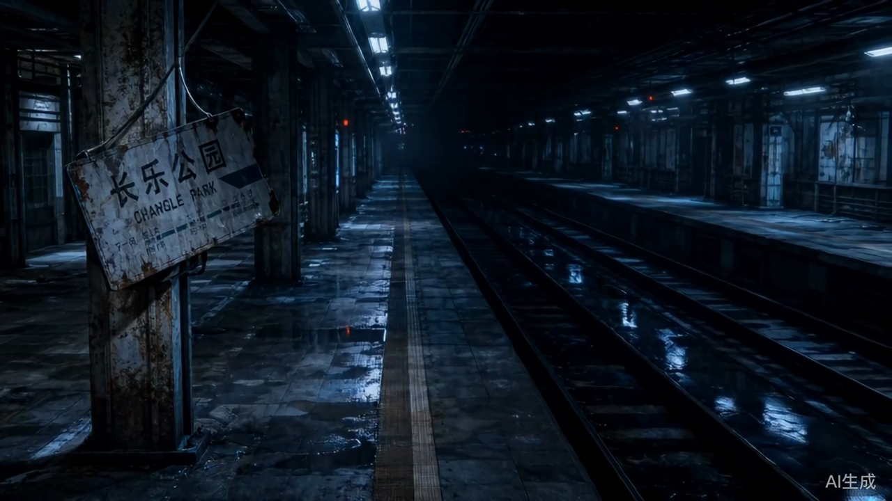

# 真实 AI 与角色闭环接入记录

> 更新日期：2026-07-24
> 范围：文本、角色定妆、分镜参考图、视频、TTS

## 1. 当前模型

| 类型 | Provider | 模型 | 状态 |
|---|---|---|---|
| 文本 | OpenAI-compatible | 由 `AI_MODEL*` 配置 | 已接入 |
| 图片 | Agnes | `agnes-image-2.1-flash` | 已接入并真实验证 2K、16:9 与参考图输出 |
| 视频 | Agnes | `agnes-video-v2.0` | 已接入后台任务、限流、恢复轮询和本地持久化 |
| 音频 | DashScope | `qwen3-tts-flash` / `qwen3-tts-instruct-flash` | 已接入并真实验证 |

密钥只保存在被 Git 忽略的 `.env.local`。文档和源码不得记录真实密钥。

## 2. 角色闭环

1. 项目总纲或剧本存在后，在角色库执行“AI 生成角色”。
2. 服务端提取姓名、戏剧身份、性格、固定外观和 TTS 音色。
3. 再次同步只新增角色并补齐空字段，不覆盖已有人工设定。
4. 单角色详情可显式执行“AI 补全档案”。
5. 使用 Agnes `agnes-image-2.1-flash` 生成定妆图候选，确认后写入 `reference_image_url`。
6. 分镜保存 `character_id`；历史分镜会按同项目角色名轻量回填。
7. 生成分镜静帧时自动读取角色定妆图，并通过 `extra_body.image` 提交给 Agnes 参考图生图接口。
8. 角色详情可用 `qwen3-tts-flash` 生成短句试听，不写入正式音频资产表。
9. 手动改名会先预览影响范围，可选择同步当前项目文本；AI 补全档案不会修改角色姓名。
10. 角色音色先根据年龄段、声线性别和气质推荐，试听确认后锁定；对白生成只读取已锁定的角色主音色。
11. 静帧生成前解析实际出镜角色，强制注入准确姓名、性别、年龄、外貌、服装和定妆参考图；校验不通过时不调用图片模型。
12. 多人同框会从分镜动作和视觉提示词识别同项目角色，最多按顺序提交 3 张角色参考图；画外音不会被误生成为实体人物。

分镜 AI 现在会读取当前项目角色清单，`character_name` 优先输出角色真名，并把姓名、性别、年龄段和固定外观约束写入视觉提示词；静帧生成接口会基于最新角色档案再次注入硬约束。

### 2.1 角色改名一致性

- `characters.name` 是角色当前姓名，`storyboards.character_id` 是分镜角色归属的真相源。
- 分镜列表和详情通过 `character_id` 关联角色表读取最新姓名，不再优先相信历史 `character_name`。
- `POST /api/characters/:id/rename-preview` 返回项目简介、最新总纲、场景正文和分镜文本的记录数与引用次数。
- 同步改名在一个 MySQL 事务中更新角色、项目简介、最新总纲、场景标题/摘要/正文，以及分镜角色名/动作/对白/视觉提示词。
- 同项目角色不允许重名；结构化总纲通过 JSON 解析后递归更新，不对 JSON 文本做直接字符串拼接。
- 系统会结合角色 ID、历史分镜姓名和剧本说话人标签识别历史姓名，兼容接入前已经发生的手工改名。
- 角色详情提供“检查姓名引用”，无需再次改名也能把既有正文中的历史姓名统一为当前姓名。
- 角色定妆图、静帧、视频和音频属于历史媒体，不会因改名被覆盖；内容直接出现旧名字时需要重新生成对应资产。

### 2.2 角色音色一致性

- 角色结构化保存 `age_group`、`gender`、`voice_style`、`voice_profile_key` 和 `voice_locked`。
- 没有结构化年龄或性别的历史角色，会先从姓名、身份标签和外观描述推断，但推断结果不会自动锁定。
- 推荐器优先满足声线性别和年龄段，再按沉稳、权威、克制、温柔、童真等气质标签排序。
- 少年、青年、中年和老年男性不再共用同一个 `Ethan`：系统分别提供男童、少年、青年、成年、中年和老年方案。
- 中年男声默认使用 `Kai + qwen3-tts-instruct-flash`，并固定传入成熟、低沉、克制和避免少年感的控制指令。
- 角色年龄、性别或声音气质发生变化时自动取消旧锁定，必须重新试听确认。
- 对白轨必须绑定已锁定角色音色；旁白可从系统音色目录独立选择。
- 历史音频不自动重生成，`audio_assets` 保存生成时的音色方案和控制指令快照。

### 2.3 持久化生成任务

- 图片生成提交后立即返回作业 ID，页面通过轮询显示排队、执行、成功和失败进度，不再同步等待 1-3 分钟。
- `generation_jobs` 在素材落库前就保存任务状态，因此刷新页面、切换模块或进入任务中心后仍能追踪。
- 服务重启会恢复未完成任务；失败任务保留最终 Provider、模型和供应商错误，可从任务中心显式重试。
- `FRAME_FALLBACK_MODELS` 可配置图片模型降级链；当前默认 `agnes-image-2.1-flash`，临时失败时回退 `agnes-image-2.0-flash`。
- 静帧结果会读取真实图片尺寸并按 `FRAME_IMAGE_RATIO` 校验，当前要求 16:9。
- 普通视频使用 `video_image` 后台任务；Agnes 任务 ID 会立即保存，状态查询网络抖动自动退避，重启或重试不会重复创建供应商任务。
- Agnes 视频创建默认每分钟最多 2 次；完成结果立即下载到 `.codex-runtime/generated-videos`，数据库只保存稳定的本地 URL。

## 3. 数据结构

### `storyboards.character_id`

- 可空，兼容没有角色或历史数据的镜头。
- 指向当前镜头的主要角色。
- 旧数据按 `项目 + character_name` 自动回填。

### `character_images`

- `character_id`：所属角色
- `version_no`：生成批次
- `image_url` / `thumbnail_url`：候选媒体
- `prompt_snapshot` / `model_name`：生成快照
- `status`：`candidate` 或 `confirmed`
- `confirmed_at`：主版本确认时间

当前每个角色只允许一张 `confirmed` 定妆图。

### `image_assets.character_snapshot`

- 保存该候选图生成时的主要角色、同框角色、性别、年龄、外貌和参考图快照。
- 角色后续改名或修改档案不会回写历史静帧；需要更新画面时重新生成新版本。

### `voice_profiles`

- `profile_key`：系统稳定音色方案标识
- `model_name` / `voice_id`：DashScope 模型与基础音色
- `gender` / `age_groups` / `style_tags`：匹配元数据
- `instructions`：`qwen3-tts-instruct-flash` 的固定声音控制指令
- `status` / `sort_order`：可用状态和展示顺序

系统当前内置 13 套中文角色音色方案。

### `audio_assets` 音色快照

- `voice_profile_key`：生成时使用的系统音色方案
- `voice_name` / `model_name`：实际供应商参数
- `voice_instructions`：生成时实际提交的声音控制指令

## 4. 主要 API

| 方法 | 路径 | 说明 |
|---|---|---|
| `POST` | `/api/projects/:id/characters/generate` | 从总纲和剧本同步角色 |
| `POST` | `/api/characters/:id/rename-preview` | 预览改名影响范围与历史媒体数量 |
| `PUT` | `/api/characters/:id` | 保存角色档案，可事务同步角色姓名引用 |
| `POST` | `/api/characters/:id/generate-profile` | 补全单角色档案 |
| `GET` | `/api/characters/:id/images` | 读取定妆图候选 |
| `POST` | `/api/characters/:id/images/generate` | 生成定妆图候选 |
| `POST` | `/api/character-images/:id/confirm` | 确认角色主参考图 |
| `POST` | `/api/characters/:id/voice-preview` | 生成角色音色试听 |
| `GET` | `/api/voice-profiles` | 读取系统音色目录与角色画像枚举 |
| `GET` | `/api/projects/:id/voice-cast` | 读取项目角色音色总表 |
| `GET` | `/api/characters/:id/voice-recommendations` | 读取角色画像和音色推荐 |
| `PUT` | `/api/characters/:id/voice-binding` | 确认并锁定角色主音色 |
| `POST` | `/api/shots/:id/images/generate` | 生成分镜静帧，自动携带角色参考图 |

所有接口均要求登录，并校验角色、项目或分镜归属。

## 5. 配置

```env
AI_PROVIDER=openai-compatible
AI_BASE_URL=
AI_API_KEY=
AI_MODEL=
AI_MODEL_CHARACTER=

TOAPI_API_KEY=
FRAME_PROVIDER=toapi
FRAME_BASE_URL=https://toapis.com/v1
FRAME_MODEL=gpt-image-2
FRAME_IMAGE_RATIO=16:9

BIGMODEL_API_KEY=
VIDEO_PROVIDER=bigmodel
VIDEO_BASE_URL=https://open.bigmodel.cn/api/paas/v4
VIDEO_MODEL=cogvideox-flash
VIDEO_IMAGE_UPLOAD_API_KEY=

DASHSCOPE_API_KEY=
AUDIO_PROVIDER=dashscope
AUDIO_MODEL=qwen3-tts-flash
```

完整超时、轮询和重试项以根目录 `.env.example` 为准。

## 6. 真实验证记录

- 项目角色抽取：单次验证成功生成 5 个结构化角色档案；项目级再次同步只新增角色并补齐空字段。
- 单角色补全：成功返回完整外观、性格和受支持音色。
- 角色文生图：ToAPI `gpt-image-2` 返回候选并成功确认；历史 Agnes 结果只作为兼容基线保留。
- 角色参考图生图：确认图作为输入后成功生成下一版本，分镜 168 的确认静帧为 1280×720。
- 图生视频：本地确认静帧先上传为公网 HTTPS 地址，再由智谱 `cogvideox-flash` 生成 5 秒视频；实测样本约 92 秒完成。
- TTS：`qwen3-tts-flash` 成功生成 WAV，服务端媒体地址返回 HTTP 200。
- 中年男声：`Kai + qwen3-tts-instruct-flash` 真实生成约 5 秒 WAV，媒体文件约 222 KB，服务端媒体地址返回 HTTP 200。
- 年龄分层：真实项目中约 40 岁男性推荐“沉稳中年男声”，14-17 岁少年推荐“清爽少年音”，不再共用同一青年音方案。
- 分镜关联：验收时当前项目已有分镜全部回填 `character_id`；分镜数量会随剧本重生成变化，不作为固定指标。
- 角色感知分镜：生成提示会注入角色姓名、身份和固定外观，模型返回“主角”等泛称时会归一为项目角色真名。
- 角色感知静帧：真实接口抽样确认女主“沈砚”解析为 `female + young_adult`，使用已确认定妆图且无阻断；缺少性别或无法匹配角色库的旧分镜返回 409。
- 声音角色边界：仅存在于扬声器、旁白或门外声音层时保持空镜；只有画面明确点名并描述其可见形象时才按实体角色生成。
- 页面验收：角色库与分镜角色下拉已在 1280px 视口复核，计数、操作区、三列卡片和角色选择器无挤压或遮挡。
- 工程验证：`npm test`、类型检查、生产构建和 Node 语法检查均通过；前后端健康检查返回 HTTP 200。

## 7. 已知边界与下一步

- 当前分镜仍保存一个主要角色 ID；同框角色根据分镜动作和视觉提示词中的准确姓名动态解析，最多提交 3 张参考图，尚未建立独立的多角色关系表。
- 生成记录已经持久化并支持重启恢复，但执行器仍运行在 Node 服务进程中；大规模并发时仍应拆分独立消息队列和 Worker。
- 当前静帧、视频以单镜头操作为主；下一阶段可增加“只生成缺失项”的项目级批量生产。
- 图生视频要求源图能被供应商公网访问；本地图当前会先上传 ToAPI，并带短重试。
- 导出前会把远程图片和视频下载到本地工作目录；正式部署前仍应把 ToAPI、智谱和 DashScope 返回文件转存 OSS 或 COS。
- `/workspace/export?projectId=12` 当前存在空渲染，导出记录页仍需修复。

## 8. 当前媒体样本

`gpt-image-2` 生成并确认的 16:9 分镜静帧：


同一静帧生成的 `cogvideox-flash` 视频实帧：


